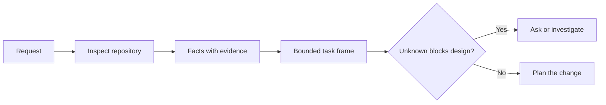

# إطار المهمة قبل أن يكتب العميل الرمز

> وكيل التشفير يمكنه تنفيذ مهمة واضحة بسرعة. يمكنه أيضا تنفيذ مهمة غير واضحة بسرعة. السرعة هي نفسها. التكلفة ليست كذلك.

> **【中文解读】**编码代理 实现清晰任务很快,实现模糊任务同样很快速度, 价格完全不同. 本课讲 写代码之前的第一步:把一个模糊请求变成一个由仓库证据支、边界明确的任务框架(任务框架) ―― وكيل لن يتوقف عن طرح الأسئلة بسبب模糊 المهمة، فإنه سوف يتوقف عن القرار بثقة ؛ دور إطار المهمة هو وضع هذه القرارات في المقدمة.

>  **【前置】**دراسة: المرحلة 14 第 31 课                                                                                                                                                                                                                                                         `outputs/task-frame.md`في الدراسة 44 أصبح خطة تنفيذية لدليل

**Type:** Learn + Build | **类型:** 学习 + 动手实践
**Languages:** Python (stdlib) | **语言:** Python（标准库）
**Prerequisites:** Phase 14 lessons 31 and 36 | **前置知识:** Phase 14 第 31、36 课
**Time:** ~60 minutes | **时间:** 约 60 分钟

## أهداف التعلم

- حول طلب إلى إطار مهمة محدد قبل التحرير.
  ترجمة: في محاولة تحرير، تحويل طلب إلى إطار مهمة مع الحدود.
- فصل الحقائق المرجعية عن الافتراضات والسئلة المفتوحة.
  ترجمة:把仓库事实与假设,等决问题区分开.
- تعريف المسارات المسموح بها، والمسارات المحظورة، والدليل على قبولها.
  中文翻译: تعريف السماح للطرق、 منع الطرق والقرارات.
- قرر متى يكون التجسس كافياً لبدء العمل
  中文翻译:判断什么时候侦察已足够、可以开始动手──

## الفشل الثمين الفشل الثمين

إضافة حماية البريد الإلكتروني المكرر يبدو محدداً. ليس كذلك. هل التفريد ينتمي إلى API أو خدمة النطاق أو قاعدة البيانات؟ هل تكون المقارنة حساسة للحالة؟ ما هي شكل الخطأ العام بالفعل؟ هل يسمح بالهجرة؟ أي اختبار يثبت السلوك؟

> "ضافة إلى حماية الملفات المرجعية" يبدو محدداً جداً، في الواقع ليس محدداً. هل ينبغي وضع الاختلاف بين الخدمات في مجال API أو قاعدة البيانات؟

وكيل قادر سوف يملأ هذه الفجوات باختيارات معقولة. هذه هي الحالة الخطرة لأن التنفيذ يمكن أن تكون نظيفة، اختبار، ومع ذلك لا تزال غير متوافقة مع النظام.

> وكيل ذو قدرة يستخدم خيارات تبدو معقولة لملء هذه الفراغات. هذه هي الحالة الخطيرة: تحقيق يمكن القيام به، وجود تغطية اختبارية، ولكن لا يزال غير متوافق مع النظام بأكمله.

لذا فإن الوحدة الأولى من عمل وكيل التشفير ليست تحرير. إنها إطار مهم مدعوم من خلال دليل مخزن.

> لذلك، الوحدة الأولى من عمل وكيل التدوين ليست تحرير واحد، ولكن هي إطار مهمة مدعومة من قبل مخزن الأدلة.

> **【中文解读】**الفشل الثمين المعنى ليس أن الكود مكتوب سيئا، بل أن الكود مكتوب على المهمة فهمها خطأ.‬ العميل لن يتغير بسبب المهمة المظلمة وتتغير ببطء‬‬‬‬‬‬‬‬‬‬‬‬‬‬‬‬‬‬‬‬‬‬‬‬‬‬‬‬‬‬‬‬‬‬‬‬‬‬‬‬‬‬‬‬‬‬‬‬‬‬‬‬‬‬‬‬‬‬‬‬‬‬‬‬‬‬‬‬‬‬‬‬‬‬‬‬‬‬‬‬‬‬‬‬‬‬‬‬‬‬‬‬‬‬‬‬‬‬‬‬‬‬‬‬‬‬‬‬‬‬‬‬‬‬‬‬‬‬‬‬‬‬‬‬‬‬‬‬‬‬‬‬‬‬‬‬‬‬‬‬‬‬‬‬‬‬‬‬‬‬‬‬‬‬‬‬‬‬‬‬‬‬‬‬‬‬‬‬‬‬‬‬‬‬‬‬‬‬‬‬‬‬‬‬‬‬‬‬‬‬‬‬‬‬‬‬‬‬‬‬‬‬‬‬‬‬‬‬‬‬‬‬‬‬‬‬‬‬‬‬‬‬‬‬‬‬‬‬‬‬‬‬‬‬‬‬‬‬‬‬‬‬‬‬‬‬‬‬‬‬‬‬‬‬‬‬‬‬‬‬‬‬‬‬‬‬‬‬‬‬‬‬‬‬‬‬‬‬‬‬‬‬‬‬‬‬‬‬‬‬‬‬‬‬‬‬‬‬‬‬‬‬‬‬‬‬‬‬‬‬‬‬‬‬‬‬‬‬‬‬‬‬‬‬‬‬‬‬‬‬‬‬‬‬‬‬‬‬‬‬‬‬‬‬‬‬‬‬‬‬‬‬‬‬‬‬‬‬‬‬‬‬‬‬‬‬‬‬‬‬‬‬‬‬‬‬‬‬‬‬‬‬‬‬‬‬‬‬‬‬‬‬‬‬‬‬‬‬‬‬‬‬‬‬‬‬‬‬‬‬‬‬‬‬‬‬‬‬‬‬‬‬‬‬‬‬‬‬‬‬‬‬‬‬‬‬‬‬‬‬‬‬‬‬‬‬‬‬‬‬‬‬‬‬‬‬‬‬

## إطار المهمة الإطار المهمة

الإطار المفيد له ستة مجالات:

| Field | Question |
|---|---|
| Goal | What observable behavior must change? |
| Repository facts | What did you verify in code, tests, config, or history? |
| Allowed paths | Where may the change land? |
| Forbidden paths | What must remain untouched? |
| Acceptance evidence | Which commands or observations prove the goal? |
| Unknowns | Which decisions still need evidence or human judgment? |

> **【中文解读】**六个段分别是: هدف ((((ما يمكن مراقبة السلوك يجب أن يتغير) 仓库事实 (((تولى التدوين والتجربة والتصميم أو التحقق من ما) ‬ السماح للطريق (((التغيير يسمح بالوقوف هناك) ‬ حظر الطرق (((ما لا يمكن أبدا أن يواجهه) ‬ قبول الدليل (((أي أوامر أو مراقبة يمكن أن تثبت تحقيق الهدف) ‬ غير المعروفة ‬ ما هي القرارات التي تحتاج إلى الدليل أو الحكم البشري)) ‬ أسهل تجاهل هو ‬ الحظر الطرق ‬ و الجهازات غير المعروفة ‬ الاولين يخططون فضاءً سلبيًا، والآخرين يضعون القرارات التي لا يصلون إليها بشكل واضح تحت الاحتفاظ.‬

تحتاج الحقائق إلى الإيصالات. تستخدم API 409 للنسخة المزدوجة ليست حقيقة حتى تتمكن من الإشارة إلى الاختبار أو المعاملة الموجودة. مسار الملف والخط كاف. نتيجة الأوامر أفضل عندما يكون السلوك مهمًا.

> الحقيقة تحتاج إلى شهادة. "البرنامج الإلكتروني للتحميل الاحتياطي 409" لا يعد حقيقة قبل أن تتوجه إلى محاكمة أو معالجة موجودة.



>  **【类比】**任务框架像装修前的墙审批单:哪面墙能动(محصول على المسارات) 哪面是承重墙绝不能动(مسارات محظورة) 验收入住的标准是什么 ((دليل على قبول) 🙈没有这张单子,装修队(代理) 动作越快,错墙的概率越大。

## التعرف هو البحث عن القيود

لا تقرأ المستودع بأكمله. ابحث عن السطحات التي تقيد التغيير:

> لا تَدْخلُ إلى المُخزنِ بأكملهِ. إبحثُ عن تلك الحُجَزَةِ الحقيقيةِ التي تَحْتَمِلُ هذه التغييراتِ:

1. السلوك الحالي ومُتصل به
   中文翻译:当前行为以及调用它的代码──
2. أقرب اختبار موجود
   中文翻译:离得最近现存测试──
3. العقد العام أو الشكل المتسلسل
   ترجمة باللغة الصينية: شكل البيانات بعد التسلسل.
4. تعليمات المشروع التي تحكم المسار
   中文翻译:管辖这些路径的项目规范(如 AGENTS.md)
5. أوامر البناء والتحقق
   中文翻译:构建与验证命令。
6. تغييرات مشابهة مكتملة تكشف عن الأنماط المحلية.
   ترجمة: مثل: تم إنجاز التحركات، فهي تكشف عن عاداتها.

توقف عندما يكون كل قرار مخطط يدعم به إما بالدليل أو تم تفويضه صراحة أو يُدعى بأنه مجهول.

> عندما يكون هناك دليل على كل قرار في كل خطة، أو تم إعطائه سلطة واضحة، أو تم تحديد المشاريع غير المعروفة، توقف المراقبة، بعد ذلك، استمر القراءة، والنصف الآخر يتأخر.

> **【中文解读】**偵察的目的不是了解整个代码库,而是找约束:谁调用它,哪个测试管它,公开契约长什么样,本地惯例怎么写.

## المجهولات ليست فشلات المجهولات ليست فشل

المجهول هو فجوة خاضعة للسيطرة الافتراض هو إجابة غير خاضعة للسيطرة على تلك الفجوة

> المجهول هو فجوة قابلة للسيطرة؛ افتراضات هي إجابة غير قابلة للسيطرة على هذا الفجوة.

تصنيف كل مجهول:

- **Discoverable:**يمكن للمخزن أو النظام التشغيلي الإجابة عليه.
  中文翻译:**可发现：**يمكن أن يجيب على ذلك النظام في المخزن أو النظام في النشاط
- **Decidable:**عقد المهمة يعطي الوكيل سلطة اختيار.
  中文翻译:**可决定：**المهام المفروضة تمت تمكين الوكيل
- **Human:**يغير الخيار سلوك المنتج أو التكلفة أو المخاطر أو التوافق العام.
  中文翻译:**需人来定：**هذا الاختيار سيغير سلوك المنتج ‬التكلفة‬الرياد أو التوافق العام‬
- **Deferred:**الخيار خارج هذا الجزء ويأتي في غياب الأهداف
  中文翻译:**可延后：**هذا الاختيار لا ينتمي إلى هذا الجزء، يجب أن يضع في غيّر هدف.

يجب أن يستمر العميل عبر المجهولات التي يمكن اكتشافها و تمنحها، يجب أن يتوقف على المجهولات البشرية قبل أن يتم دفن الخيار في الرمز.

> على المعلومة التي يمكن اكتشافها والتي تم منحها، يجب أن يستمر الوكيل في التقدم؛ على المعلومة التي يجب أن يتم تحديدها من قبل الإنسان، يجب أن يتوقف الوكيل قبل أن يتم دفن هذه الخيارات في الكود.

> **【中文解读】**وضع المعلومة في فئة، أكثر أمانا من التظاهر عدم وجود المعلومة. أربعة أنواع من التعاملات: التفتيشات المكتشفة، اختيارات قابلة للقرار، الاختيارات التي يمكن أن يحددها الإنسان، والمسائل التي يمكن أن يتم تسجيلها بعد ذلك إلى غير الغاية.

## قبول قبل التنفيذ

اكتب الدليل قبل التشغيل

> قبل كتابة دليل، وإعادة كتابة إضافة.

- إدارة اختبار مركزة أو تكامل
  中文翻译: أحدى الوحدات أو أوامر اختبار المجموعة المركزية
- رحلة متصفح مع منفذ عرض مسمى والحالة المتوقعة.
  中文翻译: مرة واحدة تحديد الموقع والحالة المطلوبة من المتصفح ؛
- طلب بالأسلاك وعقد الإجابة الدقيقة
  中文翻译: خط على طلب وتحديد الإجابة
- قياس الأداء مع عتبة؛
  中文翻译: قياس أداء معين
- فحص المجال الذي يؤكد عدم تغيير أي ملف غير مرتبط.
  中文翻译: تأكد عدم وجود مستندات غير مرتبطة

موافقة الاختبارات ليست خطة إثبات. أسمي الاختبار المعتمد والادعاء الذي يدعمه.

> "الامتحان تمت" ليس خطة إثبات.

> **【中文解读】** قبول قبل التنفيذ  هو TDD في المهندسية الوكيل: قبل أن يتحرك الوكيل  تحدد ما هو أمر ما للإنتاج قادرة على الإعلان عن المهمة قد تم الانتهاء 🏼 هذا  القيام بإنجاز  تعريف  من تقرير الوكيل الذاتي، والحصول على عودة إلى أمر يمكن تنفيذ  قابل إعادة التنفيذ 🏻

## بناء ذلك تحرك لتحقيق

المختبر يخلق`TaskFrame`، يصدق حدودها و أدلة ، و يكتب`outputs/task-frame.md`. . .

>  تجربة جزء سوف تخلق واحد `TaskFrame`,تجربة حدودها وشهاداتها ,并写出 `outputs/task-frame.md`.

إدارة من هذا دليل الدروس:

```bash
python3 code/main.py
python3 -m unittest discover code/tests -v
```

كسر المثال بأربعة طرق: إزالة الهدف، إزالة استلام الحقيقة، التداخل بين مسار مسموح به ومحرم، وإزالة أمر القبول. يجب على المؤكد رفض كل إطار لسبب مختلف.

> استخدام أربعة طرق لتدمير هذا المثال: حذف الهدف ‬ حذف دليل حقيقة ‬ دع السبيل والحظر على طريق الإعادة التعبئة ‬ حذف أمر قبول‬ يجب على المحقق أن يرفض كل إطار يتم تدميره لسبب مختلف‬‬‬‬‬‬‬‬‬‬‬‬‬‬‬‬‬‬‬‬‬‬‬‬‬‬‬‬‬‬‬‬‬‬‬‬‬‬‬‬‬‬‬‬‬‬‬‬‬‬‬‬‬‬‬‬‬‬‬‬‬‬‬‬‬‬‬‬‬‬‬‬‬‬‬‬‬‬‬‬‬‬‬‬‬‬‬‬‬‬‬‬‬‬‬‬‬‬‬‬‬‬‬‬‬‬‬‬‬‬‬‬‬‬‬‬‬‬‬‬‬‬‬‬‬‬‬‬‬‬‬‬‬‬‬‬‬‬‬‬‬‬‬‬‬‬‬‬‬‬‬‬‬‬‬‬‬‬‬‬‬‬‬‬‬‬‬‬‬‬‬‬‬‬‬‬‬‬‬‬‬‬‬‬‬‬‬‬‬‬‬‬‬‬‬‬‬‬‬‬‬‬‬‬‬‬‬‬‬‬‬‬‬‬‬‬‬‬‬‬‬‬‬‬‬‬‬‬‬‬‬‬‬‬‬‬‬‬‬‬‬‬‬‬‬‬‬‬‬‬‬‬‬‬‬‬‬‬‬‬‬‬‬‬‬‬‬‬‬‬‬‬‬‬‬‬‬‬‬‬‬‬‬‬‬‬‬‬‬‬‬‬‬‬‬‬‬‬‬‬‬‬‬‬‬‬‬‬‬‬‬‬‬‬‬‬‬‬‬‬‬‬‬‬‬‬‬‬‬‬‬‬‬‬‬‬‬‬‬‬‬‬‬‬‬‬‬‬‬‬‬‬‬‬‬‬‬‬‬‬‬‬‬‬‬‬‬‬‬‬‬‬‬‬‬‬‬‬‬‬‬‬‬‬‬‬‬‬‬‬‬‬‬‬‬‬‬‬‬‬‬‬‬‬‬‬‬‬‬‬‬‬‬‬‬‬‬‬‬‬‬‬‬‬‬‬‬‬‬‬‬‬‬‬‬‬‬‬‬‬‬‬‬‬‬‬‬‬

## استخدمها في مستودع حقيقي

قبل أن تطلب من وكيل تحرير:

> في让代理 动手改代码之前:

1. اكتب الهدف كسلوك وليس تغيير الملف
   中文翻译:把目标写成一行为,而不是一次文件改动──
2. سجل اثنين أو ثلاثة حقائق مع أدلة دقيقة.
   中文翻译:记录两三条带精确凭据的事实──
3. أسمي أصغر مجموعة مسارات مسموح بها
   中文翻译:点名最小集合的允许路径──
4. اسم المساحة السلبية صراحة.
   中文翻译:显式点名不做什么的负空间。
5. اكتب القيادة أو الملاحظة التي تغلق المهمة.
   中文翻译:写下关闭 This条任务的命令或观察。
6. قم بإدراج القرارات التي لم تستحقها بعد.
   中文翻译:列出你还没有证据支、尚无资格做决定──

يجب أن يتناسب الإطار على شاشة واحدة. إذا لم يتم ذلك، قد تحتوي المهمة على تغييرات متعددة يمكن التحقق منها بشكل مستقل.

> إذا تم تركها، فإن هذه المهمة قد تتضمن العديد من التغييرات التي يمكن التحقق منها بشكل مستقل.

> **【中文解读】**هذه الخطوة السادسة هي قائمة عملية في هذا الدراسة، يمكن وضعها مباشرة في سير العمل الخاص بك: هدف كتابة السلوكيات والحقيقة مع الأدلة والسماح بتقليل المسار والبيانات السلبية والمساحة السلبية والقرارات المقبلة والمسؤولية غير المقررة.

## التمرينات التمرينات

1. إصطناع خطأ حقيقي من أحد مستودعاتك دون اقتراح حل
   الصينية: من مخزنك الخاص اختر خطأ حقيقي
2. إبحث عن ادعاء واحد في الإطار الذي هو افتراض في الواقع واستبدله بالدليل
   中文翻译:找出框架里一条实际是假设的事实,用证据替代它
3. إضافة شخص مجهول يجيب على العقد العام
   ترجمة: إضافة إلى شيء غير معروف، فإن إجابته ستغير الصفقة العامة.
4. تقسيم مسار واحد واسع مسموح به في أصغر مجموعة آمنة.
   中文翻译:把一条过宽的允许路径拆成最小安全集合──
5. إضافة إيصال النطاق إلى دليل القبول.
   中文翻译:给验收证证加一条范围凭证──

## المزيد من القراءة

- [Nuseibeh and Easterbrook, Requirements Engineering: A Roadmap](https://www.cs.toronto.edu/~sme/papers/2000/ICSE2000.pdf)، لتثبيت التنفيذ على أهداف العالم الحقيقي والقيود المتطورة.
  中文翻译:Nuseibeh 与 Easterbrook需求工程:路线图如何实现定在真世界目标和演化中的约束上.
- [Yang et al., SWE-agent: Agent-Computer Interfaces Enable Automated Software Engineering](https://arxiv.org/abs/2405.15793)، لإثبات أن واجهة حول وكيل التشفير تغير فعاليتها.
  中文翻译:Yang 等SWE-agent证明编码 周围的接口设计会改变它的实际效果──

## ما تبقيه ، ما تبقيه

إبق`outputs/task-frame.md`. هو مدخل الدروس التالية، حيث يصبح الإطار خطة تنفيذية مدعومة بالأدلة.

> حافظ`outputs/task-frame.md`في الدراسة التالية، سيتحول إطار المهمة إلى خطة تنفيذية مدعومة بالدليل.
