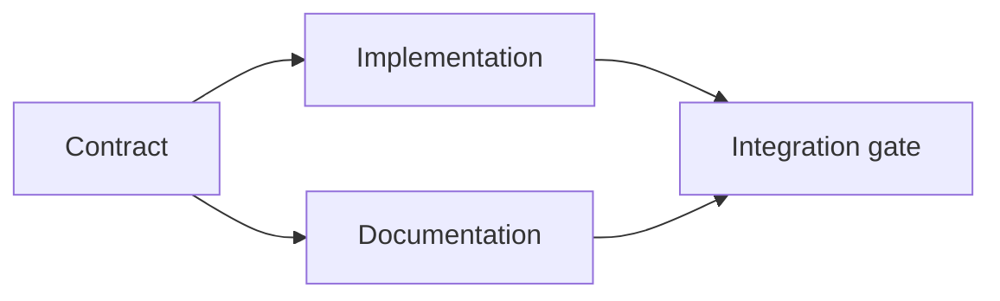

# بناء خطة إعدام مدعومة بالدليل

> خطة ليست قائمة أعمال جميلة. إنها رسم بياني يعتمد فيه كل تغيير له سبب وكل عقدة نهاية له دليل.

> **【中文解读】**计划不是" أفضل نظرة على قائمة التأمل"، ولكن هو رسم الاعتماد: كل تغيير لديه سبب (((دليل支) ، كل نقطة نهاية لديه دليل (((تفتيش قبول) ‬‬‬‬‬‬‬‬‬‬‬‬‬‬‬‬‬‬‬‬‬‬‬‬‬‬‬‬‬‬‬‬‬‬‬‬‬‬‬‬‬‬‬‬‬‬‬‬‬‬‬‬‬‬‬‬‬‬‬‬‬‬‬‬‬‬‬‬‬‬‬‬‬‬‬‬‬‬‬‬‬‬‬‬‬‬‬‬‬‬‬‬‬‬‬‬‬‬‬‬‬‬‬‬‬‬‬‬‬‬‬‬‬‬‬‬‬‬‬‬‬‬‬‬‬‬‬‬‬‬‬‬‬‬‬‬‬‬‬‬‬‬‬‬‬‬‬‬‬‬‬‬‬‬‬‬‬‬‬‬‬‬‬‬‬‬‬‬‬‬‬‬‬‬‬‬‬‬‬‬‬‬‬‬‬‬‬‬‬‬‬‬‬‬‬‬‬‬‬‬‬‬‬‬‬‬‬‬‬‬‬‬‬‬‬‬‬‬‬‬‬‬‬‬‬‬‬‬‬‬‬‬‬‬‬‬‬‬‬‬‬‬‬‬‬‬‬‬‬‬‬‬‬‬‬‬‬‬‬‬‬‬‬‬‬‬‬‬‬‬‬‬‬‬‬‬‬‬‬‬‬‬‬‬‬‬‬‬‬‬‬‬‬‬‬‬‬‬‬‬‬‬‬‬‬‬‬‬‬‬‬‬‬‬‬‬‬‬‬‬‬‬‬‬‬‬‬‬‬‬‬‬‬‬‬‬‬‬‬‬‬‬‬‬‬‬‬‬‬‬‬‬‬‬‬‬‬‬‬‬‬‬‬‬‬‬‬‬‬‬‬‬‬‬‬‬‬‬‬‬‬‬‬‬‬‬‬‬‬‬‬‬‬‬‬‬‬‬‬‬‬‬‬‬‬‬‬‬‬‬‬‬‬‬‬‬‬‬‬‬‬‬‬‬‬‬‬‬‬‬‬‬‬‬‬‬‬‬‬‬‬‬‬‬‬‬‬‬‬‬‬‬‬‬‬‬‬‬‬‬‬‬

>  **【前置】**تعلم دراسة قبل دراسة قبل دراسة قبل دراسة قبل دراسة قبل دراسة قبل دراسة قبل دراسة قبل دراسة قبل دراسة قبل دراسة قبل دراسة قبل دراسة قبل دراسة قبل دراسة قبل دراسة قبل دراسة قبل دراسة قبل دراسة قبل دراسة قبل دراسة قبل دراسة قبل دراسة قبل دراسة قبل دراسة قبل دراسة قبل دراسة قبل دراسة قبل دراسة قبل دراسة قبل دراسة قبل دراسة قبل دراسة قبل دراسة قبل دراسة قبل دراسة قبل دراسة قبل دراسة قبل دراسة قبل دراسة قبل دراسة قبل دراسة قبل دراسة قبل دراسة قبل دراسة قبل دراسة قبل دراسة قبل دراسة قبل دراسة قبل دراسة قبل دراسة قبل دراسة قبل دراسة قبل دراسة قبل دراسة قبل دراسة قبل دراسة قبل دراسة قبل دراسة قبل دراسة قبل دراسة قبل دراسة قبل دراسة قبل دراسة قبل دراسة قبل دراسة قبل دراسة قبل دراسة قبل دراسة قبل دراسة قبل دراسة قبل دراسة قبل دراسة قبل دراسة قبل دراسة قبل دراسة قبل دراسة قبل دراسة قبل دراسة قبل دراسة قبل دراسة قبل دراسة قبل دراسة قبل دراسة قبل دراسة قبل دراسة قبل دراسة قبل دراسة قبل دراسة قبل دراسة قبل دراسة قبل دراسة قبل دراسة قبل دراسة قبل دراسة قبل دراسة قبل دراسة قبل دراسة قبل دراسة قبل دراسة قبل دراسة قبل دراسة قبل دراسة قبل دراسة قبل دراسة قبل دراسة قبل دراسة قبل دراسة قبل دراسة قبل دراسة قبل دراسة قبل دراسة قبل دراسة قبل دراسة قبل دراسة قبل در در در دراسة قبل در در دراسة قبل دراسة قبل در در در در در در در در در در در در در دراسة قبل در در در در در در در در در در در در در دراس`outputs/task-frame.md`)―本课产出 `outputs/evidence-plan.json`،سأصبح في المرحلة 45 عقدة لتمثيل وكلاء أكثر

**Type:** Learn + Build | **类型:** 学习 + 动手实践
**Languages:** Python (stdlib) | **语言:** Python（标准库）
**Prerequisites:** Phase 14 lesson 43 | **前置知识:** Phase 14 第 43 课
**Time:** ~65 minutes | **时间:** 约 65 分钟

## أهداف التعلم

- حول إطار المهمة إلى عناصر عمل مع الأدلة والبرهان.
  ترجمة:把任务框架转化为带证据与证明的工作项.
- النموذج التنظيم كاعتماد بدلا من تسلسل النص.
  中文翻译: باستخدام الاعتماد على بناء النظام الأول والآخر، وليس باستخدام روايات النصية.
- اكتشاف الحقائق المفقودة، والاعتمادات غير المعروفة، والدورات قبل التحرير.
  中文翻译:在动手编辑之前,检测缺失的事实、未知的依赖和循环依赖──
- خطوات منفصلة يمكن أن تجري معا من خطوات التي يجب أن تنتظر.
  ترجمة باللغة الصينية:区分可以同时运行步骤和必须等待的步骤──

## لماذا تفشل خطط العميل لماذا تفشل خطط العميل

خطط ضعيفة تكرر الطلب في الوقت المقبل:

> 弱计划只是把请求复述成未来时:

1. قم بتحديث إطار الإعداد
   中文翻译:更新 API。
2. إضافة الاختبارات.
   中文翻译:加测试──
3. تحديث الوثائق
   中文翻译:更新文档。

لا يوجد شيء في تلك القائمة يُخبر ما تم العثور عليه، لماذا هذه الملفات صحيحة، أي عقد يتغير أولاً، أو ما يمكن أن يحدث في وقت واحد.

> في هذه القائمة لا يوجد أي تعبير: اكتشاف ما، لماذا هذه الملفات، أي اتفاقات تتغير، ما هي الخطوات التي يمكن أن تبذلها.

> **【中文解读】**弱计划的特征是"复述请求"它看起来有序号、有动词,但没有一个仓库证证──强计划对每个工作项目做五个承诺(见下表):标识符、最小改动、证、依赖、证明──缺少任何一项,

خطة قوية تضع خمس التزامات لكل عنصر عمل:

| Commitment | Purpose |
|---|---|
| Identifier | Stable reference for dependencies and handoff |
| Change | The smallest behavior or contract change |
| Evidence | Repository facts that justify the change |
| Dependencies | Work that must be true first |
| Proof | The exact check that closes the item |

> **【中文解读】**五个承诺分别是:标识符 (标识符) 转变 (转变) 最小的行为或契约变更) 证据 (证据) 证明 (转变) 合理仓库事实) 依赖 (依赖) 必须先为真工作 (证据) 关闭 (关闭) 工作项目的确切检查) :" التغيير يجب أن يكون أقل و "" 证明 (证明) يجب أن يكون أكثر المهام التي يتم القاضي عليها من قبل قبل قبل قبل قبل قبل قبل قبل قبل قبل قبل قبل قبل قبل قبل قبل قبل قبل قبل قبل قبل قبل قبل قبل قبل قبل قبل قبل قبل قبل قبل قبل قبل قبل قبل قبل قبل قبل قبل قبل قبل قبل قبل قبل قبل قبل قبل قبل قبل قبل قبل قبل قبل قبل قبل قبل قبل قبل قبل قبل قبل قبل قبل قبل قبل قبل قبل قبل قبل قبل قبل قبل قبل قبل قبل قبل قبل قبل قبل قبل قبل قبل قبل قبل قبل قبل قبل قبل قبل قبل قبل قبل قبل قبل قبل قبل قبل قبل قبل قبل قبل قبل قبل قبل قبل قبل قبل قبل قبل قبل قبل قبل قبل قبل قبل قبل قبل قبل قبل قبل قبل قبل قبل قبل قبل قبل قبل قبل قبل قبل قبل قبل قبل قبل قبل قبل قبل قبل قبل قبل قبل قبل قبل قبل قبل قبل قبل قبل قبل قبل قبل قبل قبل قبل قبل قبل قبل قبل قبل قبل قبل قبل قبل قبل قبل قبل قبل قبل قبل قبل قبل قبل قبل قبل قبل قبل قبل قبل قبل قبل قبل قبل قبل قبل قبل قبل قبل قبل قبل قبل قبل قبل قبل قبل قبل قبل قبل قبل قبل قبل قبل قبل قبل قبل قبل قبل قبل قبل قبل قبل قبل قبل قبل قبل قبل قبل قبل قبل قبل قبل قبل قبل قبل قبل قبل قبل قبل قبل قبل قبل قبل قبل قبل قبل قبل قبل قبل قبل قبل قبل قبل قبل قبل قبل قبل قبل قبل قبل قبل قبل قبل قبل قبل قبل قبل قبل قبل قبل قبل قبل قبل قبل قبل قبل قبل قبل قبل قبل قبل قبل قبل قبل قبل قبل قبل قبل قبل قبل قبل قبل قبل قبل قبل قبل قبل قبل قبل قبل قبل قبل قبل قبل قبل قبل قبل قبل قبل قبل قبل قبل قبل قبل قبل قبل قبل قبل قبل قبل قبل قبل قبل قبل قبل قبل قبل قبل قبل قبل قبل قبل قبل قبل قبل قبل قبل قبل قبل قبل قبل قبل قبل قبل قبل قبل قبل قبل قبل قبل قبل قبل قبل قبل قبل قبل قبل قبل قبل قبل قبل قبل قبل قبل قبل قبل قبل قبل قبل قبل قبل قبل قبل قبل قبل قبل قبل قبل قبل قبل قبل قبل قبل قبل قبل قبل قبل قبل قبل قبل قبل قبل قبل قبل قبل قبل قبل قبل قبل قبل قبل قبل قبل قبل قبل قبل قبل قبل

## تخطط للعقد قبل تنفيذها

عندما تعتمد العديد من السطحات على نفس السلوك، حدد السلوك أولاً. يمكن بعد ذلك مشاركة عقد واحد بدلاً من اختراع أربعة إصدارات.

> عندما تعتمد العديد من الظروف على نفس السلوك ، تحدد السلوك نفسه أولاً.

>  **【类比】**契约先行像先定国标插头再生产电器器──插座厂(实现) 和电器厂(文档) يمكن أن تكون مفتوحة في نفس الوقت، لأن الاتصال قد قفل ؛ المقبلين(集成门) فقط بحاجة إلى المراقبة نفس المعيار التفتيش على الجانبين── لا يوجد علامة وطنية على أنها تعمل في نفس الوقت، إنتاج الانبعاثات



الرسم البياني يظهر التزامن الآمن. يمكن أن يتواصل التنفيذ والوثائق معا بعد إصلاح العقد. التكامل ينتظر كليهما.

> هذا الصورة تكشف عن نقاط الوضع الآمن. بعد إصلاح الاتفاقية، يمكن أن يتم تنفيذ التنفيذ والوثائق في نفس الوقت.

## الأدلة تغير الخطة

لا يعد دليل المحتفظة ديكورية يجب أن يكون قادرًا على تغيير العمل:

> لا يوجد إثبات لتزيين المخزن. يجب أن يكون لديه القدرة على تغيير محتوى العمل:

- المساعد الحالي يزيل التجريد الجديد المخطط له
  中文翻译: وظيفة مساعدة موجودة ، قطعت الصورة الجديدة المخطط لها.
- اختبار التوافق يفرض خطوة الهجرة.
  ترجمة: تجربة قابلية للتحرك، قوّت إلى خطة خارج خطة التحرك.
- قيود التنفيذ تنتقل تغيير النظام إلى مهمة أخرى.
  中文翻译: إطلاق خطة، تحويل خطة إلى مهمة أخرى
- نوع الاستجابة العامة يغير ترتيب التنفيذ والوثائق.
  中文翻译: نوع الإجابة العامة، تغير التسلسل الأول والآخر من المستندات.

إذا كانت الأدلة لا يمكن أن تغير الخطة، فإنها لا تكون على الأرجح دليل على هذا القرار.

> إذا كانت الأدلة غير مخطط لها، فهي ليست أكثر من نصف الأدلة على هذا القرار.

> **【中文解读】**هذا هو معيار مزيف مفيد جدا: وضع "الدليل" إلى جانب القرار، والسؤال "إذا كان على عكس ذلك، هل سيتغير الخطة".

## تصميم للانقطاع

تنتهي جلسات وكيل التشفير بشكل غير متوقع. خطة إعادة التنفيذ لها عناصر عمل صغيرة بما فيه الكفاية يمكن لجلسة أخرى تحديد:

> 编码 وكيل الاجتماع سوف تنتهي بشكل غير متوقع.

- أي عنصر مكتمل ؛
  中文翻译:哪个工作项已完成;
- ما هو دليل التدقيق؟
  中文翻译:哪个证明跑过了;
- أي أثاث تغيرت؛
  中文翻译: ماذا حدث؟
- أي تعتمدات غير مقفلة الآن؟
  中文翻译: 哪些依赖已解锁;
- ما هي المادة الآمنة التالية
  中文翻译:下一个安全工作项是什么――

لا ترميز الحالة فقط في صناديق الإشارة داخل المحادثة. تخزين الخطة بجانب العمل.

> لا تُضع الحالة فقط في الصفحة المحددة من سجل المحادثة. ضع خطة في المكتب.

> **【中文解读】**العاملات المخططات يجب أن تكون خارجة إلى نظام الملفات مثل اللعبة على السجلات الحفظية.

## التحقق من التحقق من التحقق من التحقق من التحقق من التحقق

رفض الخطة قبل تنفيذها عندما:

> في حالة التوصل إلى الحالة التالية، رفض هذا البرنامج قبل تنفيذه:

- يتم نقل معرف؛
  中文翻译:标识符重复;
- لا يوجد دليل على وجود عنصر عمل؛
  中文翻译:某工作项没有证据;
- لا يوجد دليل على عنصر العمل؛
  中文翻译:某工作项没有证明;
- تعتمد على اسم عنصر مجهول.
  中文翻译:某依指向不存在的工作项;
- يحتوي الرسم البياني على دورة؛
  中文翻译: تعتمد على التأثيرات
- يحدث أول إجراء لا رجعة فيه قبل حل عدم اليقين المعني.
  ترجمة: أول حركة لا رجعة فيها، ظهرت في الوقت الذي تم فيه حل عدم اليقين الذي يعتمد عليه.

أول خمسة عمليات فحص ميكانيكية، والآخر يتطلب الحكم ويجب أن يتم استدعائه صراحة.

> السابق خمسة المادة الاختبار هو الآلي.

> **【中文解读】**六条拒绝规则里藏藏着本课最重要的排序原则:不可逆动作 (不可逆动作) 迁移,删除,发布,公开契约变更) يجب أن يكون بعد عدم اليقين.

## بناء ذلك تحرك لتحقيق

`code/main.py`النماذج العمل على العناصر، وتؤكد إيصالاتها، وحساب موجات التنفيذ مع نوع التوبولوجي، ويكتب `outputs/evidence-plan.json`. . .

> `code/main.py`建模工作项、校验它们的证书、用拓排序计算执行波次,并写出 `outputs/evidence-plan.json`.

أركض

> 运行:

```bash
python3 code/main.py
python3 -m unittest discover code/tests -v
```

النموذج ينتج ثلاث موجات. تعريف العقد يبدأ أولاً. تنفيذ وثائق يبدأ معاً. بوابة التكامل يبدأ أخيراً.

> مثالات: تشاوق تعريف أول عمل، تنفيذ وملف في نفس الوقت، جمع وحدة آخر عمل.

> **【中文解读】**"بوب" هو التطبيق المباشر للتخطيط التطوير: كل دور من المهام لا تعتمد على بعضها البعض، يمكن تقسيمها إلى مختلف وكيل وخطوط؛ عبر البوب يجب أن تكون على طول المرحلة.

## استخدمها مع وكيل التشفير مع وكيل التشفير

اطلب من العميل ان يقدم الخطة قبل ان يغير الملفات

> دع العميل في تغيير الملفات قبل أن يخرج من خطة.

1. كل دعوى عن المسار والسلوك لديها إيصال من مخزن
   ترجمة: كل طريق و تصريحات تصرفات لها سندات مخزن
2. كل شيء لديه دليل واضح على الانتهاء
   ترجمة: كل عمل لديه دليل واضح على الانتهاء.
3. الرسم البياني يؤخر العمل الثمين أو غير العكسي حتى يتم حل عدم اليقين الذي يعتمد عليه.
   ترجمة: تعتمد على عمل مكلف أو لا يمكن العكس منه، تأخير إلى أن يتم حل عدم اليقين الذي يعتمد عليه.

أوافق على الخطة، وليس وعد غامض بالتحذر

> الموافقة على هذا البرنامج، ليس مجرد عزم مضحك من "أحضر قلبي"

## التمرينات التمرينات

1. إضافة عنصر الهجرة الذي يتطلب موافقة بشرية صريحة.
   ترجمة: إضافة عمل نقل يحتاج إلى موافقة صارغة.
2. قم بإنشاء دورة و اشرح الخلاف الخفية بين المنتجات وراءها
   الصينية: صنع دورة تعتمد،并 تفسيرها خلفها مخبأة منتجات التفرق.
3. تقسيم عنصر واحد لديه أمرين دليل.
   ترجمة: تَزْرِعُ إمرَةِ عملٍ
4. أضف عنصر العمل الذي يمكن أن يبدأ في الموجة الثانية دون لمس أي من الفرع الموجودة.
   ترجمة: إضافة واحدة يمكن أن تكون في الموجة الثانية
5. أعد الخطة كـ "ماركداون" مع الحفاظ على "جي إس أون" كمصدر الحقيقة.
   中文翻译:把计划染成 Markdown,同时保持 JSON 作为唯一事实来源──

## المزيد من القراءة

- [Nuseibeh and Easterbrook, Requirements Engineering: A Roadmap](https://www.cs.toronto.edu/~sme/papers/2000/ICSE2000.pdf)، للعلاقة المتكررة بين الأهداف والتفاصيل والاتفاق والتطور.
  中文翻译:Nuseibeh و Easterbrook需求工程:路线图目标、规格、共识与演化之间的代关系──
- [Barry Boehm, A Spiral Model of Software Development and Enhancement](https://dl.acm.org/doi/10.1145/12944.12948)، لتنظيم التطوير حول حل المخاطر بدلاً من تسلسل خطي ثابت.
  براري بوهم نموذج حلقة تطوير البرمجيات حول التخلص من المياه وليس ترتيبات التطورات على نحو ثابت

## ما تبقيه ، ما تبقيه

إبق`outputs/evidence-plan.json`هذا يصبح عقد التفويض في الدروس التالية

> حافظ`outputs/evidence-plan.json`سوف يتحول إلى اتفاقية في الدراسة التالية
