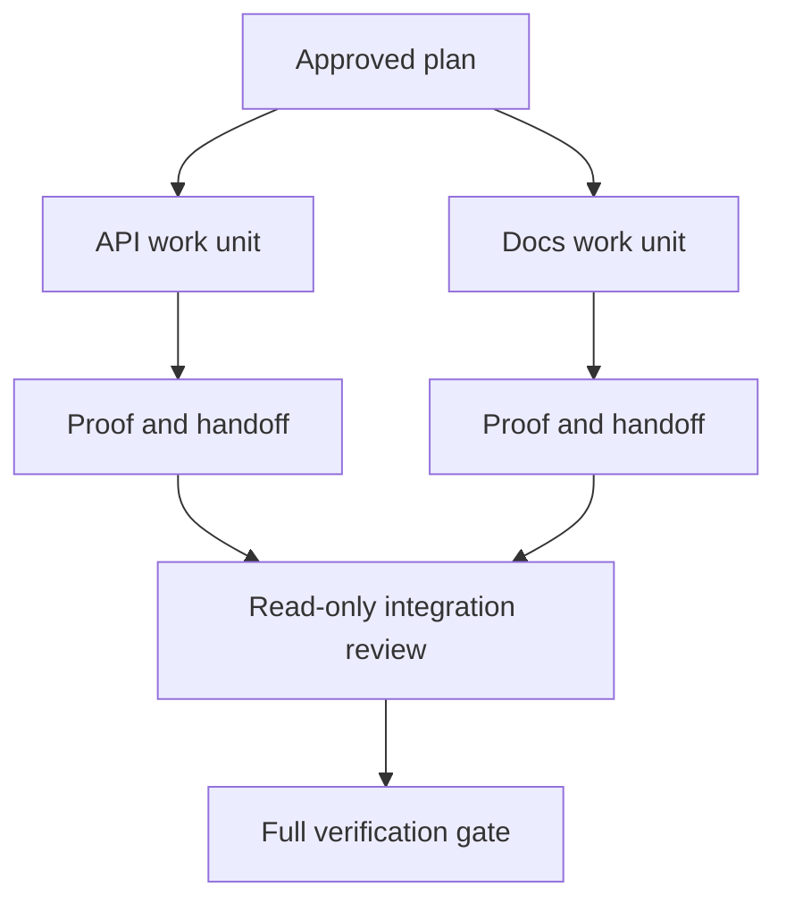

# وكيل المفوض يعمل مع عقد العزل والاندماج

> وكلاء متوازين يوفّرون وقت الجدار فقط عندما يكون العمل مستقلًا. وإلا يحولون مهمة واضحة إلى مشكلة تنسيق مع معدل فشل أسرع.

> **【中文解读】**وكيل الموافقة 只有 في العمل مستقل حقا عندما يكون قادر على صرف الوقت؛ وإلا فإنه يحول مهمة واضحة إلى مشكلة تنسيقية، ويغيب أسرع.

>  **【前置】**دراسة قبل دراسة، يرجى التعلم أولاً في المرحلة 14 第 39 课  المراجعة وكيل  هذه الدورة المجمعة هي "بناء و المشارك الانفصال" في التطبيق في مرحلة المشتركة) و 44 课  من شهادة إصدار التخطيط  هذه الدورة الإدخال هو الناتج من ذلك`outputs/evidence-plan.json`، من بينها تنفيذ التدابير مباشرة تحديد أي عامل يمكن أن يشارك)`outputs/delegation-plan.json`, سجل تفصل لماذا آمن , طريق للذين , تجمع لتلقي دليل

**Type:** Learn + Build | **类型:** 学习 + 动手实践
**Languages:** Python (stdlib) | **语言:** Python（标准库）
**Prerequisites:** Phase 14 lessons 39 and 44 | **前置知识:** Phase 14 第 39、44 课
**Time:** ~70 minutes | **时间:** 约 70 分钟

## أهداف التعلم

- تقرر ما إذا كان التفويض مبرراً بالانستقلال الحقيقي.
  中文翻译: تقرير أن يتم تأمين استقلالية حقيقية.
- أعط كل عامل ملكية ملف حصرية و إثبات صريح
  ترجمة: أعط كل عامل حق الملكية والثبات المحدد
- تدفقات تنفيذ الحساب من الاعتمادات
  中文翻译:从依赖关系计算执行波次――
- صمم عقد دمج لتدمير عملاء العمل بأمان
  中文翻译:设计一个安全合并 وكيل 工作的合并契约。

## اختبار التوازي

لا تمنح المفوضية لأن هناك المزيد من الوكلاء المتاحة. تمنح المفوضية عندما يكون واحداً على الأقل من هذه الحقائق:

> لا تتحملين الوكالة أكثر من اللازمة

- يمكن لثلاث تحقيقات أن تجيب على مختلف المجهولات بشكل مستقل.
  中文翻译: اثنين من التحقيقات يمكن أن تجيب بشكل مستقل على مختلف الأحداث غير المعروفة.
- اثنين من عمليات التنفيذ تمتلك ملفات وعقود منفصلة؛
  中文翻译: اثنين من التحقق من وجود وثائق واتفاقات متناقضة.
- يمكن للمراجعة تفتيش أثرية مكتملة دون تغييرها.
  中文翻译: يمكن للمراجعة أن تفتش المنتج المنتهي دون تعديله.
- يمكن إجراء فحص خارجي بطيء بينما يستمر العمل المحلي.
  ترجمة: إختبار خارجي سريع يمكن أن يبدأ في العمل في نفس الوقت.

إبق العمل متسلسل عندما يحتاج العملاء إلى نفس الملفات أو نفس القرار غير المحل أو نفس البيئة المتغيرة.

> عندما يحتاج العديد من العملاء إلى نفس الملفات أو نفس البيئة المتغيرة، فلتحافظ على التواصل

> **【中文解读】**"موازنة الاختبار" هي أول كلمة في هذا الدراسة: المتاحة ليست سبب، الاستقلال هو فقط.

## وحدة عمل هي عقد

كل وحدة تم تفويضها تحتاج:

> كل وحدة تم تكليفها تحتاج:

| Field | Meaning |
|---|---|
| Goal | One observable result |
| Owner | One accountable worker |
| Paths | Exclusive write ownership |
| Dependencies | Completed units required before starting |
| Proof | Exact evidence returned to the integrator |
| Handoff | Files changed, decisions made, remaining risk |

> **【中文解读】**六段里最关键的是 Paths (المركز) و الدليل (المركز)                                                                                                                                                                                                                                                   

تعامل مع الخلفية ليست وحدة عمل. تنفيذ التحقق من النسخة المكررة `app/accounts.py`و إثبات ذلك باستخدام اختبار الحساب المستهدف

> "فقطة" ليست وحدة عمل`app/accounts.py`里实现重复检查,并使用聚焦的账户测试证明它""才是.

## العزل لديه ثلاث طبقات

1. **Filesystem isolation:**الأشجار المختلفة أو صناديق الرمل تمنع التحرير المشترك غير المقصود.
   中文翻译:**文件系统隔离：**独立工作树或沙箱防止意外的共享编辑──
2. **Ownership isolation:**العقود تمنع عمالين من تحرير نفس المسار عمدا.
   中文翻译:**所有权隔离：**-منع العمال من العمل على نفس الطريق
3. **State isolation:**السجلات والإخراجات المفصلة تمنع عامل واحد من إعادة كتابة دليل عامل آخر.
   中文翻译:**状态隔离：**独立日志与输出 منع عامل واحد تغطية عامل آخر شهادة

لا يحل عزل النظام الملفي الملكية. لا تزال اثنين من الأشجار النظيفة العمل يمكن أن تنتج تصاميم متناقضة. يجب أن يحل عقد الاندماج واجهات مشتركة قبل بدء العمل.

> لا يزال هناك احتمالات لإنتاج تصميمات متضاربة بينهما. يجب أن يتم تحديد المواصلات المشتركة قبل البدء في العمل.

> **【中文解读】**يتم التفكير في الغالب في "فتح شجرة العمل على الانتهاء" ولكن شجرة العمل فقط لمنع الصدمة غير المطلوبة ، ومنع عدم وجود عاملين في تصميم الصراع من جانبهم.



> 图解: خطة الموافقة تم تفكيكها إلى وحدتين عمل، وتسليم كل منها دليل التداول وتسليمات التداول؛ المشتركون يقومون أولا فقط بالقيام بالقيام بالقيام بالقيام بالقيام بالقيام بالقيام بالقيام بالقيام بالقيام بالقيام بالقيام بالقيام بالقيام بالقيام بالقيام بالقيام بالقيام بالقيام بالقيام بالقيام بالقيام بالقيام بالقيام بالقيام بالقيام بالقيام بالقيام بالقيام بالقيام بالقيام بالقيام بالقيام بالقيام بالقيام بالقيام بالقيام بالقيام بالقيام بالقيام بالقيام بالقيام بالقيام بالقيام بالقيام بالقيام بالقيام بالقيام بالقيام بالقيام بالقيام بالقيام بالقيام بالقيام بالقيام بالقيام بالقيام بالقيام بالقيام بالقيام بالقيام بالقيام بالقيام بالقيام بالقيام بالقيام بالقيام بالقيام بالقيام بالقيام بالقيام بالقيام بالقيام بالقيام بالقيام بالقيام بالقيام بالقيام بالقيام بالقيام بالقيام بالقيام بالقيام بالقيام بالقيام بالقيام بالقيام بالقيام بالقيام بالقيام بالقيام بالقيام بالقيام بالقيام بالقيام بالقيام بالقيام بالقيام بالقيام بالقيام بالقيام بالقيام بالقيام بالقيام.

## المتكامل لا يعيد بناء العمل

يجب على المتكامل:

> 集成者 ينبغي:

1. تأكيد أن كل تسليم يطابق نطاقه المخصص؛
   中文翻译: تأكد أن كل صلة تتوافق مع نطاق تخصيصها ؛
2. اقرأ بيانات الدليل وليس مجرد ملخص للعامل
   中文翻译:读证明输出本身,而不只是工人的总结;
3. الجمع بين التغييرات في ترتيب الاعتماد؛
   中文翻译:按依序合并改动;
4. تشغيل بوابة الوحدة المتقاطعة بالكامل
   中文翻译:运行完整的跨单元验证门;
5. رفض توسيع النطاق الخفي
   中文翻译: رفض الاختفاء
6. تسجيل النزاعات كقرارات جديدة، وليس تحرير صامت.
   中文翻译:把冲突记录为新决定,而不是改掉──

إذا كان التكامل يتطلب إعادة كتابة معظم نتائج العامل، فإن التفكك الأصلي كان خاطئا.

> إذا كان التجميع يحتاج إلى إعادة كتابة معظم نتائج العمال، فإن التفكيك الأول هو خطأ.

> **【中文解读】**دور المتكامل هو "المقبل"، وليس "مختار المعدات". المادة الثانية من المهام هي أن يسهل القفز على نفسها من قبل العامل الذي يقرأها فقط، على غرار إعطاء المقبل خارج الحزمة للمقبل.

## أدوار الإنسان والعميل

ولا يزيل التفويض الحكم البشري. لا يزال الإنسان يمتلك الخيارات التي تغير السلوك العام، والمخاطر، والسلطة، أو التكلفة غير المعادلة. يمكن للعملاء أن يملكوا التحقيقات المحدودة، وتنفيذ، التحقق، والإعادة النظر.

> الوكيل لا يحل محل الحكم. يواصل الإنسان أن يكون لديه خيارات تغير السلوك العام.

هذا هو استقلالية مقياسية: النظام يمنح الحرية حيث تكون الأدلة والردع قوية، ويطلب نقطة تفتيش حيث تكون العواقب عالية.

> هذا هو الحق في الحكم الذاتي المحدد: نظام في الأدلة والقدرة على التداول القوية، في الحالات الخطيرة في الآونة الأخيرة وضع نقاط الاختبار.

> **【中文解读】**"الجهاز الذاتي للتدريب" هو قيمة هذا الدراسة: المستوى الذاتي ليس أكثر من أفضل، ويتمثل في "قوة الدليل × قابلة للتدوير" إلى الصواب.

## بناء ذلك تحرك لتحقيق

المختبر يُحقق من التداخل في المسار، ويقوم بتؤكيد الاعتمادات، ويحسب موجات التنفيذ الآمن، ويكتب `outputs/delegation-plan.json`. . .

> 实验部分会检查路径重叠、校验依赖、计算安全的执行波次,并写出 `outputs/delegation-plan.json`.

أركض

> 运行:

```bash
python3 code/main.py
python3 -m unittest discover code/tests -v
```

تغيير الوحدة الأدوية إلى المالكة`app/`يجب أن يُغلق الخطة لأن مسار الأم يتداخل مع وحدة API

> ضع الملفات وحدات تحويلها إلى امتلاك`app/`يجب أن يتم إيقاف هذا الخطوط، لأن هذه الطرق تتداخل مع API

> **【中文解读】**破坏实验 把 docs 单元所有权改成 `app/`) يظهر ميكانيكية الانفصال من الملكية: الطريق على الاعتبار غير على الاعتراف، على الاختبار مباشرة رفض.

## التمرينات التمرينات

1. تحلل التغيير الحقيقي إلى وحدتين عمل مستقلين وحدة تنسيق واحدة.
   ترجمة:把一个真实改动分解成两个独立工作单元和一个集成者.
2. ابحث عن تقسيم متوازي مقترح يبدو مستقل فقط، وذكر القرار المشترك.
   ترجمة: العثور على واحد فقط يبدو مستقلة ومفصلة التفريق المشترك، وقال انه المشترك في قرارها.
3. إضافة عامل بحثي يقرأ فقط، والذي يخرج من جدول الفعل.
   ترجمة: إضافة عامل تدريب فقط يقرأ، إنتاجها هو مظاهر حقيقية
4. إضافة بوابة دمج التي تحقق من مجموعة الملفات المتغيرة النهائية ضد جميع عقود الوحدة.
   中文翻译:加一个合并门:把最终改动文件集合与所有单元契约逐一核对──
5. تحديد قاعدة الإلغاء للعامل الذي يصبح اعتماده غير صالح.
   中文翻译:为一个依赖失效的工人 定义取消规则。

## المزيد من القراءة

- [Reid Smith, The Contract Net Protocol](https://doi.org/10.1109/TC.1980.1675516)، لتصنيف رسمي مبكر لتخصيص المهام الموزعة وتقديم تقارير عن النتائج.
  الصفحة الرئيسية/صفحة الرئيسية/صفحة الرئيسية/صفحة الرئيسية/صفحة الرئيسية/صفحة الرئيسية/صفحة الرئيسية/صفحة الرئيسية/صفحة الرئيسية/صفحة الرئيسية/صفحة الرئيسية/صفحة الرئيسية/صفحة الرئيسية/صفحة الرئيسية/صفحة الرئيسية/صفحة الرئيسية/صفحة الرئيسية/صفحة الرئيسية/صفحة الرئيسية/صفحة الرئيسية/صفحة الرئيسية/صفحة الرئيسية/صفحة الرئيسية/صفحة الرئيسية/صفحة الرئيسية/صفحة الرئيسية/صفحة الرئيسية/صفحة الرئيسية/صفحة الرئيسية/صفحة الرئيسية/صفحة الرئيسية/صفحة الرئيسية/صفحة الرئيسية/صفحة الرئيسية/صفحة الرئيسية/صفحة الرئيسية/صفحة الرئيسية/صفحة الرئيسية/صفحة الرئيسية/صفحة الرئيسية/صفحة الرئيسية/صفحة الرئيسية/صفحة الرئيسية/صفحة الرئيسية/صفحة الرئيسية/صفحة الرئيسية/صفحة الرئيسية/صفحة الرئيسية/صفحة الرئيسية/صفحة الرئيسية/صفحة الرئيسية/صفحة الرئيسية/صفحة الرئيسية/صفحة الرئيسية/صفحة الرئيسية/صفرد/صفحة الرئيسية/صفحة الرئيسية/صفرد/صفرد/صفة/صفرد/صفة/صفرد/صفة/صفة/صفة/صفة/صفة/صفة/صفة/صفة/صفة/صفة/صفة/صفة/صفة/صفة/صفة/صفة/صفة/صفة/صفة/
- [Eric Horvitz, Principles of Mixed-Initiative User Interfaces](https://dl.acm.org/doi/10.1145/302979.303030)، لتحديد متى يجب أن تعمل الآلات ومتى يجب أن تعيد السيطرة إلى الشخص.
  ترجمة باللغة الصينية:إريك هورفيتز مبدأ المزيج المتحرك المتحرك يقرر التلقائي متى يجب أن يتم التحرك، متى يجب أن يتم تسليم السيطرة إلى الإنسان، أي "تخرج استقلالية المقرر".

## ما تبقيه ، ما تبقيه

إبق`outputs/delegation-plan.json`يُسجل لماذا الانقسام آمن، ومن يملك كل مسار، وما هو دليل يجب أن يتلقى التكامل.

> حافظ`outputs/delegation-plan.json` يُسجل سبب سلامة هذا الانفصال  كل طريق إلى من يملكها  وكذلك ما يجب أن يتلقىه التكامل‬‬‬‬‬‬‬‬‬‬‬‬‬‬‬‬‬‬‬‬‬‬‬‬‬‬‬‬‬‬‬‬‬‬‬‬‬‬‬‬‬‬‬‬‬‬‬‬‬‬‬‬‬‬‬‬‬‬‬‬‬‬‬‬‬‬‬‬‬‬‬‬‬‬‬‬‬‬‬‬‬‬‬‬‬‬‬‬‬‬‬‬‬‬‬‬‬‬‬‬‬‬‬‬‬‬‬‬‬‬‬‬‬‬‬‬‬‬‬‬‬‬‬‬‬‬‬‬‬‬‬‬‬‬‬‬‬‬‬‬‬‬‬‬‬‬‬‬‬‬‬‬‬‬‬‬‬‬‬‬‬‬‬‬‬‬‬‬‬‬‬‬‬‬‬‬‬‬‬‬‬‬‬‬‬‬‬‬‬‬‬‬‬‬‬‬‬‬‬‬‬‬‬‬‬‬‬‬‬‬‬‬‬‬‬‬‬‬‬‬‬‬‬‬‬‬‬‬‬‬‬‬‬‬‬‬‬‬‬‬‬‬‬‬‬‬‬‬‬‬‬‬‬‬‬‬‬‬‬‬‬‬‬‬‬‬‬‬‬‬‬‬‬‬‬‬‬‬‬‬‬‬‬‬‬‬‬‬‬‬‬‬‬‬‬‬‬‬‬‬‬‬‬‬‬‬‬‬‬‬‬‬‬‬‬‬‬‬‬‬‬‬‬‬‬‬‬‬‬‬‬‬‬‬‬‬‬‬‬‬‬‬‬‬‬‬‬‬‬‬‬‬‬‬‬‬‬‬‬‬‬‬‬‬‬‬‬‬‬‬‬‬‬‬‬‬‬‬‬‬‬‬‬‬‬‬‬‬‬‬‬‬‬‬‬‬‬‬‬‬‬‬‬‬‬‬‬‬‬‬‬‬‬‬‬‬‬‬‬‬‬‬‬‬‬‬‬‬‬‬‬‬‬‬‬‬‬‬‬‬‬‬‬‬‬‬‬‬‬‬‬‬‬‬‬‬‬‬‬‬‬‬‬‬‬‬‬‬‬‬‬‬‬‬
