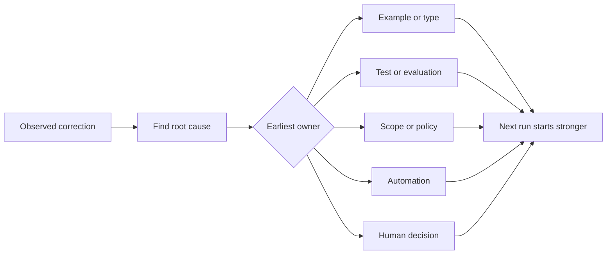

# حول كل عامل تصحيح إلى تحسين النظام

> تصحيح يمر فقط في الدردشة يصلح مرة واحدة. تصحيح يروج إلى اختبار، حدود، مثال، أو أداة يحسن في كل مرة أخرى.

> **【中文解读】**فقط في سجلات الدردشة تصحيح، فقط تصحيح مرة واحدة من التشغيل؛ يتم تحسينها إلى اختبار، الحدود، مثال أو تصحيح الأداة، كل مرة من التشغيل بعد التحسين.

>  **【前置】**دراسة دراسية دراسية دراسية دراسية دراسية دراسية دراسية دراسية دراسية دراسية دراسية دراسية دراسية دراسية دراسية دراسية دراسية دراسية دراسية دراسية دراسية دراسية دراسية دراسية دراسية دراسية دراسية دراسية دراسية دراسية دراسية دراسية دراسية دراسية دراسية دراسية دراسية دراسية دراسية دراسية دراسية دراسية دراسية دراسية دراسية دراسية دراسية دراسية دراسية دراسية دراسية دراسية دراسية دراسية دراسية دراسية دراسية دراسية دراسية دراسية دراسية دراسية دراسية دراسية دراسية دراسية دراسية دراسية دراسية دراسية دراسية دراسية دراسية دراسية دراسية دراسية دراسية دراسية دراسية دراسية دراسية دراسية دراسية دراسية دراسية دراسية دراسية دراسية دراسية دراسية دراسية دراسية دراسية دراسية دراسية دراسية دراسية دراسية دراسية دراسية دراسية دراسية دراسية دراسية دراسية دراسية دراسية دراسية دراسية دراسية دراسية دراسية دراسية دراسية دراسية دراسية دراسية دراسية دراسية دراسية دراسية دراسية دراسية دراسية دراسية دراسية دراسية دراسية دراسية دراسية دراسية دراسية دراسية دراسية دراسية دراسية دراسية دراسية دراسية دراسية دراسية دراسية دراسية دراسية دراسية دراسية دراسية دراسية دراسية دراسية دراسية دراسية دراسية دراسية دراسية دراسية دراسية دراسية دراسية دراسية دراسية دراسية دراسية دراسية دراسية دراسية دراسية دراسية دراسية`outputs/feedback-ratchet.json`, انها مستقبل العمل على التغيير المدخلات

**Type:** Learn + Build | **类型:** 学习 + 动手实践
**Languages:** Python (stdlib) | **语言:** Python（标准库）
**Prerequisites:** Phase 14 lessons 37 to 41 | **前置知识:** Phase 14 第 37-41 课
**Time:** ~65 minutes | **时间:** 约 65 分钟

## أهداف التعلم

- تحويل تصحيحات الوكيل إلى التحكمات الدائمة.
  ترجمة: تغيير تصحيحات العميل إلى وسيلة سيطرة دائمة
- ضع كل جهاز تحكم في أول طبقة يمكن أن تمنع تكرار.
  ترجمة: ضع كل حكم في أول طبقة من الاحتمالات
- إعادة تكرار الدروس مع بصمات أصابع مستقرة
  中文翻译: مع ثابتة الإصبع للعودة إلى التدريس إلى العودة
- إقلاع التحكمات التي لم تعد تحمي المخاطر الحقيقية.
  中文翻译:退役那些不再保护真实风险的控制──

## التصحيح هو دليل

عندما تخبر وكيل لا تعديل هذا الملف، تعلمت أن حدود النطاق لم تكن قابلة للتنفيذ. عندما تقول هذا الشكل الخارجي خاطئ، تعلمت أن هناك مثال أو اختبار مفقود. عندما تفشل الإعداد مرة أخرى، تعلمت أن معرفة البيئة تنتمي إلى التلقائية.

> عندما تقول للعميل "بعد ذلك الملف"، تعلمت أن الحدود غير قابلة للتنفيذ. عندما تقول "هذا الناتج غير صالح"، تعلمت أن هناك غياب مثال أو اختبار.

تعامل التعديل كلاحظة عن نظام العمل، وليس كخيبة كتابة على الفور.

> إصلاح النظام العمل، بدلا من الفشل في كتابة مرة واحدة

> **【中文解读】**هذا الجزء تغير وجهة النظر: كل تصحيح هو النظام الذي يبلغ عن خللاته "الحدود لا يمكن تنفيذها" "عدم وجود مثال" "المعرفة لا تمر"

## ترقية إلى أول طبقة فعالة

استخدم هذا الترتيب:

> 按这个顺序升级:

| Recurring failure | Durable destination |
|---|---|
| Wrong result or regression | Test or evaluation |
| Off-scope or unsafe action | Scope or permission policy |
| Repeated setup or command mistake | Automation or tool |
| Repeated output-format mistake | Canonical example plus validator |
| Ambiguous local convention | Instruction with a scenario check |
| Product disagreement | Human decision record |

التحكمات السابقة أرخص. النوع الذي يمنع حالة غير صالحة أقوى من تعليق مراجعة الذي يلتقطها لاحقا. الاختبار المركز أقوى من الفقرة التي تطلب من الوكيل أن يتذكر.

> 越早的控制越便宜──一类防止非法状态出现,强过一条事后才抓住它评审评论──一段集中测试,强过一段求代理"记住"文字──

> **【中文解读】**هذا الجدول هو الجدول الأساسي للقرارات في هذا الدراسة: نتائج خطأ تحسين للاختبار/التقييم؛ فوق الحدود تحسين لسلسلة/حكم الاستراتيجية؛ مرة أخرى على حفرة البيئة تحسين للاستعمال الآلي؛ صيغة خطأ تحسين لتنظيم المثاليات加校 परीक्षक؛约定含糊升级为带场景检查的指令;产品分歧升级为人工决定记录──原则是"越靠前控制越便宜"能在类型系统中停留,别留到评审;能用测试钉死,别写在快速里里──



> 图解: مشاهدة إلى تصحيح → 找根因 → 判定最早的责任层(مثال/نوع、测试/评估、范围/策略、自动化、人工决定)→

## سجلات " راتشيت "

التقاط:

> 记录这些字段:

- الأعراض
  中文翻译: أعراض
- السبب الجذري
  中文翻译:根因;
- النتائج
  中文翻译:后果;
- عدد التكرار
  中文翻译:复发次数;
- التحكم المختار
  中文翻译: اختياري التحكم
- التحقق من التحكم
  中文翻译: التحكم في طريقة التحقق من الذات
- المالك
  中文翻译: مسئول;
- تاريخ مراجعتها أو تقاعدها
  中文翻译:复审或退役日期。

لا تعزز كل تفضيل فريد، ولكن تعزز تصحيح عندما يبرر التكرار أو التأثير تعقيدًا دائمًا.

> لا تحسن كل مرة واحدة من المفضلة فقط عندما يكون عدد المرات المتكررة أو النتائج الخطيرة إلى حد أن يستحق إدخال تعقيد دائم، فقط تحسن هذه المادة.

> **【中文解读】**في 8 فصائل، يُفسر "تأمين طريقة التحقق من أنفسهم" و"النهاية من الحكم" بسهولة. الأول يضمن أن هذا التحكم قد توقف حقاً، وإلا كان مجرد تعزيز نفسي.

>  **【类比】**棘轮手像一个只不跌的储蓄──之前:每次纠正都从零开始、说完就忘;之后:每次纠正都推动轮单向前进一格(一条可验证的控制),系统只会变强,不会回来──

## أسباب و أعراض مختلفة

الوكيل الذي تم تحريره على README هو أعراض.

> "الوكيل "غيرت قراءة " هي أعراضها.

- المهام سمحت لجذر المخبأ
  中文翻译: المهام سمحت مخزن الجذر؛
- كانت الوثائق تعتبر آمنة بشكل ضمني.
  中文翻译:文档被默认当作安全区;
- تنفيذ خطة المجموعة والوثائق؛
  中文翻译: التخطيط لإنجاز الملفات المكتوبة
- كان لدى عمالين ملكية متداخلة
  中文翻译: ملكية عاملين متداخلة

كل سبب ينتمي إلى نظام مختلف، قاعدة تكرر العلامة فقط سوف تفشل في الحالة التالية مختلفة قليلا.

> كل سبب يتعامل مع مختلف السيطرة. فقط إعادة تشريع قواعد الأعراض، في المرة القادمة التي تكون فيها حالات مختلفة قليلاً سوف تفشل.

> **【中文解读】**إنه من السهل أن يسرق: كتابة "بيل غير README" إلى قاعدة من السهل، ومعرفة "لماذا سيتم تغييرها" من الصعب. ولكن أربعة أسباب محتملة تشير إلى أربع أنواع مختلفة من الإصلاحات.

## التحكمات أيضاً تتدهور

يمكن أن تتعارض التحكمات القديمة، وتتفجير السياق، وتشفير نظام لم يعد موجودًا. كل قاعدة مدعومة تحتاج إلى مراجعة التقاعد. إزالتها أو إعادة كتابتها عندما:

> 大上下文、并固化一个已经不存在的系统──每条升级过的规则都需要退役检查──当下列情况出现时,删除或重写它:

- تغير الهندسة المعمارية الأساسية؛
  中文翻译: تم تغيير الهيكل الأساسي.
- تم استبدالها بمراقبة أكثر قوة قابلة للتنفيذ.
  中文翻译:更强的可执行控制取代了它;
- لم تتكرر الفشل عبر نافذة ذات مغزى؛
  中文翻译: في نافذة زمنية ذات معنى
- التحكم يخلق مزيدا من الاحتكاكات أكثر من المخاطر التي يمنعها
  ترجمة: التحكم في الصناعة قد تجاوزت منازعها

الهدف ليس أطول ملف تعليمات بل هو أصغر نظام يحافظ على الحكم الذي حصل عليه بجد

> الهدف ليس أطول ملفات التعليمات، ولكن الحفاظ على نظام القوة القصوى من القوة القصوى.

> **【中文解读】**棘轮只进不退,但控制会过期──"كل قاعدة يجب أن يكون لها فحص إ退役" مع الملف المستهدف مثل AGENTS.md) والحفاظ على الملف المباشر: لا يزيد من التخلص من قواعد تجمع, في النهاية سوف تتناقض بين بعضها البعض、 يغرق التركيز、 وصف نظام غير موجود.

## بناء ذلك تحرك لتحقيق

المختبر يصنف التعديلات، ويعززها في التحكم، ويعيد نقل بصمات الأصابع، ويكتب `outputs/feedback-ratchet.json`. . .

> ‬ ‬ ‬ ‬ ‬ ‬ ‬ ‬ ‬ ‬ ‬ ‬ ‬ ‬ ‬ ‬ ‬ ‬ ‬ ‬ ‬ ‬ ‬ ‬ ‬ ‬ ‬ ‬ ‬ ‬ ‬ ‬ ‬ ‬ ‬ ‬ ‬ ‬ ‬ ‬ ‬ ‬ ‬ ‬ ‬ ‬ ‬ ‬ ‬ ‬ ‬ ‬ ‬ ‬ ‬ ‬ ‬ ‬ ‬ ‬ ‬ ‬ ‬ ‬ ‬ ‬ ‬ ‬ ‬ ‬ ‬ ‬ ‬ ‬ ‬ ‬ ‬ ‬ ‬ ‬ ‬ ‬ ‬ ‬ ‬ ‬ ‬ ‬ ‬ ‬ ‬ ‬ ‬ ‬ ‬ ‬ ‬ ‬ ‬ ‬ ‬ ‬ ‬ ‬ ‬ ‬ ‬ ‬ ‬ ‬ ‬ ‬ ‬ ‬ ‬ ‬ ‬ ‬ ‬ ‬ ‬ ‬ ‬ ‬ ‬ ‬ ‬ ‬ ‬ ‬ ‬ ‬ ‬ ‬ ‬ ‬ ‬ ‬ ‬ ‬ ‬ ‬ ‬ ‬ ‬ ‬ ‬ ‬ ‬ ‬ ‬ ‬ ‬ ‬ ‬ ‬ ‬ ‬ ‬ ‬ ‬ ‬ ‬ ‬ ‬ ‬ ‬ ‬ ‬ ‬ ‬ ‬ ‬ ‬ ‬ ‬ ‬ ‬ ‬ ‬ ‬ ‬ ‬ ‬ ‬ ‬ ‬ ‬ ‬ ‬ ‬ ‬ ‬ ‬ ‬ ‬ ‬ ‬ ‬ ‬ ‬ ‬ ‬ ‬ ‬ ‬ ‬ ‬ ‬ ‬ ‬ ‬ ‬ ‬ ‬ ‬ ‬ ‬ ‬ ‬ ‬ ‬ ‬ ‬ ‬ ‬ ‬ ‬ ‬ ‬ ‬ ‬ ‬ ‬ ‬ ‬ ‬ ‬ ‬ ‬ ‬ ‬ ‬ ‬ ‬ ‬ ‬ ‬ ‬ ‬ ‬ ‬ ‬ ‬ ‬`outputs/feedback-ratchet.json`.

أركض

> 运行:

```bash
python3 code/main.py
python3 -m unittest discover code/tests -v
```

أضف اثنين من التعديلات المختلفة التي لها نفس السبب. تحسين التطبيع حتى تتراجع إلى جهاز واحد دون انهيار فشل غير مرتبط.

> 加入两条措辞不同但根因相同的纠正──改进归化逻辑,直到它们合并成一个控制,同时不让无关的失败被错合并──

> **【中文解读】**破坏实验演示指纹去重的关键张力:归一化太松,同一根因的两条纠正各立一条控制(重复膨胀);太紧,无关失败被错合并(错伤) ;;去重的点是根因,不是措辞

## التمرينات التمرينات

1. خذ خمسة تصحيحات من جلسة تشفير حديثة وتصنيف أصحابها الحقيقيين.
   ترجمة: من حديث حديثه الأخير عن إصلاحات، فحصها على المستوى الحقيقي للمسؤولية.
2. استبدل قاعدة في النص مع اختبار يمكن تنفيذه.
   中文翻译:把一条文字规则替换成一个可执行的测试──
3. إضافة وزن التأثيرات حتى يتم تعزيز حدوث أول حدوث حاد على الفور.
   ترجمة: إضافة الوزن، دع خطورة تحدث لأول مرة يمكن أن ترتفع على الفور.
4. أضف صاحب وتاريخ التقاعد إلى نتائج المختبر
   ترجمة: إعطاء تجربة إضافة إلى المسؤول وال退役日期
5. مراجعة تعليمات وكيل موجودة وحذفها فقط بعد إثبات وجود مراقبة أقوى.
   ترجمة: مراجعة أمر العميل الحالي، فقط بعد إثبات وجود قوة أكبر في التحكم في ذلك القرار.

## المزيد من القراءة

- [Basili, Caldiera, and Rombach, The Goal Question Metric Approach](https://www.cs.toronto.edu/~sme/CSC444F/handouts/GQM-paper.pdf)، لتحويل الأهداف إلى أسئلة وقياسات عمليات.
  中文翻译:باسيلي、كالديرا ورومباخ 目标问题量法把目标转化为问题和可操作的量量──
- [Shinn et al., Reflexion](https://arxiv.org/abs/2303.11366)، لاستخدام آثار المراجعة لتحسين القرارات اللاحقة دون تغيير أوزان النموذج.
  中文翻译:شين 等تفكير باستخدام反轨迹改进后续决策而不改动模型权重──
- [Madaan et al., Self-Refine](https://arxiv.org/abs/2303.17651)، للردود التكراري والإصلاح داخل حلقة المهام.
  中文翻译:Madaan 等Self-Refine任务循环内部的代反与修订──

## ما تبقيه ، ما تبقيه

إبق`outputs/feedback-ratchet.json`إنها نهاية دائمة لمسار الهندسة بمساعدة العملاء ومقدمة لتغييرات مقاعد العمل في المستقبل.

> حافظ`outputs/feedback-ratchet.json` هو نقطة نهاية دائمة لطرق "عميل  مساعد انجري" ، و أيضا مستقبل العمل
