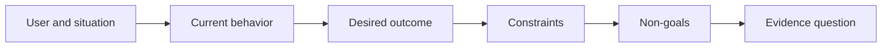

# تعريف النتيجة قبل اختيار الخروج

> التنفيذ السريع يزيد من العقوبة للاختيار الخطأ. تشكيل النتيجة أولاً حتى تسريع نقاط في الاتجاه الصحيح.

> **【中文解读】**"المخرجات" (الإنتاج) هو ما تحدد أن تبنيه (المساعد) ، الصفحة، النموذج، النتيجة (النتيجة) هو تغيير في العالم يمكن ملاحظته (المغيرات) ، من الذي يتغير في أي حالة من الأحوال.

>  **【前置】**无硬性前置课程──本课是 47-54 课程“塑造构建」路径(结果定义 → 工作流发现 → 假设与风险 → 最小切片 → 规格 → 指标 → 分阶段发布 → 反所有权)

**Type:** Learn + Build | **类型:** 学习 + 动手实践
**Languages:** Python (stdlib) | **语言:** Python（标准库）
**Prerequisites:** None | **前置知识:** 无
**Time:** ~60 minutes | **时间:** 约 60 分钟

## أهداف التعلم

- اكتب إطار النتيجة دون تسمية الحل
  中文翻译:写出一个不点名任何解决方案的结果框架.
- تحديد المستخدم، والوضع، والسلوك الحالي، والتغيير المرغوب فيه.
  中文翻译:识别用户、情境、现行行为和期望的改变──
- أوضح القيود وغير الأهداف صراحة.
  中文翻译:把约束和非目标写明确──
- اكتشاف تسرب الخلّة قبل أن تصبح صلبة في نطاقها.
  ترجمة: في الحلّة التفشّل الصلبة إلى نطاقه قبل أن يتمّ اختبارها

## إنتاج ليس نتيجة إنتاج ليس مثل النتائج

بني مساعد حادثةتسمية المخرج. لا يذكر من يحتاج إليها، ما يصبح أفضل، أو ما يجب أن يبقى آمنا.

> "إنشاء مساعد حادثة" هو اسم واحد من المنتجات.

الإطار الناتج يقول:

> 结果框架 يقول:

> عندما يصل إشعار الإنتاج، يحدد المهندس المكلف عن الخدمة الفاشلة والإجراء الآمن التالي في غضون دقيقتين، بينما يبقى التشخيص قراءة فقط ومراجعة.

> 译文: عندما يصل الإشعار إلى الشرطة ، يمكن لمهندس المرتبة في الدقائق الثانية تحديد الخدمة المتعثرة والعثور على خطوة خطوة أخرى آمنة ، في حين يُبقى التشخيص كاملًا فقط وقراً ويمكن مراجعته.

هذه الجملة يمكن أن تُرضى بواسطة البرمجيات أو كتاب التشغيل أو إصلاح البيانات أو تغييرات صغيرة في واجهة التفاعل.

> يمكن أن تكون هذه العبارة من قبل برنامج، كتاب، إصلاح بيانات، أو تغيير واجهة أصغر لتلبية ذلك.

> **【中文解读】**الفرق بين النتائج والإنتاج هو أساس هذا الدراسة: النتائج هي مجرد مدخل إلى الفضاء ، والنتيجة هي فقط نهاية الوصول.

## الإطار الستة الأجزاء

| Part | Question |
|---|---|
| User | Who experiences the problem directly? |
| Situation | When and where does it occur? |
| Current behavior | What happens today, including workarounds? |
| Desired outcome | What observable state should improve? |
| Constraints | Which safety, policy, cost, or compatibility limits are fixed? |
| Non-goals | What tempting adjacent work is excluded? |



> 图解: المستخدم ووضع → حالية السلوك → نتائج 期望 → 约束 → غير هدف → 证据问题,六段依序收紧。

> **【中文解读】**六段是有序的: أولاً الناس والحالات،才谈到行为;先看清现状 (بما في ذلك الوضع الحالي) ؛才谈到改变;约束收紧解空间,非目标住顺手的诱惑,最后落到"ماذا يمكن للمشاهدة أن تثبت النتائج الموصوفة"......

## ابحث عن حل لتسريبات

تصريحات النتائج تسرب الحلول عندما تحتوي على شكل منتج أو واجهة أو اختيار نموذج أو إطار أو بنية لم يتم الحصول عليها من خلال الأدلة.

> عندما يتضمن النتائج بيانات غير مؤكدة على شكل المنتج، واجهة، اختيار النموذج، الإطار أو البنية، فإن الحل قد تمت الإفشاح.

- يستلم المستخدمون ملخصاً أسبوعياً للذكاء الاصطناعييتسرب ملخصاً وتسلسل.
  中文翻译::"المستخدم يحصل على مقتطف من الذكاء الاصطناعي كل أسبوع" فجر "المقتطف" هذا النموذج و"الاسبوع" هذا النغمة.
- المستخدمون يفهمون تغييرات الحساب قبل أن يذكر الموافقة النتيجة.
  中文翻译::"المستخدم في التصديق قبل فهم حساب تغيرات"
- تطبيق قاعدة بيانات متجهات تسرب البنية التحتية.
  中文翻译: ""التنظيم لمجموعة بيانات" "فجر البنية التحتية"".
- تتوفر أدلة سياسية ذات صلة خلال المراجعةتعلّق بإمكانها.
  中文翻译: "الامتحانات يمكن الحصول على أدلة سياسية ذات صلة"

القيود يمكن أن تسمى التكنولوجيا عندما يتصل التوافق حقاً بها.

> عندما يكون التوافقات مقفلة بالفعل عندما يتم اختيار التكنولوجيا، يمكن أن يُذكر التكنولوجيا.

> **【中文解读】**泄漏检测的判断:句子里出现了"صيغة المنتج/界面/模型/框架/架构"级别的词((AI 摘要、向量库、App),而它还没有得到证据,就是泄漏.

## القيود تحمي النتيجة

القيود ليست تفاصيل تنفيذها إنها جزء من هدف العالم الحقيقي:

> 约束不是实现细节──它们是真世界目标的一部分:

- لا يوجد إنتاج يكتب أثناء التشخيص
  中文翻译: دوران عدم كتابة الإنتاج库
- الاستجابة ضمن ميزانية الوقت المحدد للحدث
  中文翻译: فى الحادث الوقت الميزانية
- تظل الأحداث المختصة في المراجعة ذات الصلة بالسلطة.
  中文翻译: الحفاظ على سلطة الحسابات الحالية
- لا يوجد إدمان جديد على الوقت الذي يتم فيه التشغيل.
  中文翻译:不引入新运行时依赖;
- سلوك الوصول يبقى سليم
  中文翻译: عدم وجود عوائق في الحياة

بناء يصل إلى النتيجة عن طريق خرق قيود لم يصل إلى النتيجة.

> بناء واحد على خلاف الحكم وصل، لم يكن هناك نتائج حقيقية وصل.

> **【中文解读】**وراء ذلك، فإنّ القواعد المذكورة في المادة الثانية من القواعد المذكورة في المادة الثانية من القواعد المذكورة في القواعد المذكورة في القواعد المذكورة في القواعد المذكورة في القواعد المذكورة في القواعد المذكورة في القواعد المذكورة في القواعد المذكورة في القواعد المذكورة في القواعد المذكورة في القواعد المذكورة في القواعد المذكورة في القواعد المذكورة في القواعد المذكورة في القواعد المذكورة في القواعد المذكورة في القواعد المذكورة في القواعد المذكورة في القواعد المذكورة في القواعد المذكورة في القواعد المذكورة في القواعد المذكورة في القواعد المذكورة في القواعد المذكورة في القواعد المذكورة في القواعد المذكورة في القواعد المذكورة في القواعد المذكورة في القواعد المذكورة في القواعد المذكورة في القواعد المذكورة في القواعد المذكورة في القواعد المذكورة، والتي تعتبر في القواعد المذكورة في القواعد المذكورة في القواعد المذكورة في القاعدة في القاعدة في القاعدة في القاعدة في القاعدة في القاعدة.

## غير أهداف إنشاء حدود غير أهداف تحديد حدود

غير الأهداف تمنع قطعة مفيدة من أن تتحول إلى منصة. الأهداف غير الجيدة هي ملموسة بما فيه الكفاية لرفض العمل:

> غير هدف منع التوسع في كيس مفيد إلى منصة.

- لا توجد إصلاحات تلقائية؛
  中文翻译:不做自动修复;
- لا يوجد نظام جديد لتوجه الإنذار؛
  中文翻译:不建新告警路由系统;
- عدم استبدال قائد الحادث
  中文翻译:不取代事故指挥官
- لا تحليل تاريخي في هذا الجزء
  中文翻译:本切片不做历史分析。

> **【中文解读】**غير الهدف هو مساحة سلبية من المجال، مع "الطرق المحظورة" في إطار المهام الدراسية 43.

## بناء ذلك تحرك لتحقيق

المختبر يصدق`OutcomeFrame`و يكتب`outputs/outcome-frame.json`. . .

>  تجربة جزء من تجربة واحد `OutcomeFrame`وكتب`outputs/outcome-frame.json`.

```bash
python3 code/main.py
python3 -m unittest discover code/tests -v
```

استبدل النتيجة المرغوبة بـ استخدم مساعد الحادث. يجب على المؤكد أن يُعبر عن تسريب النتائج المقترحة إلى النتيجة.

> أن تحوّل النتائج المتوقعة إلى "مساعد في استخدام الحوادث"

> **【中文解读】**破坏实验把"فحص التفشيل"变成一条机械规则:期望结果一 بمجرد ظهور تشكلات فكافية ((استخدام/بناء/نشر加产品名)) ، الاختبارات على الرفض.

## التمرينات التمرينات

1. إعادة كتابة طلب ميزة من سجل الخلفية الخاص بك كإطار النتيجة.
   中文翻译:把你后载里 一条功能请求重写成结果框架──
2. إضافة قيود واحد يغير الحلول التي لا تزال ممكنة.
   中文翻译:加一条能改变"الحل الذي لا يزال ممكن"
3. أضف هدفين غير هدفين يبقون الجزء الأول صغيرًا
   中文翻译:加两条非目标,让第一切片保持小──
4. حدد أوائل ملاحظات ستفسر النتيجة المرغوبة.
   中文翻译: أشار إلى أوائل、能证伪期望结果的观察──
5. اكتب ثلاثة نتائج مختلفة يمكن أن تلبي نفس النتيجة.
   中文翻译:写出三种不同的产出,它们都能满足同一个结果──

## المزيد من القراءة

- [Nuseibeh and Easterbrook, Requirements Engineering: A Roadmap](https://www.cs.toronto.edu/~sme/papers/2000/ICSE2000.pdf)، لتعامل أهداف العالم الحقيقي كمركز للعمل البرمجي
  中文翻译:Nuseibeh 与 Easterbrook需求工程:路线图把真世界目标当作软件工作的点──
- [Dardenne, van Lamsweerde, and Fickas, Goal-Directed Requirements Acquisition](https://doi.org/10.1016/0167-6423(93)90021-G) ، لتحسين الأهداف على مستوى عال إلى قيود ومتطلبات تشغيلية.
  中文翻译:داردن ‧ فان لامسويرد 与 Fickas  مطلوبات الهدف الموجهة للحصول على  تحسين أهداف المستوى العالي لتحديد الاحتياجات القابلة للتشغيل 

## ما تبقيه ، ما تبقيه

إبق`outputs/outcome-frame.json`الدروس التالية تختبر ذلك ضد تدفق العمل الناس الفعلي.

> حافظ`outputs/outcome-frame.json` Next class will take it to check people's actual execution workflow to check
