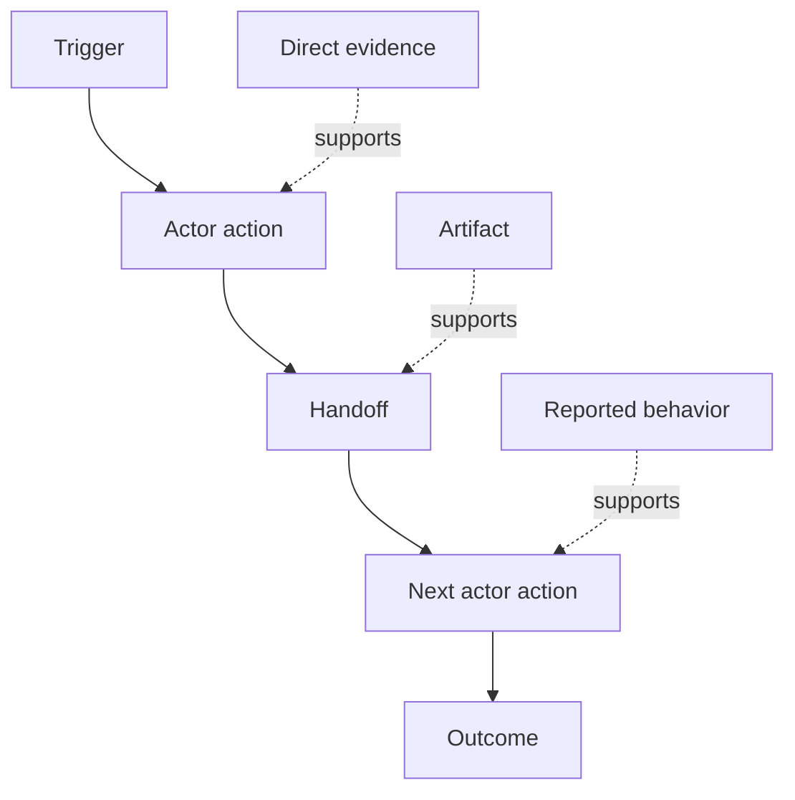

# اكتشف تدفق العمل الناس فعلا أداء                                                                                                                                                                                                                                                                                                                                                                                                                                                                                                                     

> لا تنتظر الاحتياجات في الاجتماع ليتم جمعها.

> **【中文解读】**需求 ليس يقع في الاجتماع وغيرها من المقبلين ، بل يقع في التحرّك ، وتحايل الطرق ، والسجلات والفصلات. هذا الدروس يعلمك من "" ما يحدث الآن حقا "" الخروج إلى العمل وتكتشيف: إعطاء كل خطوة بناء ؛ المفعول ؛ التشغيل ؛ تحريك ؛ إدخال ، المخرج ؛ التعبئة ؛ الحكم ؛ الدليل ؛ إعطاء الدليل ؛ تصنيف ؛ المنتج ؛ المنتج > المفاهيم > التوصيف ؛ والحفاظ على الفصلات بدلاً من تقييمها. هذا هو "التشكيل البناء" الدراسة الثانية.

>  **【前置】**دراسة دراسية قبل دراسة دراسة دراسية قبل دراسة دراسية دراسية دراسية دراسية دراسية دراسية دراسية دراسية دراسية دراسية دراسية دراسية دراسية دراسية دراسية دراسية دراسية دراسية دراسية دراسية دراسية دراسية دراسية دراسية دراسية دراسية دراسية دراسية دراسية دراسية دراسية دراسية دراسية دراسية دراسية دراسية دراسية دراسية دراسية دراسية دراسية دراسية دراسية دراسية دراسية دراسية دراسية دراسية دراسية دراسية دراسية دراسية دراسية دراسية دراسية دراسية دراسية دراسية دراسية دراسية دراسية دراسية دراسية دراسية دراسية دراسية دراسية دراسية دراسية دراسية دراسية دراسية دراسية دراسية دراسية دراسية دراسية دراسية دراسية دراسية دراسية دراسية دراسية دراسية دراسية دراسية دراسية دراسية دراسية دراسية دراسية دراسية دراسية دراسية دراسية دراسية دراسية دراسية دراسية دراسية دراسية دراسية دراسية دراسية دراسية دراسية دراسية دراسية دراسية دراسية دراسية دراسية دراسية دراسية دراسية دراسية دراسية دراسية دراسية دراسية دراسية دراسية دراسية دراسية دراسية دراسية دراسية دراسية دراسية دراسية دراسية دراسية دراسية دراسية دراسية دراسية دراسية دراسية دراسية دراسية دراسية دراسية دراسية دراسية دراسية دراسية دراسية دراسية دراسية دراسية دراسية دراسية دراسية دراسية دراسية دراسية دراسية دراسية دراسية دراسية دراسية دراسية دراسية در`outputs/workflow-evidence.json`، و سوف يُعدّ الدروس التالية التضارب واللامتأكد الملاحظ إلى مخطط افتراضي

**Type:** Learn + Build | **类型:** 学习 + 动手实践
**Languages:** Python (stdlib) | **语言:** Python（标准库）
**Prerequisites:** Phase 14 lesson 47 | **前置知识:** Phase 14 第 47 课
**Time:** ~70 minutes | **时间:** 约 70 分钟

## أهداف التعلم

- قم بتصميم سير العمل الحالي على أنه إجراءات مرتبطة مع الأدلة.
  ترجمة باللغة الصينية:把当前工作流建模为带证据的有序动作.
- فصل الملاحظة المباشرة عن السلوك المبلغ عنه أو المستنتاج.
  ترجمة: تفرق بين الملاحظة المباشرة والحديث والتقييم.
- تحديد العراك، التسليمات، السلطة، والحالة الخفية.
  中文翻译:定位摩擦、交接、权限和隐藏状态──
- ضع القوائم غير المؤكدة مرئية بدلاً من تحويلها إلى متطلبات.
  中文翻译:让不确定的断言保持可见,而不是把它们变成需求──

## ابدأ بالنظام الحالي

لا تبدأ بسؤال ما هي الميزات التي يريدها الناس، ابدأ بإعادة بناء ما يحدث الآن.

> لا تسأل الناس عن ما يريدون من وظيفة..

لكل خطوة، سجل:

> لكل خطوة، سجّل:

| Field | Example |
|---|---|
| Actor | On-call engineer |
| Trigger | Production alert arrives |
| Action | Opens alert, then searches dashboards |
| Input | Alert payload and deployment record |
| Output | Candidate service and owner |
| Friction | Context switching across three tools |
| Authority | Incident commander approves a write |
| Evidence | Screen recording, incident log, runbook |

تدفق العمل أكبر من الشاشة. يتضمن الانتظار، نسخة ورقق، قنوات جانبية، الموافقة، إعادة إصلاح الخطأ، والخطوات التي توقف الناس عن ملاحظة.

> 工作流比屏幕大── يشمل الانتظار ‬ النسخة الملتصقة ‬ الصورة الصغيرة ‬ الموافقة ‬ إعادة التأهيل الخطأ، وكذلك الخطوات التي لم يعد الناس يلاحظونها‬

> **【中文解读】**起点决定质量: من "ما تريد" أن يخرج من تصفية الرغبة، من "ما تفعله الآن" أن يخرج من الصفحة هو مجرد قيود清单.

## الأدلة قوية الأدلة ضعيفة

استخدم سلم الأدلة البسيط:

> باستخدام سلم بسيط

1. **Direct behavior:**الملاحظة، تتبع، تسجيل، أو حدث النظام.
   中文翻译:**直接行为：**مشاهدة تتبع وتسجيل الحوادث
2. **Artifact:**التذكرة، دفتر الدفع، السجل، النموذج، أو الناتج المكتمل.
   中文翻译:**产物：**工单、运维手册、日志、表单或已完成作品──
3. **Reported behavior:**الشخص يصف ما يفعلونه
   中文翻译:**口述行为：**شخص ما يصف نفسه كيف يفعل ذلك
4. **Inference:**الفريق يختتم بما قد يحدث
   中文翻译:**推断：**المجموعة تُخمن ما حدث تقريباً

كلّهما قد يكون مفيدًا، فقط أول اثنان يثبتان السلوك الحالي مباشرة، ووضع علامة على البقية حتى لا يتضخم الثقة بصمت.

> قد يكون كل الدرجات الأربعة مفيدة، ولكن فقط الدرجات الثانية الأولى يمكن أن تثبت مباشرة السلوك الحالي.

> **【中文解读】**درجة الدليل هي مقياس دراسة هذا الدراسة: نفس العبارة "المهندسين المهنيين في المرتبة الأولى يبحثون في السوق الأجهزة"، الملاحظة مباشرة، والعمل الذي تم تركته، والعمل الذي يقولونه، والفريق الذي يفترض أنه، والثقة تختلف عن المراتب القليلة.

>  **【类比】**证据阶梯像新闻信源分级级──之前:会议纪要里" الجميع هكذا يفعل" و录屏观察 كتب على نفس الدرجة直气壮; بعد ذلك: كل条记录带等级标签直接观察是第一手信源,口述是当事人回忆,推断是编辑推测,信度不再膨胀──



> 图解:触发 → 行动者动作 → 交接 → 下一个行动者动作 → 结果;不同强度的证据(直接证据、产物、口述) 分别支不同的步骤──

## أبحث عن أربعة أشياء أبحث عن أربعة أشياء

- **Friction:**الجهد المتكرر، التأخير، إعادة الدخول، أو التعافي.
  中文翻译:**摩擦：**重复劳动、延迟、 إعادة التسجيل أو إعادة الإعفاء
- **Hidden state:**الحقائق التي تحمل في الذاكرة، أو المحادثة، أو الملاحظات الشخصية.
  中文翻译:**隐藏状态：**على ذكرى ‬ ‬ ‬ ‬ ‬ ‬ ‬ ‬ ‬ ‬ ‬ ‬ ‬ ‬ ‬ ‬ ‬ ‬ ‬ ‬ ‬ ‬ ‬ ‬ ‬ ‬ ‬
- **Authority:**الشخص أو النظام الذي تمكن من إجراء تغييرات متتالية.
  中文翻译:**权限：**يُسمح بإجراء تغييرات في الشخص أو النظام
- **Exceptions:**حالة توقف سير العمل الطبيعي عن أن يكون طبيعياً.
  中文翻译:**例外：**لا يوجد مزيد من الحالات الطبيعية

غالبا ما تفشل ميزات الذكاء الاصطناعي في التسليمات والاستثناءات لأن الطريق السعيد هو الطريق الوحيد الذي تم تشكيله.

> وظائف الذكاء الاصطناعي دائما ماتت في صلة والاستثناءات، لأن في البداية فقط شكلت طريق السعادة السليمة.

> **【中文解读】**وهكذا هو الهدف العالي في مجال العمل: نقطة تحسين إشارات التضرب؛ الحالة الخفية هي أكبر عقبة في التلقية ؛ الحكم القرارية التي يجب أن تبقى نقطة فحص إصطناعي ؛ الاستثناء هو "تظاهر البيئة الطبيعية؛ البيئة الإنتاجية حول السيارة".

## لا تقاسم الخلافات لا تقاسم الفوارق

يمكن للمستخدمين تنفيذ عمليات عمل مختلفة لأسباب جيدة. احتفظ بالفوارق حتى تفهم ما إذا كانت تمثل:

> يمكن للمستخدمين تنفيذ عمليات مختلفة، وكل منهم لديه سبب مناسب.

- أدوار مختلفة
  中文翻译: مختلف角色;
- مستويات المخاطر المختلفة
  中文翻译: مختلف风险等级;
- الإرث والعملية الحالية
  中文翻译: old流程与新流程并存;
- اختلافات الخبرة
  中文翻译:熟练度差异;
- خلاف سياسي حقيقي
  中文翻译:一场真正的政策分歧──

متوسط تدفق العمل لا يمكن وصف أي شخص.

> ويمكن أن يكون هناك شخص يصفها بشكل غير معتدل.

> **【中文解读】**إنّ جمع المتغيرين إلى "تدفق متوسط العمل" هو الممارسة الأكثر خطورة: هو يصف مستخدمًا غير موجود.

## بناء ذلك تحرك لتحقيق

المختبر يحتفظ بالأدلة في كل خطوة من سير العمل، ويمتدّل التنظيم والثقة، ويحسب نسبة الأدلة المباشرة، ويكتب `outputs/workflow-evidence.json`. . .

>  الجزء التجريبي يعطي كل عمل تدريجية دليل  ترتيب التجربة والثقة  حساب حصة الدليل المباشر، وكتب `outputs/workflow-evidence.json`.

```bash
python3 code/main.py
python3 -m unittest discover code/tests -v
```

إضافة مسار استثناء حيث لا يوجد سجل التنفيذ. الحفاظ على النظام الرئيسي سليم وتسجيل حيث تبدأ الفرع.

> إضافة إلى ذلك، فإنّه من المفترض أن يكون هناك إضافة إلى إضافة إلى إضافة إلى إضافة إلى إضافة إلى إضافة إلى إضافة إلى إضافة إلى إضافة إلى إضافة إلى إضافة إلى إضافة إلى إضافة إلى إضافة إلى إضافة إلى إضافة إلى إضافة إلى إضافة إلى إضافة إلى إضافة إلى إضافة إلى إضافة إلى إضافة إلى إضافة إلى إضافة إلى إضافة إلى إضافة إلى إضافة إلى إضافة إلى إضافة إلى إضافة إلى إضافة إلى إضافة إلى إضافة إلى إضافة إلى إضافة إلى إضافة إلى إضافة إلى إضافة إلى إضافة إلى إضافة إلى إضافة إلى إضافة إلى إضافة إلى إضافة.

> **【中文解读】**تمارس التجربة التدميرية هي إثبات الإستثناءات: الحفاظ على الهيكلية في النظام الرئيسي، والإثناءات كجزء من الأدلة التي تحمل نفسها، بدلاً من الوصول إلى إحدى الخطوات الرئيسية.

## التمرينات التمرينات

1. إعادة إنشاء سير عمل واحد من سجل دون مقابلة أي شخص
   中文翻译:不访谈任何人,只从一日志重建工作流──
2. إجراء مقابلة مع المستخدم وتسجيل كل ادعاء لا يزال يفتقر إلى أدلة مباشرة.
   中文翻译:访谈一位用户,标记每一条仍缺少直接证据的断言──
3. أضف حدة سلطة واحدة و خطوة واحدة للتعافي من الفشل
   中文翻译:加一个权限边界和一条失败恢复步骤。
4. نموذج اثنين من خيارات سير العمل دون دمجها.
   中文翻译:建模两条工作流变体,不合并它们──
5. حدد ميزة المقترحة التي تزيل خطوة مرئية ولكن تترك العمل الخفي دون تناول.
   ترجمة: العثور على "قطع الخطوات المرئية، ولكن لا يصل إلى العمل المخفي"

## المزيد من القراءة

- [Nuseibeh and Easterbrook, Requirements Engineering: A Roadmap](https://www.cs.toronto.edu/~sme/papers/2000/ICSE2000.pdf)، خاصةً معالجة التحفيز كترجمة وتصميم ونموذج وتصديق بدلاً من مجرد الاستيلاء عليه.
  中文翻译:Nuseibeh 与 Easterbrook需求工程:路线图特别是把需求获取看作解释、建模与验证,而不是简单采集──
- [Gotel and Finkelstein, An Analysis of the Requirements Traceability Problem](https://doi.org/10.1109/ICRE.1994.292398)، بسبب صعوبة الحفاظ على العلاقة بين المتطلبات ومصادرها.
  ترجمة باللغة الصينية:جيتيل و فينكلشتاين حاجة قابل للتتبعة مشكلة التحليل صعوبة الحفاظ على العلاقة بين الطلب ومصدرها

## ما تبقيه ، ما تبقيه

إبق`outputs/workflow-evidence.json`يُحوّل التضارب والشك الملاحظ إلى خريطة افتراضية في الدروس التالية.

> حافظ`outputs/workflow-evidence.json` Next class will turn the observed friction and uncertainty into a hypothetical map
