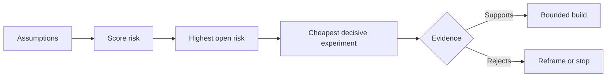

# خريطة افتراضات وحل الأكثر خطورة واحد أولا

> خريطة طريق تخفي عدم اليقين داخل الميزات خريطة افتراضات تكشف ما يجب أن يكون صحيحا قبل أن تستحق تلك الميزات وجودها.

> **【中文解读】**路线图把不确定性藏在一个"功能"里;假设地图则把"这些功能值得存在的前提"放在桌面上. 本课是代理工程方法论系列 (Phase 14 · 43-54) 里承承起下一环: 第48课发现人们实际执行工作流, 本课把"这件事值得做"本身分解成一组可证的假设,根据影响,不确定性,不可逆性三维排行风险,然后先确定最不便宜,最能活的实验,然后先做最令人兴奋的功能.

>  **【前置】**學本课前 請先掌握:Phase 14 第 48 课 (((((((((((((((((((((((((((((((((((((((((((((((((((((((((((((((((((((((((((((((((((((((((((((((((((((((((((((((((((((((((((((((((((((((((((((((((((((((((((((((((((((((((((((((((((((((((((((((((((((((((((((((((((((((((((((((((((((((((((((((((((((((((((((((((((((((((((((((((((((((((((((((((((((((((((((((((((((((((((((((((((((((((((((((((((((((((((((((((((((((((((((((((((((((((((((((((((((((((((((((((((((((((((((((((((((((((((((((((((((((((((((((((((((((((((((((((((((((((((((((((((((((((((`outputs/assumption-map.json`في الدراسة 50 يتم اختيار "يمكن أن تنتج أقصر قطع من الأدلة القرارية"

**Type:** Learn + Build | **类型:** 学习 + 动手实践
**Languages:** Python (stdlib) | **语言:** Python（标准库）
**Prerequisites:** Phase 14 lesson 48 | **前置知识:** Phase 14 第 48 课
**Time:** ~65 minutes | **时间:** 约 65 分钟

## أهداف التعلم

- تحويل العمل المقترح إلى افتراضات صريحة.
  ترجمة: تغيير عمل التشاور إلى افتراضات واضحة
- تأثير النتيجة، وعدم اليقين، وعدم العودة بشكل منفصل.
  ترجمة: تفرق على التأثيرات واللامتأكدات والعكس
- اختر التجربة التالية من خلال المخاطر، وليس الحماس.
  中文翻译: حسب风险 وليس حرارة لتختار التجربة التالية
- استبدل الافتراضات التي تم اختبارها بالدليل والقرارات.
  ترجمة باللغة الصينية: باستخدام أدلة وقرارات بدلا من فرضية المحققة.

## كل بناء يحتوي على رهانات

أداة الحوادث قد تعتمد على أن كل هذه هي صحيحة:

> أداة معالجة الحوادث قد تعتمد على كل من هذه القواعد:

- يحتوي سياق الإنذار على معلومات كافية لتحديد خدمة؛
  ترجمة: المعلومات المحتوية على خدمات التعرف على المعلومات المحتوية على المعلومات المحتوية على المعلومات المحتوية على المعلومات المحتوية على المعلومات المحتوية على المعلومات المحتوية على المعلومات المحتوية على المعلومات المحتوية على المعلومات المحتوية على المعلومات المحتوية على المعلومات المحتوية على المعلومات المحتوية على المعلومات المحتوية على المعلومات المحتوية على المعلومات المحتوية على المعلومات المحتوية على المعلومات المحتوية على المعلومات المحتوية على المعلومات المحتوية على المعلومات المحتوية على المعلومات المحتوية على المعلومات المحتوية.
- المهندسون يثقون في توصية لم يستخرجوها بأنفسهم
  中文翻译: المهندس会信任一条 ليس نصيحة من نفسه
- وقت الاستجابة المرغوب فيه مهم من الناحية العملية.
  中文翻译: توقعات الرد على الوقت في النقل مهمة حقاً
- يمكن الوصول إلى البيانات المطلوبة دون وجود سلطة غير آمنة.
  中文翻译: مطلوبة البيانات بدون حاجة لخطر
- وتحدث سير العمل في كثير من الأحيان بما يكفي لتبرير الصيانة.
  ترجمة: هذا العمل يحدث بشكل متكرر بما فيه الكفاية، يستحق الحفاظ على المدى الطويل.

هذه ليست مهام تنفيذ، بل هي الشروط ليكون البناء قيمًا ويمكن استخدامه ويمكن عمله وآمنًا.

> هذه ليست مهمة تنفيذية، بل هي شرطات تتمثل في بناء "قيمة، قابلة للاستخدام، قابلة للقيام بالأمن".

> **【中文解读】**كل سطر من قائمة الوظائف يضغط على عدة ملاحظات خفية: هل سيتم استخدام المستخدم؟ هل سيتم الحصول على البيانات؟ هل يمكن للمنظمة أن تستمر؟

## فصول افتراضية

| Class | Question |
|---|---|
| Value | Will the outcome matter enough? |
| Usability | Can the user understand and act on it? |
| Feasibility | Can the system produce it with available data and constraints? |
| Viability | Can the organization sustain cost, ownership, and operation? |
| Safety | Can it fail without unacceptable consequence? |

> **【中文解读】**五类假设各问一个问题:价值 (¿结果足够重要吗) 可用性 (¿用户看懂并能根据此行动吗) 可用性 (¿可用性) 可用性 (¿可用性) 可用性 (¿可用性) 可用性 (¿可用性) 可用性 (¿可用性) 可用性 (¿可用性) 可用性 (¿可用性) 可用性 (¿可用性) 可用性 (¿可用性) 可用性 (¿可用性) 可用性 (¿可用性) 可用性 (¿可用性) 可用性 (¿可用性) 可用性 (¿可用性) 可用性 (¿可用性) 可用性 (¿可用性) 可用性 (¿可用性) 可用性 (¿可用性) 可用性 (¿可用性) 可用性 (¿可用性) 可用性 (¿可用性) 可用性)                                                                                                                      

اكتب الافتراضات كبيانات قابلة للتصديق. الخصة مفيدة لا يمكن اختبارها. ثمانية من كل 10 مهندسين على المكالمة يحددون الخدمة الصحيحة بشكل أسرع باستخدام النتيجة القراءة فقط يمكن.

> وضع فرضية في بيانات مزيفة. "هذا الميزة مفيدة" لا يمكن اختبارها. "ثمانية من بين المهندسين العشرة المثاليين يمكنهم فقط قراءة النتائج بشكل أسرع لتحديد الوصول إلى الخدمة الصحيحة".

## الخطر ليس رقم واحد

المختبر يستخدم ثلاثة أبعاد من واحد إلى خمسة:

>  تجربة كود باستخدام ثلاثة 1 إلى 5 من الامتدادات:

- **Impact:**الضرر إذا كان الافتراض خاطئ.
  中文翻译:**影响：**افترض خسارة في الوقت المختلف
- **Uncertainty:**ضعف الأدلة الحالية
  中文翻译:**不确定性：**هناك أدلة على وجود ضعف كبير
- **Irreversibility:**تكلفة التعلم بعد الالتزام.
  中文翻译:**不可逆性：**押上承诺后再学习的代价──

النتيجة المثالية تضاعف التأثير وعدم اليقين، ثم تضيف عدم العودة. الصيغة ليست عالمية. غرضها هو إجبار الفريق على تحديد لماذا يجب حل مجهول واحد قبل الآخر.

> مثال: تعريف يؤثر على عدم اليقين، وإضافة إلى عدم الرد. هذه الصيغة ليست عامة، ويهدف إلى جعل الفريق يوضح: لماذا يجب حل هذا المشروع المجهول قبل ذلك المشروع المجهول.

>  **【类比】**假设排雷像拆迁前的房屋检查: 每面墙(假设) 分别量三已塌多大面积(影响) 结构判断有多拿不准(不确定性) 错了还能不能回去(不可逆性) 首处理"崩了最疼 + 最拿不准 + 不回去"那面墙,而不是最好那面──



> **【中文解读】**هذا التخطيط هو محرك هذا الدراسة: افتراض → 打风险分 → 找到风险最高且仍开放的假设 → 为它设计最便宜的决定性实验 → 证据要么支持(进入有边界的建设),要么反对(重建问题或直接停止) 注意两个出口都不叫"继续按照原计划做" 实验的意义就是让失败发生在一个便宜的地方

## تصميم تجربة، وليس طقوس التأكيد

الاختبار المفيد له:

> إختبار مفيد:

- ادعاء يمكن أن يكون خاطئاً
  中文翻译: تصريح محتمل
- مجموعة من السكان أو عينات واقعية
  中文翻译: إما حقيقة أو نموذج حقيقي
- نتيجة قابل للملاحظة
  中文翻译: نتيجة قابل الملاحظة
- حد حد حدد قبل النتيجة
  中文翻译: 值  值  值  值  值  值  值  值  值  值  值  值  值  值  值  值  值  值  值  值  值  值  值  值  值  值  值  值  值  值  值  值  值  值  值  值  值  值  值  值  值  值  值  值  值  值  值  值  值  值  值  值  值  值  值  值  值  值  值  值  值  值  值  值  值  值  值  值   值  值  值  值  值   值  值   值  值   值   值 值   值    值                                                                                  
- القرار التالي للجازة والفشل والدليل الغامض
  ترجمة: للمرور  失败和模糊证据分别准备好 下一步决策

تجنب الاختبارات التي تظهر فقط أن الفريق يمكن أن تبني الفكرة.

> تجنب تلك الاختبارات التي تثبت فقط أن الفريق يستطيع فعل هذا

> **【中文解读】**"طقوس التأكيد" تعني تلك الادعاءات التي لا يهم كيفية النتيجة ستواصل القيام بهامثليات نجحت على الخط، فشلت في إعادة التأهيل. التجربة الحقيقية لديها ثلاثة علامات صعبة: الادعاءات قد تكون مزيفة التي تكون محددة قبل النتيجة. كل نوع من الأدلة تتعامل مع خطوة مختلفة.

## التحول يغير النظام

الخيارات ذات التنافسية العالية والغير قابلة للعودة تحتاج إلى أدلة سابقة. يمكن أن يسبق إعادة تشغيل القراءة فقط إدماج الإنتاج. يمكن أن يسبق جهاز تعديل مؤقت هجرة البيانات. يمكن أن يسبق توصية مصرح بها الإنسان إجراءً تلقائيًا.

> ويتطلب الاختيار الكبير واللاعكسية نتائجًا سابقة. يمكن أن يذهب إلى الإنتاج قبل التكامل. يمكن أن يذهب إلى المعدات المؤقتة قبل نقل البيانات. يمكن أن يذهب إلى التوصية الاصطناعية قبل تنفيذها تلقائيًا.

يجب أن يتبع شكل البناء شكل عدم اليقين.

> يجب أن يتوافق شكل البناء على شكل غير مؤكد.

> **【中文解读】**مبدأ الترتيب واحد فقط: كلما كان من الصعب الرد على القرار، كلما كان من الصعب الحصول على دليل على أشكال بديلة رخيصة.

## بناء ذلك تحرك لتحقيق

المختبر يصنف الافتراضات، ويفرق بين الادعاءات المختبرة والفتوحة، ويختار أعلى مخاطر مفتوحة، ويكتب `outputs/assumption-map.json`. . .

> قانون التجربة يمنح الفرصة ترتيب ‬ التمييز بين المختبرين والتي لا تزال مفتوحة ‬ واختيار المخططات المفتوحة الأكثر خطورة، وكتب ‬`outputs/assumption-map.json`.

```bash
python3 code/main.py
python3 -m unittest discover code/tests -v
```

تغيير الأدلة على افتراض المخاطر العالية وملاحظة كيف تتغير التجربة التالية.

> 修改风险最高那条假设的证据 字段,观察"下一个实验" كيف تتغير مع ذلك

> **【中文解读】** `risk_score = impact * uncertainty + irreversibility`هو قصداً بسيطة الحسابات  لا يعني وجودها على وجه التحديد ، بل أن تحويل "الاول من التجربة" إلى مشكلة واضحة قابلة للجدل ‬‬‬‬‬‬‬‬‬‬‬‬‬‬‬‬‬‬‬‬‬‬‬‬‬‬‬‬‬‬‬‬‬‬‬‬‬‬‬‬‬‬‬‬‬‬‬‬‬‬‬‬‬‬‬‬‬‬‬‬‬‬‬‬‬‬‬‬‬‬‬‬‬‬‬‬‬‬‬‬‬‬‬‬‬‬‬‬‬‬‬‬‬‬‬‬‬‬‬‬‬‬‬‬‬‬‬‬‬‬‬‬‬‬‬‬‬‬‬‬‬‬‬‬‬‬‬‬‬‬‬‬‬‬‬‬‬‬‬‬‬‬‬‬‬‬‬‬‬‬‬‬‬‬‬‬‬‬‬‬‬‬‬‬‬‬‬‬‬‬‬‬‬‬‬‬‬‬‬‬‬‬‬‬‬‬‬‬‬‬‬‬‬‬‬‬‬‬‬‬‬‬‬‬‬‬‬‬‬‬‬‬‬‬‬‬‬‬‬‬‬‬‬‬‬‬‬‬‬‬‬‬‬‬‬‬‬‬‬‬‬‬‬‬‬‬‬‬‬‬‬‬‬‬‬‬‬‬‬‬‬‬‬‬‬‬‬‬‬‬‬‬‬‬‬‬‬‬‬‬‬‬‬‬‬‬‬‬‬‬‬‬‬‬‬‬‬‬‬‬‬‬‬‬‬‬‬‬‬‬‬‬‬‬‬‬‬‬‬‬‬‬‬‬‬‬‬‬‬‬‬‬‬‬‬‬‬‬‬‬‬‬‬‬‬‬‬‬‬‬‬‬‬‬‬‬‬‬‬‬‬‬‬‬‬‬‬‬‬‬‬‬‬‬‬‬‬‬‬‬‬‬‬‬‬‬‬‬‬‬‬‬‬‬‬‬‬‬‬‬‬‬‬‬‬‬‬‬‬‬‬‬‬‬‬‬‬‬‬‬‬‬‬‬‬‬‬‬‬‬‬‬‬‬‬‬‬‬‬‬‬‬‬‬‬‬‬‬‬‬‬‬‬‬‬‬‬‬‬‬‬‬‬‬‬‬‬

## التمرينات التمرينات

1. اكتب خمسة افتراضات لشخصية تريد بناؤها
   中文翻译:为你想做某功能写下五条假设──
2. أضف افتراض سلامة واحد لم يتم حذف قائمة الميزات الخاصة بك.
   ترجمة: إضافة إلى "مصطلحات الأمان"
3. حدد عتبة ستجعلك تتوقف عن البناء
   ترجمة: تعريف واحد سوف تجعلك توقف هذا البناء 值.
4. استبدل تجربة كبيرة باختبار أكثر رخيصا حاسما.
   ترجمة: تغيير تجربة كبيرة إلى تجربة أرخص ولكن أيضاً تحديداً
5. مقارنة تصنيف المخاطر مع أولوية خريطة الطريق وشرح عدم التطابق.
   中文翻译:对比风险排序与路线图优先级,并解释两者的错位──

## المزيد من القراءة

- [Barry Boehm, A Spiral Model of Software Development and Enhancement](https://dl.acm.org/doi/10.1145/12944.12948)، لدورة تطوير مدفوعة بالمخاطر التي تحل عدم اليقين قبل التزام أعمق.
  اللغة الصينية ترجمة:Boehm螺旋模型风险驱动的发展循环:在更深的承诺之前先解决不确定性──
- [Dardenne, van Lamsweerde, and Fickas, Goal-Directed Requirements Acquisition](https://doi.org/10.1016/0167-6423(93)90021-G) ، لتحسين الأهداف مع إلقاء العقبات والقيود على السطح.
  ترجمة: داردنة 等 احتياجات توجيه الهدف الحصول في تحديد الهدف في الوقت نفسه

## ما تبقيه ، ما تبقيه

إبق`outputs/assumption-map.json`الدرس التالي يستخدمها للاختيار أصغر قطعة يمكن أن تنتج أدلة حاسمة.

> حافظ`outputs/assumption-map.json`: الدروس التالية ستستخدمها لتحديد أقصر قطع من الأدلة القصوى
