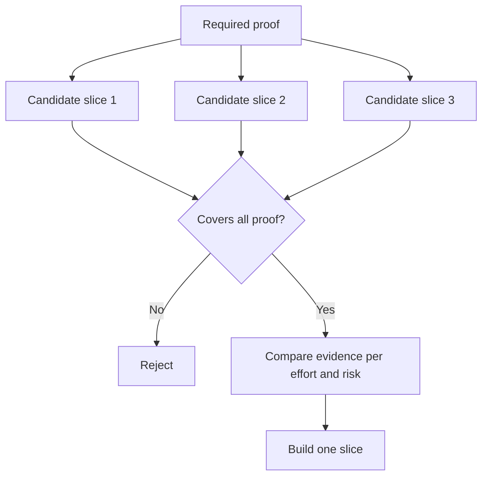

# اختر أصغر قطعة يمكن أن تغير القرار

> الصغر مفيد فقط عندما يثبت شيئاً مهماً. إنّه صغيراً لا يمكن أن يغير القرار التالي غير مكتمل.

> **【中文解读】**"قيام صغيرا" فقط في القدرة على إثبات أن هناك أشياء مهمة فقط تكون ذات قيمة لا تغيير في التشكيل الصغرى للقرار التالي، وليس أقل قطع ممكنة، مجرد عدم الانتهاء.

>  **【前置】**學本课前 請先掌握:Phase 14 第 49 课 (映射假设与风险本课的"必需证明集"直接来自那里风险最高的开放假设)`outputs/slice-decision.json`سوف تصبح مدخلة في المادة 51

**Type:** Learn + Build | **类型:** 学习 + 动手实践
**Languages:** Python (stdlib) | **语言:** Python（标准库）
**Prerequisites:** Phase 14 lesson 49 | **前置知识:** Phase 14 第 49 课
**Time:** ~65 minutes | **时间:** 约 65 分钟

## أهداف التعلم

- تعريف قطعة من الافتراضات التي تثبت.
  中文翻译:用"切片能证明哪些假设"来定义切片──
- توازن قيمة النتيجة، وتقليل عدم اليقين، والجهد، والنتيجة.
  中文翻译: في النتائج قيمة عدم اليقينة消减投入和后果之间做权衡.
- تفضل الأدلة العكسية على التزام الإنتاج المبكر
  ترجمة: الاختيار الأولوي للدليل العكسي، وليس الالتزام بالدرجة المبكرة للإنتاج.
- رفض الشرائح التي تفرغ الجزء المخاطر من سير العمل.
  中文翻译: رفض تلك الصفحات التي تحيط بالعمل

## الإثبات الإستقليمي يعني نهاية إلى نهاية

يختلف قطعة مفيدة من الحد الأدنى من التدفق الحقيقي اللازم لملاحظة النتيجة. يمكن أن تكون ضيقة في المستخدمين والبيانات والمدة والقدرة. يجب ألا تكون ضيقة عن طريق إزالة عدم اليقين الدقيق الذي تحتاج إلى الاختبار.

> يمكن أن تكون شريحة مفيدة على طول "يمكن مراقبة نتيجة" من الحد الأدنى من عمليات حقيقية اللازمة. يمكن أن تكون ضيقة على مستخدماتها، البيانات، الوقت، القدرة، ولكن لا يمكن أن تكون ضيقة من خلال قطع "اللامتأكد الذي كنت تريد اختبار" لتضيقها.

أمثلة:

> مثال:

- إعادة تشغيل القراءة فقط عبر عشرة حوادث حقيقية تختبر تحديد خدمة و ثقة المشغل.
  ترجمة باللغة الصينية:跨十次真实事故的只读回放,能检验服务识别和操作者信任──
- لوحة التحكم الملموسة على البيانات الاصطناعية قد تختبر فهمها ولكن لا يمكن تحقيق جدوى البيانات.
  ترجمة: الصينية: أجهزة التحكم المعدنية المعدنية المعدنية المعدنية المعدنية المعدنية المعدنية المعدنية المعدنية المعدنية المعدنية المعدنية المعدنية المعدنية المعدنية المعدنية المعدنية المعدنية المعدنية المعدنية المعدنية المعدنية المعدنية المعدنية المعدنية المعدنية المعدنية المعدنية المعدنية المعدنية المعدنية المعدنية المعدنية المعدنية المعدنية المعدنية المعدنية المعدنية المعدنية المعدنية المعدنية المعدنية المعدنية المعدنية المعدنية المعدنية المعدنية المعدنية المعدنية المعدنية المعدنية المعدنية المعدنية المعدنية المعدنية المعدنية المعدنية المعدنية المعدنية المعدنية المعدنية المعدنية المعدنية المعدنية المعدنية المعدنية المعدنية المعدنية المعدنية المعدنية المعدنية المعدنية المعدنية المعدنية المعدنية المعدنية المعدنية المعدنية المعدنية المعدنية المعدنية المعدنية المعدنية المعدنية المعدنية المعدنية المعدنية المعدنية المعدنية المعدنية المعدنية المعدنية المعدنية.
- جهاز تصنيع التحكم الذاتي يختبر كل شيء في وقت واحد مع عواقب غير مقبولة.
  ترجمة: إعادة تلقائية لبيئة الإنتاج مرة واحدة اختبر كل شيء، ولكن النتائج لا يمكن قبولها.

> **【中文解读】**"طول" يعني من النهاية إلى النهاية打通真工作流:输入是真的、决策路径是真的、能观察结果──狭窄的方向只能是范围 ((كم عدد الأشخاص、كم عدد البيانات、多长时间)) ، لا يمكن أن يكون عمق ((把最难那一步抽掉))  ثانيا, ثلاثة أمثلة هي اثنين من النماذج النموذجية:

>  **【类比】**في الواقع، لا يوجد سوى نوع من المياه، ولكن يجب أن يكون هناك كهرباء حقيقية. إذا كان الشكل غير متواجد في المياه، فإنه لا يثبت دائما أن "العيش ينزل"

## تعريف الإثبات المطلوب أولاً تعريف الإثبات الضروري أولاً

خذ الافتراضات المفتوحة ذات المخاطر العالية وتحويلها إلى مجموعة دليل مطلوبة.

> 取出风险最高的开放假设,把它们变成一个"必需证明集"── 候选片只覆盖这个集,才有评价资格──

ثم مقارنة الشرائح الملائمة على:

> ثم مقارنة بين قطع مؤهلة:

| Dimension | Direction |
|---|---|
| Outcome value | More is better |
| Uncertainty reduced | More is better |
| Effort | Less is better |
| Consequence | Less is better |
| Reversibility | More is better |

نتيجة المختبر بسيطة عمداً، بوابة الإهتمام مهمة أكثر من الرياضيات.

> 实验代码的评分故意简单――资格门比算术更重要――



> **【中文解读】**هذا التسلسل هو جوهر هذا الدراسة: المهارات (المناسبة) في الأمام، والقياسات الحسابية في الخلف.

## الحد الأدنى الكاذب المشترك

- **The UI-only minimum:**يزيل البيانات وعدم اليقين التشغيلي.
  中文翻译:**只有 UI 的最小：**تخلص من عدم اليقين في مستوى البيانات والتنفيذ
- **The infrastructure-only minimum:**يثبت إمكانية تقنية دون قيمة للمستخدم.
  中文翻译:**只有基础设施的最小：**تثبت أن هذا هو ما تم فعله على نحو تقني، ولكن لا يثبت قيمة المستخدم.
- **The happy-path minimum:**يفرغ الاستثناء الذي يخلق أكبر مخاطر.
  中文翻译:**只有正常路径的最小：**لقد فقدت أغلب المخاطر التي تتعلق بالصنع
- **The demo minimum:**يُنتجُ عبارةً عن عبارةٍ مقنعةٍ لكن لا يوجد قياسٍ قابلٍ للتكرار.
  中文翻译:**演示级最小：**أُنتجت عروض مقنعة، لكن لا يوجد قياس قابل للرد
- **The platform minimum:**يُبني آلة قابلة لإعادة الاستخدام قبل أن يكسبها أحد عمليات العمل.
  中文翻译:**平台级最小：**قبل أن تكون أي عمل من أشكال التثبيت قيمة، قم بإنشاء الآلات القابلة للاستعادة.

> **【中文解读】**五种假最小的各有各种诱惑:UI 最小出图快, 基础设施最小对工程师胃口,演示最小最能动动领导──它们的共同点是系统地绕开真正风险而"最小"的意思恰恰是让风险早点暴露──自我检查方法只有一个:

## إضافة قاعدة توقف

قبل تنفيذها، اكتب ما يحدث إذا فشل الشريحة:

> قبل أن تتحقق من الحركة، اكتب أولاً "قطعة فشلت كيف ستنجح":

- التخلي عن النتيجة
  中文翻译:放弃这个结果 ((整个方向止损);
- تغيير المستخدم المستهدف أو الوضع؛
  中文翻译:更换目标用户或使用场景;
- اختبار آلية مختلفة
  中文翻译:换一种机制再测;
- جمع أدلة أفضل؛
  中文翻译: أولا جمع أفضل شهادات ؛
- تقييد السلطة أكثر
  中文翻译:把授权收得更狭──

إذا كانت كل النتيجة تؤدي إلى بناء، فإن القسم ليس تجربة.

> إذا كانت كل النتائج تتجه نحو "استمر في القيام بها" ، فإن هذه القطعة ليست تجربة.

> **【中文解读】**停止规则是实验的"诚实检查": كل النتيجة هي قطعة من "واصل البناء" ، مجرد ارتداء خطة قائمة في الخارج التجربة.

## بناء ذلك تحرك لتحقيق

المختبر يصف المرشحين بالدليل المطلوب، ويحدد الشرائح المؤهلة، ويكتب `outputs/slice-decision.json`. . .

>  تجربة كود حسب الضروري إثبات  المرشح  اعطاء المههلين قطع  , وكتب `outputs/slice-decision.json`.

```bash
python3 code/main.py
python3 -m unittest discover code/tests -v
```

إضافة مرشح أرخص يثبت افتراض واحد فقط، يجب أن يبقى غير مؤهل حتى لو كانت درجة الرقمية مرتفعة.

> إضافة إلى إثبات فرضية ضرورية، ولكن مرشحات أرخص. حتى لو كانت درجة العددية عالية، يجب أن لا تزال غير مؤهلة للمشاركة.

> **【中文解读】** `score = (结果价值 + 不确定性消减) / (投入 + 后果 × 不可逆系数)`مجرد أداة ترتيب ، الحراس الحقيقيون هم مجموعة تتضمن المراقبة`required_proof <= set(item.proves)` تجربة تدمير بعد الصف تحقيقتها: مرشح رخيص ولكن لا يشمل كل الإثباتات الضرورية، والقياسات مرتفعة جداً لا تدخل في حفرة المرشحين

## التمرينات التمرينات

1. صمم ثلاث شرائح لنفس النتيجة على مستويات مختلفة من النتائج.
   ترجمة: لـ نفس النتيجة تصميم ثلاث قطع مختلفة من الدرجات الاخيرة.
2. أوضح الدليل المطلوب قبل تسجيل الرقم
   中文翻译: 在打分之前先写下必备证明集──
3. إزالة قدرة واحدة مع الحفاظ على الأدلة الحاسمة.
   中文翻译: قطع掉一项能力,同时保住决定性的证据──
4. إضافة قاعدة توقف للطيار الفاشل.
   中文翻译:为一次失败的试点补一条停止规则。
5. تحديد مكون المنصة القابلة لإعادة الاستخدام الذي يجب أن ينتظر حتى بعد القسم.
   中文翻译:指出一个应等切片后再做可复用平台组件──

## المزيد من القراءة

- [Barry Boehm, A Spiral Model of Software Development and Enhancement](https://dl.acm.org/doi/10.1145/12944.12948)، لتطابق كل دورة تطوير مع المخاطر التي يجب أن تحل.
  ترجمة باللغة الصينية: نموذج المزاج المتحرك يسمح لكل دورة من دورات التطوير للتعامل مع المشكلة التي يجب أن يتم حلها.
- [Lenarduzzi and Taibi, MVP Explained: A Systematic Mapping Study on the Definitions of Minimal Viable Product](https://arxiv.org/abs/1609.07592)، لغموض حول أقل ويمكن الاستفادة من في ممارسة منتجات البرمجيات.
  中文翻译:ليناردوزي مع تايبيMVP 解析软件产品实践中"最小" و"可行"两个词的歧义理──

## ما تبقيه ، ما تبقيه

إبق`outputs/slice-decision.json`إنه يسجل لماذا هذه الجزءة هي أصغر جزء يمكن أن يغير القرار

> حافظ`outputs/slice-decision.json`"تُسجل لماذا هذه القطعة هي" "أقل قطعة من القرارات التي يمكن أن تغيرها"
