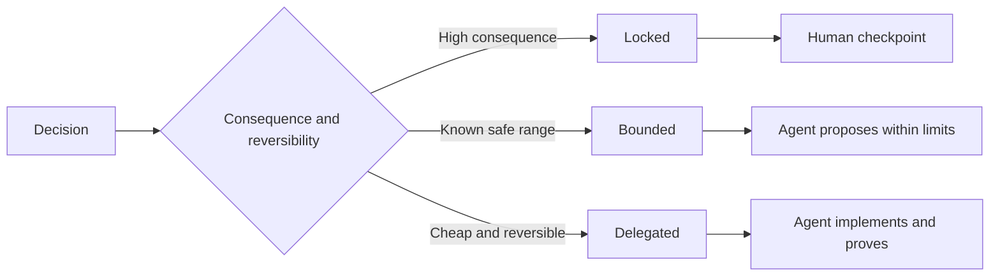

# اكتبوا مواصفات تحافظ على الحكم

> تصلح المواصفات المفيدة الثنائيات والأدلة مع ترك خيارات التنفيذ المراجعة مفتوحة. إنها حدود القرار ، وليس سيناريو.

> **【中文解读】**إعادة تحديد المواصفات الجيدة "لا تغيرات ومثبات" ، وتبقي إعادة التنفيذ المتحرك للقيام بها على حدة القرار ، وليس كتاباً.

>  **【前置】**دراسة دراسية قبل دراسة دراسة دراسية دراسية دراسية دراسية دراسية دراسية دراسية دراسية دراسية دراسية دراسية دراسية دراسية دراسية دراسية دراسية دراسية دراسية دراسية دراسية دراسية دراسية دراسية دراسية دراسية دراسية دراسية دراسية دراسية دراسية دراسية دراسية دراسية دراسية دراسية دراسية دراسية دراسية دراسية دراسية دراسية دراسية دراسية دراسية دراسية دراسية دراسية دراسية دراسية دراسية دراسية دراسية دراسية دراسية دراسية دراسية دراسية دراسية دراسية دراسية دراسية دراسية دراسية دراسية دراسية دراسية دراسية دراسية دراسية دراسية دراسية دراسية دراسية دراسية دراسية دراسية دراسية دراسية دراسية دراسية دراسية دراسية دراسية دراسية دراسية دراسية دراسية دراسية دراسية دراسية دراسية دراسية دراسية دراسية دراسية دراسية دراسية دراسية دراسية دراسية دراسية دراسية دراسية دراسية دراسية دراسية دراسية دراسية دراسية دراسية دراسية دراسية دراسية دراسية دراسية دراسية دراسية دراسية دراسية دراسية دراسية دراسية دراسية دراسية دراسية دراسية دراسية دراسية دراسية دراسية دراسية دراسية دراسية دراسية دراسية دراسية دراسية دراسية دراسية دراسية دراسية دراسية دراسية دراسية دراسية دراسية دراسية دراسية دراسية دراسية دراسية دراسية دراسية دراسية دراسية دراسية دراسية دراسية دراسية دراسية دراسية دراسية دراسية دراسية دراسية دراس`outputs/executable-specification.json`هو وكيل المعدات و اتفاقية مشاركة في مراجعة البشر

**Type:** Learn + Build | **类型:** 学习 + 动手实践
**Languages:** Python (stdlib) | **语言:** Python（标准库）
**Prerequisites:** Phase 14 lesson 50 | **前置知识:** Phase 14 第 50 课
**Time:** ~75 minutes | **时间:** 约 75 分钟

## أهداف التعلم

- النتيجة المفصلة، والغيرات المتغيرة، والمثلة، غير الأهداف، والدليل.
  中文翻译:区分结果、不变量、示例、非目标和证明──
- علامة القرارات كحصيلة أو محدودة أو تم تفويضها.
  ترجمة:把每个决定标注为锁定、受限或委托──
- الحفاظ على حكم العميل حيث الخيارات رخيصة و قابل للتعديل.
  中文翻译: في اختيار رخيصة ويمكن العكس مكان الاحتفاظ بقوة الوكيل في الحكم.
- تطلب نقاط تفتيش بشرية حيث تغيرت النتائج أو السلوك العام
  ترجمة باللغة الصينية: نقطة التفتيش الاصطناعي القسري في أماكن تغيرات كبيرة أو عامة في السلوك.

## اثنان من أشد السيئين

مهمة أقل تحديداً تطلب من وكيل تخمين النظام. مهمة أكثر تحديداً تطلب منه نقل تصميم قد يكون خاطئاً بالفعل.

> 规格不足任务让代理去猜系统;规格过度任务让它抄袭一个可能就错的设计.

الوسيط المفيد هو عقد يمكن تنفيذه:

> النموذج المتوسط المفيد هو عقد يمكن تنفيذه:

| Surface | Purpose |
|---|---|
| Outcome | The observable result |
| Invariants | Conditions that must always remain true |
| Examples | Concrete cases that reveal intent |
| Non-goals | Adjacent behavior intentionally excluded |
| Decision policy | Which choices are locked, bounded, or delegated |
| Proof | Evidence required before completion |

> **【中文解读】**两个极端对应两种浪费:规格不足浪费在返工上(وكيل 猜错了重做),规格过度浪费在翻译上(人把设计写成伪代码,Agent 再转抄成代码,中间没有增量智能) 六面契约是中间路:结果说清"要什么"、不变量说清"任何时候不能破坏什么"、示例传递意图、非目标划边界、决策政策声明授权、证明定义"完成" 六面契约是中间路:结果说清"要什么"、不变量说清"任何时候不能破坏什么"、示例传递意图、非目标划边界、决策政策声明授权、证明定义"完成" 六面契约是中间路:结果说清"什么要"、不变量说清"任何时候不能破坏什么"",示例传递意图、非目标划边界、决策政策声明授权、证明定义"完成" 证明定义"完成  每个方面都给执行留下了判断空间──

## ثلاثة أساليب القرار

- **Locked:**لا يجب على الوكيل أن يختار. الاستخدام لموافقة العامة، السلطة، السلامة، التكلفة غير المعادلة، أو التزام المنتج.
  中文翻译:**锁定（Locked）：**الوكيل لا يجب أن يختار نفسه. للاستخدام في التوافق العام والحكم والسلامة والتكلفة غير المعادلة أو التزامات المنتج.
- **Bounded:**يمكن للعميل اختيار داخل حدود صريحة. استخدام ل ميزانيات البحث، أعداد محاولة إعادة، والاعتمادات المسموح بها، أو عائلة واجهة معروفة.
  中文翻译:**受限（Bounded）：**يمكن للعميل اختيار ضمن حدود محددة. لبحث الميزانية.
- **Delegated:**الوكيل يمتلك الخيار ويجب أن يشرحه. الاستخدام للهيكل المحلي، والأسماء، والعكسية العوامل، وتفاصيل التنفيذ.
  中文翻译:**委托（Delegated）：**الوكيل لديه هذا الخيار، ولكن يجب أن يكون قادر على تفسيره.



> **【中文解读】**ثلاث أنماط من المعايير التقسيمية هناك مشكلة واحدة فقط:后果与可逆性.后果大、不可逆 → 锁定并设人工检查点.后果可控但有安全范围.受限,Agent 在界内自由.便宜且可逆 → 委托.Agent 自己定定但要解释.

>  **【类比】**ثلاثة أنواع من النماذج القرارية مثل ثلاثة أنواع من العقود في عقد التجهيز: تحمل الثقل والكهرباء المفتوحة إلى الموت ؛ قفل خطأ في الخروج من الحياة ؛ ميزانية محددة ‬‬المنطقة المحدودة ‬المنطقة المأمنة ‬المنطقة المحدودة ‬المنطقة المأمنة ‬المنطقة الداخلية كيف يضع العاملون في المراقبة ‬المنصب便宜可逆‬‬‬‬‬مكتبة المفتوحة ‬‬المكتبة المفتوحة ‬‬‬‬المكتبة المفتوحة ‬‬‬هو تقرير الحادث‬‬‬‬‬‬‬‬‬‬‬‬‬‬‬‬‬‬‬‬‬‬‬‬‬‬‬‬‬‬‬‬‬‬‬‬‬‬‬‬‬‬‬‬‬‬‬‬‬‬‬‬‬‬‬‬‬‬‬‬‬‬‬‬‬‬‬‬‬‬‬‬‬‬‬‬‬‬‬‬‬‬‬‬‬‬‬‬‬‬‬‬‬‬‬‬‬‬‬‬‬‬‬‬‬‬‬‬‬‬‬‬‬‬‬‬‬‬‬‬‬‬‬‬‬‬‬‬‬‬‬‬‬‬‬‬‬‬‬‬‬‬‬‬‬‬‬‬‬‬‬‬‬‬‬‬‬‬‬‬‬‬‬‬‬‬‬‬‬‬‬‬‬‬‬‬‬‬‬‬‬‬‬‬‬‬‬‬‬‬‬‬‬‬‬‬‬‬‬‬‬‬‬‬‬‬‬‬‬‬‬‬‬‬‬‬‬‬‬‬‬‬‬‬‬‬‬‬‬‬‬‬‬‬‬‬‬‬‬‬‬‬‬‬‬‬‬‬‬‬‬‬‬‬‬‬‬‬‬‬‬‬‬‬‬‬‬‬‬‬‬‬‬‬‬‬‬‬‬‬‬‬‬‬‬‬‬‬‬‬‬‬‬‬‬‬‬‬‬‬‬‬‬‬‬‬‬‬‬‬‬‬‬‬‬‬‬‬‬‬‬‬‬‬‬‬‬‬‬‬‬‬‬‬‬‬‬‬‬‬‬‬‬‬‬‬‬

## تحديد السلوك من خلال الأمثلة

المثال يضغط النية بشكل أفضل من الصفات.  مفيد،  قوي، و جاهز للإنتاج غير قابل للتنفيذ. مجموعة صغيرة من الأمثلة الطبيعية والحافة والفشل والحظر يعطي كل من البناء والتحقق شيئاً ملموساً.

> مثال عن تصميمات تصميمات أكثر إمكانية للتمزيق. "مُساعدة" "مُمْكِنُ" "مُتَنْتَجِرُ" "مُتَنْتَجِرُ" لا يمكن تنفيذها. "مُثَلٌ ضئيلٌ من المُثَلِين المُغَطِّينَ المُعتادَات والحدود والفشل والمنع، يُعطى المُبني والموّجّدُ أَمْرًا مُحدَّدًا يمكن أن يَمْسِكَهُما كلاهما".

الأمثلة لا تحل محل الخيارات الثابتة. حالة واحدة لا يمكن أن تثبت قاعدة سلامة عالمية.

> مثال لا يمكن استبدال عدم التغيرات. مثال استعمال تمت مرارا دليل ليس قاعدة سلامة عادية.

> **【中文解读】**هذا الجزء يحل "形容词陷": كتابة ""输出要干净" = أي شيء لم يكتب، كتابة ""إعطاء إشعار مع ID التنفيذية يجب أن ينفذ المسؤول عن الخدمة"" فقط نقل النية.

## يجب أن يتماشى الدليل مع الادعاء يجب أن يتماشى الدليل مع القول

- اختبار الوحدة يثبت عقد وظيفة محلية
  中文翻译:单元测试证明局部函数契约。
- اختبار الأسلاك يثبت التسلسل وسلوك النقل
  中文翻译:线上(线) اختبار دليل تسلسل مع تصريحات النقل.
- رحلة المتصفح تثبت مسار الواجهة
  中文翻译:浏览器旅程证明一条界面路径。
- مجموعة إعادة التمثيل تثبت السلوك على الحالات الممثلة.
  中文翻译:回放集证明行为在代表性用例上的表现──
- سجل مراجعة يثبت أن حدود السلطة تمت.
  ترجمة: الاختبار الحصري

لا تقبل الطبقة السفلى كدليل على ادعاء عن الطبقة العليا.

> لا تقبلوا بثبات منخفضة لتدعم تصريحات منخفضة

> **【中文解读】**كل نوع من الأدلة لديه مجالها: عمل المراقبة، وبرنامج التجربة، وبرنامج التجربة، ومرحلة المراقب، وإعادة التسجيل، والتحقق من الاختبار.

## احفظ المجهولات عمداً

يمكن أن تقول المواصفات يمكن لتنفيذها اختيار أي مصدر يمكن قراءته فقط يعود في الميزانية الزمنية. هذا ليس غامضاً. إنه قرار تم تفويض عمداً مع حدود ودليل.

> يمكن أن يكتب "التحقق من أي مصدر بيانات يمكن أن يختارها في الميزانية الزمنية للعودة".

يجب أن تتطور المواصفات عندما تتغير الأدلة. الحفاظ على السبب وراء الخيارات المقفلة والحدودة حتى يتمكن فرق لاحقة من مراجعتها دون علم الآثار.

> 证据变化时规格也应演化── الحفاظ على الحبس والقيود والانتخابات وراء الأسباب، لم يكن الفريق اللاحق بحاجة إلى "القديمة" لتعديلها──

> **【中文解读】**الفرق بين "有意保留未知" و"没想清楚" هو الحدود والثبات: الأول كتب على سبيل المثال "选择空间 (((任何只读源) 约束 ((时间预算)) والقبض ((证明)) ، والآخر لا يكتب أي شيء.

## بناء ذلك تحرك لتحقيق

المختبر يصدق كل سطح عقد، يُفحص أنواع القرار، ويكتب`outputs/executable-specification.json`. . .

>  تجربة كود كود كود كود كود كود كود كود كود كود كود كود كود كود كود كود كود كود كود كود كود كود كود كود كود كود كود كود كود كود كود كود كود كود كود كود كود كود كود كود كود كود كود كود كود كود كود كود كود كود كود كود كود كود كود كود كود كود كود كود كود كود كود كود كود كود كود كود كود كود كود كود كود كود كود كود كود كود كود كود كود كود كود كود كود كود كود كود كود كود كود كود كود كود كود كود كود كود كود كود كود كود كود كود كود كود كود كود كود كود كود كود كود كود كود كود كود كود كود كود كود كود كود كود كود كود كود كود كود كود كود كود كود كود كود كود كود كود كود كود كود كود كود كود كود كود كود كود كود كود كود كود كود كود كود كود كود كود كود كود كود كود كود كود كود كود كود كود كود كود كود كود كود كود كود كود كود كود كود كود كود ك كود كود كود ك ك كود كود كود ك ك كود كود ك ك ك ك كود كود ك ك كود كود ك ك ك كود كود كود ك ك ك كود ك ك ك ك ك ك ك كود ك ك ك ك كود كود ك ك ك ك ك ك ك ك ك ك ك ك كود كود ك ك ك ك كود ك كود ك ك ك ك ك ك ك ك ك كود ك ك ك ك ك ك كود ك ك ك ك ك ك ك ك ك كود ك ك ك ك ك ك ك ك ك ك ك ك ك ك ك ك ك ك ك ك ك ك ك ك`outputs/executable-specification.json`.

```bash
python3 code/main.py
python3 -m unittest discover code/tests -v
```

نقل قرار كتابة الإنتاج من مقفل إلى تمنح. شرح لماذا النظام يقبل القيمة ولكن مخاطر المنتج لا.

> أن "إنتاج كتابة" هذه القرارات من مقفلة 改成委托── شرح لماذا النموذج البيانات(الخطة) قبول هذا القيمة، والنتج风险 لا يقبل──

> **【中文解读】**القواعد الثنائية للجهاز الاختبارية من المفيد أن يلاحظ: ستة قواعد لا غيابها لا غنى عنها، و أن النموذج غير المفوض يجب أن يكون له سبب "لا سبب للاغلاق" و"لا سبب للاغلاق" كل من المفروض أن يكون غير كامل.

## التمرينات التمرينات

1. حول تذكرة التخلف إلى السطحات الست المحددة.
   ترجمة:把一张后载 工单转写成六面的规格──
2. استبدل ثلاث تعليمات تنفيذية بمثابة متغير واحد ومثلتين.
   中文翻译:把三条实现命令替换成一条不变量加两个例子──
3. قم بتدوين كل قرار وتبرير كل خيار مقفل أو محدود
   ترجمة: أعطى كل قرار نموذج العلامة، و أعطى كل خيار مقفل أو مقيد سببها.
4. إضافة إيصال دليل لكل غير متغير
   ترجمة: للشخصية: للشخصية: للشخصية: للشخصية: للشخصية: للشخصية: للشخصية: للشخصية: للشخصية: للشخصية: للشخصية: للشخصية: للشخصية: للشخصية: للشخصية: للشخصية: للشخصية: للشخصية: للشخصية: للشخصية: للشخصية: للشخصية: للشخصية: للشخصية: للشخصية: للشخصية: للشخصية: للشخصية: للشخصية: للشخصية: للشخصية: للشخصية: للشخصية: للشخصية: للشخصية: للشخصية:
5. إزالة قيود لا توجد أدلة أو سبب للمخاطر.
   中文翻译: حذف掉一条既无证也无风险理由支的约束──

## المزيد من القراءة

- [Nuseibeh and Easterbrook, Requirements Engineering: A Roadmap](https://www.cs.toronto.edu/~sme/papers/2000/ICSE2000.pdf)، للعلاقة بين الأهداف، والتفاصيل الدقيقة، والتحقق من المصادقة، والاتفاق، والتطور.
  中文翻译:Nuseibeh و Easterbrook需求工程:路线图目标、精确规格、验证、共识与演化之间的关系──
- [Zave and Jackson, Four Dark Corners of Requirements Engineering](https://doi.org/10.1145/267895.267896)، لفرق الافتراضات والمتطلبات والتفاصيل البيئية.
  ترجمة باللغة الصينية: زيف مع جاكسون  حاجة انجراج  أربعة زوايا مظلمة  الفرق الظروف البيئية  حاجة ومواصفات 
- [Gotel and Finkelstein, An Analysis of the Requirements Traceability Problem](https://doi.org/10.1109/ICRE.1994.292398)، للحفاظ على سبب وجود متطلب ومن أين جاء
  中文翻译:جوتيل ومفينكلشتاين需求追溯性问题分析保留"需求为什么存在从哪里"

## ما تبقيه ، ما تبقيه

إبق`outputs/executable-specification.json`يصبح العقد الذي يتشارك فيه وكلاء التشفير والمراجعون البشريين

> حافظ`outputs/executable-specification.json`ستصبح وكالة ترميزية مع اتفاقية مشاركة في مراجعة البشر
