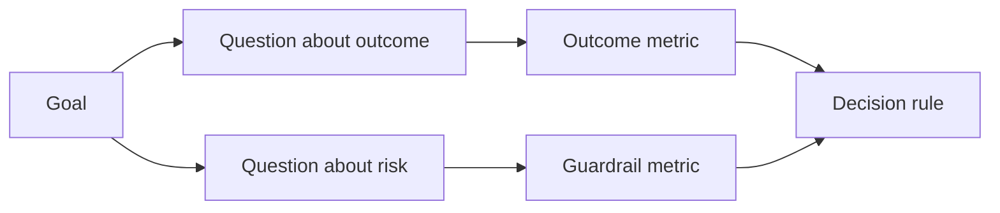

# تصميم مقاييس النجاح قبل وجود النتيجة

> يجب أن يُجيب القرار عن القياس وليس عن تزيين لوحة التحكم. ابدأ بالهدف، استنتاج الأسئلة، ثم اختر أصغر المقاييس التي تجيب عليها.

> **【中文解读】**يجب أن يُجيب على القرار، وليس على وضعها على لوح أداة.

>  **【前置】**دراسة دراسة قبل دراسة قبل دراسة قبل دراسة:مرحلة 14 第 47 课  成果先于产出本课的"目标"من هناك) و第 51 课  写保留判断力规则规格里的"证明"面在此展开成测量计划)`outputs/measurement-report.json`هو 53 课原型/试点/生产三档的证据门。

**Type:** Learn + Build | **类型:** 学习 + 动手实践
**Languages:** Python (stdlib) | **语言:** Python（标准库）
**Prerequisites:** Phase 14 lessons 47 and 51 | **前置知识:** Phase 14 第 47、51 课
**Time:** ~70 minutes | **时间:** 约 70 分钟

## أهداف التعلم

- استنتاج الأسئلة والمقاييس من هدف النتيجة.
  中文翻译:从结果目标推导出问题和标标――
- تحديد العدوان، النوافذ، المصادر، والاتجاهات قبل مراقبة النتائج.
  中文翻译: في الملاحظة نتائج قبل تحديد值、窗口、来源和方向。
- إزواج مقاييس النتيجة مع الحواجز والمقاييس المضادة.
  ترجمة باللغة الصينية: إعطاء نتائج مؤشر على
- تتناسب الدليل التقييم مع القرار الذي يجب أن يدعمه البناء.
  ترجمة: اجعل شهادة التقييم تتطابق مع قرارات البناء التي يجب أن تدعمها.

## الهدف، السؤال، المقياسات الأهداف، المشكلة، المؤشر

ابدأ بأهداف:

> من هدف:

> تقليل الوقت لتحديد الخدمة المتضررة دون زيادة الإجراءات غير الآمنة.
>
> في ظل عدم زيادة عدم الأمن في العمليات، تقليل الوقت اللازم للخدمات المتأثرة بالتحديد.

أسئلة مشتقة:

> 推导出问题:

- ما هو سرعة تحديد الخدمة الصحيحة؟
  ترجمة: هل تم تحديد الخدمة بشكل سريع؟
- كم مرة تكون الخدمة المحددة صحيحة؟
  ترجمة: كم من احتمالات وجود خدمة تحديد الموقع؟
- هل التشخيص يبقى قراءة فقط؟
  中文翻译: هل عملية التشخيص تظل فقط قراءة؟
- هل تدفق العمل يزيد من إبعاد التحذير أو عبء العمل للمشغل؟
  هل هذا التدفق العمل يزيد من معدل تجاهل الشرطة أو عبء المديرين؟

ثم اختر المقاييس التي تعمل على هذه الأسئلة.

> ثم اختر أن تكون قادرة على تحويل هذه المشاكل إلى مؤشر رقمي قابل للتقييم.



> **【中文解读】**توجيهات GQM لا يمكن العكس: هدف → 问题 → 指标── هدف هو لغة القرار(快而不险) ، مشكلة هو لغة الدراسة(多快?多准? فقط قراءة؟) ، مؤشر才 هو لغة رقمية(中位秒数、正确率、写次数)  قفز من الطبقة الوسطى مباشرة من هدف صنع مؤشر، ونحن نحصل على " متوسط الوقت الإجابة" مثل هذا لا يستجيب القرار ولا يظهر على المخاطر.

## الميتريك يحتاج لعقد

كل متريك يحتاج:

> كل مؤشر يحتاج:

| Field | Example |
|---|---|
| Name | `median_identification_seconds` |
| Direction | at most |
| Threshold | 120 |
| Window | ten incident replays |
| Source | replay event log |
| Population | on-call engineers in the pilot |
| Kind | outcome or guardrail |

بدون المصدر والنوافذ، لا يمكن إعادة إنتاج رقم.

> لا يوجد مصدر و نافذة، لا يوجد رقم يمكن إعادة التنفيذه، لا يوجد قيمة، لا يمكن تحريك القرارات.

> **【中文解读】**契约的七字段回答四个问题:叫什么(اسم) 朝哪边好(方向) 多好算好(门) 、在哪测的(窗口/来源/人口) 、属于哪类的(نوع) ٬缺"在哪测的",同一数字换个环境就不可复现;缺"多好算好",指标永远只会"看起来在变好"──这和第 51 课程规格契约的规格构建指标也是一项需要收收条款的规格──

>  **【类比】**إشارة تشيكو مثل الإشارة على قائمة التجربة:抽血前就已印好"尿酸 208-428 μmol/L" هذا النطاق والشروط.

## النتيجة، الحراسة، والمعادلة الميترية

- **Outcome metric:**هل تحسنت الحالة المطلوبة؟
  中文翻译:**结果指标：**هل تحسنت الحالة؟
- **Guardrail:**هل كان هناك قيود ثابتة ما زال صحيحاً؟
  中文翻译:**护栏指标：**هل لا يزال القرار المثبت قائماً؟
- **Counter-metric:**هل تكلفة التحسين المحلي أو ضرر في مكان آخر؟
  中文翻译:**反指标：**هل تحسن المجال يُنتقل إلى مكان آخر؟

لمجرد وقوع حادث، السرعة ليست كافية. الدقة، وتسجيلات الإنتاج، وحمل العمل المدير، والإشعارات المفقودة تحمي من نتيجة سريعة ولكن غير آمنة.

> بالنسبة لتدفقات العمل الحادث، فإن السرعة فقط غير كافية.

> **【中文解读】**ثلاثة مؤشرات تشكل مثلثا: نتائج مؤشرات إثبات "تغيرت جيدة" ،护 مؤشرات الحفاظ على "لم يتغير خراب" (((مثلاً في الإنتاج كتب恒为零) ، ضد مؤشرات 住" سوء处不是被挪走" ((本团队快了,是不是把负担给下游值班) ◦

## الأدلة غير التواصلية والإنترنت الأدلة غير التواصلية والأدلة على الإنترنت

التشغيل غير التواصل المباشر مفيد للتكرار والتغطية الحافة. الطيار المحدود مفيد للتأثيرات الحقيقية على السلوك والثقة وتدفق العمل. لا يوجد بديل عن الآخر.

> قيمة الإرسال عبر الإنترنت تعتمد على قابلية التكرار والتشغيل الحدودي؛ قيمة تجربة الحدودي تعتمد على السلوك الحقيقي، والثقة، وتأثيرات التدفقات التجارية.

استخدم الأدلة الأرخص التي يمكن أن تجيب على القرار الحالي. لا تعرض المستخدمين الحقيقيين فقط لأن التنفيذ جاهز.

> لا تستخدم فقط لأن الإنجاز قد تم، ولكن فقط لوضع المستخدم الحقيقي في المجال.

> **【中文解读】**离线/在线的取舍标准是"القرار الحالي يتطلب ما" وليس"التحقق من التقدم إلى أين"......回放集答"算法对不对",试点答"人信不信、用不用"...... الأكثر شيوعاً من الأخطاء هي استخدام مؤشر离线 للإجابة على سؤال فقط للتجربة كي يجيب على سؤال (((المهندس" يجب" أن يثق بهذه الاقتراحة) ، أو على العكس من ذلك

## قرر قبل أن تقيس القرارات، وتقييم البيانات

اكتب المخططات والفشل والمسارات الغامضة قبل رؤية النتائج وإلا سيتحرك الفريق العتبة لحماية البناء

> في رؤية النتيجة قبل كتابة جيدة من خلال 、 فشل وم模糊三条路径── وإلا فالفريق سوف تحافظ على هذا البناء وتحرك 值──

مثال:

> مثال:

- الممر: معدل الخدمة الصحيحة لا يقل عن 0.9 و متوسط الوقت لا يقل عن 120 ثانية.
  中文翻译:通过:正确服务率不低于0.9 且中位耗时不超过120秒;
- فشل: أي سجل إصدار أو تصحيح أقل من 0.75
  中文翻译:失败: ظهور أي إنتاج, أو شرح الصحة أقل من 0.75؛
- غامض: تحسين صغير مع اختلاف واسع، يتطلب مجموعة إعادة تشغيل أكبر.
  中文翻译:模糊: تحسين幅度小且方差大,需要扩大回放集再测──

> **【中文解读】**"القرارات الأولية" هي دفاعات ضد الإنسان: بعد أن تظهر البيانات، يضع الجميع القيمة القيمة القيمة في مكان مرورهم على نحو جيد.

## بناء ذلك تحرك لتحقيق

يقوم المختبر بتصديق خطة قياس وتقييم العدوان الشاملة، وتسجيل القيم المفقودة، ويكتب `outputs/measurement-report.json`. . .

> تجربة كود كود كود تجربة خطة قياس  حسب القيمة المطلوبة من القيمة الحدودية 记录缺失值,并写出 `outputs/measurement-report.json`.

```bash
python3 code/main.py
python3 -m unittest discover code/tests -v
```

إزالة مقياس الحراسة وملاحظة لماذا تصبح الخطة غير صالحة حتى عندما تبقى مقياس النتيجة.

> إزالة المعلمات، مشاهدة لماذا حتى لو كانت النتائج موجودة، سيتم اعتبار أن المخطط كله غير فعال.

> **【中文解读】**قواعد المختبر هي تشكيل هذا الدروس: غياب الهدف، غياب المشكلة، غياب المؤشرات، غياب النتائج، غياب الحماية، غياب التوجيهات غير القانونية، غياب المصادر أو النافذة أي من المواد سوف تجعل الوضع غير صالحة، والقيمة العددية في المدى الخلفي كلها تفقد معنىها

## التمرينات التمرينات

1. استنتاج ثلاث أسئلة من هدف واحد
   中文翻译:从一个结果目标推导出三个问题――
2. أضف مقياسًا مضادًا يلتقط التكلفة المتحولة إلى دور آخر.
   ترجمة: إضافة واحد يمكن أن يلتقط "التكلفة يتم تحويلها إلى دور آخر"
3. حدد المصدر والسكان والنوافذ لكل متري
   中文翻译:为每个标标定义来源、人群和窗口──
4. اكتب القرارات المُجازية والفاشلة والمتضاربة قبل أن تولد القيم.
   中文翻译: كتابة جيدة قبل أن تولد عدد القيمة
5. حدد مقياس واحد سهل التجميع لكنه لا يستطيع تغيير القرار.
   ترجمة: أجد مؤشرًا سهلًا للتجميع ولكن لا يتغير من إصدار القرار، فلتحذفه

## المزيد من القراءة

- [Basili, Software Modeling and Measurement: The Goal/Question/Metric Paradigm](https://drum.lib.umd.edu/items/8119803a-362b-42ec-b6ce-2311713e7236)، لتحقيق قياسات عمليات من أهداف صريحة.
  中文翻译:باسيلي软件建模与测量:GQM 范式从显式目标推导可操作测量──
- [Basili, Caldiera, and Rombach, The Goal Question Metric Approach](https://www.cs.toronto.edu/~sme/CSC444F/handouts/GQM-paper.pdf)، لتطبيق الطريقة كنظام للمراجعة والتحسين.
  中文翻译:باسيلي、كالدييرا مع روباك جي كوم 方法把该方法用作反与改进系统。

## ما تبقيه ، ما تبقيه

إبق`outputs/measurement-report.json`. يحدد بوابة الأدلة للمشهد الأول أو الطيار أو مرحلة الإنتاج.

> حافظ`outputs/measurement-report.json`■ حددت الأسلوب الأصلي أو المحاولة أو مرحلة الإنتاج
