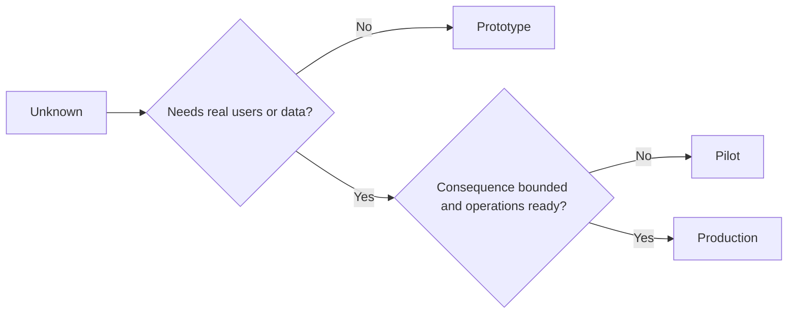

# اختر النموذج الأول أو الطيار أو الإنتاج عمداً

> هذه بيئات تعليمية مختلفة، وليس مستويات من اللون. اختر المرحلة التي تجيب على الحالي غير معروف مع أقل عواقب غير ضرورية.

> **【中文解读】**النوع الأول، التجربة، والإنتاج هي ثلاثة أنواع مختلفة من بيئة التعلم، وليس درجة من الت磨يد ثلاثة درجات. معيار الاختيار واحد فقط: أي واحد يمكن أن يكون على الأقل غير ضروري نتيجة للرد على ما لم يعد معروف.

>  **【前置】**學本课前 請先掌握:Phase 14 第 50 课 ((أقل قطع أحدد أولاً ما يجب أن يثبت)) 第 51 课 ((规格契约控制与证明条款) و第 52 课 ((مؤشر النجاح每档的证据门) 本课产出`outputs/stage-decisions.json`هو 54 课反棘轮的运营基线――

**Type:** Learn + Build | **类型:** 学习 + 动手实践
**Languages:** Python (stdlib) | **语言:** Python（标准库）
**Prerequisites:** Phase 14 lessons 50 to 52 | **前置知识:** Phase 14 第 50-52 课
**Time:** ~70 minutes | **时间:** 约 70 分钟

## أهداف التعلم

- اختر مرحلة بناء من غير المعروف، الجمهور، البيانات، النتائج، والإستعداد.
  中文翻译: بناء على المعلومات، والمعاملات، والبيانات، والنتيجة، والإجراءات، والإجراءات، والحصول على الخيارات.
- تحديد الضوابط الخاصة بالمراحل ومعايير الخروج.
  中文翻译:定义档位专属的控制措施和退出标准──
- منع النماذج الأولية من أن تصبح ببساطة أنظمة إنتاجية.
  中文翻译: منع النوع الأصلي تحول إلى نظام الإنتاج
- تأخير السلطة الحقيقية حتى تبررها الأدلة والعمليات
  ترجمة باللغة الصينية:把真权限推迟到证据与运维能力都配得上它的时候.

## ثلاثة أسئلة مختلفة

| Stage | Primary question |
|---|---|
| Prototype | Can this mechanism produce the evidence at all? |
| Pilot | Does it work safely with a bounded real audience and real conditions? |
| Production | Can we own it continuously at the promised reliability and risk level? |

يمكن أن يكون النموذج الأول كاملًا تقنياً ومازال قابلاً للتخلص منه. يمكن للطيار استخدام بيانات الإنتاج مع البقاء محدودًا في الجمهور والسلطة. يبدأ الإنتاج عندما تتقبل المنظمة المسؤولية المستمرة.

> **【中文解读】**السؤال الثالث هو ثلاثة أسئلة مختلفة: النموذج الأول "لا يمكن أن تنتج هذه الآلية إثباتات" ، السؤال التجريبي "هل هو آمن في المستهلك الحقيقي والظروف الحقيقية في مجموعة من المجتمعات" ، السؤال الإنتاج "هل يمكننا أن نستمر في امتلاكها على مستوى الوفاء والخطر المعهد به" .

## النموذج الأول

استخدم النموذج الأول عندما لا يتطلب المجهول مستخدمين حقيقيين أو بيانات حقيقية. احتفظ به:

> عندما لا يحتاج المستخدم الحقيقي أو البيانات الحقيقية، استخدم النموذج الأصلي.

- القابلة للتحليل
  中文翻译:随时可扔;
- المعزولة
  中文翻译: جدا جدا
- ضيق في السلوك
  中文翻译: تصرفات ضيقة
- صراحة حول سؤال التعلم
  中文翻译:把学习问题写明白;
- خالية من ضمانات تشغيل مزيفة.
  لا تحمل أيّة حملات خاطئة.

لا تحسين الهندسة المعمارية قبل أن يحصل الآلية على مرحلة أخرى.

> قبل أن يفوز هذا الجهاز بالمركز التالي، لا تحسين البنية.

> **【中文解读】**أشد القوانين الخمسة الأصلية "العزل" و"لا تحمل الضمانات المزيفة": التقسيم يضمن فشلها عندما يقع على الصفر؛ لا يضمن الاستخدامية يضمن عدم وجود أحد يبدأ في الاعتماد عليه.

## طيار محاولة

استخدم طيار عندما يتطلب ما لا يعرف سلوكًا حقيقيًا أو بيانات واقعية أو تدفق عمل حقيقي ، ولكن النتائج أو الاستعداد لا يتوافق مع الإفراج الواسع بعد.

> عندما يحتاج الملفات غير المعروفة إلى إجراءات حقيقية أو بيانات حقيقية أو تدفق عمل حقيقي، ولكن النتائج أو الاستعدادات لا تتوافق مع الإصدارات الكبيرة، استخدم محاولة.

الطيار يحتاج:

> 试点需要:

- جمهور مسموح به؛
  中文翻译:点名的人群;
- مالك بشري
  中文翻译:一位人类负责人;
- المدة المحدودة والسلطة؛
  中文翻译:有界的时长与权限;
- التحقيق والعودة إلى الوراء
  中文翻译:审计与回滚;
- حدود الخروج والحافظة على الحواجز
  中文翻译: نتائج مع护值 ((من 第52 课);
- معايير الخروج للتوسع أو التعديل أو التوقف.
  中文翻译:扩展、修订或停止的退出标准──

> **【中文解读】**الوصفية للطرح التجاري هي "الحقيقي ولكن لديه حدود": باستخدام بيانات حقيقية、 مجموعة من الناس الحقيقيين، ولكن اسم المشاهدين、 时长封顶、 الحكم ضيقة。 ستة متطلبات في "المسؤول البشري" و"الانسحاب من المعايير" الأكثر شيوعاً في省略

## إنتاج إنتاج

إنتاج يحتاج إلى أكثر من نشر:

> إنتاج احتياجات أكثر من نشر:

- هدف مستوى الخدمة
  中文翻译:服务级别目标(SLO);
- الملكية عند المكالمة والحوادث
  中文翻译:值班与事故归属;
- مراجعة الأمن والخصوصية
  中文翻译: سلامة والخصوصية مراجعة
- مراقبة التكاليف والقدرة؛
  中文翻译: تكلفة ومساحة التحكم
- إعادة التأثير والإسترداد
  中文翻译:回滚与恢复;
- المراقبة المستمرة
  中文翻译: مسلسل监控;
- طريق التقاعد
  中文翻译:一条退役路径。



> **【中文解读】**في سبع أشكال، فإنّه من بين أكثر الأشياء مضادة للشعور هو أنّه آخر "طريق إرجاع": قبل دخول الإنتاج يجب أن تكتب جيداً كيفية إرجاعه.

>  **【类比】**ثلاث مراحل من السيارات: القيادة المثلى للدراسة (التي تُصيب بالانفتاح مرة أخرى، والتي تُصيب بالخلفية) ، والتي لا تقل عن المثلة الجديدة، والتي تُعتبر نفسها في السرعة السريعة.

## المرحلة التجول

يصبح النموذج الأول خطير عندما يحصل على المستخدمين أو البيانات أو السلطة دون الحصول على الملكية. حدد النموذج الأول والحدود التجريبية في التكوين والتحكم في الوصول والمتسع والوثائق. لا يكفي إشارة تحذير.

> عندما يتم الحصول على المستخدم أو البيانات أو السلطة دون الحصول على إصدار، يصبح خطرا.

يجب أن تكون المرحلة قابلة للملاحظة من النظام نفسه.

> يجب أن يتم مراقبة المرتبة من النظام نفسه.

> **【中文解读】**阶段漂移(مرحلة التحرك) هو حادث صامت أكثر شيوعًا: "توقيتًا على التشغيل" من النموذج الأصلي من النصوص الدقيقة ، وبعد ثلاثة أشهر أصبح طريقًا رئيسيًا لا يجرؤه أحد على إعادة تشغيلها.

## بناء ذلك تحرك لتحقيق

يختار المختبر مرحلة من سياق القرار، ويرد التحكمات المطلوبة، ويكتب `outputs/stage-decisions.json`. . .

>  تجربة كود من قرارات التنفيذية                                                                                                                                                                                                                                                                                                                                                                                                                                                                                                                 `outputs/stage-decisions.json`.

```bash
python3 code/main.py
python3 -m unittest discover code/tests -v
```

قم بتغيير مثال التجربة إلى نتيجة منخفضة مع استعداد للعمل. شرح ما هي الأدلة الإضافية التي ستبرر الإنتاج.

> أن تغير مثال المحاولة إلى نتائج أقل وتشغيل أفضل.

> **【中文解读】** `choose_stage`                                                                                                                                                                                                                                                                                                                         

## التمرينات التمرينات

1. تصنيف ثلاثة مشاريع حالية حسب مرحلة التعلم، وليس حالة الانتشار.
   ترجمة: طبقاً للدراسة (→ التدريس)
2. اكتب معايير خروج الطيار التي تشمل قرار وقف.
   中文翻译:为试点写包含"停止" قرارات إرجاع المعايير
3. إضافة جهاز تحكم فني يمنع النموذج الأول من الوصول إلى بيانات الإنتاج.
   ترجمة:加一条技术控制, منع النوع الأصلي من التأثير على البيانات الإنتاجية.
4. تحديد أول مسؤولية تشغيلية تجعل الإنتاج البناء.
   中文翻译:指出第一"接下它,构建就成了生产"的运营责任──
5. صمم إيصال إعادة التأمين للطيار المحدد
   中文翻译:为有界试点设计一份回滚凭证──

## المزيد من القراءة

- [Barry Boehm, A Spiral Model of Software Development and Enhancement](https://dl.acm.org/doi/10.1145/12944.12948)، لتطابق كل إعادة التكرارالتزام للمخاطر المحددة.
  ترجمة باللغة الصينية: نموذج المكافحة المكافحة لتحقيق التزام كل دور من الأجيال مع خطورة الحل
- [Fagerholm et al., Building Blocks for Continuous Experimentation](https://doi.org/10.1145/2601248.2601276)، للظروف التنظيمية والتقنية المطلوبة لإجراء التجارب بشكل مستمر.
  中文翻译:فاجر هولم 等 دوام التجربة  دوامية تنفيذ التجربة  مطلوبة للتنظيم والشروط التقنية 

## ما تبقيه ، ما تبقيه

إبق`outputs/stage-decisions.json`يُسجل لماذا كل مرحلة مُبررة وما هي التحكمات التي يجب أن تكون موجودة قبل المرحلة التالية.

> حافظ`outputs/stage-decisions.json` يُسجل لماذا تم تأسيس كل درج، وكذلك ما هي الحكمات التي يجب أن تكون هناك قبل دخول الدرجة التالية‬‬‬‬‬‬‬‬‬‬‬‬‬‬‬‬‬‬‬‬‬‬‬‬‬‬‬‬‬‬‬‬‬‬‬‬‬‬‬‬‬‬‬‬‬‬‬‬‬‬‬‬‬‬‬‬‬‬‬‬‬‬‬‬‬‬‬‬‬‬‬‬‬‬‬‬‬‬‬‬‬‬‬‬‬‬‬‬‬‬‬‬‬‬‬‬‬‬‬‬‬‬‬‬‬‬‬‬‬‬‬‬‬‬‬‬‬‬‬‬‬‬‬‬‬‬‬‬‬‬‬‬‬‬‬‬‬‬‬‬‬‬‬‬‬‬‬‬‬‬‬‬‬‬‬‬‬‬‬‬‬‬‬‬‬‬‬‬‬‬‬‬‬‬‬‬‬‬‬‬‬‬‬‬‬‬‬‬‬‬‬‬‬‬‬‬‬‬‬‬‬‬‬‬‬‬‬‬‬‬‬‬‬‬‬‬‬‬‬‬‬‬‬‬‬‬‬‬‬‬‬‬‬‬‬‬‬‬‬‬‬‬‬‬‬‬‬‬‬‬‬‬‬‬‬‬‬‬‬‬‬‬‬‬‬‬‬‬‬‬‬‬‬‬‬‬‬‬‬‬‬‬‬‬‬‬‬‬‬‬‬‬‬‬‬‬‬‬‬‬‬‬‬‬‬‬‬‬‬‬‬‬‬‬‬‬‬‬‬‬‬‬‬‬‬‬‬‬‬‬‬‬‬‬‬‬‬‬‬‬‬‬‬‬‬‬‬‬‬‬‬‬‬‬‬‬‬‬‬‬‬‬‬‬‬‬‬‬‬‬‬‬‬‬‬‬‬‬‬‬‬‬‬‬‬‬‬‬‬‬‬‬‬‬‬‬‬‬‬‬‬‬‬‬‬‬‬‬‬‬‬‬‬‬‬‬‬‬‬‬‬‬‬‬‬‬‬‬‬‬‬‬‬‬‬‬‬‬‬‬‬‬‬‬‬‬‬‬‬‬‬‬‬‬‬‬‬‬‬‬‬‬‬‬‬‬‬‬‬‬‬‬‬‬‬‬
