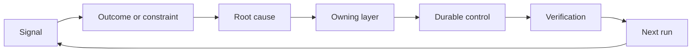

# بناء ريشيت ردود الفعل مع الملكية والقاعدة

> إرسال البضائع يغلق حلقة بناء واحدة وفتح حلقة التعلم يجب أن تغير الأدلة النظام أو يصبح التليميترية التي لا يملكها أحد

> **【中文解读】**關關上一個建構循环,同時打開學習循环. يجب أن تغير النظام، وإلا يتحول إلى بيانات بعيدة التقييم التي لا يدركها أحد. 本课是 工程工程方法论系列的收官: 工程工程工程方法论系列的收官: 工程工程工程学研究系列的收官: 工程工程工程学研究系列的收官: 工程工程工程学研究系列的收官: 工程工程工程学研究系列的收官: 工程工程工程学研究系列的收官: 工程工程工程学研究系列的收官: 工程工程工程学研究系列的收官: 工程工程工程学研究系列的收官: 工程工程工程学研究系列的收官: 工程工程工程学研究系列的收官: 工程工程工程学研究系列的收官: 工程学研究的收官: 工程学研究的收官: 工程学研究的收官: 工程学研究的收藏: 工程学研究, 工程学研究, 工程学研究, 工程学研究, 工程学研究, 工程学研究, 工程学研究, 工程学研究, 工程学研究, 工程学研究, 工程学研究, 工程学研究, 工程学研究, 工程学研究, 工程学研究, 工程学研究, 工程学研究, 工程学研究, 工程学研究, 工程学研究, 工程学研究, 工程学研究, 工程学研究, 工程学研究, 工程学研究, 工程等 工程等 工程等 工程等 工程等 工程等 工程等 工程等 工程等 工程 工程 工程 工程 工程 工程 工程 工程 工程 工程 工程 工程 工程 工程 工程 工程 工程 工程 工程 工程 工程 工程 工程 工程 工程 工程 工程 工程 工程 工程 工程 工程 工程 工程 工程 工程 工程 工程 工程 工程 工程 工程 工程 工程 工程 工程 工程 工程 工程 工程 工程 工程 工程 工程 工程 工程 工程 工程 工程 工程 工程 工程 工程 工程 工程 工程 工程 工程

>  **【前置】**دراسة دراسة دراسة دراسة دراسة دراسة دراسة دراسة دراسة دراسة دراسة دراسة دراسة دراسة دراسة دراسة دراسة دراسة دراسة دراسة دراسة دراسة دراسة دراسة دراسة دراسة دراسة دراسة دراسة دراسة دراسة دراسة دراسة دراسة دراسة دراسة دراسة دراسة دراسة دراسة دراسة دراسة دراسة دراسة دراسة دراسة دراسة دراسة دراسة دراسة دراسة دراسة دراسة دراسة دراسة دراسة دراسة دراسة دراسة دراسة دراسة دراسة دراسة دراسة دراسة دراسة دراسة دراسة دراسة دراسة دراسة دراسة دراسة دراسة دراسة دراسة دراسة دراسة دراسة دراسة دراسة دراسة دراسة دراسة دراسة دراسة دراسة دراسة دراسة دراسة دراسة دراسة دراسة دراسة دراسة دراسة دراسة دراسة دراسة دراسة دراسة دراسة دراسة دراسة دراسة دراسة دراسة دراسة دراسة دراسة دراسة دراسة دراسة دراسة دراسة دراسة دراسة دراسة دراسة دراسة دراسة دراسة دراسة دراسة دراسة دراسة دراسة دراسة دراسة دراسة دراسة دراسة دراسة دراسة دراسة دراسة دراسة دراسة دراسة دراسة دراسة دراسة دراسة دراسة دراسة دراسة دراسة دراسة دراسة دراسة دراسة دراسة دراسة دراسة دراسة دراسة دراسة دراسة دراسة دراسة دراسة دراسة دراسة دراسة دراسة دراسة دراسة دراسة دراسة دراسة

**Type:** Learn + Build | **类型:** 学习 + 动手实践
**Languages:** Python (stdlib) | **语言:** Python（标准库）
**Prerequisites:** Phase 14 lessons 46 and 53 | **前置知识:** Phase 14 第 46、53 课
**Time:** ~75 minutes | **时间:** 约 75 分钟

## أهداف التعلم

- حول الحوادث والتقييمات وسلوك المستخدمين والتصحيحات إلى أعمال خاصة
  ترجمة باللغة الصينية:把事故、评估、用户行为和纠正转化为有主人的行动──
- توجيه كل إشارة إلى السياق، التقييم، السياسة، وقت التشغيل، أو التخلف.
  ترجمة:                                                                                                                                                                                                                                                              
- إعطاء الأولوية للرد على أساس شدة وتكرارها.
  中文翻译: حسب الدرجة الدرجة الأولى مع ارتفاع تردد الدرجة الأولى.
- أعط كل مراقب شرط تقاعد
  ترجمة: أعط كل تدابير التحكم مع شرط إعادة العمل

## ردود الفعل هي البنية التحتية مقابل البنية التحتية

يمكن لفريق جمع آثار، وتقييمات، وتذاكر الدعم، ومسجلات الحوادث دون تعلم أي منها. الآلية المفقودة هي الترويج: مسار محدد من الملاحظة إلى تغيير دائم مع صاحب والدليل.

> يمكن لفريق أن يجمع كل أثر وتقييم وتجربة وتجربة الحوادث، ولكن من أي شيء يكتشف كل شيء.

الحلقة هي:

> هذه الدورة هي:

1. مراقبة إشارة ملموسة؛
   中文翻译: مشاهدة إشارة محددة
2. ربطها بالنتيجة أو القيود أو الافتراضات
   中文翻译:把它关联到某结果、约束或假设;
3. تحديد أول طبقة النظام التي تمتلك السبب؛
   中文翻译:找到"拥有这个根因"的最早系统层;
4. تخلق تغيير محدود
   中文翻译: إنشاء تغيرات مع الحدود.
5. التحقق من أن التكرار يصبح أقل احتمالاً
   中文翻译: تجرب证复发概率确实降低;
6. النظر في ما إذا كان يجب أن تبقى الرقابة.
   中文翻译:复核这个控制是否还应保留──

> **【中文解读】**"反是基础设施" يعني: تعلم لا يعتمد على الموقف على الآلية.可观测性,评估,工单系统只是管道 للمواد الخام، والمنشأة الحقيقية هي تلك الخطوة الستة للترقية، وخاصة الخطوة الخامسة والستة، وهي لا توجد في عمليات معظم الفريق:

## الطريق إلى الطبقة المالكة

| Signal | Destination |
|---|---|
| False positive, regression, wrong result | Evaluation or test |
| Missing context, duplicate work, stale fact | Context source or retrieval route |
| Unsafe action or authority gap | Policy or permission boundary |
| Timeout, retry storm, unavailable dependency | Runtime control |
| New product need or unresolved tradeoff | Shaped backlog item |

إصلاح السبب في أقرب طبقة فعالة. لا تضيف فقرة أخرى على الفور عندما يمكن اختبار أو إذن أن يجعل الفشل مستحيلا.

> عندما يكون الاختبار أو الحكم قادر على جعل الفشل يصبح مستحيلا، لا تتراجع مرة أخرى على الفور.



> **【中文解读】**路由表把"什么信号去哪"变成查表操作: err err errore result to evaluate、缺上下文去检查、越权去策略、超时去运行时、新产品诉求去待办. 核心纪律是"最早有效层"快速是最贵重的修复位置(每轮都占下文、随模型变化),测试和权限是最便宜的位置(一次写入、永久生效) 大多数"我们再优化下提示词"的讨论,其实应该发生在另一个层面的

## الملكية جزء من السيطرة

كل عمل يحتاج:

> كل حركة محركية تحتاج:

- صاحب واحد
  中文翻译:恰好一个主人;
- الأولوية القائمة على العواقب والتكرار
  ترجمة باللغة الصينية: على أساس الدرجة الأولوية للثمرة والثمرة
- الأثاث الذي سيتم تغييره؛
  中文翻译:要改那工件;
- التحقق الذي يثبت التغيير
  中文翻译: اثبات该变更生效的验证;
- نافذة مراجعة أو انتهاء الصلاحية؛
  中文翻译: إطار تأخير أو إعادة تأخير
- حالة التقاعد
  中文翻译:一条退役条件。

تحسين غير مملك هو ملاحظة مع تصميم أفضل.

> لا يوجد تحسينات من قبل الرئيس، مجرد نسخة أفضل نظرة من سجل المراقبة.

> **【中文解读】**六段里"恰好一个主人" و"退役条件" تشكل جولتين من الجولة: الرئيس ضمان变更真落地(观察→行动) ، والوضع الخرجي ضمان السيطرة لن يكون لا حدود لها (行动→清理) 

## إقلاع عن التحكمات المستمرة

أنظمة التعليقات تتراكم السياسة. يمكن أن تصبح هذه السياسة متناقضة ومكلفة.

> في حين أن هذه الاستراتيجيات قد تصبح متناقضة، فإن التكلفة مرتفعة.

- تغييرات في الهندسة المعمارية أو سير العمل
  中文翻译: تغيرات في الهيكل أو العمل
- تحلّ محلّ تعليمات مستوى أعلى بمعدل غير متغير من المستوى الأدنى؛
  ترجمة: "تغيرات من مستوى أقل استبدلت أوامر من مستوى أعلى"
- لم تظهر الفشل المحمي عبر النافذة المختارة.
  ترجمة: فشل تم الحفاظ عليه لم يظهر مرة واحدة في نافذة المراقبة بأكملها .
- الاختيار يمنع العمل الشرعي أكثر من منع الأذى
  ترجمة: هذا التحكم يمنع العمل الطبيعي أكثر من عدد الإصابات التي يسببها.

التقاعد يحتاج أيضاً إلى دليل لا تُحذفِ جهاز التحكم لأنه يشعرُ بالقدوم.

> لا تُحاول إزالة السيطرة لأنّك "تَشعرُ بأنّ الوقت قد مضى"

> **【中文解读】**هذا الجزء هو إعطاء "حلقة الثعلب" إعادة التسجيل: فقط في داخل لا رجعة الثعلب في نهاية المطاف سوف تقفل الآلة موتها.

## ربط بناء وكيل التشفير ردود الفعل 打通 بناء  مع وكيل التشفير 

نفس الرشة تخدم كلا المسارات:

> مع واحدة محور الخدمة

- تغير دليل المنتج إطار النتيجة أو الافتراضات أو القسم أو خطة القياس.
  中文翻译:产品证据改变结果框架、假设、切片或测量计划──
- تغيير تصحيحات وكيل التشفير في الاختبارات أو السياق أو نطاقها أو التلقائية أو التسليم.
  中文翻译:编码 وكيل 的纠正改变测试、上下文、范围、自动化或交接──
- الحوادث يمكن أن تغير كل من حدود المنتج و مكتب العمل العميل.
  中文翻译: حادث既可以改变产品边界,也可以改变代理 工作台。

هذا هو السبب في أن تشكيل البناء ليس مرحلة تنتهي قبل التشفير. إنه يستمر خلال كل تغيير مقبول.

> هذا هو السبب في أن "بناء البلاستيك" ليس مرحلة في التدوين قبل أن يبدأ، فإنه يمر عبر كل تغيير مقبول.

> **【中文解读】**هذا الجزء يُنهي سلسلة 43-54 : افتراضات إطار المهمة في الدورة 43 "المحترون سيثقون في هذا الاقتراح") عندما يتم إعادة إثباتات تجربة حقيقية ، فإن التغيير ليس مجرد رمز ، هناك إطار مهمة آخر في حد ذاته.

## بناء ذلك تحرك لتحقيق

المختبر يصنف الإشارات، ويخلق أفعال ريشيت المملوكة، ويضع أولوياتها، ويكتب`outputs/feedback-backlog.json`. . .

>  تجربة كود إعطاء إشارة التفرقة  خلق المديرين الحركة المحورية  ترتيب أفضل الأولوية ، و كتابة `outputs/feedback-backlog.json`.

```bash
python3 code/main.py
python3 -m unittest discover code/tests -v
```

أضف إشارة وقت وقف التشغيل وتأكيد أنه يتجه إلى وقت التشغيل بدلاً من التخلف العام.

> إشارة فوق الوقت، تأكد أنها تم توجيهها إلى وقت التشغيل بدلا من دخول المنتظر العام.

> **【中文解读】** `destination()`مع keyword تطابق العرض من خلال المظهر`promote()`则把六字段动作象化: الدرجة الأولوية = 严重度 × 频率, لكل هدف مقيدة ثابتة دوامية`evaluations/regression-suite.json`)、ثبتة تحديدات ووضع شروط إعادة التأهيل`expires_after_days`لا يعني "الفترة المحددة تلقائياً"، بل "الفترة المحددة يجب أن تُرجع" إعادة إصدار شهادة، والرجع هو مدخل للشهادة

## التمرينات التمرينات

1. تحويل حادثة واحدة و شكوى مستخدم واحدة إلى إجراءات
   ترجمة باللغة الصينية:把一次事故和一条用户投诉转写成棘轮动作
2. أسمائ الطبقة الأولى التي يمكن أن تمنع كل تكرار.
   中文翻译:指出能阻止每次复发的最早层――
3. إضافة أوامر التحقق أو ملاحظات إلى إصدار المختبر.
   ترجمة: إعطاء تجربة أو مشاهدة
4. تحديد شرط التقاعد للقاعدة في السياسة
   中文翻译:为一条策略规则定义退役条件──
5. تعقب واحد قبول التصحيح مرة أخرى إلى إطار المهمة التالية.
   ترجمة: تُرجع إصلاحات معتمدة إلى إطار المهمة التالية.

## المزيد من القراءة

- [Basili, Caldiera, and Rombach, The Goal Question Metric Approach](https://www.cs.toronto.edu/~sme/CSC444F/handouts/GQM-paper.pdf)، للتعلم التنظيمي من خلال القياس المتحكم في الهدف.
  中文翻译:باسيلي、كالديرا مع روباك جي كيو ام 方法通过目标导向的测量实现组织学习。
- [Fagerholm et al., Building Blocks for Continuous Experimentation](https://doi.org/10.1145/2601248.2601276)، للدورة التقنية والتنظيمية التي تربط الأدلة بتطوير منتج مستمر.
  ترجمة باللغة الصينية:Fagerholm 等 التجربة المستمرة من التكوين 把证据接回持续产品开发的技术与组织循环
- [Nuseibeh and Easterbrook, Requirements Engineering: A Roadmap](https://www.cs.toronto.edu/~sme/papers/2000/ICSE2000.pdf)، لمعالجة المتطلبات كما تتطور خلال دورة حياة النظام.
  中文翻译:Nuseibeh 与 Easterbrook需求工程:路线图把需求视为在系统生命周期中持续演化──

## ما تبقيه ، ما تبقيه

إبق`outputs/feedback-backlog.json`. هو المادة النهائية من طريق الحكم على المنتج وتسليمها ومدخل إلى الإطار التالي.

> حافظ`outputs/feedback-backlog.json` هو الجزء النهائي من طريق "الحكم على المنتجات والإرسال" ، و هو أيضاً مدخل في إطار النتائج التالي
