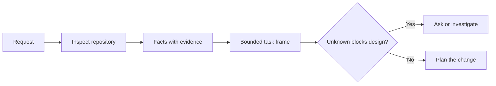

# Rencadre la tâche avant que l'agent n'écrive le code.

> Un codeur peut mettre en œuvre une tâche claire rapidement. Il peut aussi mettre en œuvre une tâche non claire rapidement. La vitesse est la même. Le coût n'est pas.

> **【中文解读】**编码代理 实现清晰任务快速,实现模糊任务同样快速度,成本完全不同. 本课讲 写代码前的第一步:把一个模糊请求变成一个由仓库证据支、边界明确的任务框架. 任务框架. 任务框架. 任务框架. 任务框架. 编码代理. 编码代理. 编码代理. 编码代理. 编码代理. 编码代理. 编码代理. 编码代理. 编码代理. 编码代理. 编码代理. 编码代理. 编码代理. 编码代理. 编码代理. 编码代理. 编码代理. 编码代理. 编码代理. 编码代理. 编码代理. 编码代理. 编码代理. 编码代理. 编码代理. 编码代理. 编码代理. 编码代理. 编码代理. 编码代理. 编码. 编码. 编码. 编码. 编码. 编码. 编码. 编码. 编码. 编码. 编码. 编码. 编码. 编码. 编码. 编码. 编码. 编码. 编. 编. 编. 编. 编. 编. 编. 编. 编. 编. 编. 编. 编. 编. 编. 编. 编. 编. 编. 编. 编. 编. 编. 编. 编. 编. 编. 编. 编. 编. 编. 编. 编. 编. 编. 编. 编. 编. 编. 编. 编. 编. 编. 编. 编. 编. 编. 编. 编. 编. 编. 编. 编. 编. 编. 编. 编. 编. 编. 编. 编. 编. 编. 编. 编. 编. 编. 编. 编. 编.

>  **【前置】**Les cours suivants sont les suivants: la phase 14 (pourquoi le modèle échoue) et la phase 36 (pour comprendre pourquoi il faut un cadre)`outputs/task-frame.md`Le programme d'exécution de la preuve est transformé en un programme d'exécution dans le chapitre 44.

**Type:** Learn + Build | **类型:** 学习 + 动手实践
**Languages:** Python (stdlib) | **语言:** Python（标准库）
**Prerequisites:** Phase 14 lessons 31 and 36 | **前置知识:** Phase 14 第 31、36 课
**Time:** ~60 minutes | **时间:** 约 60 分钟

## Objectifs d'apprentissage

- Transformer une demande en un cadre de tâches limité avant de la modifier.
  Avant de l'éditer, transformer une requête en un cadre de tâches ayant des limites.
- Séparer les faits du référentiel des hypothèses et des questions ouvertes.
  Traduction anglaise: 把仓库事实与假设的区分, 等待决策问题
- Définir les chemins autorisés, les chemins interdits et les preuves d'acceptation.
  Traduction anglaise: définir permis chemin, interdit chemin et acceptation de preuves.
- Décidez quand la reconnaissance est suffisante pour commencer à travailler.
  Je sais que tu es là, mais je peux commencer à t'en servir.

## Le coût de l'échec est cher.

 Ajouter une protection par courrier électronique dupliquée semble spécifique. Ce n'est pas le cas. L'unicité appartient-elle à l'API, au service de domaine ou à la base de données? Est-ce que la comparaison est sensible aux cas? Quelle forme d'erreur est déjà publique? Est-ce qu'une migration est autorisée? Quel test prouve le comportement?

> "Plus de protection des boîtes de réception" semble très spécifique, en réalité pas spécifique. La seule nature devrait être placée dans l'API, dans le domaine des services ou dans la base de données.

Un agent compétent comblera ces lacunes avec des choix plausibles.

> Un agent compétent utilisera des choix qui semblent raisonnables pour combler ces vides. C'est la seule situation dangereuse: il peut être réalisé un test, mais il reste incompatible avec l'ensemble du système.

La première unité de travail de codeur n'est donc pas une modification, mais un cadre de tâches soutenu par des données de référentiel.

> Ainsi, la première unité du code agent 工作 n'est pas une édition, mais un cadre de tâches supporté par le stockage de preuves.

> **【中文解读】**L'échec coûteux indique que le code n'est pas écrit mal, mais que le code a été écrit mais que la tâche a été comprise mal. Agent ne change pas en raison de l'impasse de la tâche et qu'il change lentement Il va prendre des décisions en confiance  Ces décisions sont prises en remplacement de vos décisions 

## Le cadre de tâches.

Un cadre utile comporte six champs:

| Field | Question |
|---|---|
| Goal | What observable behavior must change? |
| Repository facts | What did you verify in code, tests, config, or history? |
| Allowed paths | Where may the change land? |
| Forbidden paths | What must remain untouched? |
| Acceptance evidence | Which commands or observations prove the goal? |
| Unknowns | Which decisions still need evidence or human judgment? |

> **【中文解读】**六个字段分别是: objectif (what can be observed behavior must change) 仓库事实 (what can be observed behavior must change) 仓库事实 (what can be observed behavior must change) 仓库事实 (what can be observed behavior must change) 仓库事实 (what can be observed behavior must change) 仓库事实 (what can be observed behavior must change) 仓库事实 (what can be observed behavior must change) 仓库事实 (what can be observed behavior must change) 仓库事实 (what can be observed behavior must change) 仓库事实 (what can be observed behavior must change) 仓库事实 (what can be observed behavior must change) 仓库事实 (what can be observed behavior must change) 仓库事实 (what can be observed behavior must change) 仓库事实 (what can be observed behavior must change) 仓库事实 (what can be observed behavior must change) 仓库事实 (what can be observed behavior changed) 仓库事实 (what can be observed behavior changed) 仓库 facts) 仓库事实 (what can be observed behavior) 仓库 facts (what can be observed behavior) 仓库 facts) 仓库 facts (what can be observed behavior (what can be observed behavior) 仓库 facts) 仓库 facts (what can be observed) 仓库 facts) 仓库 facts (what can be observed 仓库 facts) 仓库 facts (what can be observed 仓库 facts) 仓库 facts (what can be observed 仓库 facts) 仓库 facts (what can be observed 仓库 facts) 仓库 facts (what can be observed 仓库 facts) 仓库 facts) 仓库 facts (what can be observed 仓库 facts) 仓库 facts (what can be observed 仓库 facts (what can be observed 仓库 facts) 仓库 facts) 仓库 facts (what can be observed 仓库 facts) 仓库 facts (what can be observed 仓库 facts) 仓库 facts (what can be observed  仓库 facts) 仓库 facts (

Les faits ont besoin de reçus. L'API utilise 409 pour les duplicates n'est pas un fait tant que vous ne pouvez pas indiquer le test ou le gestionnaire existant. Un chemin de fichier et une ligne suffisent. Un résultat de commande est meilleur lorsque le comportement compte.

> Les faits nécessitent des certificats. " L'API pour le retour répété 409 " n'est pas un fait avant que vous ne fassiez référence à un test ou un processeur existant.



>  **【类比】**任务框架像装修前的墙审批单:哪面墙能动(permis par voie) 哪面是承重墙绝不能动(prohibés par voie) 验收入住的标准是什么 (验收入住的标准是什么) 验收入住的标准是什么 (验收入住的标准是什么) △没有这张单子,装修队(Agent) 动作越快,错墙的概率越大──

## La reconnaissance est une recherche de contraintes.

Ne lisez pas l'ensemble du référentiel.

> Ne passe pas à travers le magasin. Va trouver les vrais liens de ce changement.

1. Le comportement actuel et son appelant.
   Le code de la loi est le code de la loi.
2. Le test le plus proche.
   Le test de survie récent est terminé.
3. Le contrat public ou la forme sérialisée.
   Traduction anglaise: forme de données après la séquestration.
4. Les instructions du projet qui régissent le chemin.
   Le projet est basé sur la création d'un projet de développement de l'entreprise.
5. Les commandes de construction et de vérification.
   Le texte est traduit en français par "construire et vérifier".
6. Des modifications similaires qui révèlent des schémas locaux.
   Les changements accomplis sont similaires, ils révèlent les habitudes locales.

Arrêtez quand chaque décision prévue est soit appuyée par des preuves, explicitement déléguée, ou répertoriée comme inconnue.

> Lorsque chaque décision de chaque plan a été confirmée ou autorisée, ou que trois personnes sont placées à l'intérieur de ce projet, il est interdit de le faire.

> **【中文解读】**Le but de l'observation n'est pas de comprendre l'ensemble du code, mais de trouver un ensemble: qui l'utilise, quel test peut le tester, comment écrire les règles locales.

## Les inconnus ne sont pas des échecs.

Une hypothèse est une réponse incontrôlée à cette lacune.

> L'ignorance est un vide contrôlé; le supposé est une réponse incontrôlée à ce vide.

Classifier chaque inconnu:

- **Discoverable:**le référentiel ou le système d'exploitation peut répondre.
  Le mot grec traduit par " le mot grec "**可发现：**Le système de stockage ou de fonctionnement peut y répondre.
- **Decidable:**le contrat de tâche confère au mandataire le pouvoir de choisir.
  Le mot grec traduit par " le mot grec "**可决定：**任务契约已授权 Agent 自行选择──
- **Human:**le choix modifie le comportement du produit, le coût, le risque ou la compatibilité avec le public.
  Le mot grec traduit par " le mot grec "**需人来定：**Cette option modifiera le comportement du produit, le coût, le risque ou la compatibilité publique.
- **Deferred:**Le choix est en dehors de cette tranche et appartient à des non-objectifs.
  Le mot grec traduit par " le mot grec "**可延后：**Cette sélection ne fait pas partie de cette pièce, elle doit être mise en œuvre.

L'agent doit continuer à parcourir les inconnus découvertables et délégués, il doit s'arrêter sur les inconnus humains avant que le choix ne soit enterré dans le code.

> Pour les inconnus qui peuvent être découverts et autorisés, l'agent doit continuer à avancer; pour les inconnus qui doivent être déterminés, l'agent doit suspendre cette sélection avant qu'ils ne soient enterrés dans le code.

> **【中文解读】**Les questions à poser sont les suivantes: les questions à poser, les questions à poser, les questions à poser, les questions à poser, les questions à poser, les questions à poser, les questions à poser, les questions à poser, les questions à poser, les questions à poser, les questions à poser, les questions à poser, les questions à poser, les questions à poser, les questions à poser, les questions à poser, les questions à poser, les questions à poser, les questions à poser, les questions à poser, les questions à poser, les questions à poser, les questions à poser, les questions à poser, les questions à poser, les questions à poser, les questions à poser, les questions à poser, les questions à poser, les questions à poser, les questions à poser, les questions à poser, les questions à poser, les questions à poser, les questions à poser, les questions à poser, les questions à poser, les questions à poser, les questions à poser, les questions à poser, les questions à poser, les questions à poser, les questions à poser, les questions à poser, les questions à propos de prendre, les questions à propos de prendre, les questions à propos de prendre, les questions à propos de prendre, etc.

## Acceptation avant mise en œuvre

Écrivez la preuve avant le patch.

> Précédent, réécriture, réécriture, réécriture, réécriture, réécriture, réécriture, réécriture, réécriture, réécriture, réécriture, réécriture, réécriture, réécriture, réécriture, réécriture, réécriture, réécriture, réécriture, réécriture, réécriture, réécriture, réécriture, réécriture, réécriture, réécriture, réécriture, réécriture, réécriture, réécriture, réécriture, réécriture, réécriture, réécriture, réécriture, réécriture, réécriture, réécriture, réécriture, réécriture, réécriture, réécriture, réécriture, réécriture, réécriture, réécriture, réécriture, réécriture, réécriture, réécriture, réécriture, réécriture, réécriture, réécriture, réécriture, réécriture, réé, réécriture, réécriture, réé, réécriture, réécriture, réé, réédition, réédition, réédition, réédition, réédition, réédition, réédition, réédition, réédition, réédition, réédition, réédition, réédition, réédition, réédition, réédition, réédition, réédition, réédition, réédition, réédition, réédition, et réédition, réédition, réédition, et réédition,

- une commande d'essai d'unité ou d'intégration centrée;
  Un ordre de test de concentration ou de concentration.
- un parcours de navigateur avec un point de vue nommé et l'état attendu;
  Une fois indiquant l'état de l'opération du navigateur;
- une demande par voie électronique et un contrat de réponse exacte;
  Traduction anglaise: un lien entre une demande et une réponse précises;
- une mesure de performance avec un seuil;
  Une mesure de la performance de la valeur;
- une vérification de la portée qui confirme qu'aucun fichier non lié n'a été modifié.
  Un contrôle de portée de la documentation est effectué.

Le test de réussite  n'est pas un plan de preuve.

> "Le test est passé" n'est pas un programme de démonstration.

> **【中文解读】** Acceptation avant réalisation  est TDD en 工程中的变体:                                                                                                                                                                                                                                                     

## Construisez-le et mettez-le en œuvre.

Le laboratoire crée une`TaskFrame`, valide ses limites et ses preuves, et écrit `outputs/task-frame.md`- Je suis désolé .

> 实验部分会创建一个 `TaskFrame`, l'écriture de ses limites et de ses preuves`outputs/task-frame.md`Il y a une autre.

Retournez dans ce répertoire de leçons:

```bash
python3 code/main.py
python3 -m unittest discover code/tests -v
```

Décomposez l'exemple de quatre façons: supprimez l'objectif, supprimez un reçu de facteur, chevauchez un chemin autorisé et interdit, et supprimez la commande d'acceptation.

> Utiliser quatre façons de détruire cet exemple: supprimer l'objectif, supprimer un document de fait, permettre les chemins et interdire les chemins de rechange, supprimer les ordres d'acceptation, et pour différentes raisons, rejeter chaque cadre détruit.

## Utilisez-le dans un réel entrepôt.

Avant de demander à un agent de modifier:

> Dans le cas d'un agent,

1. Écrivez l'objectif comme un comportement, pas un changement de fichier.
   Le texte est écrit en un seul acte, et non en un seul document.
2. Enregistrez deux ou trois faits avec des preuves exactes.
   Le fait de faire des preuves précises
3. Nommez le plus petit ensemble de chemins autorisé.
   Le nom de la plus petite collection est permis.
4. Nommez explicitement l'espace négatif.
   Le nom de la société est "L'espace négatif".
5. Écrivez la commande ou l'observation qui clôture la tâche.
   Le texte de la loi est le texte de la loi.
6. Faites une liste des décisions que vous n'avez pas encore prises.
   L'équipe de la Fédération de Russie a été créée pour la première fois en 2011.

Le cadre doit s'adapter à un écran. Si ce n'est pas le cas, la tâche peut contenir plusieurs modifications vérifiables indépendamment.

> Le cadre de tâches devrait être débloqué. Si on ne le fait pas, cette tâche pourrait contenir plusieurs modifications indépendantes.

> **【中文解读】**Ce six étapes sont des étapes de la formation, peuvent être directement insérées dans votre flux de travail: objectif écrit comme comportement, faits avec preuve, permet de minimiser les chemins, la manifestation de l'espace négatif, l'acceptation des commandes, les étapes et les étapes de la liste des choses à faire.

## Des exercices.

1. Encadrez un vrai bug dans un de vos référentiels sans proposer une solution.
   Choisir un vrai bug dans votre propre entrepôt, faire un cadre, ne pas proposer de solution.
2. Trouvez une affirmation dans le cadre qui est en fait une hypothèse.
   Le texte est écrit en français en français en français en français en français en français en français en français en français en français en français en français en français en français en français en français en français en français en français en français en français en français en français en français en français en français en français en français en français en français en français en français en français en français en français en français en français en français en français en français en français en français en français en français en français en français en français en français en français en français en français en français en français en français en français en français en français en français en français en français en français en français en français en français en français en français en français en français en français en français en français en français en français en français en français en français en français en français en français en français en français en français en français en français en français en français en français en français en français en français en français en français en français en français en français en français en français en français en français en français en français en français en français en français en français en français en français en français en français en français en français en français en français en français en français en français en français en français en français en français en français en français en français en français en français en français en français en français en français en français en français en français en français en français en français en français en français en français en français en français en français en français en français en français en français en français en français en français en français en français en français en français en français en français en français en français en français en français en français en français en français en français en français en français en français en français en français en français en français en français en français en français en français en français en français en français en français en français en français en français en français en français en français en français en français en français en français en français en français en français en français en français en français en français en français en français en français en français en français en français en français en français en français en français en français en français en français en français en français en français en français en français en français en français en français en français en français en français en français en français en français en français en français en français en français en français en français en français en français en français en français en français en français en français en français en français en français en français en français en français en français en français en français en français en français en français en français en français en français en français en français en français en français
3. Ajoutez un humain inconnu dont la réponse changerait le contrat public.
   En français, la réponse est "l'homme qui doit venir".
4. Partagez un large chemin permis dans le plus petit ensemble de sécurité.
   Le chemin de la sécurité est décomposé en un ensemble de sécurité minimale.
5. Ajouter un reçu de champ à la preuve d'acceptation.
   En français, le mot "préceptation" est traduit par "préceptation".

## Encore une lecture

- [Nuseibeh and Easterbrook, Requirements Engineering: A Roadmap](https://www.cs.toronto.edu/~sme/papers/2000/ICSE2000.pdf), pour ancrer la mise en œuvre aux objectifs du monde réel et aux contraintes en évolution.
  Nuseibeh et Easterbrook 需求工程:路线图如何实现定在真世界目标和演化中的约束上.
- [Yang et al., SWE-agent: Agent-Computer Interfaces Enable Automated Software Engineering](https://arxiv.org/abs/2405.15793), pour prouver que l'interface autour d'un agent de codage modifie son efficacité.
  Le design de l'interface autour de l'agent change son effet réel.

## Ce que vous gardez , vous gardez .

Je le garde .`outputs/task-frame.md`Il est l'entrée de la prochaine leçon, où le cadre devient un plan d'exécution fondé sur des preuves.

> Garder à l' écoute`outputs/task-frame.md`Dans la classe suivante, le cadre de tâches se transforme en un plan d'exécution fondé sur des preuves.
