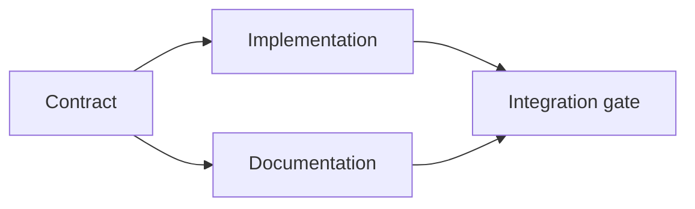

# Construisez un plan d' exécution fondé sur des preuves.

> Un plan n'est pas une liste de tâches plus jolie. C'est un graphique de dépendance dans lequel chaque changement a une raison et chaque nœud terminal a une preuve.

> **【中文解读】**Le plan n'est pas un " meilleur plan d'attente ", mais un diagramme de dépendance: chaque changement a des raisons de le faire, chaque terminal a des raisons de le faire.

>  **【前置】**Précédent de la phase 14 § 43                                                                                                                                                                                                                                                                                                                                                                                                                                                                                                                    `outputs/task-frame.md`)―本课产出 `outputs/evidence-plan.json`Je serai un agent de l'agence de formation en 45e classe.

**Type:** Learn + Build | **类型:** 学习 + 动手实践
**Languages:** Python (stdlib) | **语言:** Python（标准库）
**Prerequisites:** Phase 14 lesson 43 | **前置知识:** Phase 14 第 43 课
**Time:** ~65 minutes | **时间:** 约 65 分钟

## Objectifs d'apprentissage

- Convertir un cadre de tâche en éléments de travail avec des preuves et des preuves.
  Le cadre de tâches est transformé en un travail avec preuve et preuve.
- L'ordre de modèle est une dépendance au lieu d'une séquence de prose.
  Traduction anglaise: avec la dépendance construire un ordre de départ, et non avec la description de la phrase.
- Détecter les faits manquants, les dépendances inconnues et les cycles avant de modifier.
  En français, le mot "déficit" est traduit par "déficit".
- Des étapes séparées qui peuvent couler ensemble et des étapes qui doivent attendre.
  Les étapes peuvent être exécutées simultanément et les étapes doivent être attendues.

## Pourquoi les plans des agents échouent-ils ?

Les plans faibles répètent la demande dans le futur:

> Le faible plan est de faire une requête à l'avenir:

1. Mettez à jour l'API.
   Le mot "résavoir" est traduit par "résavoir".
2. Ajoutez des tests.
   Le mot "test" est traduit par "test".
3. Mettre à jour la documentation.
   Le texte est en français.

Rien dans cette liste ne dit ce qui a été trouvé, pourquoi ces fichiers sont corrects, quel contrat change en premier, ou ce qui peut se passer simultanément.

> Il n'y a pas de phrase dans cette liste: découvrir ce que, pourquoi ces documents, quelles sont les conditions de travail, quelles étapes peuvent être mises en œuvre.

> **【中文解读】**La caractéristique du faible programme est la "reprise requête" qui semble avoir un nombre, un mot, mais pas de preuve de stockage.

Un plan solide comporte cinq engagements pour chaque élément de travail:

| Commitment | Purpose |
|---|---|
| Identifier | Stable reference for dependencies and handoff |
| Change | The smallest behavior or contract change |
| Evidence | Repository facts that justify the change |
| Dependencies | Work that must be true first |
| Proof | The exact check that closes the item |

> **【中文解读】**五个承诺分别是:标识符 (标识符) 转变 (转变) 转变 (转变) 转变 (转变) 转变 (转变) 转变 (转变) 转变 (转变) 转变 (转变) 转变 (转变) 转变 (转变) 转变 (转变) 转变 (转变) 转变 (转变) 转变 (转变) 转变 (转变) 转变 (转变) 转变 (转变) 转变 (转变) 转变 (转变) 转变 (转变) 转变 (转变) 转变 (转变) 转变 (转变) 转变 (转变) 转变 (转变) 转变 (转变) 转变 (转变) 转变 (转变) 转变 (转变) 转变 (转变) 转变 (转变) 转变 (转变) 转变 (转变) 转变 (转变) 转变 (转变) 转变) 转变 (转变) 转变 (转变) 转变 (转变) 转变) 转变 (转变) 转变 (转变) 转变) 转变 (转变) 转变 (转变) 转变) 转变 (转变) 转变 (转变) 转变) 转变 (转变) 转变) 转变 (转变) 转变 (转变) 转变 (转变) 转变) 转变 (转变) 转变 (转变) 转变)

## Planifiez le contrat avant sa mise en œuvre.

Lorsque plusieurs surfaces dépendent du même comportement, définissez d'abord le comportement. Les tests, la mise en œuvre, la documentation et l'intégration peuvent ensuite partager un contrat au lieu d'inventer quatre versions.

> Lorsque plusieurs surfaces dépendent du même comportement, définissez d'abord le comportement lui-même.

>  **【类比】**契约先行如先定国标插头再生产电器器――插座厂(实现) 和电器厂(文档) peuvent être ouverts simultanément, car l'interface est déjà verrouillée;验收员(集成门) doit seulement faire face à la même norme d'inspection sur les deux côtés──



Le graphique expose une simultanée sûre. La mise en œuvre et la documentation peuvent se poursuivre ensemble après la fixation du contrat.

> Le tableau révèle que, après la fixation du contrat, la réalisation et le dossier peuvent être poursuivis simultanément; l'intégration doit être complète.

## Les preuves changent le plan.

Les preuves de référentiel ne sont pas une décoration.

> √ Le stockage de données n'est pas un objet de décoration. Il doit être capable de modifier le contenu du travail:

- Un assistant existant supprime une nouvelle abstraction prévue.
  Une fonction de complément existante, coupée de nouveaux abstraits dans le plan.
- Un test de compatibilité force une étape de migration.
  Un test de compatibilité, forcé à sortir des étapes de déplacement hors plan.
- Une contrainte de déploiement déplace un changement de schéma dans une autre tâche.
  Un déploiement de la tâche, un changement de schéma, une autre tâche.
- Un type de réponse publique modifie l'ordre de mise en œuvre et de documentation.
  Traduction anglaise: un type de réponse publique, modifié par l'ordre de réalisation et de documentation.

Si les preuves ne peuvent pas modifier le plan, elles ne sont probablement pas des preuves de cette décision.

> Si les preuves changent sans le plan, il est presque pas la preuve de cette décision.

> **【中文解读】**C'est une excellente référence à la preuve: mettre "la preuve" à côté de la décision, demander "si elle est inversement, le plan va-t-il changer ?"

## Conçu pour interrompre

Les sessions d'agent de codage se terminent de façon inattendue.

> La réunion de l'agent est terminée imprévus­ment.

- le poste complet;
  Le travail est terminé.
- la preuve qui a été déposée;
  Qui est le témoin qui a couru ?
- les objets modifiés;
  Quel est le nombre de produits qui ont changé ?
- les dépendances désormais débloquées;
  Qui sont ceux qui sont en train de se défaire ?
- Quel est le prochain élément de sécurité.
  Le travail de sécurité est ce que...?

Ne cochez pas l'état uniquement dans les cases à cocher dans un chat.

> Ne mettez pas l'état en code dans le cadre de sélection du journal de discussion. Mettez le plan à côté du travail.

> **【中文解读】**L'article "Quelles preuves ont été obtenues" est particulièrement important: les preuves ne doivent pas être obtenues à plusieurs reprises, et ne doivent pas être supprimées pour être obtenues à plusieurs reprises.

## Validation du plan.

Rejeter le plan avant l'exécution lorsque:

> Dans les cas suivants, il est possible de refuser le programme avant son exécution:

- un identifiant est dupliqué;
  Le mot " " " " " " " " " " " " " " " " " " " " " " " " " " " " " " " " " " " " " " " " " " " " " " " " " " " " " " " " " " " " " " " " " " " " " " " " " " " " " " " " " " " " " " " " " " " " " " " " " " " " " " " " " " " " " " " " " " " " " " " " " " " " " " " " " " " " " " " " " " " " " " " " " " " " " " " " " " " " " " " " " " " " " " " " " " " " " " " " " " " " " " " " " " " " " " " " " " " " " " " " " " " " " " " " " " " " " " " " " " " " " " " " " " " " " " " " " " " " " " " " " " " " " " " " " " " " " " " " " " " " " " " " " " " " " " " " " " " " " " " " " " " " " " " " " " " " " " " " " " " " " " " " " " " " " " " " " " " " " " " " " " " " " " " " " " " " " " " " " " " " " " " " " " " " " " " " " " " " " " " " " " " " " " " " " " " " " " " " " " " " " " " " " " " " " " " " " " " " " " " " " " " " " " " " " " " " " " " " " " " " " " " " " " " " " " " " " " " " " " " " " " " " " " " " " " " " " " " " " " " " " " " " " " " " " " " " " " " " " " " " " " " " " " " " " " " " " " " " " " " " " " " " " " " "
- un article de travail n'a pas de preuve;
  Un travail sans preuve.
- un article de travail n'a pas de preuve;
  Un travail qui n'a pas été prouvé.
- une dépendance nomme un élément inconnu;
  Un travail qui dépend de l'existence.
- le graphique contient un cycle;
  En français, "conférence" est une expression de la langue française.
- la première action irréversible a lieu avant que l'incertitude pertinente ne soit résolue.
  Le premier indéfectible, apparaissant alors que l'incertitude dont il dépend est résolue.

Les cinq premiers contrôles sont mécaniques, le dernier exige un jugement et doit être appelé explicitement.

> Il faut que les inspections soient automatiques.

> **【中文解读】**六条拒绝规则里藏藏着本课程最重要的排序原则:不可逆动作 (transférer, supprimer, publier, ouvrir un accord) doit être éliminé après son incertitude.

## Construisez-le et mettez-le en œuvre.

`code/main.py`Les modèles de travail des éléments, valident leurs reçus, calculent les ondes d'exécution avec un sort topologique, et écrit `outputs/evidence-plan.json`- Je suis désolé .

> `code/main.py`建模工作项、校验它们的证书、用拓排序计算执行波次,并写出 `outputs/evidence-plan.json`Il y a une autre.

Je vais courir .

> 运行:

```bash
python3 code/main.py
python3 -m unittest discover code/tests -v
```

L'exemple produit trois ondes. La définition du contrat se déroule en premier. La mise en œuvre et la documentation se rejoignent. La porte d'intégration se déroule en dernier.

> Pour les autres, il est nécessaire de définir les conditions de travail et de travail.

> **【中文解读】**"Boe next" est une application directe du top  ordre: chaque travail de la série est indépendant, peut être divisé entre différents agents et processus;

## Utilisez-le avec un agent de codage avec un agent de codage

Demandez à l'agent de produire le plan avant qu'il change les fichiers.

> 让代理在改文件之前先产出计划. 审查计划时住三个事情:

1. Chaque revendication de chemin et de comportement a un reçu de référentiel.
   Chaque article de la déclaration de conduite a des preuves de stockage.
2. Chaque article a une preuve claire de finition.
   Chaque travail a une preuve de réalisation claire.
3. Le graphique retarde un travail coûteux ou irréversible jusqu'à ce que l'incertitude dont il dépend soit résolue.
   Traduction anglaise: dépendance à un travail coûteux ou irréversible, retardée jusqu'à ce que l'incertitude qui en dépend soit résolue.

Approuvez le plan, pas une promesse vague d'être prudent.

> Ce n'est pas une promesse de "je vais faire un petit cœur".

## Des exercices.

1. Ajouter un élément de migration qui nécessite une approbation humaine explicite.
   En français, traduit par "l'emploi" est un terme qui signifie "l'emploi".
2. Créez un cycle et expliquez le désaccord de produit caché derrière.
   Le mot "production" est traduit par "production".
3. Divisez un élément qui a deux commandes de preuve.
   Le travail de l'équipe de formation de l'équipe de formation de l'équipe de formation de l'équipe de formation de l'équipe de formation de l'équipe de formation de l'équipe de formation de l'équipe de formation de l'équipe de formation de l'équipe de formation de l'équipe de formation de l'équipe de formation de l'équipe de formation de l'équipe de formation de l'équipe de formation de l'équipe de formation de l'équipe de formation de l'équipe de formation de l'équipe de formation de l'équipe de formation de l'équipe de formation de l'équipe de formation de l'équipe de formation de l'équipe de formation de l'équipe de formation de l'équipe de formation de l'équipe de formation de l'équipe de formation de l'équipe de formation de l'équipe de formation de l'équipe de formation de l'équipe de formation de l'équipe de formation de l'équipe de formation de l'équipe de formation de l'équipe de l'équipe de formation de l'équipe de l'équipe de l'équipe de l'équipe de référencadriteur.
4. Ajoutez un élément de travail qui peut fonctionner dans la deuxième vague sans toucher aucune des branches existantes.
   En français, traduire par " ajouter un travail à la deuxième vague "
5. Rendez le plan comme Markdown tout en gardant JSON comme source de vérité.
   Le système de données est en train de se dérouler en un seul système de données.

## Encore une lecture

- [Nuseibeh and Easterbrook, Requirements Engineering: A Roadmap](https://www.cs.toronto.edu/~sme/papers/2000/ICSE2000.pdf), pour la relation itérative entre les objectifs, les spécifications, l'accord et l'évolution.
  Le projet de développement de l'économie est un projet de développement de l'économie.
- [Barry Boehm, A Spiral Model of Software Development and Enhancement](https://dl.acm.org/doi/10.1145/12944.12948), pour l'ordre de développement autour de la résolution des risques plutôt que d'une séquence linéaire fixe.
  Le modèle de la spirale développé par Barry Boehm est basé sur le développement de l'équipement en fonction de la détérioration du vent plutôt que de la configuration de l'équipement.

## Ce que vous gardez , vous gardez .

Je le garde .`outputs/evidence-plan.json`Il devient le contrat de délégation dans la prochaine leçon.

> Garder à l' écoute`outputs/evidence-plan.json`Il deviendra un contrat de travail.
