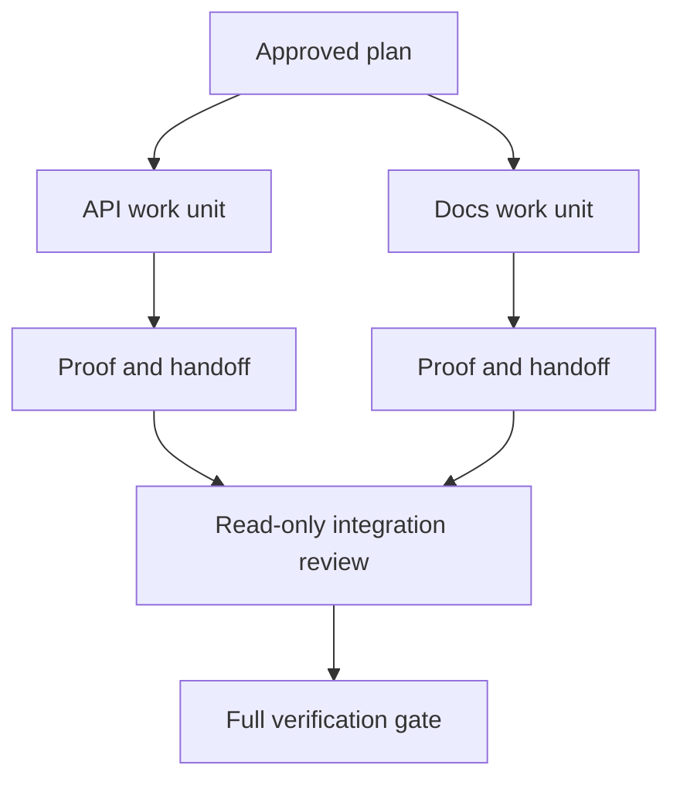

# L' agent délégué travaille avec les contrats d' isolement et de fusion.

> Les agents parallèles ne permettent d'économiser du temps sur le mur que lorsque le travail est indépendant.

> **【中文解读】**L'agent de coordonnée ne peut gagner du temps que lorsqu'il est vraiment indépendant dans son travail; sinon, il transforme une tâche claire en un problème de coordination et échoue plus rapidement.

>  **【前置】**Les participants à la phase 14 de l'étude sont les "constructeurs et marqueurs séparés" dans l'application de la phase de fusion) et la phase 44 de la formation.`outputs/evidence-plan.json`Les résultats de l'exécution des cours sont les suivants:`outputs/delegation-plan.json`Les documents sont détachés pour la sécurité, les chemins vers qui, les collections doivent recevoir des preuves.

**Type:** Learn + Build | **类型:** 学习 + 动手实践
**Languages:** Python (stdlib) | **语言:** Python（标准库）
**Prerequisites:** Phase 14 lessons 39 and 44 | **前置知识:** Phase 14 第 39、44 课
**Time:** ~70 minutes | **时间:** 约 70 分钟

## Objectifs d'apprentissage

- Décider si la délégation est justifiée par une véritable indépendance.
  Le gouvernement est un gouvernement qui a été créé pour assurer la sécurité et la sécurité de l'humanité.
- Donnez à chaque travailleur la propriété exclusive des dossiers et une preuve explicite.
  Traduction anglaise: donner à chaque travailleur le droit de propriété et de preuve de désignation exclusive.
- Des ondes d'exécution de calcul provenant de dépendances.
  Le texte est traduit en français par "Références".
- Conçuez un contrat de fusion pour combiner le travail des agents en toute sécurité.
  Le travail de l'agent est un contrat de travail.

## Le test de parallélisme.

Ne déléguer pas parce qu'il y a plus d'agents disponibles.

> Ne pas être chargé de " plus d'agent disponible " lorsque:

- deux enquêtes peuvent répondre de manière indépendante à des inconnues différentes;
  Deux enquêtes peuvent répondre indépendamment à des questions inconnues différentes.
- deux mises en œuvre possèdent des dossiers et des contrats disjoints;
  Traduction anglaise: deux réalisations possédant des documents et des accords qui ne sont pas en relation;
- un examinateur peut inspecter un artefact fini sans le modifier;
  Un examinateur peut inspecter le produit fini sans le modifier;
- un contrôle extérieur lent peut être effectué pendant que les travaux locaux se poursuivent.
  Un contrôle extérieur lent peut fonctionner simultanément en continuant à travailler en son propre lieu.

Gardez le travail en série lorsque les agents ont besoin des mêmes fichiers, de la même décision non résolue ou du même environnement changeant.

> Lorsque plusieurs agents ont besoin du même document, du même décideur ou du même environnement variable, gardez la file.

> **【中文解读】**" Égalité de test " est la première ligne de ce cours: la disponibilité n'est pas une raison, l'indépendance est seulement.

## Une unité de travail est un contrat.

Chaque unité déléguée a besoin de:

> Chaque unité chargée a besoin:

| Field | Meaning |
|---|---|
| Goal | One observable result |
| Owner | One accountable worker |
| Paths | Exclusive write ownership |
| Dependencies | Completed units required before starting |
| Proof | Exact evidence returned to the integrator |
| Handoff | Files changed, decisions made, remaining risk |

> **【中文解读】**Les principales caractéristiques de la procédure sont les "Paths" et les "Proofs" ("Construction de l'exécution") et les "Proofs") ("Construction de l'exécution") ("Construction de l'exécution") et "Proofs") ("Proofs") ("Proofs") et les "Proofs") ("Proofs") ("Proofs") et "Proofs") ("Proofs") ("Proofs") et "Proofs") ("Proofs") ".

Manifiez le backend n'est pas une unité de travail. Implémenter le double contrôle `app/accounts.py`et prouver avec le test de compte ciblé est.

> "Faier un bout en arrière" n'est pas une unité de travail.`app/accounts.py`Il a réalisé un examen répété et a utilisé un test de compte à foyer pour le prouver.

## L'isolement a trois couches séparées.

1. **Filesystem isolation:**Les arbres de travail ou les boîtes à sable séparés empêchent les modifications partagées accidentelles.
   Le mot grec traduit par " le mot grec "**文件系统隔离：**独立工作树或沙箱防止意外的共享编辑──
2. **Ownership isolation:**Les contrats empêchent deux travailleurs de modifier intentionnellement le même chemin.
   Le mot grec traduit par " le mot grec "**所有权隔离：**Il y a deux ouvriers qui ont le même chemin.
3. **State isolation:**Les journaux et les sorties séparés empêchent un travailleur de surécrire les preuves d'un autre travailleur.
   Le mot grec traduit par " le mot grec "**状态隔离：**独立日志与输出 empêcher un travailleur de couvrir un autre travailleur

L'isolement du système de fichiers ne résout pas la propriété. Deux arbres de travail propres peuvent toujours produire des conceptions contradictoires.

> Le système de documents séparé ne résolve pas le problème de propriété. Deux arbres de travail propres peuvent encore résulter de conceptions en conflit.

> **【中文解读】**Trois niveaux de séparation sont souvent errants de " ouvrir un arbre de travail et terminer le travail " , mais un arbre de travail ne peut que prévenir les collisions accidentelles, prévenir les deux travailleurs de différentes façons de créer des conflits.



> 图解: le projet approuvé décompose deux unités de travail, chacun avec des certificats et des instructions de communication; les participants ne font d'abord que lire et examiner les résultats, puis effectuent la vérification complète.

## L' intégrateur ne reconstruit pas le travail.

L'intégrateur doit:

> 集成者 devrait:

1. confirmer que chaque remise correspond à sa portée assignée;
   Traduction anglaise: confirmer que chaque partie correspond à la portée de son répartition;
2. lire la preuve, et pas seulement le résumé du travailleur;
   Le résultat de la production est le résultat de la production.
3. combiner les changements d'ordre de dépendance;
   Suivant le texte de la loi de l'Égypte,
4. faire fonctionner la porte de l'unité transversale complète;
   Le mot "translation" est traduit par "translation".
5. rejeter l'expansion cachée du champ d'application;
   Le récit de la Bible est le récit de la Bible.
6. enregistrer les conflits comme de nouvelles décisions, pas des éditions silencieuses.
   Le texte de la Bible est un texte écrit par les Juifs.

Si l'intégration nécessite la réécriture de la plupart des résultats d'un travailleur, la décomposition initiale était erronée.

> Si l'intégration nécessite une réécriture de la plupart des résultats du travailleur, explique que la décomposition initiale est de l'erreur.

> **【中文解读】**Le rôle de l'intégrant est de " recevoir " et non de " compléter " . Le deuxième devoir est de laisser passer le plus facilement le travail de l'employé, comme de donner un sac à l'extérieur à celui qui est accepté.

## Les rôles de l'homme et de l'agent

La délégation ne supprime pas le jugement humain. L'homme possède toujours des choix qui modifient le comportement public, le risque, l'autorité ou les coûts irréversibles.

> Le mandat ne remplace pas les jugements des autres. Les gens continuent à avoir des choix qui modifient le comportement public, le risque, l'autorisation ou le coût irréversible.

Il s'agit d'une autonomie calibrée: le système accorde la liberté lorsque les preuves et le retour sont solides, et nécessite un point de contrôle lorsque les conséquences sont élevées.

> C'est le droit d'autonomie de la certification: le système a un pouvoir de vérification de la capacité de roulement et des preuves, et des contrôles sont effectués sur les résultats de la sérieuse expérience.

> **【中文解读】**"L'autonomie de la formation" est une proposition de valeur de ce cours: l'autonomie n'est pas plus forte que la qualité, mais elle doit être comparée à la "intensité de la preuve × réversible" en équivalent à un faible risque de réversion ((run test、查代码) malgré le permis; le risque élevé de non-réversion ((删数据、发布、改公开契约) doit rester à un point de contrôle.

## Construisez-le et mettez-le en œuvre.

Le laboratoire vérifie le chevauchement des chemins, valide les dépendances, calcule les ondes d'exécution sûres et écrit `outputs/delegation-plan.json`- Je suis désolé .

> 实验部分会检查路径重叠、校验依赖、计算安全的执行波次,并写出 `outputs/delegation-plan.json`Il y a une autre.

Je vais courir .

> 运行:

```bash
python3 code/main.py
python3 -m unittest discover code/tests -v
```

Changez l' unité de docs à la propriété `app/`Le plan devrait être bloqué parce que ce chemin parent se chevauchera sur l'unité API.

> Transformer un seul document en propriété`app/`Le plan devrait être interrompu, car ce chemin est superposé par les unités API.

> **【中文解读】**破坏实验 把 docs 单元所有权改成 `app/`) démontre la mécanisation de l'isolement des propriétés: le chemin se compose non sur soi, par un éprouveur rejet directement.

## Des exercices.

1. Décomposer un changement réel en deux unités de travail indépendantes et un intégrateur.
   Traduction anglaise: mettre en œuvre une réelle transformation de la société en deux unités de travail indépendantes et un collectif.
2. Trouvez une fraction parallèle proposée qui ne semble qu'indépendante.
   Trouver un seul et unique ensemble de projets, en disant que le choix est partagé.
3. Ajoutez un chercheur qui ne peut lire que le contenu de son produit est un tableau de faits.
   Le résultat est une réalité.
4. Ajouter une passerelle de fusion qui vérifie le jeu de fichiers modifiés final contre tous les contrats unitaires.
   Le texte de la loi est le texte de la loi.
5. Définir une règle d'annulation pour un travailleur dont la dépendance devient invalide.
   Pour un travailleur qui dépend de son manque de travail, définissez la règle de l'emploi.

## Encore une lecture

- [Reid Smith, The Contract Net Protocol](https://doi.org/10.1109/TC.1980.1675516), pour un traitement formel précoce de l'allocation de tâches distribuées et de la communication des résultats.
  Le récit de la rédaction de la lettre de rédaction de la lettre de rédaction de la lettre de rédaction de la lettre de rédaction de la lettre de rédaction de la lettre de rédaction de la lettre de rédaction de la lettre de rédaction de la lettre de rédaction de la lettre de rédaction de la lettre de rédaction de la lettre de rédaction de la lettre de rédaction de la lettre de rédaction de rédaction de la lettre de rédaction de rédaction de la lettre de rédaction de rédaction de la lettre de rédaction de rédaction de rédaction de la lettre de rédaction de rédaction de rédaction de rédaction de rédaction de rédaction de rédaction de rédaction de rédaction de rédaction de rédaction de rédaction de rédaction de rédaction de rédaction de rédaction de rédaction de rédaction de rédaction de rédaction de rédaction de rédaction de rédaction de rédaction de rédaction de rédaction de rédaction de rédaction de rédaction de rédaction de rédaction de rédaction de rédaction de rédaction de rédaction de rédaction de rédaction de rédaction de rédaction de rédaction de rédaction de rédaction de rédaction de rédaction de rédaction de rédaction de rédaction de rédaction de rédaction de rédaction de rédaction de rédaction de rédaction de rédaction de rédaction de rédaction de rédaction de rédaction de rédaction de rédaction de rédaction de rédaction de rédaction de rédaction de rédaction de rédaction de rédaction de rédaction de rédaction de rédaction de rédaction de rédaction de rédaction de rédaction de rédaction de rédaction de rédaction de rédaction de rédaction de rédaction de rédaction de rédaction de rédaction de rédaction de rédaction de rédaction de rédaction de rédaction de rédaction de rédaction
- [Eric Horvitz, Principles of Mixed-Initiative User Interfaces](https://dl.acm.org/doi/10.1145/302979.303030), pour décider quand l'automatisation doit agir et quand elle doit rendre le contrôle à une personne.
  Le principe de l'interface de l'action mixte d'Eric Horvitz décide de l'automatisation du temps et du temps, du temps et du temps pour remettre le contrôle à l'homme, c'est-à-dire de l'émergence de l'autonomie de l'établissement.

## Ce que vous gardez , vous gardez .

Je le garde .`outputs/delegation-plan.json`Il indique pourquoi la fraction est sûre, qui possède chaque chemin et quelle preuve l'intégration doit recevoir.

> Garder à l' écoute`outputs/delegation-plan.json`Il a enregistré pourquoi cette séparation était sûre, pourquoi chaque chemin de retour était à qui il appartenait, et ce que l'intégration devait obtenir.
