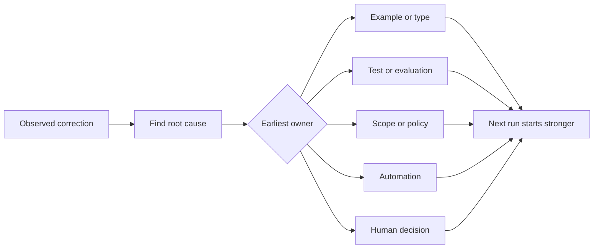

# Transformer chaque correction en amélioration du système

> Une correction qui ne vit que dans le chat répare une mise en ligne. Une correction promue dans un test, une limite, un exemple ou un outil améliore chaque mise en ligne ultérieure.

> **【中文解读】**Il est possible de modifier les données de l'agent à chaque fois qu'il est artificiellement corrigé dans son système de travail, de trouver la racine, de les améliorer à la première étape de la prévention de la réapparition, et de les supprimer régulièrement.

>  **【前置】**Les cours de l'éducation et de la formation sont organisés par des groupes de personnes qui ont des compétences en matière de formation et de formation.`outputs/feedback-ratchet.json`, c'est une nouvelle entrée dans le futur.

**Type:** Learn + Build | **类型:** 学习 + 动手实践
**Languages:** Python (stdlib) | **语言:** Python（标准库）
**Prerequisites:** Phase 14 lessons 37 to 41 | **前置知识:** Phase 14 第 37-41 课
**Time:** ~65 minutes | **时间:** 约 65 分钟

## Objectifs d'apprentissage

- Convertir les corrections d'agent en contrôles durables.
  Traduction anglaise: Transformer la correction de l'agent en un moyen de contrôle durable.
- Placez chaque contrôle dans la couche la plus précoce qui puisse empêcher la récidive.
  Traduction anglaise: mettre chaque contrôle dans la première couche de la prévention de la réapparition.
- Déduplicer les leçons répétées avec des empreintes digitales stables.
  Le mot "c'est-à-dire "c'est-à-dire "c'est-à-dire "c'est-à-dire "c'est-à-dire "c'est-à-dire" est une expression de la langue française qui signifie "c'est-à-dire "c'est-à-dire" ou "c'est-à-dire" ou "c'est-à-dire" ou "c'est-à-dire" ou "c'est-à-dire" ou "c'est-à-dire" est une expression de la langue française.
- Retirez les contrôles qui ne protègent plus un risque réel.
  Les gens qui ne veulent plus protéger le contrôle de la réalité.

## Les corrections sont des preuves.

Lorsque vous dites à un agent ne modifiez pas ce fichier, vous avez appris que la limite de portée n'était pas exécutable. Lorsque vous dites ce format de sortie est erroné, vous avez appris qu'un exemple ou un test manquait. Lorsque la configuration échoue à nouveau, vous avez appris que la connaissance de l'environnement appartient à l'automatisation.

> Quand vous dites à un agent " changement de fichier ", vous apprenez que le champ de bord est imparable. Quand vous dites " cette forme de sortie est incorrecte ", vous apprenez que l'exemple ou le test est manquant.

Traitez la correction comme une observation sur le système de travail, et non comme une erreur de rédaction rapide.

> Régler le juste travail sur l'observation du système de travail, plutôt que de faire une simple échec de l'écriture.

> **【中文解读】**Cette section change de point de vue: chaque correction est un système qui rapporte ses propres failles  " limites implémentables " " exemplaires manquants " " connaissances non en jeu " " rendre la correction une preuve plutôt qu'un accident, vous allez demander " quel niveau doit être responsable ", plutôt que de répétition dans le chat dire la même phrase

## Promouvoir à la première couche efficace

Utilisez cette commande:

> 按这个顺序升级:

| Recurring failure | Durable destination |
|---|---|
| Wrong result or regression | Test or evaluation |
| Off-scope or unsafe action | Scope or permission policy |
| Repeated setup or command mistake | Automation or tool |
| Repeated output-format mistake | Canonical example plus validator |
| Ambiguous local convention | Instruction with a scenario check |
| Product disagreement | Human decision record |

Un type qui empêche un état invalide est plus fort qu'un commentaire de critique qui le reçoit plus tard. Un test axé est plus fort qu'un paragraphe demandant à l'agent de se souvenir.

> Le contrôle plus tôt est plus facile. Un type de contrôle qui empêche l'apparition d'un état illégal, un test de contrôle plus rapide, un test plus concentré, un test plus concentré, un test plus efficace.

> **【中文解读】**Ce tableau est le tableau de décision de base de ce cours: résultats de mauvaise mise à niveau pour tester/évaluer; stratégie de mauvaise mise à niveau pour champ/licence; répétion de la mise à niveau pour automatisation; format de mauvaise mise à niveau pour exemple de réglementation et compteur de test; consigne de mise à niveau pour inspection de scène; produit de mauvaise mise à niveau pour décision artificielle.



> 图解: observer à rectifier → 找根因 → 判定最早的责任层(exemple/type、测试/评估、范围/策略、自动化、人工决定)→ La prochaine fois que le fonctionnement commence à partir de plus fort de la start-point.

## Le dossier de Ratchet.

Capture:

> 记录 ces sections:

- symptôme;
  Le mot " symptôme " est traduit par " symptôme ".
- cause profonde;
  Le mot grec traduit par " root " signifie " root ".
- conséquence;
  Le mot "je suis" est traduit en français par "je suis".
- le nombre de récurrents;
  Le nombre de fois;
- le contrôle choisi;
  Le gouvernement a décidé de le faire.
- la vérification pour le contrôle;
  Le mot " contrôle " signifie " contrôle de soi ".
- propriétaire;
  Le président de la République est le président de la République.
- date de révision ou de retraite.
  Le référendum est un accord de coopération entre les États membres.

Ne favorisez pas chaque préférence unique, mais favorisez une correction lorsque la récurrence ou la conséquence justifient une complexité permanente.

> Ne pas mettre chaque préférence unique à niveau. Ce n'est que lorsque le nombre de fois ou les conséquences sont graves et méritent d'être introduites dans une complexité permanente que la mise à niveau peut corriger cette règle.

> **【中文解读】**Le premier affirme que ce contrôle est vraiment interrompu, sinon seulement un réconfort psychologique; le second reconnaît le contrôle de la vie.

>  **【类比】**棘轮手像一个只不跌的储蓄──之前: chaque fois que la correction est faite, elle commence à zéro, elle se termine par oubli, ensuite: chaque fois que la correction est faite, elle pousse le tour à avancer, elle ne peut être contrôlée, le système ne change que de force, il ne revient pas.

## Séparer cause et symptôme

L'agent modifié README est un symptôme.

> "L'agent a changé de LIRE" est un symptôme.

- la tâche a permis la racine du référentiel;
  Le rôle de l'équipe de gestion de la gestion de la gestion de la gestion de la gestion de la gestion de la gestion de la gestion de la gestion de la gestion de la gestion de la gestion de la gestion de la gestion de la gestion de la gestion de la gestion de la gestion de la gestion de la gestion de la gestion de la gestion de la gestion de la gestion de la gestion de la gestion de la gestion de la gestion de la gestion de la gestion de la gestion de la gestion de la gestion de la gestion de la gestion de la gestion de la gestion de la gestion de la gestion de la gestion de la gestion de la gestion de la gestion de la gestion de la gestion de la gestion de la gestion de la gestion de la gestion de la gestion de la gestion de la gestion de la gestion de la gestion de la gestion de la gestion de la gestion de la gestion de la gestion de la gestion de la gestion de la gestion de la gestion de la gestion de la gestion de la gestion de la gestion de la gestion de la gestion de la gestion de la gestion de la gestion de la gestion de la gestion de la gestion de la gestion de la gestion de la gestion de la gestion de la gestion de la gestion de la gestion de la gestion de la gestion de la gestion de la gestion de la gestion de la gestion de la gestion de la gestion de la gestion de la gestion de la gestion de la gestion de la gestion de la gestion de la gestion de la gestion de la gestion de la gestion de la gestion de la gestion de la gestion de la gestion de la gestion de la gestion de la gestion de la gestion de la gestion de la gestion de la gestion de la gestion de la gestion de la gestion de la gestion de la gestion de la gestion de la gestion de la gestion de la gestion de la gestion de la gestion de la gestion de la gestion de la gestion de la gestion de la gestion de la gestion de la gestion de la gestion de la gestion de la gestion de la gestion de la gestion de la gestion de la gestion de la gestion de la gestion de la gestion de la gestion de la gestion de la gestion de la gestion de la gestion de la gestion de la gestion de la gestion de la gestion de la gestion de la gestion de la gestion de la gestion de la gestion de la gestion de la gestion de la gestion de la gestion de la gestion de la gestion de la gestion de la gestion de la gestion de la gestion de la gestion de la gestion de la gestion de la gestion de la gestion
- les documents ont été implicitement considérés comme sûrs;
  Le document est reconnu comme étant une zone sûre.
- la mise en œuvre et la documentation du plan en série;
  Le projet de mise en œuvre et le dossier sont liés ensemble.
- Deux travailleurs avaient des propriétés qui se chevauchent.
  La propriété de deux ouvriers est superposée.

Chaque cause appartient à un contrôle différent. Une règle qui ne fait que répéter le symptôme échouera dans le cas suivant légèrement différent.

> Chaque cause est contrôlée différemment. Il suffit de répéter les règles des symptômes, et la prochaine fois, dans des situations légèrement différentes, elles échoueront.

> **【中文解读】**C'est l'étape la plus facile à retenir: il est facile de transformer "BÉRÉDIRE" en règle, de trouver "Pourquoi il sera modifié" est difficile. Mais quatre causes possibles se déroulent vers quatre différentes réformes:

## Les contrôles se détériorent aussi.

Les anciens contrôles peuvent entrer en conflit, gonfler le contexte et encoder un système qui n'existe plus.

> 旧控制会相互冲突、大上下文、并固化一个已经不存在的系统──每条升级过的规则都需要退役检查──当下列情况出现时,删除或重写它:

- la structure sous-jacente a changé;
  La structure de base est déjà changée.
- une régulation exécutable plus stricte l'a remplacé;
  Le contrôle exécutable de la force supérieure a remplacé le contrôle exécutable de la force supérieure.
- l'échec n'a pas été récurrent dans une période significative;
  Traduction anglaise: dans une fenêtre de temps significative,
- Le contrôle crée plus de friction que le risque qu'il empêche.
  Le stress de la fabrication est déjà supérieur à celui de la résistance.

L'objectif n'est pas le plus long fichier d'instructions, mais le plus petit système qui préserve le jugement durement gagné.

> L'objectif n'est pas le plus long document d'instruction, mais le système le plus petit de pouvoir de jugement qui puisse être conservé.

> **【中文解读】**棘轮只进不退,但控制会过期──"Chaque règle doit avoir un contrôle de résiliation" avec le maintenance du projet de règlement du projet de règlement (documentation) 如 AGENTS.md:

## Construisez-le et mettez-le en œuvre.

Le laboratoire classe les corrections, les fait passer en contrôles, duplique les empreintes digitales et écrit.`outputs/feedback-ratchet.json`- Je suis désolé .

> La partie expérimentale se charge de la réparation des classes, de les mettre en ordre pour les contrôler, de les peser avec des empreintes digitales, et de les écrire.`outputs/feedback-ratchet.json`Il y a une autre.

Je vais courir .

> 运行:

```bash
python3 code/main.py
python3 -m unittest discover code/tests -v
```

Ajouter deux corrections formulées différemment avec la même cause. Améliorer la normalisation jusqu'à ce qu'elles s'effondrent dans un seul contrôle sans effondrement d'échecs non liés.

> 加入两条措辞不同但根因相同纠正──改进归化逻辑,直到它们合并成一个控制,同时不让无关的失败被错合并──

> **【中文解读】**破坏实验演示指纹重重的关键张力:归一化太松,同一根因的两条纠正各立一条控制(重复膨胀);太紧,无关失败被错合并(误伤) ・・・

## Des exercices.

1. Prenez cinq corrections d'une récente session de codage et classez leurs vrais propriétaires.
   Le récent édition de la série intitulée "La rédaction de la rédaction de la rédaction de la rédaction de la rédaction de la rédaction de la rédaction de la rédaction de la rédaction de la rédaction de la rédaction de la rédaction de la rédaction de la rédaction de la rédaction de la rédaction de la rédaction de la rédaction de la rédaction de la rédaction de la rédaction de la rédaction de la rédaction de la rédaction de la rédaction de la rédaction de la rédaction de la rédaction de la rédaction de la rédaction de la rédaction de la rédaction de la rédaction de la rédaction de la rédaction de la rédaction de la rédaction de la rédaction de la rédaction de la rédaction de la rédaction de la rédaction de la rédaction de la rédaction de la rédaction de la rédaction de la rédaction de la rédaction de la rédaction de la rédaction de la rédaction de la rédaction de la rédaction de la rédaction de la rédaction de la rédaction de la rédaction de la rédaction de la rédaction de la rédaction de la rédaction de la rédaction de la rédaction de la rédaction de la rédaction de la rédaction de la rédaction de la rédaction de la rédaction de la rédaction de la rédaction de la rédaction de la rédaction de la rédaction de la rédaction de la rédaction de la rédaction de la rédaction de la rédaction de la rédaction de la rédaction de la rédaction de la rédaction de la rédaction de la rédaction de la rédaction de la rédaction de la rédaction de la rédaction de la rédaction de la rédaction de la rédaction.
2. Remplacez une règle de prose par un test exécutable.
   Le texte est traduit en français par " " " " " " " " " " " " " " " " " " " " " " " " " " " " " " " " " " " " " " " " " " " " " " " " " " " " " " " " " " " " " " " " " " " " " " " " " " " " " " " " " " " " " " " " " " " " " " " " " " " " " " " " " " " " " " " " " " " " " " " " " " " " " " " " " " " " " " " " " " " " " " " " " " " " " " " " " " " " " " " " " " " " " " " " " " " " " " " " " " " " " " " " " " " " " " " " " " " " " " " " " " " " " " " " " " " " " " " " " " " " " " " " " " " " " " " " " " " " " " " " " " " " " " " " " " " " " " " " " " " " " " " " " " " " " " " " " " " " " " " " " " " " " " " " " " " " " " " " " " " " " " " " " " " " " " " " " " " " " " " " " " " " " " " " " " " " " " " " " " " " " " " " " " " " " " " " " " " " " " " " " " " " " " " " " " " " " " " " " " " " " " " " " " " " " " " " " " " " " " " " " " " " " " " " " " " " " " " " " " " " " " " " " " " " " " " " " " " " " " " " " " " " " " " " " " " " " " " " " " " " " " " " " " " " " " " " " " " " " " " " " " " " " " " " " " " " " " " " " " " " " "
3. Ajoutez une pondération des conséquences afin que la première occurrence sévère puisse être immédiatement encouragée.
   Le premier événement grave peut être immédiatement amélioré.
4. Ajoutez un propriétaire et une date de retraite à la sortie du laboratoire.
   En français, le terme "période" est traduit par "période".
5. Revoir une instruction d'agent existante et la supprimer seulement après avoir prouvé l'existence d'un contrôle plus fort.
   Examen d'une directive d'agent existante, seulement après avoir prouvé l'existence d'un contrôle plus fort, la supprimer.

## Encore une lecture

- [Basili, Caldiera, and Rombach, The Goal Question Metric Approach](https://www.cs.toronto.edu/~sme/CSC444F/handouts/GQM-paper.pdf)Les objectifs sont conçus pour la transformation des questions et des mesures opérationnelles.
  Le texte de la loi de Rome est le texte de la loi de Rome.
- [Shinn et al., Reflexion](https://arxiv.org/abs/2303.11366), pour utiliser des traces de rétroaction pour améliorer les décisions ultérieures sans changer les poids du modèle.
  Le modèle de réflexion est utilisé pour modifier le modèle de réflexion.
- [Madaan et al., Self-Refine](https://arxiv.org/abs/2303.17651), pour les retours et les révision itératifs à l'intérieur d'une boucle de tâches.
  Le cycle de tâches interne de l'équipe de révision et de révision.

## Ce que vous gardez , vous gardez .

Je le garde .`outputs/feedback-ratchet.json`Il s'agit de la fin durable du chemin de l'ingénierie assistée par l'agent et de l'entrée pour les futurs changements de bureau.

> Garder à l' écoute`outputs/feedback-ratchet.json`Il s'agit du "point de départ" de la route "Agent assistant engineering" et de l'entrée de la future
