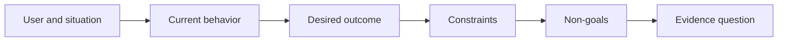

# Définir le résultat avant de choisir la sortie.

> La mise en œuvre rapide augmente la peine pour avoir choisi le mauvais problème.

> **【中文解读】**"produit" (output) est ce que vous décidez de construire: un assistant, une page, un modèle; "resultés" (output) est le changement observable dans le monde qui a changé quelque chose dans une situation.

>  **【前置】**无硬性前置课程──本课是 47-54 课程『塑造构建』路径(结果定义 → 工作流发现 → 假设与风险 → 最小切片 → 规格 → 指标 → 分阶段发布 → 反所有权)

**Type:** Learn + Build | **类型:** 学习 + 动手实践
**Languages:** Python (stdlib) | **语言:** Python（标准库）
**Prerequisites:** None | **前置知识:** 无
**Time:** ~60 minutes | **时间:** 约 60 分钟

## Objectifs d'apprentissage

- Écrivez un cadre de résultat sans nommer une solution.
  En français, traduire par " écrire un résultat de toute solution ".
- Identifier l'utilisateur, la situation, le comportement actuel et le changement souhaité.
  Le mot "conception" est traduit par "conception".
- Faites préciser les contraintes et les non-objectifs.
  Le texte est écrit en français.
- Détecter la fuite de solution avant qu'elle ne se durcisse.
  En français, traduit par "détecter" ou "détecter" est une méthode de traitement de la maladie.

## La production n' est pas le résultat.

Construire un assistant d'incident nomme une sortie.

> "Faire un assistant d'accident" est un nom donné à une production. Il ne dit pas qui en a besoin, ce qui va changer, ce qui doit être en sécurité.

Un cadre de résultats dit:

> 结果框架 ainsi dit:

> Lorsque l'alerte de production arrive, l'ingénieur en appel identifie le service défaillant et une prochaine action sûre dans les deux minutes, tandis que le diagnostic reste lisible et vérifiable.

> 译文: Lorsque l'appel de production arrive, l'ingénieur de travail peut en deux minutes localiser le service de dépannage et trouver un prochain mouvement sûr, tout en diagnostiquant le processus entier en lecture et en vérification.

Cette phrase peut être satisfaite par un logiciel, un manuel d'exécution, une réparation de données ou un changement d'interface plus petit.

> Cette phrase peut être utilisée par un logiciel, un manuel de travail, une révision de données ou un changement d'interface plus petit pour satisfaire la requête. Elle permet à l'équipe de se fixer sur le résultat plutôt que sur le produit que quelqu'un a imaginé en premier.

> **【中文解读】**La différence entre les résultats et les résultats est basée sur ce cours: les résultats ne sont qu'une entrée dans l'espace, le résultat est le seul point final à atteindre.

## Le cadre en six parties.

| Part | Question |
|---|---|
| User | Who experiences the problem directly? |
| Situation | When and where does it occur? |
| Current behavior | What happens today, including workarounds? |
| Desired outcome | What observable state should improve? |
| Constraints | Which safety, policy, cost, or compatibility limits are fixed? |
| Non-goals | What tempting adjacent work is excluded? |



> 图解: user与情境 → 当前行为 → 期望结果 → 约束 → 非目标 → 证据问题,六段依序收紧──

> **【中文解读】**六段是有序的:先有人和情境,才谈到行为;先看清现状 (incluant les moyens de contournement actuels),才谈到改变;约束收紧解空间, non-objectif 住顺手的诱惑,最后落到" ce que l'observation peut prouver que le résultat est atteint "......

## Trouvez une solution pour la fuite.

Les déclarations de résultats filtrent des solutions lorsqu'elles contiennent une forme de produit, une interface, un choix de modèle, un cadre ou une architecture qui n'a pas été obtenu par des preuves.

> Lorsque les résultats de la présentation contiennent des formes, des interfaces, des modèles, des cadres ou des structures de produits qui n'ont pas encore été prouvés, la solution est évacuée.

- Les utilisateurs reçoivent un résumé hebdomadaire de l'IA les fuites de résumé et de cadence.
  Le résumé de l'article est publié en français en français en français en français en français en français en français en français en français en français en français en français en français en français en français en français en français en français en français en français en français en français en français en français en français en français en français en français en français en français en français en français en français en français en français en français en français en français en français en français en français en français en français en français en français en français en français en français en français en français en français en français en français en français en français en français en français en français en français en français en français en français en français en français en français en français en français en français en français en français en français en français en français en français en français en français en français en français en français en français en français en français en français en français en français en français en français en français en français en français en français en français en français en français en français en français en français en français en français en français en français en français en français en français en français en français en français en français en français en français en français en français en français en français en français en français en français en français en français en français en français en français en français en français en français en français en français en français en français en français en français en français en français en français en français en français en français en français en français en français en français en français en français en français en français en français en français en français en français en français en français en français en français en français en français en français en français en français en français en français en français en français en français en français en français en français en français en français en français en français en français en français en français en français en français en français en français en français en français en français en français en français en français en français en français en français en français en français en français en anglais en anglais en anglais en anglais en anglais en anglais en anglais en anglais en anglais en anglais en anglais en anglais en anglais en anglais en anglais en anglais en anglais en anglais en anglais en anglais en anglais.
- Les utilisateurs comprennent les changements de compte avant que l'approbation indique le résultat.
  Le résultat est le résultat.
- Déployer une base de données vectorielle fuites d'infrastructure.
  Le gouvernement a mis en place un programme de répartition des données.
- Les données probantes pertinentes sur les politiques sont disponibles lors de l'examenindiquent une capacité.
  Le "révision" est une capacité de décrire les faits.

Les contraintes peuvent nommer une technologie lorsque la compatibilité la corrige vraiment.

> Lorsque la compatibilité est vraiment bloquée par le type technique choisi, on peut la nommer technique.

> **【中文解读】**漏洞检测的判斷: dans le texte apparaît "produit formé/interface/模型/框架/架构" (la catégorie "produit formé/interface/model/framework/architecture") (en anglais) AI abstract、 量库、App), alors qu'il n'est pas encore prouvé qu'il s'agit d'une fuite.

## Les contraintes protègent le résultat.

Les contraintes ne sont pas des détails de mise en œuvre, elles font partie de l'objectif du monde réel:

> 约束不是实现细节──它们是真世界目标的一部分:

- aucune production n'écrit pendant le diagnostic;
  Le langage de la langue chinoise est traduit en français par " langage de la langue chinoise ".
- la réponse dans le cadre du budget de temps d'incident;
  Dans le cadre de la mise en œuvre de la loi sur les accidents,
- les événements d'audit existants restent authentiques;
  Le gouvernement a décidé de mettre fin à la crise financière.
- aucune nouvelle dépendance à l'heure de fonctionnement;
  Ne pas introduire de nouvelles fonctionnalités.
- Le comportement d'accessibilité reste intact.
  Le comportement sans obstacle reste parfait.

Une construction qui atteint le résultat en violant une contrainte n'a pas atteint le résultat.

> Une construction qui a été réalisée en violation des règles n'a pas vraiment eu de résultats.

> **【中文解读】**Les règles sont écrites dans le cadre des résultats plutôt que dans la description des relations publiques, la raison étant la dernière phrase: " le succès " de la violation de la loi ne compte pas pour le succès.

## Les objectifs non-objectifs créent une frontière

Les objectifs non objectifs empêchent une tranche utile de se transformer en plateforme.

> Non-objectif: empêcher une pièce utile de s'élargir en une plateforme.

- aucune remise en état automatique;
  Le mot "réparation" est traduit par "réparation".
- aucun nouveau système de routage d'alerte;
  Le système de police de la ville est en train de se développer.
- aucun remplacement du commandant de l'incident;
  Le président de la République est le président de la République.
- Aucune analyse historique dans cette tranche.
  Le texte est en français.

> **【中文解读】**Non objectif est un espace négatif de portée, avec la construction du "route interdite" dans le cadre de la 43e classe de tâches.

## Construisez-le et mettez-le en œuvre.

Le laboratoire valide une`OutcomeFrame`et écrit `outputs/outcome-frame.json`- Je suis désolé .

> 实验部分会校验一个 `OutcomeFrame`Il a écrit:`outputs/outcome-frame.json`Il y a une autre.

```bash
python3 code/main.py
python3 -m unittest discover code/tests -v
```

Le validateur doit signaler que la sortie proposée a été introduite dans le résultat.

> Pour les résultats attendus, il faut remplacer les résultats par "aide aux accidents d'utilisation".

> **【中文解读】**破坏实验把"泄漏检测"变成一条机械规则:期望结果一 une fois que se produit une explication de la situation, l'expérimentateur a refusé le test.

## Des exercices.

1. Réécrivez une demande de fonctionnalité de votre backlog comme cadre de résultat.
   Une requête de fonction est réécrite en cadre de résultats.
2. Ajouter une contrainte qui modifie les solutions qui restent possibles.
   Le lien est également utilisé dans les textes de la Bible.
3. Ajouter deux buts qui gardent la première tranche petite.
   Le premier morceau reste petit.
4. Identifiez la première observation qui refusait le résultat souhaité.
   En français, le premier est celui qui a été observé.
5. Écrivez trois résultats différents qui pourraient satisfaire le même résultat.
   En français, traduit par " écrire trois sortes différentes, elles peuvent toutes satisfaire le même résultat ".

## Encore une lecture

- [Nuseibeh and Easterbrook, Requirements Engineering: A Roadmap](https://www.cs.toronto.edu/~sme/papers/2000/ICSE2000.pdf), pour traiter les objectifs du monde réel comme l'ancre du travail logiciel.
  Le projet de développement de l'économie de l'Union européenne est un projet de développement de l'économie de l'Union européenne.
- [Dardenne, van Lamsweerde, and Fickas, Goal-Directed Requirements Acquisition](https://doi.org/10.1016/0167-6423(93)90021-G), pour affiner les objectifs de haut niveau en contraintes et exigences opérationnelles.
  Le débat de la recherche et de la recherche sur les objectifs de la société est un débat de la recherche et de la recherche.

## Ce que vous gardez , vous gardez .

Je le garde .`outputs/outcome-frame.json`La leçon suivante le teste contre le flux de travail que les gens effectuent réellement.

> Garder à l' écoute`outputs/outcome-frame.json`️ Suivant les cours, il sera examiné en fonction des travaux effectués par les gens.
