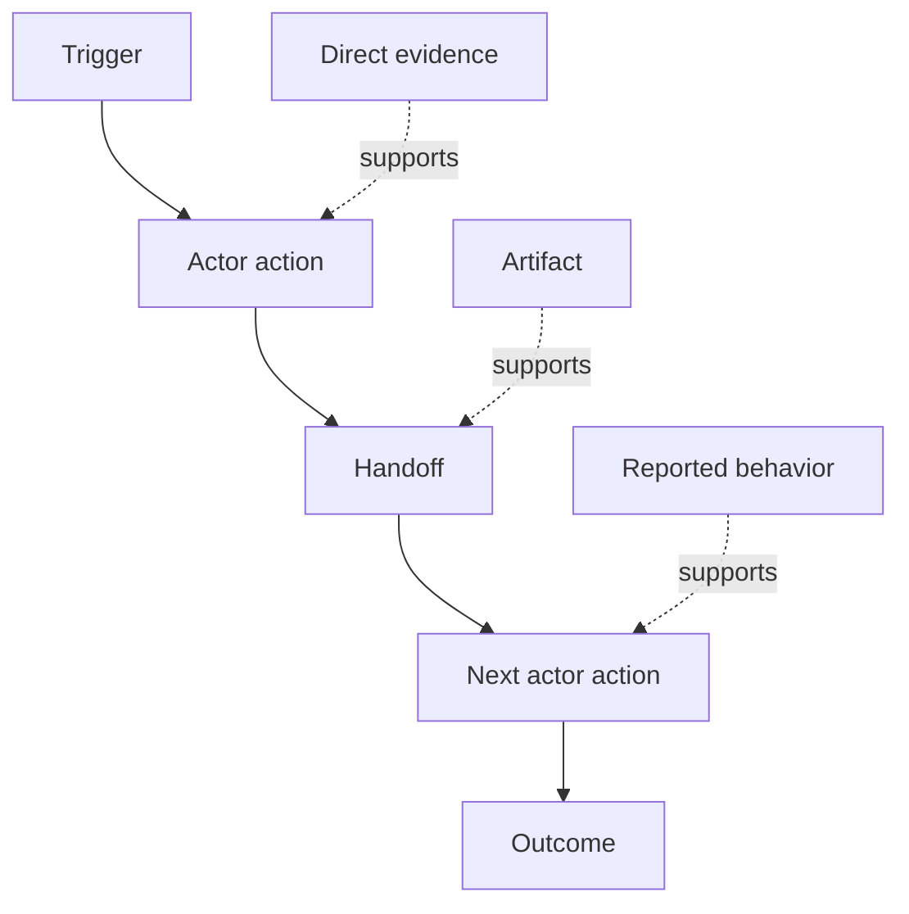

# Découvrez le flux de travail que les gens font réellement

> Les exigences ne sont pas à attendre dans une réunion pour être collectées, elles sont dispersées sur des actions, des solutions, des dossiers et des désaccords.

> **【中文解读】**Le besoin n'est pas de se poser dans les réunions et d'autres personnes, mais de se disperser dans les mouvements, les contours, les enregistrements et les différends. Le cours vous apprend à partir de " ce qui se passe réellement maintenant " à sortir et à travailler.

>  **【前置】**Les résultats de l'examen de cette classe sont exactement ce que nous attendons: les résultats doivent être dans le flux de travail réel des gens, et non dans le flux de travail imaginaire.`outputs/workflow-evidence.json`La classe suivante transformera les frottements et l'incertitude observés en un schéma hypothétique.

**Type:** Learn + Build | **类型:** 学习 + 动手实践
**Languages:** Python (stdlib) | **语言:** Python（标准库）
**Prerequisites:** Phase 14 lesson 47 | **前置知识:** Phase 14 第 47 课
**Time:** ~70 minutes | **时间:** 约 70 分钟

## Objectifs d'apprentissage

- Modéliser le flux de travail actuel en actions ordonnées avec des preuves.
  Le travail actuel est construit en tant que modèle de travail.
- Séparer l'observation directe du comportement rapporté ou déduit.
  Le comportement de l'observation directe est différencié de celui de l'expression.
- Trouvez les frictions, les délivrances, l'autorité et l'état caché.
  Le mot "coupage" est le mot "coupage".
- Gardez les affirmations incertaines visibles au lieu de les transformer en exigences.
  En français, les affirmations sont des affirmations qui ne sont pas définitives.

## Commencez par le système actuel.

Ne commencez pas par demander quelles caractéristiques les gens veulent, mais reconstruisez ce qui se passe maintenant.

> Ne demandez pas ce que les gens veulent faire.

Pour chaque étape, enregistrer:

> Pour chaque étape, enregistrer:

| Field | Example |
|---|---|
| Actor | On-call engineer |
| Trigger | Production alert arrives |
| Action | Opens alert, then searches dashboards |
| Input | Alert payload and deployment record |
| Output | Candidate service and owner |
| Friction | Context switching across three tools |
| Authority | Incident commander approves a write |
| Evidence | Screen recording, incident log, runbook |

Le flux de travail est plus grand que l'écran. Il comprend l'attente, la copie-collage, les canaux latéraux, l'approbation, la récupération d'erreur et les étapes que les gens ont cessé de remarquer.

> 工作流比屏幕大──il comprend les étapes d'attente, de copie, de collage, de petite information, d'approbation, de récupération d'erreur, ainsi que celles que les gens n'ont plus remarqué──

> **【中文解读】**Le point de départ décide la qualité: de " ce que tu veux " à partir du " désir de faire ", de " maintenant comment faire " à partir du " désir de faire " à partir du " désir de faire " à partir du " désir de faire " à partir du " désir de faire " à partir du " désir de faire " à partir du " désir de faire " à partir du " désir de faire " à partir du " désir de faire " à partir du " désir de faire " à partir du " désir de faire " à partir du " désir de faire " à partir du " désir de faire " à partir du " désir de faire " à partir du " désir de faire " à partir du " désir de faire " à partir du " désir de faire " à partir du " désir de faire " à partir du " désir de faire " à partir du " désir de faire " à partir du " désir de faire " à partir du " désir de faire " à partir du " désir de faire " à " désir de faire " à " faire " à " faire " à " faire " à " à " faire " à " à " faire " à " à " faire " à " à " à " faire " à " à " à " faire " à " à " à " faire " à " à " à " à " à " faire " à " à " à " à " à " faire " à " à " à " à " à " à " à " à " à " à " à " à " à " à " à " à " à " à " à " à " à " à " à " à " à " à " à " à " à " à " à " à " à " à " à " à " à " à " à " à " à " à " à " à " à " à " à " à " à " à " à " à " à " à " à " à " à " en " à " à " à " à " à " à " à " à " à " à " à " à " à " à " à " à " à " " " à " " " " " " à " en " à " à " à " à " à " à " " " à " " " " " " à " à " " " " " à " " "

## Les preuves sont fortes.

Utilisez une échelle simple:

> Avec une simple échelle de preuve:

1. **Direct behavior:**observation, trace, enregistrement ou événement du système.
   Le mot grec traduit par " le mot grec "**直接行为：**观察、trace、录屏或系统事件──
2. **Artifact:**billet, annuaire, journal, formulaire ou sortie complète.
   Le mot grec traduit par " le mot grec "**产物：**工单、运维手册、日志、表单或已完成的作品──
3. **Reported behavior:**une personne décrit ce qu'elle fait.
   Le mot grec traduit par " le mot grec "**口述行为：**Quelqu'un décrit comment je fais.
4. **Inference:**L'équipe conclut ce qui se passe probablement.
   Le mot grec traduit par " le mot grec "**推断：**L'équipe a décidé ce qui s'est passé.

Les quatre peuvent être utiles. Seuls les deux premiers prouvent directement le comportement actuel.

> Les quatre niveaux peuvent être utiles, mais seuls les deux premiers peuvent prouver directement le comportement actuel.

> **【中文解读】**Les échelons de preuve sont des mesures de ce cours: les mêmes phrases " les ingénieurs de classe doivent vérifier le tableau de bord " , observées directement, les traces de travail, les déclarations de l'équipe, les spéculations de l'équipe, la crédibilité de plusieurs échelons, les propos et les conclusions ne peuvent pas être utilisées, mais doivent être étiquetées, sinon elles seront considérées comme des faits après deux ou trois fois de rédaction, sur la base du modèle de flux de travail.

>  **【类比】**证据阶梯像新闻信源分级级──之前:会议纪要里"大家都如此干"和录屏观察写作如理直气壮;后:每条记录带级标签直接观察是第一手信源,口述是当事人回忆,推断是编辑推测,信度不再膨胀──



> 图解:触发 → 行动者动作 → 交接 → 下一个行动者动作 → 结果;不同强度的证据(直接证据、产物、口述) 分别支不同的步骤──

## Cherchez quatre choses.

- **Friction:**des efforts répétés, des retards, des réentrées ou des rétablissements.
  Le mot grec traduit par " le mot grec "**摩擦：**Réintégration ou réintégration de la population
- **Hidden state:**des faits contenus dans la mémoire, la conversation ou les notes personnelles.
  Le mot grec traduit par " le mot grec "**隐藏状态：**En se souvenant de faits, de notes personnelles.
- **Authority:**la personne ou le système autorisé à apporter un changement conséquent.
  Le mot grec traduit par " le mot grec "**权限：**Il est permis de faire des changements à la personne ou au système.
- **Exceptions:**le cas où le flux de travail normal cesse d'être normal.
  Le mot grec traduit par " le mot grec "**例外：**Les conditions de travail normales ont disparu.

Les caractéristiques de l'IA échouent souvent à des remises et des exceptions parce que le chemin heureux était le seul chemin façonné.

> L'IA fonctionne souvent dans les situations de connexion et d'exception, car au début, elle n'a créé que des chemins de réussite.

> **【中文解读】**C'est ainsi que le travail est le plus important dans la vie: les points d'amélioration des indications de frottement; l'état caché est le plus grand obstacle à l'automatisation; les pouvoirs décident où il faut laisser un point de contrôle artificiel; l'exception est la source de la réaction commune de "l'environnement de production normal"", la dernière phrase qui mérite d'être copiée et transmise en fonction de l'IA, qui est conçue pour le premier contact ou la première exception.

## Ne pas méditer les désaccords

Deux utilisateurs peuvent effectuer des flux de travail différents pour de bonnes raisons.

>  Deux utilisateurs peuvent exécuter des flux de travail différents, et chacun a des raisons légitimes                                                                                                                                                                                                                                                    

- différents rôles;
  Le rôle de la femme est différent.
- différents niveaux de risque;
  Le mot "je" est traduit par "je" en français.
- l'héritage et le processus actuel;
  Traduction anglaise: vieil processus et nouveau processus;
- les différences d'expertise;
  Le mot "expérience" est traduit par "expérience".
- Un véritable désaccord politique.
  Le mot grec traduit par " politique " est traduit par " politique " en français.

Un flux de travail moyen ne peut décrire personne.

> Un flux de travail moyen peut être décrit.

> **【中文解读】**Rassembler deux variables dans un " flux de travail moyen " est la pratique la plus profonde et la plus dangereuse: elle décrit un utilisateur qui n'existe pas.

## Construisez-le et mettez-le en œuvre.

Le laboratoire stocke des données sur chaque étape du flux de travail, valide l'ordre et la confiance, calcule le rapport direct-évidence et écrit `outputs/workflow-evidence.json`- Je suis désolé .

> La partie expérimentale fournit à chaque processus de travail des preuves de l'ordre et de la confiance des expériences.`outputs/workflow-evidence.json`Il y a une autre.

```bash
python3 code/main.py
python3 -m unittest discover code/tests -v
```

Ajoutez un chemin d'exception dans lequel le dossier de déploiement manque.

> Ajouter un article sur "L'exception des manquements de logements de déploiement"

> **【中文解读】**La pratique de la destruction de l'expérience est exceptionnelle: le processus principal est de maintenir la ligneur, l'exception est une branche de la preuve elle-même, et non une partie de l'expérience.

## Des exercices.

1. Reconstruire un flux de travail à partir d'un journal sans interviewer personne.
   Le récit de la rédaction de la Bible est le récit de la rédaction de la Bible.
2. Interroger un utilisateur et marquer toute allégation qui manque encore de preuves directes.
   En français, le mot "interview" est traduit par "interview".
3. Ajouter une limite d'autorité et une étape de récupération de défaillance.
   En français, une autre version est "Connection de la réforme".
4. Modèle deux variantes de flux de travail sans les fusionner.
   Le mot " travail " est traduit par " travail " en français.
5. Identifiez une caractéristique proposée qui supprime une étape visible mais laisse le travail caché intact.
   En français, "découper les étapes visibles, mais ne pas rencontrer le travail caché" est une fonction proposée.

## Encore une lecture

- [Nuseibeh and Easterbrook, Requirements Engineering: A Roadmap](https://www.cs.toronto.edu/~sme/papers/2000/ICSE2000.pdf)Il est important de noter que les données de base sont disponibles dans les pays tiers.
  Le projet de recherche et développement de l'économie de l'Union européenne (UE) est un projet de recherche et développement de l'économie de l'Union européenne (UE) qui vise à améliorer la qualité de l'économie de l'Union européenne.
- [Gotel and Finkelstein, An Analysis of the Requirements Traceability Problem](https://doi.org/10.1109/ICRE.1994.292398), pour la difficulté de préserver la relation entre les exigences et leurs sources.
  Le problème de la recherche et de la recherche est le problème de la recherche et de la recherche.

## Ce que vous gardez , vous gardez .

Je le garde .`outputs/workflow-evidence.json`Il transforme l'observation de la friction et de l'incertitude en une carte d'hypothèse dans la prochaine leçon.

> Garder à l' écoute`outputs/workflow-evidence.json`◊ Next class will transformer l'affrontement observé et l'incertitude en une hypothèse de carte de la planète.
