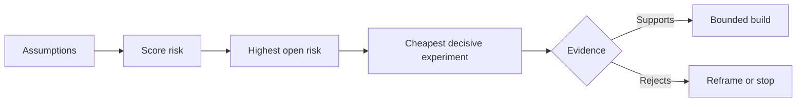

# Suppositions de carte et résoudre le plus risqué d'abord

> Une feuille de route cache l'incertitude à l'intérieur des caractéristiques.

> **【中文解读】**路线图把不确定性藏在一个个"功能"里;假设地图把"这些功能值得存在的前提"摊到桌面上. 本课是代理工程方法论系列的第一节: 第48课发现人们实际执行的工作流, 本课把"这件事值得做"本身分解成一组可证据的假设,根据影响,不确定性,不可逆性三维排行风险,然后先确定最不便宜,最能活死的实验,然后先做最令人兴奋的功能.

>  **【前置】**Les résultats de la formation sont les résultats de l'étude de la formation professionnelle.`outputs/assumption-map.json`Dans la section 50 , on choisit "les plus petits morceaux de preuves décisives".

**Type:** Learn + Build | **类型:** 学习 + 动手实践
**Languages:** Python (stdlib) | **语言:** Python（标准库）
**Prerequisites:** Phase 14 lesson 48 | **前置知识:** Phase 14 第 48 课
**Time:** ~65 minutes | **时间:** 约 65 分钟

## Objectifs d'apprentissage

- Convertir les travaux proposés en hypothèses explicites.
  Le travail du projet de loi est transformé en une hypothèse explicite.
- Les résultats de l'impact, de l'incertitude et de l'irréversibilité sont séparés.
  Le mot "incertitude" est traduit par "incertitude".
- Choisissez l'expérience suivante par risque, pas par enthousiasme.
  Suivant: Le choix de la prochaine expérience
- Remplacez les hypothèses testées par des preuves et des décisions.
  Traduction anglaise: à la place des hypothèses de preuve et de décision.

## Chaque bâtiment contient des paris. Chaque bâtiment est en jeu.

Un outil d'incident peut dépendre de la véracité de tous ces éléments:

> Un outil de traitement des accidents peut être basé sur les éléments suivants:

- le contexte d'alerte contient suffisamment d'informations pour identifier un service;
  Suivant: Les informations contenues dans les informations suivantes sont suffisantes pour identifier les services;
- les ingénieurs font confiance à une recommandation qu'ils n'ont pas dérivées eux-mêmes;
  Traduction anglaise: Ingenieurs会信任一条 ne sont pas des conseils de leur propre chef;
- le temps de réponse souhaité est opérationnellement important;
  Le temps de réponse de l'attente est vraiment important dans le transport.
- les données requises peuvent être consultées sans autorisation dangereuse;
  Néo-Séman: "Nous avons besoin de données sans risque".
- le flux de travail se produit assez souvent pour justifier la maintenance.
  Ce travail est assez fréquent, il vaut la peine de le maintenir à long terme.

Ce ne sont pas des tâches de mise en œuvre, mais des conditions pour que la construction soit précieuse, utilisable, viable et sûre.

> Ce ne sont pas des tâches à réaliser, mais des conditions préalables à la construction de "valeur, utilisation, exploitation, sécurité".

> **【中文解读】**Chaque ligne de la liste des fonctions est soumise à plusieurs implications: l'utilisateur va-t-il en faire usage, les données seront-elles obtenues, l'organisation les conservera-t-elle ? Les diagrammes de route ne montrent jamais ces implications, elles ne se manifestent qu'après leur réalisation sous forme de retour ou d'abandon.

## Les classes de suppositions

| Class | Question |
|---|---|
| Value | Will the outcome matter enough? |
| Usability | Can the user understand and act on it? |
| Feasibility | Can the system produce it with available data and constraints? |
| Viability | Can the organization sustain cost, ownership, and operation? |
| Safety | Can it fail without unacceptable consequence? |

> **【中文解读】**五类假设各问一个问题:价值 (¿¿¿¿¿¿¿¿¿¿¿¿¿¿¿¿¿¿¿¿¿¿¿¿¿¿¿¿¿¿¿¿¿¿¿¿¿¿¿¿¿¿¿¿¿¿¿¿¿¿¿¿¿¿¿¿¿¿¿¿¿¿¿¿¿¿¿¿¿¿¿¿¿¿¿¿¿¿¿¿¿¿¿¿¿¿¿¿¿¿¿¿¿¿¿¿¿¿¿¿¿¿¿¿¿¿¿¿¿¿¿¿¿¿¿¿¿¿¿¿¿¿¿¿¿¿¿¿¿¿¿¿¿¿¿¿¿¿¿¿¿¿¿¿¿¿¿¿¿¿¿¿¿¿¿¿¿¿¿¿¿¿¿¿¿¿¿¿¿¿¿¿¿¿¿¿¿¿¿¿¿¿¿¿¿¿¿¿¿¿¿¿¿¿¿¿¿¿¿¿¿¿¿¿¿¿¿¿¿¿¿¿¿¿¿¿¿¿¿¿¿¿¿¿¿¿¿¿¿¿¿¿¿¿¿¿¿¿¿¿¿¿¿¿¿¿¿¿¿¿¿¿¿¿¿¿¿¿¿¿¿¿¿¿¿¿¿¿¿¿¿¿¿¿¿¿¿¿¿¿¿¿¿¿¿¿¿¿¿¿¿¿¿¿¿¿¿¿¿¿¿¿¿¿¿¿¿¿¿¿¿¿¿¿¿¿¿¿¿¿¿¿¿¿¿¿¿¿¿¿¿¿¿¿¿¿¿¿¿¿¿¿¿¿¿¿¿¿¿¿¿¿¿¿¿¿¿¿¿¿¿¿¿¿¿¿¿¿¿¿¿¿¿¿¿¿¿¿¿¿¿¿¿¿¿¿¿¿¿¿¿¿¿¿¿¿¿¿¿¿¿¿¿¿¿¿¿¿¿¿¿¿¿¿¿¿¿¿¿¿¿¿¿¿¿¿¿¿¿¿¿¿¿¿¿¿¿¿¿¿¿¿¿¿¿¿¿¿¿¿¿¿¿¿¿¿¿¿¿¿¿¿¿¿¿¿¿¿¿¿¿¿¿¿¿¿¿¿¿¿¿¿¿¿¿¿¿¿¿¿¿¿¿¿¿¿¿

Écrivez des hypothèses comme des déclarations falsifiables. La fonctionnalité est utilene peut pas être testée. 8 ingénieurs sur dix sur appel identifient le service correct plus rapidement avec le résultat de lecture seulement peut.

> " Cette fonction est utile " n'est pas vérifiée; " huit ingénieurs sur dix ont pu lire les résultats plus rapidement pour se positionner sur le bon service "

## Le risque n' est pas un nombre.

Le laboratoire utilise trois dimensions de 1 à 5:

> 实验代码 avec trois dimensions de 1 à 5:

- **Impact:**les dommages si l'hypothèse est fausse.
  Le mot grec traduit par " le mot grec "**影响：**假设为假时的损失──
- **Uncertainty:**faiblesse des preuves actuelles.
  Le mot grec traduit par " le mot grec "**不确定性：**Il existe des preuves de faiblesse.
- **Irreversibility:**le coût de l'apprentissage après engagement.
  Le mot grec traduit par " le mot grec "**不可逆性：**Le prix de la réapprentissage après avoir fait un engagement.

Le score d'exemple multiplie l'impact et l'incertitude, puis ajoute l'irréversibilité. La formule n'est pas universelle. Son but est de forcer l'équipe à déclarer pourquoi un inconnu doit être résolu avant un autre.

> Exemple: les évaluations ont pour effet de multiplier l'incertitude, de réapporter l'irréversibilité. Cette formule n'est pas courante, elle a pour but de faire comprendre aux équipes pourquoi cette question inconnue doit être résolue avant celle-ci.

>  **【类比】**假设排雷像拆迁前的房屋检查:每面墙(假设) 分别量三数会倒塌多大面积(影响) 结构判断有多拿不准(不确定性) 错了还能不能回去(不可逆性) 首处理"倒塌最疼 + 最拿不准 + 不回去"



> **【中文解读】**Le schéma de processus est l'émotion du cours: supposer → 打风险分 → 找到风险最高且仍开放的假设 → 为了它设计最便宜的决定性实验 → 证据要支持或支持(进入有边界的建设),要反对(重建问题或直接停止) 注意两个出口都不叫"继续按照原计划做"实验的意义是让失败发生在一个便宜的地方

## Conceptez une expérience, pas un rituel de confirmation.

Un test utile a:

> Un test utile:

- une allégation qui pourrait être fausse;
  Une affirmation peut être fausse.
- une population ou un échantillon réaliste;
  Traduction anglaise: un véritable ensemble ou un modèle réel;
- un résultat observable;
  Le résultat de la réaction est le résultat de la réaction.
- un seuil décidé avant le résultat;
  Un résultat déterminé avant de voir le résultat;
- une décision suivante pour la réussite, l'échec et des preuves ambiguës.
  Pour passer, rater et perdre, être prêt à prendre une décision.

Évitez les tests qui démontrent que l'équipe peut construire l'idée.

> Évitez les tests qui montrent que l'équipe peut le faire.

> **【中文解读】**"Rituel de confirmation" désigne les démonstrations qui, quel que soit le résultat, continueront à être faites. Les démonstrations réussissent sur la ligne, échouent sur la ligne de révision.

## La réversibilité change l'ordre.

Les choix irréversibles et de haute conséquence nécessitent des preuves antérieures. Un jeu de lecture uniquement peut précéder une intégration de production. Un adaptateur temporaire peut précéder une migration de données. Une recommandation approuvée par l'homme peut précéder une action automatique.

> Les conséquences de la sélection importante et irréversible nécessitent des preuves plus précoces. Les références peuvent être transmises avant l'intégration de la production; les adaptateurs temporaires peuvent être transmis avant la migration des données; les recommandations d'approbation artificielle peuvent être transmises avant l'exécution automatique.

La forme de la construction doit suivre la forme de l'incertitude.

> La forme de la construction doit être conforme à la forme de l'incertitude.

> **【中文解读】**Le principe de la régularité n'a qu'une seule phrase: plus il est difficile de revenir à la décision, plus il faut obtenir des preuves sur une forme alternative à la baisse.

## Construisez-le et mettez-le en œuvre.

Le laboratoire classe les hypothèses, distingue les affirmations testées des affirmations ouvertes, sélectionne le risque ouvert le plus élevé et écrit `outputs/assumption-map.json`- Je suis désolé .

> √ Le code d'expérimentation donne une séquence de hypothèses √ la différence entre les déclarations vérifiées et toujours ouvertes √ choisir les projets ouverts les plus risqués, et écrire √`outputs/assumption-map.json`Il y a une autre.

```bash
python3 code/main.py
python3 -m unittest discover code/tests -v
```

Modifiez les preuves sur l'hypothèse de risque le plus élevé et observez comment l'expérience suivante change.

> 修改风险最高那条假设的证据 字段,观察"下一个实验" comment cela change avec elle

> **【中文解读】** `risk_score = impact * uncertainty + irreversibility`C'est un mathématique délibérément simple dont l'existence ne signifie pas précisément, mais transforme le " premier fait quel expérience " en un problème explicite discutable, réalisable.

## Des exercices.

1. Écrivez cinq hypothèses pour une fonctionnalité que vous voulez construire.
   Pour toi, il y a une fonction qui se passe.
2. Ajoutez une hypothèse de sécurité que votre liste de fonctionnalités a omise.
   Le mot "réfléchissez" est le mot "réfléchissez".
3. Définissez un seuil qui vous amènerait à arrêter la construction.
   Définir un qui vous fera arrêter cette construction 值──
4. Remplacez une grande expérience par un test décisif moins cher.
   Traduction anglaise: mettre en place une grande expérience pour une expérience moins chère mais aussi décisive.
5. Comparer le classement des risques avec la priorité de la feuille de route et expliquer le désaccord.
   Le premier est le premier, le deuxième est le premier.

## Encore une lecture

- [Barry Boehm, A Spiral Model of Software Development and Enhancement](https://dl.acm.org/doi/10.1145/12944.12948), pour un cycle de développement axé sur le risque qui résout l'incertitude avant un engagement plus profond.
  Le cycle de développement du modèle Boehm est un cycle de développement qui se déplace par le vent.
- [Dardenne, van Lamsweerde, and Fickas, Goal-Directed Requirements Acquisition](https://doi.org/10.1016/0167-6423(93)90021-G), pour le raffinement des objectifs tout en supprimant les obstacles et les contraintes.
  L'objectif est de réaliser des objectifs et de les atteindre.

## Ce que vous gardez , vous gardez .

Je le garde .`outputs/assumption-map.json`La leçon suivante l'utilise pour choisir la plus petite tranche qui puisse produire des preuves décisives.

> Garder à l' écoute`outputs/assumption-map.json`️ La classe suivante l'utilisera pour sélectionner les moindres morceaux de preuves décisives
