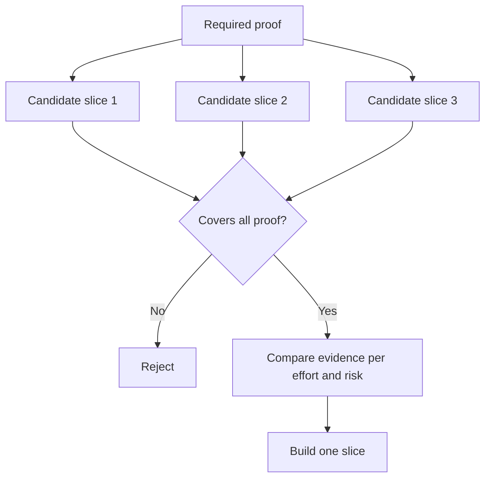

# Choisissez la plus petite tranche qui peut changer la décision

> Une petite chose n'est utile que si elle prouve quelque chose d'important.

> **【中文解读】**" faire petit " n'a de valeur que dans la capacité de prouver qu'il faut faire des choses urgentes. Une petite construction ne change pas la décision de l'étape suivante, n'est pas la plus petite pièce à réaliser, mais n'est pas terminée.

>  **【前置】**Les résultats de la formation sont les suivants:`outputs/slice-decision.json`Il sera fait une entrée dans le document de 51e classe.

**Type:** Learn + Build | **类型:** 学习 + 动手实践
**Languages:** Python (stdlib) | **语言:** Python（标准库）
**Prerequisites:** Phase 14 lesson 49 | **前置知识:** Phase 14 第 49 课
**Time:** ~65 minutes | **时间:** 约 65 分钟

## Objectifs d'apprentissage

- Définissez une tranche par les hypothèses qu'elle prouve.
  Le mot "coup" est utilisé pour décrire le coup.
- Équilibrer la valeur des résultats, la réduction de l'incertitude, l'effort et les conséquences.
  Traduction anglaise: faire un bilan entre la valeur des résultats, l'incertitude, la diminution, l'investissement et les résultats.
- Je préfère des preuves réversibles à l'engagement de production prématurée.
  Traduction anglaise: priorité choisir des preuves réversibles, plutôt que des engagements de production prématurés.
- Rejetez les tranches qui omettent la partie risquée du flux de travail.
  Rejeté les morceaux qui ont été déclenchés par le vent du travail.

## La preuve signifie que la preuve est de bout en bout.

Une tranche utile traverse le flux de travail réel minimum nécessaire pour observer un résultat. Elle peut être étroite en termes d'utilisateurs, de données, de durée et de capacité. Elle ne doit pas être étroite en éliminant l'incertitude exacte dont vous avez besoin pour tester.

> Un morceau utile pour "observer un résultat" peut être le plus petit flux de travail réel nécessaire. Il peut se rétrécir sur les capacités des utilisateurs, des données, du temps, des capacités, mais ne peut pas se rétrécir en coupant "l'incertitude que vous voulez vérifier".

Les exemples:

> Je suis un enfant.

- Une répétition en lecture seulement sur dix incidents réels teste l'identification du service et la confiance de l'opérateur.
  Le service de reconnaissance et de confiance des opérateurs.
- Un tableau de bord polissé sur des données synthétiques peut tester la compréhension mais pas la faisabilité des données.
  Traduction chinoise: un dispositif de contrôle de la qualité de la matière à base de données synthétiques peut être capable de "voir bien comprendre", mais ne peut pas vérifier la faisabilité des données.
- Un remédiateur automatique de production teste tout en même temps avec des conséquences inacceptables.
  La production environnementale est automatiquement réparée, une fois, elle est testée, mais les résultats sont inacceptables.

> **【中文解读】**" longitudinal " signifie " extrême à extrême " et " véritable flux de travail ": l'entrée est réelle, le chemin de décision est réel, il est possible d'observer un résultat. " Régré de direction " ne peut être que la portée de la personne, du nombre de données, du temps), ne peut pas être la profondeur de la tâche la plus difficile à réaliser. " Deuxièmement, trois exemples sont deux réactions typiques:

>  **【类比】**Il faut avoir un vrai réseau d'eau. Si le réseau n'est pas en électricité, il ne s'avère jamais possible de " vivre " sur ce problème, c'est juste un tableau.

## Définir la preuve requise Premièrement définir la preuve nécessaire

Prenez les hypothèses ouvertes à risque élevé et transformez-les en un ensemble de preuves requis.

> 取出风险最高的开放假设, transformés en un "ensemble de preuves essentielles"  Les candidats ne peuvent être élus que pour couvrir ce groupe, et sont éligibles à des commentaires 

Comparer les tranches admissibles sur:

> Puis comparer entre les pièces qualifiées:

| Dimension | Direction |
|---|---|
| Outcome value | More is better |
| Uncertainty reduced | More is better |
| Effort | Less is better |
| Consequence | Less is better |
| Reversibility | More is better |

Le score du laboratoire est intentionnellement simple.

> 实验代码的评分故意简单――资格门比算术更重要――



> **【中文解读】**L'ordre ici est au cœur du cours: qualification (en anglais) en avant, évaluation (en anglais) en arrière. Les évaluations sont encore élevées, à condition que l'on manque d'une preuve indispensable de non-réponse. Cela empêche l'élaboration d'un programme " bon marché mais non prouvé ".

## Les faux minimums communs

- **The UI-only minimum:**supprime les données et l'incertitude opérationnelle.
  Le mot grec traduit par " le mot grec "**只有 UI 的最小：**L'incertitude des données et du niveau de transport a été supprimée.
- **The infrastructure-only minimum:**prouve une possibilité technique sans valeur utilisateur.
  Le mot grec traduit par " le mot grec "**只有基础设施的最小：**☐ la valeur de l'utilisateur n'est pas prouvée.
- **The happy-path minimum:**Il n'y a pas de risque.
  Le mot grec traduit par " le mot grec "**只有正常路径的最小：**Il a perdu la majeure partie de son risque de fabrication.
- **The demo minimum:**produit un artefact persuasif mais aucune mesure répétée.
  Le mot grec traduit par " le mot grec "**演示级最小：**Il a produit des démonstrations convaincantes, mais sans mesure récurrente.
- **The platform minimum:**construit des machines réutilisables avant qu'un seul flux de travail ne les gagne.
  Le mot grec traduit par " le mot grec "**平台级最小：**Avant de réaliser une valeur de prouver un flux de travail, on a déjà fait des machines réutilisables.

> **【中文解读】**Les cinq fausses tentations les plus faibles sont: UI, inférieur à l'appétit des ingénieurs, démonstration des moindres moindres et plus puissants. Leur point commun est de contourner systématiquement le risque réel et le sens de "minimum" est de faire apparaître le risque plus tôt.

## Ajouter une règle d'arrêt.

Avant la mise en œuvre, écrivez ce qui se passe si la tranche échoue:

> Avant de réaliser, écrivez "Cette partie a échoué:

- abandonner le résultat;
  Le résultat est de laisser tomber le résultat.
- modifier l'utilisateur cible ou la situation;
  Traduit en français par:
- tester un mécanisme différent;
  Le mot "réinitiation" est traduit par "réinitiation".
- recueillir de meilleures preuves;
  Le premier à recueillir de meilleures preuves;
- - Il faut encore plus de pouvoir.
  Le pouvoir d'accueil est plus restreint.

Si chaque résultat conduit à la construction, la tranche n'est pas une expérience.

> Si chaque résultat est "continué", ce n'est pas une expérience.

> **【中文解读】**停止规则是实验的"诚实检查": un tout se termine par un morceau de "continuer à construire", simplement en suivant le plan établi de l'expérience.

## Construisez-le et mettez-le en œuvre.

Le laboratoire filtre les candidats par la preuve requise, marque les tranches admissibles et écrit `outputs/slice-decision.json`- Je suis désolé .

> 实验代码 实验代码 实验代码 实验代码 实验代码 实验代码 实验代码 实验代码 实验代码 实验代码 实验代码 实验代码 实验代码 实验代码 实验代码 实验代码 实验代码 实验代码 实验代码 实验代码 实验代码 实验代码 实验代码 实验代码 实验代码 实验代码 实验代码 实验代码 实验代码 实验代码 实验代码 实验代码 实验代码 实验代码 实验代码 实验代码 实验代码 实验代码 实验代码 实验代码 实验代码 实验代码 实验代码 实验代码 实验代码 实验代码 实验代码 实验代码 实验代码 实验代代代代代代代代代代代代代代代代代代代代代代代代代代代代代代代代代代代代代代代代代代代代代代代代代代代代代代代代代代代代代代代代代代代代代代代代代代代代代代代代代代代代代代代代代代代代代代代代代代代代代代代代代代代代代代代代代代代代代代代代代代代代代代代代代代代代代代代代代代代代代代代代代代代代代代代代代代代代代代代代代代代代代代代代代代代代代代代代代代代代代代代代代代代代代代代代代代代代代代代代代代代代代代代代代代代代代代代代代代代代代代代代代代代代代代代代代代代代代代代代代代代代代代代代代代代代代代代代代代代代代代`outputs/slice-decision.json`Il y a une autre.

```bash
python3 code/main.py
python3 -m unittest discover code/tests -v
```

Ajouter un candidat moins cher qui prouve une seule hypothèse requise. Il devrait rester ineligible même si son score numérique est élevé.

> Il n'y a qu'une seule preuve d'une hypothèse nécessaire, mais des candidatures moins chères. Même si son score est très élevé, il ne devrait pas être admissible à l'évaluation.

> **【中文解读】** `score = (结果价值 + 不确定性消减) / (投入 + 后果 × 不可逆系数)`只是 un outil de rangement; le vrai gardien est un ensemble contenant des contrôles `required_proof <= set(item.proves)`: un candidat bon marché mais sans couvrir toutes les preuves nécessaires, les notes de reprise sont également insuffisantes dans le groupe de candidature: c'est la codification de la " qualification ":

## Des exercices.

1. Conçuez trois tranches pour le même résultat à différents niveaux de conséquences.
   Pour le même résultat, trois épisodes de différents résultats.
2. Indiquez la preuve requise avant de les marquer.
   En français, traduit par " dans le temps "
3. Retirez une capacité tout en préservant les preuves décisives.
   En français, la capacité de décider est une capacité de décider.
4. Ajoutez une règle d'arrêt pour un pilote raté.
   Pour une fois, essayer de ne pas réussir est une règle de suspension.
5. Identifier un composant de plateforme réutilisable qui devrait attendre après la tranche.
   En français, le composant de la plateforme peut être utilisé à nouveau.

## Encore une lecture

- [Barry Boehm, A Spiral Model of Software Development and Enhancement](https://dl.acm.org/doi/10.1145/12944.12948), pour adapter chaque cycle de développement aux risques qu'il doit résoudre.
  Le modèle Boehm 螺旋模型让每一轮发展循环对应它必须解决的风险
- [Lenarduzzi and Taibi, MVP Explained: A Systematic Mapping Study on the Definitions of Minimal Viable Product](https://arxiv.org/abs/1609.07592), pour l'ambiguïté concernant les minimum et viable dans la pratique des produits logiciels.
  Le mot "minimum" et "可行" sont deux mots de la pratique du logiciel.

## Ce que vous gardez , vous gardez .

Je le garde .`outputs/slice-decision.json`Il indique pourquoi cette tranche est la plus petite qui puisse changer la décision.

> Garder à l' écoute`outputs/slice-decision.json`Il a expliqué pourquoi ce morceau est "le plus petit morceau capable de changer une décision".
