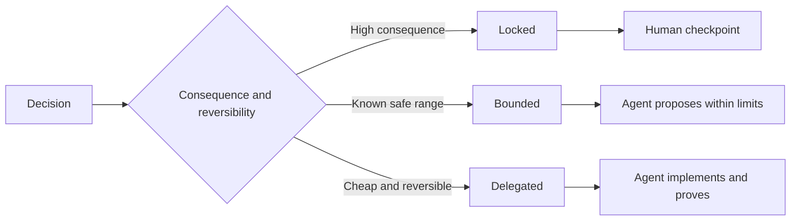

# Écrivez des spécifications qui préservent le jugement.

> Une spécification utile fixe les invariants et les preuves tout en laissant des choix de mise en œuvre réversibles ouverts.

> **【中文解读】**Un bon règlement bloque "non variable et preuve", laisse le choix de réalisation inverse à l'exécuteur c'est la limite de décision, pas un scénario. Le problème réel de l'époque de l'agent: les tâches sont écrites trop grossières, l'agent ne peut que deviner le système; écrites trop petites, le agent est déformé pour écrire, copié un modèle qui aurait pu être sur le mauvais design.

>  **【前置】**Les cours suivants sont les suivants: la phase 14 (l'article 50), la phase 14 (l'article 33), la phase 14 (l'article 33), la phase 14 (l'article 33), la phase 14 (l'article 33), la phase 14 (l'article 33), la phase 14 (l'article 33), la phase 14 (l'article 33), la phase 14 (l'article 14), la phase 14 (l'article 14), la phase 14 (l'article 14), la phase 14 (l'article 14), la phase 14 (l'article 14), la phase 14 (l'article 14), la phase 14 (l'article 14), la phase 14 (l'article 14), la phase 14 (l'article 14), la phase 4 (l'article 14), la phase 4 (l'article 14), la phase 4 (l'article 14), la phase 4 (l'article 14), la phase 2 (l'article 14), la phase 2 (l'article 14), la phase 2 (l'article 14), la phase 2 (l'article 14), la phase 2 (l'article 14), la phase 2 (l'article 6), la section 5 (l'article 6), la section 5), la section 5 (l'article 6), la section 5 (l'article 6), la section 5), la section 5 (l'article 7), la section 5), la section 5 (l'article 7), la section 5), la section 5 (l'article 7), la section 6 (l'article 7), la section 6), la section 6 (l'article 7), la section 6 (l) et la section 6 (l) et la section 6 (l) du droit) et la section (l) du droit) du droit) du droit) du droit) du droit (l) du droit) du droit) du droit (l) (l) (l) (l) (l) (l) (l) (l) (l) (l) (l) (l) (l) (l) (l) (l) (l) (l) (l) (l) (l) (l) (l) (l) (l) (l) (l) (l) (l) (l) (l) (l) (l) (l) (l) (l) (l) (`outputs/executable-specification.json`Il est codé agent et l'homme de l'évaluation partagée.

**Type:** Learn + Build | **类型:** 学习 + 动手实践
**Languages:** Python (stdlib) | **语言:** Python（标准库）
**Prerequisites:** Phase 14 lesson 50 | **前置知识:** Phase 14 第 50 课
**Time:** ~75 minutes | **时间:** 约 75 分钟

## Objectifs d'apprentissage

- Résultat séparé, invariants, exemples, non-objectifs et preuve.
  Le résultat de la réaction est le résultat de la réaction de la réaction de la réaction de la réaction de la réaction de la réaction de la réaction de la réaction de la réaction de la réaction de la réaction de la réaction de la réaction de la réaction de la réaction de la réaction de la réaction de la réaction de la réaction de la réaction de la réaction de la réaction de la réaction de la réaction de la réaction de la réaction de la réaction de la réaction de la réaction de la réaction de la réaction de la réaction de la réaction de la réaction de la réaction de la réaction de la réaction de la réaction de la réaction de la ré ré.
- Marquez les décisions comme étant fermées, limitées ou déléguées.
  Traduction anglaise:把每个决定标注为锁定、受限或委托──
- Gardez le jugement des agents où les choix sont bon marché et réversibles.
  Le pouvoir de jugement de l'agent est conservé dans le choix de l'agent à un prix abordable.
- Exiger des points de contrôle humains où les conséquences ou le comportement public changent.
  En français, la force de contrôle artificiel est imposée dans les endroits où les comportements sont considérablement ou ouvertement modifiés.

## Deux extrêmes mauvais.

Une tâche sous-spécifiée demande à un agent de deviner le système.

> 规格不足的任务让代理去猜系统;规格过度的任务让它抄写一个可能就就错的设计――

Le moyen utile est un contrat exécutable:

> Le mode intermédiaire utile est un contrat exécutable:

| Surface | Purpose |
|---|---|
| Outcome | The observable result |
| Invariants | Conditions that must always remain true |
| Examples | Concrete cases that reveal intent |
| Non-goals | Adjacent behavior intentionally excluded |
| Decision policy | Which choices are locked, bounded, or delegated |
| Proof | Evidence required before completion |

> **【中文解读】**两个极端对应两种浪费:规格不足浪费在返工上(Agent 猜错了重做),规格过度浪费在翻译上(人把设计写成伪代码,Agent 再转抄成代码,中间没有增量智能) 六面契约是中间路:结果说清"要什么"、不变量说清"任何时候不能破坏什么"、示例传递意图、非目标划边界、决策政策声明授权、证明定义"完成"

## Trois modes de décision.

- **Locked:**L'utilisation pour la compatibilité publique, l'autorité, la sécurité, le coût irréversible ou un engagement du produit.
  Le mot grec traduit par " le mot grec "**锁定（Locked）：**L'agent n'a pas à être choisi par lui-même. Il est utilisé pour une compatibilité publique, des droits, de la sécurité, des coûts irréversibles ou des engagements de produits.
- **Bounded:**L'agent peut choisir dans des limites explicites. Utilisation pour les budgets de recherche, les recensements d'essais, les dépendances autorisées ou une famille d'interface connue.
  Le mot grec traduit par " le mot grec "**受限（Bounded）：**L'agent peut choisir dans des limites précises. Pour rechercher le budget, le nombre de fois de test, la dépendance autorisée, la famille de contacts connue.
- **Delegated:**L'agent possède le choix et doit l'expliquer.
  Le mot grec traduit par " le mot grec "**委托（Delegated）：**L'agent possède cette option, mais il doit pouvoir l'expliquer.



> **【中文解读】**Les trois modes de classification ne sont qu'un seul problème: les conséquences et la réversibilité. Les conséquences sont grandes et irréversibles. Ils sont bloqués et disposent de points de contrôle artificiels. Les conséquences sont contrôlables mais sont sûres. Ils sont limités.

>  **【类比】**Trois types de décisions sont pris en compte dans les contrats de rénovation: les contrats de construction et de construction de bâtiments ou de bâtiments, les contrats de construction ou de construction de bâtiments ou de bâtiments ou de bâtiments ou de bâtiments ou de bâtiments ou de bâtiments ou de bâtiments ou de bâtiments ou de bâtiments ou de bâtiments ou de bâtiments ou de bâtiments ou de bâtiments ou de bâtiments ou de bâtiments ou de bâtiments ou de bâtiments ou de bâtiments ou de bâtiments ou de bâtiments ou de bâtiments ou de bâtiments ou de bâtiments ou de bâtiments ou de bâtiments ou de bâtiments ou de bâtiments ou de bâtiments ou de bâtiments ou de bâtiments ou de bâtiments ou de bâtiments ou de bâtiments ou de bâtiments ou de bâtiments ou de bâtiments ou de bâtiments ou de bâtiments ou de bâtiments ou de bâtiments ou de bâtiments ou de bâtiments ou de bâtiments ou de bâtiments ou de bâtiments ou de bâtiments ou de bâtiments ou de bâtiments ou de bâtiments ou de bâtiments ou de bâtiments ou de bâtiments ou de bâtiments ou de bâtiments ou de bâtiments ou de bâtiments ou de bâtiments ou de bâtiments ou de bâtiments ou de bâtiments ou de bâtiments ou de bâti ou de bâti ou de bâti ou de bâti ou de bâti ou de bâti ou de bâti ou de bâti ou de bâti ou de bâti ou de bâti ou de bâti ou de bâti ou de bâti ou de bâti ou de bâti ou de bâti ou de bâti ou de bâti ou de bâti ou de bâti ou de bâti ou de bâti ou de bâti ou de bâti ou de bâti ou de bâti ou de bâti ou de bâti ou de bâti ou de bâti ou de bâti ou de bâti ou de bâti ou de bâti ou de bâti ou de bâti ou de bâti ou de bâti ou de bâti ou de

## Définir le comportement par des exemples.

Les exemples comprennent mieux l'intention que les adjectifs. Utilisants,  robustes, et prêt à la production ne sont pas exécutables.

> Exemples de situations de défaillance et de non-conformité, donnant aux constructeurs et aux vérificateurs des éléments concrets à saisir.

Les exemples ne remplacent pas les invariants.

> Les exemples ne peuvent pas remplacer la quantité de changements.

> **【中文解读】**Cette section résolve "形容词陷": écrire "输出要干净" est comme tout ce qui n'est pas écrit, écrire "donner un message à un responsable de service avec un ID déployé" est seulement transmettre des intentions.

## La preuve doit être conforme à la déclaration.

- Un test d'unité prouve un contrat de fonction locale.
  Le texte de la lettre de référence est le texte de la lettre de référence.
- Un test de fil prouve la sérialisation et le comportement de transport.
  Le test de preuve de séquence et de transmission
- Un parcours de navigateur prouve un chemin d'interface.
  Le lien est en anglais.
- Un ensemble de répétitions prouve le comportement sur des cas représentatifs.
  Le comportement de démonstration dans les cas d'utilisation représentative
- Un journal d'audit prouve que les limites de l'autorité étaient respectées.
  Le pouvoir de contrôle de la frontière est en train de se maintenir.

Ne pas accepter une couche inférieure comme preuve d'une affirmation de couche supérieure.

> Ne prenez pas de preuves inférieures pour confirmer les affirmations de haut niveau.

> **【中文解读】**Chaque type de preuve a sa propre juridiction: fonction de tube de test de l'unité, protocole de tube de test de fil, interface de navigateur, comportement de collecte de données, contrôle des données de contrôle.

## Gardez l' inconnu délibérément

Une spécification peut dire que l'exécution peut choisir n'importe quelle source à lire uniquement qui revient dans le budget. Ce n'est pas une vagueur.

> La réglementation peut être écrite comme " réaliser une seule source de données à lire qui peut être choisie dans le budget du temps ".

Les spécifications doivent évoluer lorsque les preuves changent. Préserver la raison derrière les choix verrouillés et limités afin que les équipes ultérieures puissent les réviser sans archéologie.

> Les preuves changent, les règles doivent également évoluer.

> **【中文解读】**La différence entre "avoir envie de garder l'ignorance" et "ne pas penser clairement" réside dans la limite et la preuve: le premier écrit un espace de choix (en utilisant le budget du temps) et l'acceptation (en utilisant le budget du temps) de la preuve, le second ne dit rien.

## Construisez-le et mettez-le en œuvre.

Le laboratoire valide chaque surface du contrat, vérifie les modes de décision et écrit `outputs/executable-specification.json`- Je suis désolé .

> 实验代码校验契约 检查决策模式,并写出 `outputs/executable-specification.json`Il y a une autre.

```bash
python3 code/main.py
python3 -m unittest discover code/tests -v
```

Mettre la décision de production-écriture de verrouillé à délégué. Expliquez pourquoi le schéma accepte la valeur mais le risque produit ne l'accepte pas.

> Pour mettre cette décision de "production write in" de verrouillé 改成委托── expliquer pourquoi cette valeur est acceptée, alors que le produit risque n'est pas accepté──

> **【中文解读】**Les deux règles de l'épreuve sont les suivantes: six facettes manquantes et non mandatées doivent être justifiées " sans motif de verrouillage " et " sans face de contrat " sont jugées incomplètes.

## Des exercices.

1. Convertir un billet de retard dans les six surfaces de spécifications.
   Le texte est en français.
2. Remplacez trois instructions d'exécution par une invariante et deux exemples.
   Le texte de la loi est remplacé par un texte de la loi.
3. Marquez chaque décision et justifiez chaque choix bloqué ou limité.
   Traduction anglaise: donner à chaque décision un mode de marque, et donner une raison à chaque choix de verrouillage ou de restriction.
4. Ajoutez un reçu de preuve pour chaque invariante.
   Pour chaque article de la preuve de la résistance.
5. Supprimer une contrainte qui n'a aucune preuve ou aucune raison de risquer.
   Le texte de la loi est en français.

## Encore une lecture

- [Nuseibeh and Easterbrook, Requirements Engineering: A Roadmap](https://www.cs.toronto.edu/~sme/papers/2000/ICSE2000.pdf), pour la relation entre les objectifs, les spécifications précises, la validation, l'accord et l'évolution.
  Le projet de recherche est un projet de recherche de recherche de recherche de recherche de recherche de recherche de recherche de recherche de recherche de recherche de recherche de recherche de recherche de recherche de recherche de recherche de recherche de recherche de recherche de recherche de recherche de recherche de recherche de recherche de recherche de recherche de recherche de recherche de recherche de recherche de recherche de recherche de recherche de recherche de recherche de recherche de recherche de recherche de recherche de recherche de recherche de recherche de recherche de recherche de recherche de recherche de recherche de recherche de recherche de recherche de recherche de recherche de recherche de recherche de recherche de recherche de recherche de recherche de recherche de recherche de recherche de recherche de recherche de recherche de recherche de recherche de recherche de recherche de recherche de recherche de recherche de recherche de recherche de recherche de recherche de recherche de recherche de recherche de recherche de recherche de recherche de recherche de recherche de recherche de recherche de recherche de recherche de recherche de recherche de recherche de recherche de recherche de recherche de recherche de recherche de recherche de recherche de recherche de recherche de recherche de recherche de recherche de recherche de recherche de recherche de recherche de recherche de recherche de recherche de recherche de recherche de recherche de recherche de recherche de recherche de recherche de recherche de recherche de recherche de recherche de recherche de recherche de recherche de recherche de recherche de recherche de recherche de recherche de recherche de recherche de recherche de recherche de recherche de recherche de recherche de recherche de recherche de recherche de recherche de recherche de recherche de recherche de recherche de recherche de recherche de recherche de recherche de recherche de recherche de recherche de recherche de recherche de recherche de recherche de recherche de recherche de recherche de recherche de recherche de recherche de développement de développement de développement de développement de développement de développement de développement de développement de développement de développement de développement de développement de développement de développement de développement de développement de développement de développement de développement de développement de développement de développement de développement de développement de développement de développement de développement de développement de développement de développement de développement de développement de développement de développement de développement de développement de développement de développement de développement de développement de développement de développement de développement de développement de développement de développement de développement de développement de développement de développement de développement de développement de développement de développement de développement de développement de développement de développement de développement de développement de développement de développement de développement de développement de développement de développement de développement de développement de développement de développement de développement de développement de développement de développement de développement de développement de développement de développement de développement de développement de développement de développement de développement de développement de développement de développement de développement de développement de développement de développement de développement de
- [Zave and Jackson, Four Dark Corners of Requirements Engineering](https://doi.org/10.1145/267895.267896), pour séparer les hypothèses, les exigences et les spécifications environnementales.
  Zave et Jackson ont créé un projet de conception de l'environnement en termes de besoins et de spécificités.
- [Gotel and Finkelstein, An Analysis of the Requirements Traceability Problem](https://doi.org/10.1109/ICRE.1994.292398), pour préserver la raison pour laquelle une exigence existe et d'où elle vient.
  Le problème de la recherche et de la recherche est que les chercheurs ont été confrontés à des problèmes de recherche et de recherche.

## Ce que vous gardez , vous gardez .

Je le garde .`outputs/executable-specification.json`Il devient le contrat partagé entre les agents de codage et les examinateurs humains.

> Garder à l' écoute`outputs/executable-specification.json`Il deviendra un agent codé partagé avec l'humanité.
