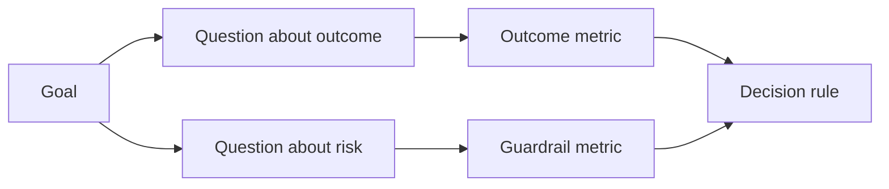

# Les métriques de réussite avant que le résultat n'existe

> La mesure doit répondre à une décision, pas décorer un tableau de bord. Commencez par l'objectif, dérivez des questions, puis choisissez les plus petites mesures qui répondent à ces questions.

> **【中文解读】**La mesure doit répondre à une décision, et non à un bloc d'outils. Le GQM est un système de mesure de la méthode de l'agent.

>  **【前置】**Les résultats de la phase 14 sont les résultats de la phase 14 et de la phase 51 de la phase 4 de la phase 4 de la phase 4 de la phase 4 de la phase 4 de la phase 4 de la phase 4 de la phase 4 de la phase 4 de la phase 4 de la phase 4 de la phase 4 de la phase 4 de la phase 4 de la phase 4 de la phase 4 de la phase 4 de la phase 4 de la phase 4 de la phase 4 de la phase 4 de la phase 4 de la phase 4 de la phase 4 de la phase 4 de la phase 4 de la phase 4 de la phase 4 de la phase 4 de la phase 4 de la phase 4 de la phase 4 de la phase 4 de la phase 4 de la phase 4 de la phase 4 de la phase 4 de la phase 4 de la phase 4 de la phase 4 de la phase 4 de la phase 4 de la phase 4 de la phase 4 de la phase 4 de la phase 4 de la phase 4 de la phase 4 de la phase 4 de la phase 4 de la phase 4 de la phase 4 de la phase 4 de la phase 4 de la phase 4 de la phase 4 de la phase 4 de la phase 4 de la phase 4 de la phase 4 de la phase 4 de la phase 4 de la phase 4 de la phase 4 de la phase 4 de la phase 4 de la phase 4 de la phase 4 de la phase 4 de la phase 4 de la phase 4 de la phase 4 de la phase 4 de la phase 4 de la phase 4 de la phase 4 de la phase 4 de la phase 4 de la phase 4 de la phase 4 de la phase 4 de la phase 4 de la phase 4 de la phase 4 de la phase 4 de la phase 4 de la phase 4 de la phase 4 de la phase 4 de la phase 4 de la phase 4 de la phase 4 de la phase 4 de la phase 4 de la phase 4 de la phase 4 de la phase 4 de la phase 4 de la phase 4 de la phase 4 de la phase 4 de la phase 4 de la phase 4 de la phase 4 de la phase 4 de la phase 4 de la phase 4 de la phase 4 de la phase 4 de la phase 4 de la phase 4 de la phase 4 de la phase 4 de la phase 4 de la phase 4 de la phase 4 de la phase 4 de la phase 4 de la phase 4 de la phase 4 de la phase 4 de la phase 4 de la phase 4`outputs/measurement-report.json`Il s'agit d'une étude de cas de cas de cas de cas de cas de cas de cas de cas de cas de cas de cas de cas de cas de cas de cas de cas de cas de cas de cas de cas de cas de cas de cas de cas de cas de cas de cas de cas de cas de cas de cas de cas de cas de cas de cas de cas de cas de cas de cas de cas de cas de cas de cas de cas de cas de cas de cas de cas de cas de cas de cas de cas de cas de cas de cas de cas de cas de cas de cas de cas de cas de cas de cas de cas de cas de cas de cas de cas de cas de cas de cas de cas de cas de cas de cas de cas de cas de cas de cas de cas de cas de cas de cas de cas de cas de cas de cas de cas de cas de cas de cas de cas de cas de cas de cas de cas de cas de cas de cas de cas de cas de cas de cas de cas de cas de cas de cas de cas de cas de cas de cas de cas.

**Type:** Learn + Build | **类型:** 学习 + 动手实践
**Languages:** Python (stdlib) | **语言:** Python（标准库）
**Prerequisites:** Phase 14 lessons 47 and 51 | **前置知识:** Phase 14 第 47、51 课
**Time:** ~70 minutes | **时间:** 约 70 分钟

## Objectifs d'apprentissage

- Dériver des questions et des mesures d'un objectif final.
  Le résultat de l'objectif est de présenter des problèmes et des indicateurs.
- Définissez les seuils, les fenêtres, les sources et les directions avant d'observer les résultats.
  Traduction anglaise: dans les résultats de l'observation, définir la valeur, la fenêtre, l'origine et la direction.
- Partagez les mesures de résultat avec les barreaux et les contre-métres.
  Traduction anglaise: donner des résultats à des indicateurs et des contre-indications.
- Les preuves de l'évaluation correspondent à la décision que doit appuyer la construction.
  En français, la traduction est: faire correspondre les preuves d'évaluation avec les décisions de construction qui doivent être prises.

## Objectif, Question, Méthrique Objectif, Problème, Indicateur

Commencez par un objectif:

> De l'objectif à la première:

> Réduire le temps d'identification du service affecté sans augmenter les actions dangereuses.
> > > > > > > > > > > > > > > > > > > > > > > > > > > > > > > > > > > > > > > > > > > > > > > > > > > > > > > > > > > > > > > > > > > > > > > > > > > > > > > > > > > > > > > > > > > > > > > > > > > > > > > > > > > > > > > > > > > > > > > > > > > > > > > > > > > > > > > > > > > > > > > > > > > > > > > > > > > > > > > > > > > > > > > > > > > > > > > > > > > > > > > > > > > > > > > > > > > > > > > > > > > > > > > > > > > > > > > > > > > > > > > > > > > > > > > > > > > > > > > > > > > > > > > > > > > > > > > > > > > > > > > > > > > > > > > > > > > > > > > > > > > > > > > > > > > > > > > > > > > > > > > > > > > > > > > > > > > > > > > > > > > > > > > > > > > > > > > > > > > > > > > > > > > > > > > > > > > > > > > > > > > > > > > > > > > > > > > > > > > > > > > > > > > > > > > > > > > > > > > > > > > > > > > > > > > > > > > > > > > > > > > > > > > > > > > > > > > > > > > > > > > > > > > > > > > > > > > > > > > > > > > > > > > > > > > > > > > > > > > > > > > > > > > > > > > > > > > > > > > > > > > > > > > > > >
> Dans le cadre de l'opération sans augmentation de la sécurité, le temps nécessaire au service de positionnement affecté est réduit.

Des questions dérivées:

> 推导出问题:

- Combien de temps faut- il pour identifier le bon service?
  Le service est-il en train de se déployer ?
- Combien de fois le service identifié est-il correct ?
  Quel est le taux de positionnement des services ?
- Le diagnostic reste-t-il seulement lu ?
  Le processus de diagnostic est-il maintenu seulement à lire ?
- Le flux de travail augmente-t-il le rejet des alertes ou la charge de travail de l'opérateur?
  Est-ce que ce flux de travail a augmenté le taux d'ignorance des policiers ou la charge des opérateurs ?

Ensuite, choisissez des mesures qui fonctionnent ces questions.

> Puis choisir de transformer ces questions en indicateurs numériques à vérifier.



> **【中文解读】**Le GQM est une méthode de recherche qui consiste à déterminer la durée de la prise de décision et la durée de la prise de décision.

## Une métrique a besoin d'un contrat.

Chaque métrique a besoin de:

> Chaque indicateur a besoin de:

| Field | Example |
|---|---|
| Name | `median_identification_seconds` |
| Direction | at most |
| Threshold | 120 |
| Window | ten incident replays |
| Source | replay event log |
| Population | on-call engineers in the pilot |
| Kind | outcome or guardrail |

Sans source et fenêtre, un nombre ne peut être reproduit.

> N'y a pas de source et de fenêtre, un chiffre ne peut pas être reproduit; n'y a pas de valeur, il ne peut pas entraîner des décisions

> **【中文解读】**契约的七字段回答四个问题:叫什么 (Name) 朝哪边好 (Direction) 多好算好 (Threshold) 、在哪测的 (Window/Source/Population) 、属于哪类的 (Kind) ⋅缺"在哪测的",同一数字换个环境就不可复现;缺"多好算好",指标永远只会"看起来在变好"──

>  **【类比】**Il n'y a pas de référence à la valeur de l'échantillon de sang. Il n'y a pas de référence à la valeur de sang.

## Résultat, garde-ferre et contre-métrologie

- **Outcome metric:**l'état souhaité s'est-il amélioré ?
  Le mot grec traduit par " le mot grec "**结果指标：**L'état de l'espérance s'est amélioré ?
- **Guardrail:**une contrainte fixe est-elle toujours valable ?
  Le mot grec traduit par " le mot grec "**护栏指标：**Le règlement fixe est-il encore en vigueur ?
- **Counter-metric:**le changement de poste local a-t-il coûté ou endommagé ailleurs ?
  Le mot grec traduit par " le mot grec "**反指标：**L'amélioration locale a-t-elle transféré les coûts ou les dommages à d'autres endroits?

Pour un flux de travail accidentel, la vitesse n'est pas suffisante.

> Pour les flux de travail d'accidents, seule la vitesse est insuffisante.

> **【中文解读】**Les trois indicateurs constituent un triangle: les résultats des indicateurs démontrent "c'est bon", les indicateurs de protection conservent "c'est pas mauvais" (comme la production écrit en恒为零), les contre-indicateurs "c'est pas mal" (本团队快了,是不是把负担给下游值班) ⋅ les plus classiques des contre-indicateurs du système d'IA: les clients optimisent le temps moyen de traitement jusqu'à un niveau extrême bas, tandis que le taux de transfert artificiel et le taux de fréquence de visite des clients augmentent.

## Des preuves hors ligne et en ligne.

Le jeu de répétition hors ligne est utile pour la répétabilité et la couverture des bords. Un pilote délimité est utile pour un comportement réel, une confiance et des effets de flux de travail.

> La valeur de la réémission en ligne repose sur la répétabilité et la couverture des frontières; la valeur des essais interconnectés repose sur le comportement réel, la confiance et l'efficacité du flux de travail.

Utilisez les preuves les moins chères qui peuvent répondre à la décision en cours.

> Il est possible de répondre aux preuves les plus abordables de la décision en cours.

> **【中文解读】**L'erreur la plus courante est de prendre un indicateur de l'offre pour répondre à une question à laquelle l'ingénieur doit faire confiance, ou bien, au contraire, une fonctionnalité est écrite en se précipitant sur le flux réel.

## Décide avant de mesurer, prépare, recette les données

Écrivez les passes, les échecs et les chemins ambiguës avant de voir les résultats.

> En voyant le résultat, écrivez bien passer, échouer et perdre la route.

Exemple:

> Je suis un enfant.

- Pass: taux de service correct d'au moins 0,9 et temps médian de 120 secondes au maximum;
  Le taux de service n'est pas inférieur à 0,9 et le temps de débit moyen ne dépasse pas 120 secondes;
- défaillance: tout taux de production de rédaction ou de correction inférieur à 0,75;
  Néo-zélandais: failure: apparaît toute production écrit, ou taux de correction inférieur à 0,75;
- ambigu: une petite amélioration avec une large variance, nécessitant un ensemble de répétition plus grand.
  Le modèle de l'équipe de réévaluation de la réévaluation de la réévaluation de la réévaluation de la réévaluation de la réévaluation de la réévaluation de la réévaluation de la réévaluation de la réévaluation de la réévaluation de la réévaluation de la réévaluation de la réévaluation de la réévaluation de la réévaluation de la réévaluation de la réévaluation de la réévaluation de la réévaluation de la réévaluation de la réévaluation de la réévaluation de la réévaluation de la réévaluation de la réévaluation de la réévaluation de la réévaluation de la réévaluation de la réévaluation de la réévaluation de la réévaluation de la réévaluation de la réévaluation de la réévaluation de la réévaluation de la réévaluation de la réévaluation de la réévaluation de la réévaluation de réévaluation de la réévaluation de la réévaluation de la réévaluation de la réévaluation de la réévaluation de la réévaluation de la réévaluation de la réévaluation de la réévaluation de la réévaluation de la réévaluation de la réévaluation de la réévaluation de la réévaluation de la réévaluation de la réévaluation de la réévaluation de la réévaluation de la réévaluation de la réévaluation de la réévaluation de la réévaluation de la réévaluation de la réévaluation de la réévaluation de la réévaluation de la réévaluation.

> **【中文解读】**La "pré-décision" est une défense contre l'homme: après la sortie des données, presque tout le monde met la valeur à la place de ses données.

## Construisez-le et mettez-le en œuvre.

Le laboratoire valide un plan de mesure, évalue les seuils inclus, enregistre les valeurs manquantes et écrit `outputs/measurement-report.json`- Je suis désolé .

> 实验代码校验一个测量计划、根据含边界值的值求值、记录缺失值,并写出 `outputs/measurement-report.json`Il y a une autre.

```bash
python3 code/main.py
python3 -m unittest discover code/tests -v
```

Retirez la mesure de garde et observez pourquoi le plan devient invalidé même lorsque les mesures de résultat restent.

> 删除护标标, observer pourquoi même si les résultats des indications sont là, l'ensemble du plan sera également jugé inefficace.

> **【中文解读】**Les règles de l'épreuveurs sont la codation de ce cours: manque d'objectifs, manque de problèmes, manque d'indicateurs, manque de résultats, manque de protection, manque de direction, manque d'origine ou de fenêtre, tout article rend le statut invalide, les valeurs numériques ultérieures perdent tout leur sens.

## Des exercices.

1. Déduire trois questions d'un seul objectif final.
   Le résultat de l'étude est le résultat de trois questions.
2. Ajouter une contre-méthrique qui capture le coût déplacé à un autre rôle.
   L'écriture de la chanson "Cost is transferred to another role" est une traduction de la chanson "Cost is transferred to another role".
3. Définir la source, la population et la fenêtre pour chaque métrique.
   Pour chaque indice définit source, groupe et fenêtre.
4. Écrivez des décisions passées, échouées et ambiguës avant de générer des valeurs.
   En français, traduire par " écrire " avant de générer des valeurs.
5. Identifiez une mesure facile à collecter mais qui ne peut pas changer la décision.
   Trouver un indicateur facile à collecter mais à changer sans avoir pris une décision, le supprimer.

## Encore une lecture

- [Basili, Software Modeling and Measurement: The Goal/Question/Metric Paradigm](https://drum.lib.umd.edu/items/8119803a-362b-42ec-b6ce-2311713e7236), pour dériver des mesures opérationnelles à partir d'objectifs explicites.
  Le programme de mesure de l'équipement de base est basé sur le modèle de mesure de l'équipement de mesure.
- [Basili, Caldiera, and Rombach, The Goal Question Metric Approach](https://www.cs.toronto.edu/~sme/CSC444F/handouts/GQM-paper.pdf), pour l'application de la méthode en tant que système de rétroaction et d'amélioration.
  Le système de gestion des ressources humaines est un système de gestion des ressources humaines.

## Ce que vous gardez , vous gardez .

Je le garde .`outputs/measurement-report.json`Il définit la porte d'épreuve pour le prototype, le pilote ou la phase de production.

> Garder à l' écoute`outputs/measurement-report.json`Il définit les preuves du type d'origine, du point de départ ou de la phase de production.
