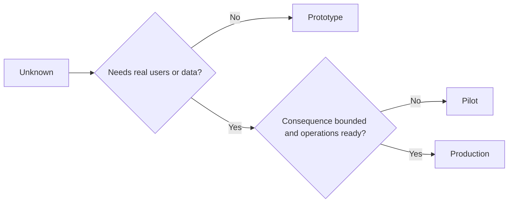

# Choisissez prototype, pilote ou production délibérément

> Il s'agit d'environnements d'apprentissage différents, pas de niveaux de polissage.

> **【中文解读】**Le principe de production est de trois types différents d'environnement d'apprentissage, pas de trois niveaux de détérioration. Le seul critère de sélection est celui qui peut répondre au minimum aux conséquences inutiles de l'inconscient.

>  **【前置】**Les résultats de la formation sont les suivants: la phase 14 § 50 课程 (→ Les résultats de la formation sont les suivants:`outputs/stage-decisions.json`Il s'agit de la 54e ligne de conduite de la roue de Thornton.

**Type:** Learn + Build | **类型:** 学习 + 动手实践
**Languages:** Python (stdlib) | **语言:** Python（标准库）
**Prerequisites:** Phase 14 lessons 50 to 52 | **前置知识:** Phase 14 第 50-52 课
**Time:** ~70 minutes | **时间:** 约 70 分钟

## Objectifs d'apprentissage

- Choisissez une étape de construction parmi l'inconnu, le public, les données, les conséquences et la préparation.
  Selon les résultats et les résultats de la sélection de la construction de rangés.
- Définir les contrôles et les critères de sortie spécifiques à chaque étape.
  Traduction anglaise: définir les mesures de contrôle et de sortie des normes.
- empêcher les prototypes de devenir silencieusement des systèmes de production.
  Prévenir le type original à devenir le système de production.
- Retarder l'autorité réelle jusqu'à ce que des preuves et des opérations la justifient.
  Le pouvoir de l'homme est en train de se détériorer.

## Trois questions différentes.

| Stage | Primary question |
|---|---|
| Prototype | Can this mechanism produce the evidence at all? |
| Pilot | Does it work safely with a bounded real audience and real conditions? |
| Production | Can we own it continuously at the promised reliability and risk level? |

Un prototype peut être techniquement complet et être jetable. Un pilote peut utiliser les données de production tout en restant limité en audience et autorité.

> **【中文解读】**Trois questions sont posées: le modèle " ce mécanisme ne peut-il pas produire de preuves ", le test " est-il sûr dans un groupe de personnes ayant des besoins réels et dans des conditions réelles ", le problème de production " ne pouvons-nous pas le maintenir à un niveau de fiabilité et de risque promises " ?

## Prototype, prototype

Utilisez un prototype lorsque l'inconnu ne nécessite pas de vrais utilisateurs ou de vrais données.

> Lorsque l'objet inconnu n'a pas besoin d'utilisateur réel ou de données réelles, utilisez le modèle original.

- décomposable;
  Je peux le jeter.
- isolé;
  Il est un peu comme ça.
- étroit dans le comportement;
  Le mot "réciproque" est traduit par "réciproque".
- explicite sur la question de l'apprentissage;
  Le problème de l'apprentissage est clair.
- exempt de fausses garanties opérationnelles.
  Le mot "la vie" est traduit par "la vie".

Ne pas optimiser l'architecture avant que le mécanisme ne gagne une autre étape.

> Avant de gagner le premier rang, ne pas optimiser l'architecture.

> **【中文解读】**Le plus dur des cinq articles de la loi originale est "séparation" et "non avec une fausse garantie": l'isolement garantit qu'il échoue lorsque l'effet est à zéro; non-compromise de disponibilité garantit que personne ne commence à en dépendre.

## Pilot, essaie

Utilisez un pilote lorsque l'inconnu nécessite un comportement réel, des données réalistes ou un véritable flux de travail, mais la conséquence ou la préparation n'est pas encore compatible avec la diffusion générale.

> Lorsque des projets inconnus nécessitent un comportement réel, des données réelles ou un flux de travail réel, mais que les résultats ou les attentes ne sont pas encore compatibles avec la large éventail de publication, utilisez un essai.

Un pilote a besoin de:

> 试点需要:

- un public désigné;
  Nom de famille:
- un propriétaire humain;
  Un homme responsable de l'humanité.
- durée et autorité limitées;
  Traduction anglaise:
- l'audit et le retour en action;
  Le référencement est le plus important.
- les seuils de sortie et de garde;
  Le résultat résultant de la formation est le résultat de la formation.
- critères de sortie pour l'expansion, la révision ou l'arrêt.
  Le terme "réforme" est traduit par "réforme".

> **【中文解读】**La caractéristique définitive du test est " réel mais il y a un décalage ": il utilise des données réelles, un groupe de personnes réelles, mais le nombre de participants, le temps de couverture, le pouvoir de restriction.

## La production, la production

La production a besoin de plus que de déploiement:

> Les besoins en production sont plus que déployés:

- objectif de niveau de service;
  Le mot "service" est traduit par "service".
- propriété à l'appel et en cas d'incident;
  Traduction anglaise: attribut à l'accident;
- l'examen de la sécurité et de la confidentialité;
  Sécurité et confidentialité;
- contrôles des coûts et des capacités;
  Traduction anglaise: coûts et capacité de contrôle;
- le retour et la récupération;
  Le récit de la rédaction de la Bible est le récit de la rédaction de la Bible.
- la surveillance continue;
  Suivant: Suivi continu;
- une voie de retraite.
  Le mot grec traduit par " route " signifie " route " ou " route ".



> **【中文解读】**Le plus contre-intuitif des sept éléments est le dernier " chemin de retrait ": avant d'entrer en production, il faut écrire comment il sortirait. Ce n'est pas un triste constat, mais reconnaître que chaque système a un cycle de vie.

>  **【类比】**Trois phases de la formation: le modèle de véhicule est en train de refaire, le résultat est nul. Le plus dangereux n'est pas le nouveau, mais celui qui a commencé à faire le modèle se croit à une vitesse élevée.

## La dérive de la scène

Le code prototype devient dangereux lorsqu'il acquiert des utilisateurs, des données ou une autorité sans acquérir la propriété.

> Lorsque le code prototype est acquiré sans avoir obtenu une attribution, il devient dangereux de mettre la frontière entre le prototype et le test dans le config, le contrôle d'accès, la distanciation et le documentation.

L'étape doit être observable à partir du système lui-même.

> Les rangs doivent être observés par le système lui-même.

> **【中文解读】**La dérive de phase est le plus courant accident de silence: le script original de Temporary Run On est entré dans le courant réel, trois mois plus tard, il est devenu un chemin clé pour que personne ne puisse le redémarrer. La défense doit être placée dans le contrôle technique de la configuration, les droits de contrôle de l'accès, les marquages de la distanciation, plutôt que dans l'interface utilisateur.

## Construisez-le et mettez-le en œuvre.

Le laboratoire choisit une étape du contexte de la décision, renvoie les contrôles requis et écrit `outputs/stage-decisions.json`- Je suis désolé .

> Expérience code de la décision en bas de page sélectionner les rangs  Retrouver la liste de contrôle nécessaire, et écrire `outputs/stage-decisions.json`Il y a une autre.

```bash
python3 code/main.py
python3 -m unittest discover code/tests -v
```

Modifier l'exemple pilote à faible conséquence avec préparation opérationnelle.

> Expliquer quelles preuves supplémentaires sont nécessaires pour soutenir la production.

> **【中文解读】** `choose_stage`La réponse de l'expérience de formation ne se trouve pas dans le code: même si la production est terminée, il manque encore de preuves, comme la performance réelle de la SLO, la vérification de la sécurité, le processus de mise en place du mécanisme de formation.

## Des exercices.

1. Classifier trois projets en cours par étape d'apprentissage et non par statut de déploiement.
   Suivant: Les trois projets de la main de la classe
2. Écrivez des critères de sortie du pilote qui incluent une décision d'arrêt.
   Pour le début de la période de transition, le processus de déclenchement de la décision de "stop" est terminé.
3. Ajouter un contrôle technique qui empêche un prototype d'atteindre les données de production.
   Le modèle de production est le modèle de production.
4. Identifier la première responsabilité opérationnelle qui fait la production de construction.
   Il est également connu pour avoir été le premier à avoir "construit et produit".
5. Conçuez un reçu de retour pour le pilote délimité.
   Pour un projet de projet, un diplôme de référencement.

## Encore une lecture

- [Barry Boehm, A Spiral Model of Software Development and Enhancement](https://dl.acm.org/doi/10.1145/12944.12948), pour correspondre l'engagement de chaque itération au risque résolu.
  Le modèle Boehm 螺旋模型让每一轮代的承诺与已解决风险相匹配
- [Fagerholm et al., Building Blocks for Continuous Experimentation](https://doi.org/10.1145/2601248.2601276)Il est important de noter que les résultats obtenus par les chercheurs ont été évalués en fonction des conditions organisationnelles et techniques requises pour mener des expériences en continu.
  Le projet de construction de la construction de la construction de la construction de la construction de la construction de la construction de la construction de la construction de la construction de la construction de la construction de la construction de la construction de la construction de la construction de la construction de la construction de la construction de la construction de la construction de la construction de la construction de la construction de la construction de la construction de la construction de la construction de la construction de la construction de la construction de la construction de la construction de la construction de la construction de la construction de la construction de la construction de la construction de la construction de la construction de la construction de la construction de la construction de la construction de la construction de la construction de la construction de la construction de la construction de la construction de la construction de la construction de la construction de la construction de la construction de la construction de la construction de la construction de la construction de la construction de la construction de la construction de la construction de la construction de la construction de la construction de la construction de la construction de la construction de la construction de la construction de la construction de la construction de la construction de la construction de la construction de la construction de la construction de la construction de la construction de la construction de la construction de la construction de la construction de la construction de la construction de la construction de la construction de la construction de la construction de la construction de la construction de la construction de la construction de la construction de la construction de la construction de la construction de la construction de la construction de la construction de la construction de la construction de la construction de la construction de la construction de la construction de la construction de la construction de la construction de la construction de la construction de la construction de la construction de la construction de la construction de la construction de la construction de la construction de la construction de la construction de la construction de la construction de la construction de la construction de la construction de la construction de la construction de la construction de la construction de la construction de la construction de la construction de la construction de la construction de la construction de la construction de la construction de la construction de la construction de la construction de la construction de la construction de la construction de la construction de la construction de la construction de la construction de la construction de la construction de la construction de la construction de la construction de la construction de la construction de la construction de la construction de la construction de la construction de la construction de la construction de la construction de la construction de la construction de la construction de la construction de la construction de la construction de la

## Ce que vous gardez , vous gardez .

Je le garde .`outputs/stage-decisions.json`Il indique pourquoi chaque étape est justifiée et quels contrôles doivent exister avant la prochaine.

> Garder à l' écoute`outputs/stage-decisions.json`Il a enregistré pourquoi chaque rang a été créé, ainsi que les contrôles qu'il doit exister avant d'entrer dans le rang suivant.
