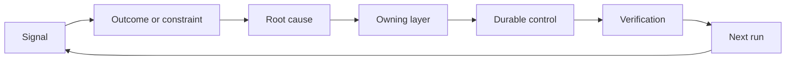

# Construire un ratchet de rétroaction avec la propriété et la retraite

> La navigation ferme une boucle de construction et ouvre la boucle d'apprentissage.

> **【中文解读】**La première étape de la série est la mise en place d'un cycle de construction, tout en ouvrant un cycle d'apprentissage. Les preuves doivent changer le système, sinon il devient un système de mesure distante inconnu.

>  **【前置】**Les cours suivants sont: la phase 14 du cours 46 (en anglais seulement) et la phase 53 (en anglais seulement) du cours.

**Type:** Learn + Build | **类型:** 学习 + 动手实践
**Languages:** Python (stdlib) | **语言:** Python（标准库）
**Prerequisites:** Phase 14 lessons 46 and 53 | **前置知识:** Phase 14 第 46、53 课
**Time:** ~75 minutes | **时间:** 约 75 分钟

## Objectifs d'apprentissage

- Transformez les incidents, les évaluations, le comportement des utilisateurs et les corrections en actions propres.
  Le comportement des utilisateurs et la correction se transforment en actions de l'utilisateur.
- Routez chaque signal vers le contexte, l'évaluation, la politique, le temps d'exécution ou le backlog.
  Traduction anglaise: mettre en œuvre une liste d'attentes pour chaque type de signal.
- Faites priorité à la récurrence par gravité et fréquence.
  Traduction anglaise: selon la gravité et la fréquence de réapparition.
- Donnez à chaque contrôle une condition de retraite.
  En français, " donner à chacun un contrôle " est une condition de retrait.

## Les retours sont des infrastructures.

Une équipe peut recueillir des traces, des évaluations, des billets de soutien et des journaux d'incidents sans en apprendre quoi que ce soit.

> Une équipe peut suivre, évaluer, travailler et faire des recherches, mais elle ne peut rien apprendre de tout. Le mécanisme manquant est la promotion: une observation vers un changement permanent, et un changement avec le propriétaire et la preuve.

La boucle est:

> Ce cycle est:

1. observer un signal concret;
   Le mot "observer" est traduit par "observer".
2. le relier à un résultat, à une contrainte ou à une hypothèse;
   Traduit en français par: mettre en relation avec un résultat, un lien ou une hypothèse;
3. identifier la couche de système la plus ancienne qui détient la cause;
   Le premier système de trouver " posséder cette racine "
4. créer un changement limité;
   Créer un changement avec des limites.
5. vérifier que la récurrence devient moins probable;
   Le taux de réapparition de la population a vraiment diminué.
6. examiner si le contrôle devrait rester.
   Le contrôle de la réaction est-il encore à conserver ?

> **【中文解读】**"反是基础设施" signifie: apprendre à ne pas compter sur l'attitude et le mécanisme.

## Route vers la couche de propriété.

| Signal | Destination |
|---|---|
| False positive, regression, wrong result | Evaluation or test |
| Missing context, duplicate work, stale fact | Context source or retrieval route |
| Unsafe action or authority gap | Policy or permission boundary |
| Timeout, retry storm, unavailable dependency | Runtime control |
| New product need or unresolved tradeoff | Shaped backlog item |

Réfléchissez à la cause au premier niveau de l'effet.

> Lorsque le premier test ou un contrôle peut rendre un échec impossible, ne revienne pas immédiatement.



> **【中文解读】**路由表把"什么信号去哪"变成查表操作: err err err err err result to evaluate 缺上下文去检查 越权去策略 超时去运行 时时、新产品诉求去等办 路由表将"什么信号去哪"变成查表操作: err err err err result to evaluate 缺上下文去检查 越权去策略 超时去运行 时、新产品诉求去等办 路由表是"最早有效层"快速是最贵重的修复位置(每轮都占下文、随着模型变化),测试和权限是最便宜的位置(一次写入、永久生效) . La plupart des discussions sur "nous devons réoptimiser un下提示词", qui devraient se dérouler à un autre niveau.

## La propriété fait partie du contrôle.

Chaque action à la raquette a besoin de:

> Chaque tournée nécessite:

- un propriétaire;
  Il est un maître.
- une priorité fondée sur les conséquences et la récurrence;
  Traduction anglaise: sur la base des résultats et des priorités de la fréquence de répétition;
- l'artefact à modifier;
  Il y a une autre partie de la pièce.
- la vérification qui prouve le changement;
  Le test de la vie éternelle
- une fenêtre de réexamen ou d'expiration;
  Une fenêtre de révision ou de révision;
- une condition de retraite.
  Le mot grec traduit par " condition de départ " signifie " condition de départ ".

Une amélioration non propre est une observation avec une meilleure mise en forme.

> Il n'y a pas d'amélioration de l'auteur, juste un enregistrement d'observation.

> **【中文解读】**六段里"恰好一个主人" et "退役条件" constituent deux directions simples du tour de file: maître garantie de changement de situation (observation→行动),退役条件 garantie de contrôle ne sera pas illimité accumulation (行动→ nettoyage) .

## Retirez les contrôles stables.

Les systèmes de rétroaction accumulent des politiques. Cette politique peut devenir contradictoire et coûteuse.

> Les stratégies de référencement sont généralement très différentes, mais elles peuvent être contradictoires.

- des modifications de l'architecture ou du flux de travail;
  Traduction anglaise: structure ou flux de travail;
- une invariante de niveau inférieur remplace une instruction de niveau supérieur;
  Traduction anglaise: une constante de niveau inférieur a remplacé une instruction de niveau supérieur;
- la défaillance protégée n'est pas apparue dans la fenêtre choisie;
  Le défaut de la protection ne s'est pas produit une seule fois dans toute la fenêtre de l'observation.
- Le contrôle bloque les travaux légitimes plus souvent qu'il ne prévient les dommages.
  Le contrôle empêche le travail normal plus souvent que le nombre de blessures.

La retraite a aussi besoin de preuves.

> Le retrait a aussi besoin de preuves. Ne retirez pas un contrôle.

> **【中文解读】**Le quatrième signal de révision est le plus pratique. Lorsque la demande de conformité est supérieure au risque d'interdiction, elle passe de l'assurance à la taxe. Mais le rétablissement doit également être prouvé: la fenêtre intérieure n'est jamais réouverte, supprimé avant de confirmer la protection a été prise par des variables de couche inférieure. La définition complète du ronds est "cette fenêtre est fermée, elle doit être laissée ouverte".

## Connectez Construire et Code Agent Feedback 打通 Construire contre contre contre contre contre contre contre contre contre contre contre contre contre contre contre contre contre contre contre contre contre contre contre contre contre contre contre contre contre contre contre contre contre contre contre contre contre contre contre contre contre contre contre contre contre contre contre contre contre contre contre contre contre contre contre contre contre contre contre contre contre contre contre contre contre contre contre contre contre contre contre contre contre contre contre contre contre contre contre contre contre contre contre contre contre contre contre contre contre contre contre contre contre contre contre contre contre contre contre contre contre contre contre contre contre contre contre contre contre contre contre contre contre contre contre contre contre contre contre contre contre contre contre contre contre contre contre contre contre contre contre contre contre contre contre contre contre contre contre contre contre contre contre contre contre contre contre contre contre contre contre contre contre contre contre contre contre contre contre contre contre contre contre contre contre contre contre contre contre contre contre contre contre contre contre contre contre contre contre contre contre contre contre contre contre contre contre contre contre contre contre contre contre contre contre contre contre contre contre contre contre contre contre contre contre contre contre contre contre contre contre contre contre contre contre contre contre contre contre contre contre contre contre contre contre contre contre contre contre contre contre contre contre contre contre contre contre contre contre contre contre contre contre contre contre contre contre contre contre contre contre contre contre contre contre contre contre contre contre contre contre contre contre contre contre contre contre contre contre contre contre contre contre contre contre contre contre contre contre contre contre contre contre contre contre contre contre contre contre contre contre contre contre contre contre contre contre contre contre contre contre contre contre contre contre contre contre contre contre contre contre contre contre contre contre contre contre contre contre contre contre contre contre contre contre contre contre contre contre contre contre contre contre contre contre contre contre contre contre contre contre contre contre contre contre contre contre contre contre contre contre contre contre contre contre contre contre contre contre contre contre contre contre contre contre contre contre contre contre contre contre contre contre contre contre contre contre contre contre contre contre contre contre contre contre contre contre contre contre contre contre contre contre contre contre contre contre contre contre contre contre contre contre contre contre contre contre contre contre contre contre contre contre contre contre contre contre contre contre contre contre contre contre contre contre contre contre contre contre contre contre contre contre contre contre contre contre contre contre contre contre contre contre contre contre contre contre contre contre contre contre contre contre contre contre contre contre contre contre contre contre contre contre contre contre contre contre contre contre contre contre contre contre contre contre contre contre contre contre contre contre contre contre contre contre contre contre contre contre contre contre contre contre contre contre

La même fourchette sert les deux pistes:

> Avec une ligne de service à roues:

- Les preuves du produit modifient le cadre de résultats, les hypothèses, la tranche ou le plan de mesure.
  Le modèle de production est le modèle de production de produits.
- Les corrections de codeur modifient les tests, le contexte, la portée, l'automatisation ou la remise.
  Le code de l'agent est modifié en version anglaise.
- Les incidents peuvent modifier à la fois la limite du produit et le tableau de bord des agents.
  Accident peut changer la frontière du produit, ou peut changer l'agent 工作台。

C'est pourquoi la mise en forme de la construction n'est pas une phase qui se termine avant le codage.

> C'est pourquoi " pour construire la forme plastique " n'est pas une phase qui se termine avant le début du codage, elle traverse chaque changement accepté.

> **【中文解读】**Cette partie a conclu la série 43-54: "Le cadre de tâches du cours 43" hypothèse "l'ingénieur va faire confiance à cette suggestion") lorsque les preuves réelles du projet de test sont renversées, le changement n'est pas seulement un code, il y a aussi un cadre de tâches suivant lui-même.

## Construisez-le et mettez-le en œuvre.

Le laboratoire classe les signaux, crée des actions propriétaires, les priorise et écrit.`outputs/feedback-backlog.json`- Je suis désolé .

> Expérience code donne des signaux de catégories  Créer des personnages de la série  Régler les priorités `outputs/feedback-backlog.json`Il y a une autre.

```bash
python3 code/main.py
python3 -m unittest discover code/tests -v
```

Ajoutez un signal de temps d'arrêt de l'exécution et confirmez qu'il est en route vers l'exécution plutôt que vers le backlog général.

> Ajouter un signal de fonctionnement en temps supersaturé, confirmer qu'il a été rouvert à l'heure de fonctionnement plutôt que d'entrer dans l'attente générale.

> **【中文解读】** `destination()`Avec les mots clés correspondant, le système peut être modifié par un composant ou un diagnostic artificiel.`promote()`则把六字段动作象化: priorité = gravité × fréquence, chaque but est lié à un fichier de travail permanent tel que`evaluations/regression-suite.json`)、certifications de validation et conditions de retrait du nombre de personnes.`expires_after_days`Le terme signifie pas "fin de période automatique de suppression", mais "fin de période doit être vérifié"

## Des exercices.

1. Transformer un incident et une plainte d'utilisateur en actions de ratchet.
   Le problème est que le problème est que le problème est le plus important.
2. Nombre de la couche la plus ancienne qui peut empêcher chaque récurrence.
   Il est également utilisé pour la lutte contre la maladie.
3. Ajouter des commandes de vérification ou des observations à la sortie du laboratoire.
   En français, traduit par " donner à l'expérimentation " ou " observer "
4. Définir une condition de retraite pour une règle de police.
   Pour une stratégie, la définition de la condition de retrait est de la même manière.
5. Trace un a accepté la correction dans le cadre de la tâche suivante.
   Traduction anglaise:把一条被接受的纠正追溯到下一个任务框架里去──

## Encore une lecture

- [Basili, Caldiera, and Rombach, The Goal Question Metric Approach](https://www.cs.toronto.edu/~sme/CSC444F/handouts/GQM-paper.pdf), pour l'apprentissage organisationnel par la mesure axée sur les objectifs.
  Le système de gestion des ressources humaines est un système de gestion des ressources humaines.
- [Fagerholm et al., Building Blocks for Continuous Experimentation](https://doi.org/10.1145/2601248.2601276), pour la boucle technique et organisationnelle qui relie les preuves au développement continu du produit.
  Le processus de construction de la construction de la construction de la construction de la construction de la construction de la construction de la construction de la construction de la construction de la construction de la construction de la construction de la construction de la construction de la construction de la construction de la construction de la construction de la construction de la construction de la construction de la construction de la construction de la construction de la construction de la construction de la construction de la construction de la construction de la construction de la construction de la construction de la construction de la construction de la construction de la construction de la construction de la construction de la construction de la construction de la construction de la construction de la construction de la construction de la construction de la construction de la construction de la construction de la construction de la construction de la construction de la construction de la construction de la construction de la construction de la construction de la construction de la construction de la construction de la construction de la construction de la construction de la construction de la construction de la construction de la construction de la construction de la construction de la construction de la construction de la construction de la construction de la construction de la construction de la construction de la construction de la construction de la construction de la construction de la construction de la construction de la construction de la construction de la construction de la construction de la construction de la construction de la construction de la construction de la construction de la construction de la construction de la construction de la construction de la construction de la construction de la construction de la construction de la construction de la construction de la construction de la construction de la construction de la construction de la construction de la construction de la construction de la construction de la construction de la construction de la construction de la construction de la construction de la construction de la construction de la construction de la construction de la construction de la construction de la construction de la construction de la construction de la construction de la construction de la construction de la construction de la construction de la construction de la construction de la construction de la construction de la construction de la construction de la construction de la construction de la construction de la construction de la construction de la construction de la construction de la construction de la construction de la construction de la construction de la construction de la construction de la construction de la construction de la construction de la construction de la construction de la construction de la construction de la construction de la construction de la construction de la construction de la construction de la construction de la construction de la construction de la construction de la construction de la construction de la construction de la construction de la construction de la construction de la
- [Nuseibeh and Easterbrook, Requirements Engineering: A Roadmap](https://www.cs.toronto.edu/~sme/papers/2000/ICSE2000.pdf), pour traiter les exigences comme évoluant au cours du cycle de vie du système.
  Le projet de demande de Nuseibeh et Easterbrook: route du projet de développement de la demande de Nuseibeh et Easterbrook: route du projet de développement de la demande de Nuseibeh et de Nuseibeh.

## Ce que vous gardez , vous gardez .

Je le garde .`outputs/feedback-backlog.json`. Il s'agit de l'artefact de clôture du parcours de jugement et de livraison du produit et de l'entrée dans le cadre de résultats suivant.

> Garder à l' écoute`outputs/feedback-backlog.json`Il s'agit de la dernière partie du processus de "détermination et de livraison des produits", et de l'entrée dans le cadre des résultats suivants.
