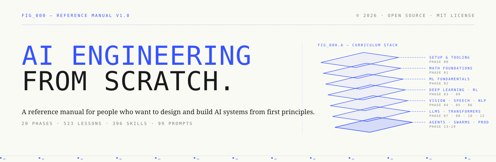
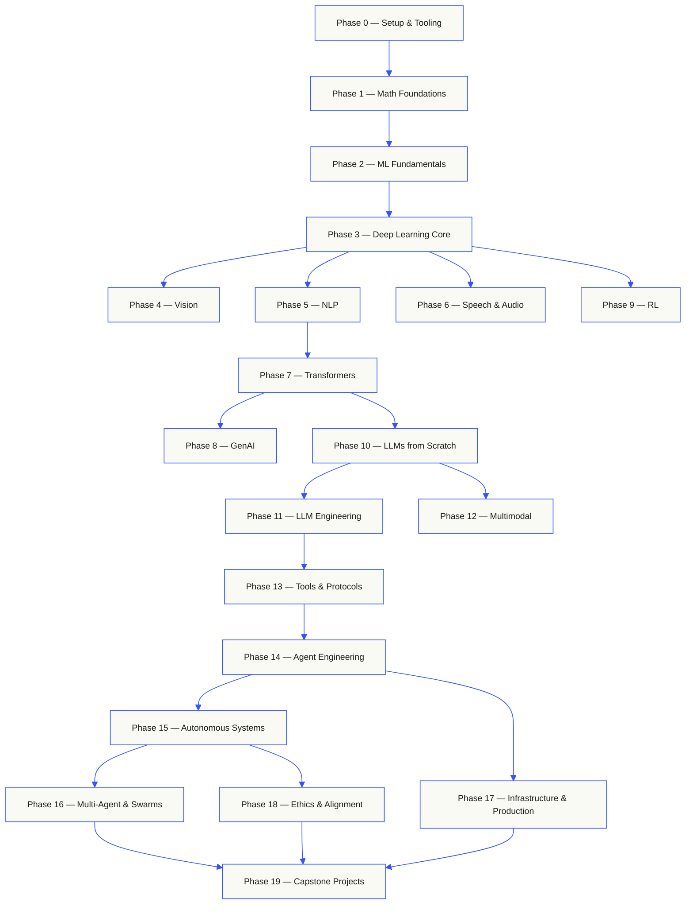

<p align="center"><sub>सामुदायिक अनुवाद। <a href="../../README.md">अंग्रेज़ी संस्करण ही प्रामाणिक है</a> · <a href="https://aiengineeringfromscratch.com">aiengineeringfromscratch.com</a></sub></p>
# AI 工程从零开始 · 中文版

<p align="center">
  
</p>

<p align="center">
  <a href="../../START.zh.md"><strong>🤖 把我发给你的 AI，30 秒开课</strong></a> &nbsp;·&nbsp;
  <a href="../../开始学习.md">🇨🇳 新手入门</a> &nbsp;·&nbsp;
  <a href="../../学习路线图.md">🗺 学习路线图</a> &nbsp;·&nbsp;
  <a href="../../FAQ.md">❓ 常见问题</a> &nbsp;·&nbsp;
  <a href="../../README.en.md">🇬🇧 English README</a>
</p>

<p align="center">
  <a href="../../LICENSE"></a>
  <a href="../../ROADMAP.md"></a>
  <a href="#contents"></a>
  <a href="https://github.com/rohitg00/ai-engineering-from-scratch/stargazers"></a>
  <a href="https://aiengineeringfromscratch.com"></a>
</p>

> **84% छात्र पहले से ही AI टूल इस्तेमाल करते हैं। पर केवल 18% ही उन्हें पेशेवर रूप से इस्तेमाल करने के लिए तैयार महसूस करते हैं।** यह पाठ्यक्रम इसी खाई को पाटता है।
>
> 523 पाठ। 20 चरण। ~342 घंटे। Python, TypeScript, Rust, Julia। हर पाठ एक पुन: उपयोग योग्य कलाकृति देता है: एक प्रॉम्प्ट, एक स्किल, एक एजेंट, एक MCP सर्वर। मुफ़्त, ओपन सोर्स, MIT।
>
> आप केवल AI सीखते नहीं। आप उसे बनाते हैं। शुरू से अंत तक। अपने हाथों से।

> **中文版说明**：本仓库是 [rohitg00/ai-engineering-from-scratch](https://github.com/rohitg00/ai-engineering-from-scratch) 的中文学习 fork——**每节课的英文原文里都嵌入了中文解读批注**（556/556 课全覆盖），大部分课另有完整中文译文（`docs/zh.md`）。你可以完全用中文学完这门课。

---

## 🚀 30 秒开始：把这条命令发给你的 AI

**你不需要会编程，不需要装任何东西。** 只要你有一个能跑命令的 AI Agent（Claude Code、Codex CLI、Cursor、Gemini CLI、Windsurf 等任一），把下面这段话**原样复制**发给它：

```text
把 https://github.com/ZhimingXUXJTU/ai-engineering-from-scratch 克隆到当前目录，
读它的 START.zh.md 并严格执行：当我的中文 AI 工程课导师，现在开始第 1 步摸底提问。
```

你的 AI 会自动克隆仓库、读懂教学流程，然后开始一对一带你上课：先问你基础和目标，再定制路线，每节课带你读中文讲义、跑代码、做测验、记进度。**你只需要说"继续"就能一直学下去。**

<details>
<summary><strong>没有会跑命令的 AI？还有三条路（点开看）</strong></summary>

**① 直接在网页上读中文课（零门槛）**。点开 [课程全景](#contents) 里任何一节课的链接 → `docs/zh.md` 就是完整中文讲义（每阶段的 `README.zh.md` 是该阶段的中文导读）。推荐新手从 [Phase 0 第 1 课：开发环境搭建](../../phases/00-setup-and-tooling/01-dev-environment/docs/zh.md) 开始。

**② 在本地跑一个中文课程网站**（需要装过 Git 和 Python）：

```bash
git clone https://github.com/ZhimingXUXJTU/ai-engineering-from-scratch.git
cd ai-engineering-from-scratch
python -m http.server 4173 --bind 127.0.0.1
```

然后浏览器打开 `http://127.0.0.1:4173/site/index.html`——带进度打卡、测验、中文界面的课程网站。

</details>

---

## 这门课是什么

一句话：**从线性代数手写实现到自主 Agent 集群，523 节课把 AI 工程的每一层都亲手造一遍。**

<!-- STATS:START (generated from site/stats.json by build.js — do not edit by hand) -->
<p align="center"><sub><b>114,584</b> readers &nbsp;·&nbsp; <b>181,995</b> page views in the last 30 days &nbsp;·&nbsp; as of 2026-08-29</sub></p>
<!-- STATS:END -->

This curriculum is the spine. 20 phases, 523 lessons, four languages: Python, TypeScript,
Rust, Julia. Linear algebra at one end, autonomous swarms at the other. Every algorithm
gets built from raw math first. Backprop. Tokenizer. Attention. Agent loop. By the time
PyTorch shows up, you already know what it's doing under the hood.

> **【中文解读】** 大多数 AI 教程是碎片：今天一篇论文解读、明天一个微调帖、后天一个炫技 Agent 演示，拼不成体系。这门课是"脊柱"：20 个阶段层层堆叠、四门语言同练。每个算法都先从数学原理手写实现——反向传播、分词器、注意力、Agent 循环——等 PyTorch 出场时，你早已知道它在底层做什么。每节课都是同一个循环：读问题 → 推数学 → 写代码 → 跑测试 → 留下一个可复用的产物。没有五分钟短视频，没有复制粘贴部署。

## The shape of the curriculum（课程全景依赖图）

> **【中文解读】** 20 个阶段像楼层一样往上盖：数学是地基，Agent 与生产系统是屋顶。已掌握下层可以跳过，但别跳过之后又奇怪顶层为什么跑不通。下面的图是官方依赖关系图（站点路线图由此生成）。

## पाठ्यक्रम की संरचना

Twenty phases stack on top of each other. Math is the floor. Agents and production are the roof.
Skip ahead if you already know the lower layers, but don't skip and then wonder why something at
the top is breaking.



## 中文版是怎么做的

本 fork 在**不改动任何英文原文**的前提下，叠加了三层中文：

| 层 | 位置 | 覆盖 |
|----|------|------|
| **① 段落级中文批注** | 每课 `docs/en.md` 内嵌【中文解读】【类比】【易错点】+ 双语标题 | **556/556 课（100%）**，英文原文逐字节保留 |
| **② 完整中文译文** | 每课 `docs/zh.md` | 458 课（含全部 MCP/Agent/毕业项目/认证课；数理阶段 1/2/3/5/7 以批注版呈现） |
| **③ 阶段中文导读** | 每阶段 `README.zh.md` | 20/20 阶段 |

另附 [新手入门](../../开始学习.md)、[学习路线图](../../学习路线图.md)、[FAQ](../../FAQ.md) 三份中文指南，以及 Claude 认证备考全套中文版（[certifications/claude/README.zh.md](../../certifications/claude/README.zh.md)）。

fork 会定期跟随上游同步（上游更新 → 合并 → 补翻译），同步过程有脚本校验"英文零删改"。

---

## 每节课交付什么

别的课程以"恭喜你学会了 X"收尾；这门课的每节课都以一个**你能装进日常工作的工具**收尾——提示词模板、Agent 技能（SKILL.md）、可部署的 Agent、即插即用的 MCP 服务器。

> By the end of the curriculum, you have a portfolio of 523 artifacts you actually
> understand because you built them.

**The lesson artifacts.** The repo ships 396 skills and 99 prompts under
`phases/**/outputs/`; install them via `scripts/install_skills.py`.。四门语言、每课可运行可测试：

```bash
python3 phases/13-tools-and-protocols/06-mcp-fundamentals/code/main.py   # 任何一课的主程序
```

---

## 考 Claude 认证？有中文备考全套

`certifications/claude/` 是 33 课的 Claude 认证备考课程（中文版：[入口 README](../../certifications/claude/README.zh.md)），覆盖全部四项认证（CCAO-F / CCDV-F / CCAR-F / CCAR-P），含原创模拟题与诊断测试。从 [certifications/claude/GETTING_STARTED.md](../../certifications/claude/GETTING_STARTED.md) 开始，或把 [skills/claude-certification/SKILL.md](../../skills/claude-certification/SKILL.md) 装进你的 agent 后运行 `/claude-certification`——学习进度记在 `CLAUDE-CERTIFICATION.md`。

Certification curricula are intentionally not converted into the books——认证课程
有意不收入电子书：它的导师状态、可运行实验、交互图表和限时模拟题只有在线形态。

---

## 把课程当书读（免费 EPUB / PDF）

20 个阶段的核心课程会编译成六卷本电子书，由 CI 自动构建并附在 [GitHub Releases](https://github.com/rohitg00/ai-engineering-from-scratch/releases)（链接永远指向最新版；每本带日期版戳，旧版仍可下载）。认证课程不进书——它的导师状态、可运行实验和交互图表只有在线形态。

| Vol | Title | Phases | Download |
|-----|-------|--------|----------|
| 1 | Foundations · Math, Tooling, and Classical Machine Learning | 00-02 | [EPUB](https://github.com/rohitg00/ai-engineering-from-scratch/releases/latest/download/aiefs-vol1-foundations.epub) · [PDF](https://github.com/rohitg00/ai-engineering-from-scratch/releases/latest/download/aiefs-vol1-foundations.pdf) |
| 2 | Deep Learning · Networks, Vision, and Speech | 03, 04, 06 | [EPUB](https://github.com/rohitg00/ai-engineering-from-scratch/releases/latest/download/aiefs-vol2-deep-learning.epub) · [PDF](https://github.com/rohitg00/ai-engineering-from-scratch/releases/latest/download/aiefs-vol2-deep-learning.pdf) |
| 3 | Language · NLP Foundations and the Transformer | 05, 07 | [EPUB](https://github.com/rohitg00/ai-engineering-from-scratch/releases/latest/download/aiefs-vol3-language.epub) · [PDF](https://github.com/rohitg00/ai-engineering-from-scratch/releases/latest/download/aiefs-vol3-language.pdf) |
| 4 | Large Language Models · Generation, Reinforcement, Pretraining, and Engineering | 08-11 | [EPUB](https://github.com/rohitg00/ai-engineering-from-scratch/releases/latest/download/aiefs-vol4-llms.epub) · [PDF](https://github.com/rohitg00/ai-engineering-from-scratch/releases/latest/download/aiefs-vol4-llms.pdf) |
| 5 | Agents · Multimodality, Protocols, Autonomy, and Swarms | 12-16 | [EPUB](https://github.com/rohitg00/ai-engineering-from-scratch/releases/latest/download/aiefs-vol5-agents.epub) · [PDF](https://github.com/rohitg00/ai-engineering-from-scratch/releases/latest/download/aiefs-vol5-agents.pdf) |
| 6 | Production · Infrastructure, Safety, and Capstones | 17-19 | [EPUB](https://github.com/rohitg00/ai-engineering-from-scratch/releases/latest/download/aiefs-vol6-production.epub) · [PDF](https://github.com/rohitg00/ai-engineering-from-scratch/releases/latest/download/aiefs-vol6-production.pdf) |

> 书是快照，仓库是活版本。每章末尾链回该课的动图、测验和可运行代码。本地构建：`python3 scripts/build_book.py`（需 pandoc），详见 [book/README.md](../../book/README.md)。

---

## 从哪里开始

| 你的情况 | 推荐起点 |
|----------|---------|
| 完全零基础 | [新手入门](../../开始学习.md) → Phase 0 环境搭建 → Phase 1 数学（用代码教数学） |
| 想尽快做 Agent 应用 | Phase 11 LLM 工程 → Phase 13 工具与协议（MCP 全栈）→ Phase 14 Agent 工程 |
| 要考 Claude 认证 | [认证课程中文版](../../certifications/claude/README.zh.md)（33 课 + 模拟题） |
| 想看全部课程表 | 下面 👇 |

---

## विषय-सूची

Twenty phases. Click any phase to expand its lesson list.

<a id="phase-0"></a>
### Phase 0: Setup & Tooling `12 lessons`
> Get your environment ready for everything that follows.

| # | Lesson | Type | Lang |
|:---:|--------|:----:|------|
| 01 | [Dev Environment](../../phases/00-setup-and-tooling/01-dev-environment/) | Build | Python |
| 02 | [Git & Collaboration](../../phases/00-setup-and-tooling/02-git-and-collaboration/) | Learn | — |
| 03 | [GPU Setup & Cloud](../../phases/00-setup-and-tooling/03-gpu-setup-and-cloud/) | Build | Python |
| 04 | [APIs & Keys](../../phases/00-setup-and-tooling/04-apis-and-keys/) | Build | Python |
| 05 | [Jupyter Notebooks](../../phases/00-setup-and-tooling/05-jupyter-notebooks/) | Build | Python |
| 06 | [Python Environments](../../phases/00-setup-and-tooling/06-python-environments/) | Build | Shell |
| 07 | [Docker for AI](../../phases/00-setup-and-tooling/07-docker-for-ai/) | Build | Docker |
| 08 | [Editor Setup](../../phases/00-setup-and-tooling/08-editor-setup/) | Build | — |
| 09 | [Data Management](../../phases/00-setup-and-tooling/09-data-management/) | Build | Python |
| 10 | [Terminal & Shell](../../phases/00-setup-and-tooling/10-terminal-and-shell/) | Learn | — |
| 11 | [Linux for AI](../../phases/00-setup-and-tooling/11-linux-for-ai/) | Learn | — |
| 12 | [Debugging & Profiling](../../phases/00-setup-and-tooling/12-debugging-and-profiling/) | Build | Python |

<details id="phase-1">
<summary><b>Phase 1 — Math Foundations</b> &nbsp;<code>22 lessons</code>&nbsp; <em>The intuition behind every AI algorithm, through code.</em></summary>
<br/>

| # | Lesson | Type | Lang |
|:---:|--------|:----:|------|
| 01 | [Linear Algebra Intuition](../../phases/01-math-foundations/01-linear-algebra-intuition/) | Learn | Python, Julia |
| 02 | [Vectors, Matrices & Operations](../../phases/01-math-foundations/02-vectors-matrices-operations/) | Build | Python, Julia |
| 03 | [Matrix Transformations & Eigenvalues](../../phases/01-math-foundations/03-matrix-transformations/) | Build | Python, Julia |
| 04 | [Calculus for ML: Derivatives & Gradients](../../phases/01-math-foundations/04-calculus-for-ml/) | Learn | Python |
| 05 | [Chain Rule & Automatic Differentiation](../../phases/01-math-foundations/05-chain-rule-and-autodiff/) | Build | Python |
| 06 | [Probability & Distributions](../../phases/01-math-foundations/06-probability-and-distributions/) | Learn | Python |
| 07 | [Bayes' Theorem & Statistical Thinking](../../phases/01-math-foundations/07-bayes-theorem/) | Build | Python |
| 08 | [Optimization: Gradient Descent Family](../../phases/01-math-foundations/08-optimization/) | Build | Python |
| 09 | [Information Theory: Entropy, KL Divergence](../../phases/01-math-foundations/09-information-theory/) | Learn | Python |
| 10 | [Dimensionality Reduction: PCA, t-SNE, UMAP](../../phases/01-math-foundations/10-dimensionality-reduction/) | Build | Python |
| 11 | [Singular Value Decomposition](../../phases/01-math-foundations/11-singular-value-decomposition/) | Build | Python, Julia |
| 12 | [Tensor Operations](../../phases/01-math-foundations/12-tensor-operations/) | Build | Python |
| 13 | [Numerical Stability](../../phases/01-math-foundations/13-numerical-stability/) | Build | Python |
| 14 | [Norms & Distances](../../phases/01-math-foundations/14-norms-and-distances/) | Build | Python |
| 15 | [Statistics for ML](../../phases/01-math-foundations/15-statistics-for-ml/) | Build | Python |
| 16 | [Sampling Methods](../../phases/01-math-foundations/16-sampling-methods/) | Build | Python |
| 17 | [Linear Systems](../../phases/01-math-foundations/17-linear-systems/) | Build | Python |
| 18 | [Convex Optimization](../../phases/01-math-foundations/18-convex-optimization/) | Build | Python |
| 19 | [Complex Numbers for AI](../../phases/01-math-foundations/19-complex-numbers/) | Learn | Python |
| 20 | [The Fourier Transform](../../phases/01-math-foundations/20-fourier-transform/) | Build | Python |
| 21 | [Graph Theory for ML](../../phases/01-math-foundations/21-graph-theory/) | Build | Python |
| 22 | [Stochastic Processes](../../phases/01-math-foundations/22-stochastic-processes/) | Learn | Python |

</details>

<details id="phase-2">
<summary><b>Phase 2 — ML Fundamentals</b> &nbsp;<code>18 lessons</code>&nbsp; <em>Classical ML — still the backbone of most production AI.</em></summary>
<br/>

| # | Lesson | Type | Lang |
|:---:|--------|:----:|------|
| 01 | [What Is Machine Learning](../../phases/02-ml-fundamentals/01-what-is-machine-learning/) | Learn | Python |
| 02 | [Linear Regression from Scratch](../../phases/02-ml-fundamentals/02-linear-regression/) | Build | Python |
| 03 | [Logistic Regression & Classification](../../phases/02-ml-fundamentals/03-logistic-regression/) | Build | Python |
| 04 | [Decision Trees & Random Forests](../../phases/02-ml-fundamentals/04-decision-trees/) | Build | Python |
| 05 | [Support Vector Machines](../../phases/02-ml-fundamentals/05-support-vector-machines/) | Build | Python |
| 06 | [KNN & Distance Metrics](../../phases/02-ml-fundamentals/06-knn-and-distances/) | Build | Python |
| 07 | [Unsupervised Learning: K-Means, DBSCAN](../../phases/02-ml-fundamentals/07-unsupervised-learning/) | Build | Python |
| 08 | [Feature Engineering & Selection](../../phases/02-ml-fundamentals/08-feature-engineering/) | Build | Python |
| 09 | [Model Evaluation: Metrics, Cross-Validation](../../phases/02-ml-fundamentals/09-model-evaluation/) | Build | Python |
| 10 | [Bias, Variance & the Learning Curve](../../phases/02-ml-fundamentals/10-bias-variance/) | Learn | Python |
| 11 | [Ensemble Methods: Boosting, Bagging, Stacking](../../phases/02-ml-fundamentals/11-ensemble-methods/) | Build | Python |
| 12 | [Hyperparameter Tuning](../../phases/02-ml-fundamentals/12-hyperparameter-tuning/) | Build | Python |
| 13 | [ML Pipelines & Experiment Tracking](../../phases/02-ml-fundamentals/13-ml-pipelines/) | Build | Python |
| 14 | [Naive Bayes](../../phases/02-ml-fundamentals/14-naive-bayes/) | Build | Python |
| 15 | [Time Series Fundamentals](../../phases/02-ml-fundamentals/15-time-series/) | Build | Python |
| 16 | [Anomaly Detection](../../phases/02-ml-fundamentals/16-anomaly-detection/) | Build | Python |
| 17 | [Handling Imbalanced Data](../../phases/02-ml-fundamentals/17-imbalanced-data/) | Build | Python |
| 18 | [Feature Selection](../../phases/02-ml-fundamentals/18-feature-selection/) | Build | Python |

</details>

<details id="phase-3">
<summary><b>Phase 3 — Deep Learning Core</b> &nbsp;<code>13 lessons</code>&nbsp; <em>Neural networks from first principles. No frameworks until you build one.</em></summary>
<br/>

| # | Lesson | Type | Lang |
|:---:|--------|:----:|------|
| 01 | [The Perceptron: Where It All Started](../../phases/03-deep-learning-core/01-the-perceptron/) | Build | Python |
| 02 | [Multi-Layer Networks & Forward Pass](../../phases/03-deep-learning-core/02-multi-layer-networks/) | Build | Python |
| 03 | [Backpropagation from Scratch](../../phases/03-deep-learning-core/03-backpropagation/) | Build | Python |
| 04 | [Activation Functions: ReLU, Sigmoid, GELU & Why](../../phases/03-deep-learning-core/04-activation-functions/) | Build | Python |
| 05 | [Loss Functions: MSE, Cross-Entropy, Contrastive](../../phases/03-deep-learning-core/05-loss-functions/) | Build | Python |
| 06 | [Optimizers: SGD, Momentum, Adam, AdamW](../../phases/03-deep-learning-core/06-optimizers/) | Build | Python |
| 07 | [Regularization: Dropout, Weight Decay, BatchNorm](../../phases/03-deep-learning-core/07-regularization/) | Build | Python |
| 08 | [Weight Initialization & Training Stability](../../phases/03-deep-learning-core/08-weight-initialization/) | Build | Python |
| 09 | [Learning Rate Schedules & Warmup](../../phases/03-deep-learning-core/09-learning-rate-schedules/) | Build | Python |
| 10 | [Build Your Own Mini Framework](../../phases/03-deep-learning-core/10-mini-framework/) | Build | Python |
| 11 | [Introduction to PyTorch](../../phases/03-deep-learning-core/11-intro-to-pytorch/) | Build | Python |
| 12 | [Introduction to JAX](../../phases/03-deep-learning-core/12-intro-to-jax/) | Build | Python |
| 13 | [Debugging Neural Networks](../../phases/03-deep-learning-core/13-debugging-neural-networks/) | Build | Python |

</details>

<details id="phase-4">
<summary><b>Phase 4 — Computer Vision</b> &nbsp;<code>28 lessons</code>&nbsp; <em>From pixels to understanding — image, video, 3D, VLMs, and world models.</em></summary>
<br/>

| # | Lesson | Type | Lang |
|:---:|--------|:----:|------|
| 01 | [Image Fundamentals: Pixels, Channels, Color Spaces](../../phases/04-computer-vision/01-image-fundamentals/) | Learn | Python |
| 02 | [Convolutions from Scratch](../../phases/04-computer-vision/02-convolutions-from-scratch/) | Build | Python |
| 03 | [CNNs: LeNet to ResNet](../../phases/04-computer-vision/03-cnns-lenet-to-resnet/) | Build | Python |
| 04 | [Image Classification](../../phases/04-computer-vision/04-image-classification/) | Build | Python |
| 05 | [Transfer Learning & Fine-Tuning](../../phases/04-computer-vision/05-transfer-learning/) | Build | Python |
| 06 | [Object Detection — YOLO from Scratch](../../phases/04-computer-vision/06-object-detection-yolo/) | Build | Python |
| 07 | [Semantic Segmentation — U-Net](../../phases/04-computer-vision/07-semantic-segmentation-unet/) | Build | Python |
| 08 | [Instance Segmentation — Mask R-CNN](../../phases/04-computer-vision/08-instance-segmentation-mask-rcnn/) | Build | Python |
| 09 | [Image Generation — GANs](../../phases/04-computer-vision/09-image-generation-gans/) | Build | Python |
| 10 | [Image Generation — Diffusion Models](../../phases/04-computer-vision/10-image-generation-diffusion/) | Build | Python |
| 11 | [Stable Diffusion — Architecture & Fine-Tuning](../../phases/04-computer-vision/11-stable-diffusion/) | Build | Python |
| 12 | [Video Understanding — Temporal Modeling](../../phases/04-computer-vision/12-video-understanding/) | Build | Python |
| 13 | [3D Vision: Point Clouds, NeRFs](../../phases/04-computer-vision/13-3d-vision-nerf/) | Build | Python |
| 14 | [Vision Transformers (ViT)](../../phases/04-computer-vision/14-vision-transformers/) | Build | Python |
| 15 | [Real-Time Vision: Edge Deployment](../../phases/04-computer-vision/15-real-time-edge/) | Build | Python |
| 16 | [Build a Complete Vision Pipeline](../../phases/04-computer-vision/16-vision-pipeline-capstone/) | Build | Python |
| 17 | [Self-Supervised Vision — SimCLR, DINO, MAE](../../phases/04-computer-vision/17-self-supervised-vision/) | Build | Python |
| 18 | [Open-Vocabulary Vision — CLIP](../../phases/04-computer-vision/18-open-vocab-clip/) | Build | Python |
| 19 | [OCR & Document Understanding](../../phases/04-computer-vision/19-ocr-document-understanding/) | Build | Python |
| 20 | [Image Retrieval & Metric Learning](../../phases/04-computer-vision/20-image-retrieval-metric/) | Build | Python |
| 21 | [Keypoint Detection & Pose Estimation](../../phases/04-computer-vision/21-keypoint-pose/) | Build | Python |
| 22 | [3D Gaussian Splatting from Scratch](../../phases/04-computer-vision/22-3d-gaussian-splatting/) | Build | Python |
| 23 | [Diffusion Transformers & Rectified Flow](../../phases/04-computer-vision/23-diffusion-transformers-rectified-flow/) | Build | Python |
| 24 | [SAM 3 & Open-Vocabulary Segmentation](../../phases/04-computer-vision/24-sam3-open-vocab-segmentation/) | Build | Python |
| 25 | [Vision-Language Models (ViT-MLP-LLM)](../../phases/04-computer-vision/25-vision-language-models/) | Build | Python |
| 26 | [Monocular Depth & Geometry Estimation](../../phases/04-computer-vision/26-monocular-depth/) | Build | Python |
| 27 | [Multi-Object Tracking & Video Memory](../../phases/04-computer-vision/27-multi-object-tracking/) | Build | Python |
| 28 | [World Models & Video Diffusion](../../phases/04-computer-vision/28-world-models-video-diffusion/) | Build | Python |

</details>

<details id="phase-5">
<summary><b>Phase 5 — NLP: Foundations to Advanced</b> &nbsp;<code>29 lessons</code>&nbsp; <em>Language is the interface to intelligence.</em></summary>
<br/>

| # | Lesson | Type | Lang |
|:---:|--------|:----:|------|
| 01 | [Text Processing: Tokenization, Stemming, Lemmatization](../../phases/05-nlp-foundations-to-advanced/01-text-processing/) | Build | Python |
| 02 | [Bag of Words, TF-IDF & Text Representation](../../phases/05-nlp-foundations-to-advanced/02-bag-of-words-tfidf/) | Build | Python |
| 03 | [Word Embeddings: Word2Vec from Scratch](../../phases/05-nlp-foundations-to-advanced/03-word-embeddings-word2vec/) | Build | Python |
| 04 | [GloVe, FastText & Subword Embeddings](../../phases/05-nlp-foundations-to-advanced/04-glove-fasttext-subword/) | Build | Python |
| 05 | [Sentiment Analysis](../../phases/05-nlp-foundations-to-advanced/05-sentiment-analysis/) | Build | Python |
| 06 | [Named Entity Recognition (NER)](../../phases/05-nlp-foundations-to-advanced/06-named-entity-recognition/) | Build | Python |
| 07 | [POS Tagging & Syntactic Parsing](../../phases/05-nlp-foundations-to-advanced/07-pos-tagging-parsing/) | Build | Python |
| 08 | [Text Classification — CNNs & RNNs for Text](../../phases/05-nlp-foundations-to-advanced/08-cnns-rnns-for-text/) | Build | Python |
| 09 | [Sequence-to-Sequence Models](../../phases/05-nlp-foundations-to-advanced/09-sequence-to-sequence/) | Build | Python |
| 10 | [Attention Mechanism — The Breakthrough](../../phases/05-nlp-foundations-to-advanced/10-attention-mechanism/) | Build | Python |
| 11 | [Machine Translation](../../phases/05-nlp-foundations-to-advanced/11-machine-translation/) | Build | Python |
| 12 | [Text Summarization](../../phases/05-nlp-foundations-to-advanced/12-text-summarization/) | Build | Python |
| 13 | [Question Answering Systems](../../phases/05-nlp-foundations-to-advanced/13-question-answering/) | Build | Python |
| 14 | [Information Retrieval & Search](../../phases/05-nlp-foundations-to-advanced/14-information-retrieval-search/) | Build | Python |
| 15 | [Topic Modeling: LDA, BERTopic](../../phases/05-nlp-foundations-to-advanced/15-topic-modeling/) | Build | Python |
| 16 | [Text Generation](../../phases/05-nlp-foundations-to-advanced/16-text-generation-pre-transformer/) | Build | Python |
| 17 | [Chatbots: Rule-Based to Neural](../../phases/05-nlp-foundations-to-advanced/17-chatbots-rule-to-neural/) | Build | Python |
| 18 | [Multilingual NLP](../../phases/05-nlp-foundations-to-advanced/18-multilingual-nlp/) | Build | Python |
| 19 | [Subword Tokenization: BPE, WordPiece, Unigram, SentencePiece](../../phases/05-nlp-foundations-to-advanced/19-subword-tokenization/) | Learn | Python |
| 20 | [Structured Outputs & Constrained Decoding](../../phases/05-nlp-foundations-to-advanced/20-structured-outputs-constrained-decoding/) | Build | Python |
| 21 | [NLI & Textual Entailment](../../phases/05-nlp-foundations-to-advanced/21-nli-textual-entailment/) | Learn | Python |
| 22 | [Embedding Models Deep Dive](../../phases/05-nlp-foundations-to-advanced/22-embedding-models-deep-dive/) | Learn | Python |
| 23 | [Chunking Strategies for RAG](../../phases/05-nlp-foundations-to-advanced/23-chunking-strategies-rag/) | Build | Python |
| 24 | [Coreference Resolution](../../phases/05-nlp-foundations-to-advanced/24-coreference-resolution/) | Learn | Python |
| 25 | [Entity Linking & Disambiguation](../../phases/05-nlp-foundations-to-advanced/25-entity-linking/) | Build | Python |
| 26 | [Relation Extraction & Knowledge Graph Construction](../../phases/05-nlp-foundations-to-advanced/26-relation-extraction-kg/) | Build | Python |
| 27 | [LLM Evaluation: RAGAS, DeepEval, G-Eval](../../phases/05-nlp-foundations-to-advanced/27-llm-evaluation-frameworks/) | Build | Python |
| 28 | [Long-Context Evaluation: NIAH, RULER, LongBench, MRCR](../../phases/05-nlp-foundations-to-advanced/28-long-context-evaluation/) | Learn | Python |
| 29 | [Dialogue State Tracking](../../phases/05-nlp-foundations-to-advanced/29-dialogue-state-tracking/) | Build | Python |

</details>

<details id="phase-6">
<summary><b>Phase 6 — Speech & Audio</b> &nbsp;<code>17 lessons</code>&nbsp; <em>Hear, understand, speak.</em></summary>
<br/>

| # | Lesson | Type | Lang |
|:---:|--------|:----:|------|
| 01 | [Audio Fundamentals: Waveforms, Sampling, FFT](../../phases/06-speech-and-audio/01-audio-fundamentals) | Learn | Python |
| 02 | [Spectrograms, Mel Scale & Audio Features](../../phases/06-speech-and-audio/02-spectrograms-mel-features) | Build | Python |
| 03 | [Audio Classification](../../phases/06-speech-and-audio/03-audio-classification) | Build | Python |
| 04 | [Speech Recognition (ASR)](../../phases/06-speech-and-audio/04-speech-recognition-asr) | Build | Python |
| 05 | [Whisper: Architecture & Fine-Tuning](../../phases/06-speech-and-audio/05-whisper-architecture-finetuning) | Build | Python |
| 06 | [Speaker Recognition & Verification](../../phases/06-speech-and-audio/06-speaker-recognition-verification) | Build | Python |
| 07 | [Text-to-Speech (TTS)](../../phases/06-speech-and-audio/07-text-to-speech) | Build | Python |
| 08 | [Voice Cloning & Voice Conversion](../../phases/06-speech-and-audio/08-voice-cloning-conversion) | Build | Python |
| 09 | [Music Generation](../../phases/06-speech-and-audio/09-music-generation) | Build | Python |
| 10 | [Audio-Language Models](../../phases/06-speech-and-audio/10-audio-language-models) | Build | Python |
| 11 | [Real-Time Audio Processing](../../phases/06-speech-and-audio/11-real-time-audio-processing) | Build | Python |
| 12 | [Build a Voice Assistant Pipeline](../../phases/06-speech-and-audio/12-voice-assistant-pipeline) | Build | Python |
| 13 | [Neural Audio Codecs — EnCodec, SNAC, Mimi, DAC](../../phases/06-speech-and-audio/13-neural-audio-codecs) | Learn | Python |
| 14 | [Voice Activity Detection & Turn-Taking](../../phases/06-speech-and-audio/14-voice-activity-detection-turn-taking) | Build | Python |
| 15 | [Streaming Speech-to-Speech — Moshi, Hibiki](../../phases/06-speech-and-audio/15-streaming-speech-to-speech-moshi-hibiki) | Learn | Python |
| 16 | [Voice Anti-Spoofing & Audio Watermarking](../../phases/06-speech-and-audio/16-anti-spoofing-audio-watermarking) | Build | Python |
| 17 | [Audio Evaluation — WER, MOS, MMAU, Leaderboards](../../phases/06-speech-and-audio/17-audio-evaluation-metrics) | Learn | Python |

</details>

<details id="phase-7">
<summary><b>Phase 7 — Transformers Deep Dive</b> &nbsp;<code>16 lessons</code>&nbsp; <em>The architecture that changed everything.</em></summary>
<br/>

| # | Lesson | Type | Lang |
|:---:|--------|:----:|------|
| 01 | [Why Transformers: The Problems with RNNs](../../phases/07-transformers-deep-dive/01-why-transformers/) | Learn | Python |
| 02 | [Self-Attention from Scratch](../../phases/07-transformers-deep-dive/02-self-attention-from-scratch/) | Build | Python |
| 03 | [Multi-Head Attention](../../phases/07-transformers-deep-dive/03-multi-head-attention/) | Build | Python |
| 04 | [Positional Encoding: Sinusoidal, RoPE, ALiBi](../../phases/07-transformers-deep-dive/04-positional-encoding/) | Build | Python |
| 05 | [The Full Transformer: Encoder + Decoder](../../phases/07-transformers-deep-dive/05-full-transformer/) | Build | Python |
| 06 | [BERT — Masked Language Modeling](../../phases/07-transformers-deep-dive/06-bert-masked-language-modeling/) | Build | Python |
| 07 | [GPT — Causal Language Modeling](../../phases/07-transformers-deep-dive/07-gpt-causal-language-modeling/) | Build | Python |
| 08 | [T5, BART — Encoder-Decoder Models](../../phases/07-transformers-deep-dive/08-t5-bart-encoder-decoder/) | Learn | Python |
| 09 | [Vision Transformers (ViT)](../../phases/07-transformers-deep-dive/09-vision-transformers/) | Build | Python |
| 10 | [Audio Transformers — Whisper Architecture](../../phases/07-transformers-deep-dive/10-audio-transformers-whisper/) | Learn | Python |
| 11 | [Mixture of Experts (MoE)](../../phases/07-transformers-deep-dive/11-mixture-of-experts/) | Build | Python |
| 12 | [KV Cache, Flash Attention & Inference Optimization](../../phases/07-transformers-deep-dive/12-kv-cache-flash-attention/) | Build | Python |
| 13 | [Scaling Laws](../../phases/07-transformers-deep-dive/13-scaling-laws/) | Learn | Python |
| 14 | [Build a Transformer from Scratch](../../phases/07-transformers-deep-dive/14-build-a-transformer-capstone/) | Build | Python |
| 15 | [Attention Variants — Sliding Window, Sparse, Differential](../../phases/07-transformers-deep-dive/15-attention-variants/) | Build | Python |
| 16 | [Speculative Decoding — Draft, Verify, Repeat](../../phases/07-transformers-deep-dive/16-speculative-decoding/) | Build | Python |

</details>

<details id="phase-8">
<summary><b>Phase 8 — Generative AI</b> &nbsp;<code>15 lessons</code>&nbsp; <em>Create images, video, audio, 3D, and more.</em></summary>
<br/>

| # | Lesson | Type | Lang |
|:---:|--------|:----:|------|
| 01 | [Generative Models: Taxonomy & History](../../phases/08-generative-ai/01-generative-models-taxonomy-history/) | Learn | Python |
| 02 | [Autoencoders & VAE](../../phases/08-generative-ai/02-autoencoders-vae/) | Build | Python |
| 03 | [GANs: Generator vs Discriminator](../../phases/08-generative-ai/03-gans-generator-discriminator/) | Build | Python |
| 04 | [Conditional GANs & Pix2Pix](../../phases/08-generative-ai/04-conditional-gans-pix2pix/) | Build | Python |
| 05 | [StyleGAN](../../phases/08-generative-ai/05-stylegan/) | Build | Python |
| 06 | [Diffusion Models — DDPM from Scratch](../../phases/08-generative-ai/06-diffusion-ddpm-from-scratch/) | Build | Python |
| 07 | [Latent Diffusion & Stable Diffusion](../../phases/08-generative-ai/07-latent-diffusion-stable-diffusion/) | Build | Python |
| 08 | [ControlNet, LoRA & Conditioning](../../phases/08-generative-ai/08-controlnet-lora-conditioning/) | Build | Python |
| 09 | [Inpainting, Outpainting & Editing](../../phases/08-generative-ai/09-inpainting-outpainting-editing/) | Build | Python |
| 10 | [Video Generation](../../phases/08-generative-ai/10-video-generation/) | Build | Python |
| 11 | [Audio Generation](../../phases/08-generative-ai/11-audio-generation/) | Build | Python |
| 12 | [3D Generation](../../phases/08-generative-ai/12-3d-generation/) | Build | Python |
| 13 | [Flow Matching & Rectified Flows](../../phases/08-generative-ai/13-flow-matching-rectified-flows/) | Build | Python |
| 14 | [Evaluation: FID, CLIP Score](../../phases/08-generative-ai/14-evaluation-fid-clip-score/) | Build | Python |
| 19 | [Visual Autoregressive Modeling (VAR): Next-Scale Prediction](../../phases/08-generative-ai/19-visual-autoregressive-var/) | Build | Python |

</details>

<details id="phase-9">
<summary><b>Phase 9 — Reinforcement Learning</b> &nbsp;<code>12 lessons</code>&nbsp; <em>The foundation of RLHF and game-playing AI.</em></summary>
<br/>

| # | Lesson | Type | Lang |
|:---:|--------|:----:|------|
| 01 | [MDPs, States, Actions & Rewards](../../phases/09-reinforcement-learning/01-mdps-states-actions-rewards/) | Learn | Python |
| 02 | [Dynamic Programming](../../phases/09-reinforcement-learning/02-dynamic-programming/) | Build | Python |
| 03 | [Monte Carlo Methods](../../phases/09-reinforcement-learning/03-monte-carlo-methods/) | Build | Python |
| 04 | [Q-Learning, SARSA](../../phases/09-reinforcement-learning/04-q-learning-sarsa/) | Build | Python |
| 05 | [Deep Q-Networks (DQN)](../../phases/09-reinforcement-learning/05-dqn/) | Build | Python |
| 06 | [Policy Gradients — REINFORCE](../../phases/09-reinforcement-learning/06-policy-gradients-reinforce/) | Build | Python |
| 07 | [Actor-Critic — A2C, A3C](../../phases/09-reinforcement-learning/07-actor-critic-a2c-a3c/) | Build | Python |
| 08 | [PPO](../../phases/09-reinforcement-learning/08-ppo/) | Build | Python |
| 09 | [Reward Modeling & RLHF](../../phases/09-reinforcement-learning/09-reward-modeling-rlhf/) | Build | Python |
| 10 | [Multi-Agent RL](../../phases/09-reinforcement-learning/10-multi-agent-rl/) | Build | Python |
| 11 | [Sim-to-Real Transfer](../../phases/09-reinforcement-learning/11-sim-to-real-transfer/) | Build | Python |
| 12 | [RL for Games](../../phases/09-reinforcement-learning/12-rl-for-games/) | Build | Python |

</details>

<details id="phase-10">
<summary><b>Phase 10 — LLMs from Scratch</b> &nbsp;<code>24 lessons</code>&nbsp; <em>Build, train, and understand large language models.</em></summary>
<br/>

| # | Lesson | Type | Lang |
|:---:|--------|:----:|------|
| 01 | [Tokenizers: BPE, WordPiece, SentencePiece](../../phases/10-llms-from-scratch/01-tokenizers/) | Build | Python, Rust |
| 02 | [Building a Tokenizer from Scratch](../../phases/10-llms-from-scratch/02-building-a-tokenizer/) | Build | Python |
| 03 | [Data Pipelines for Pre-Training](../../phases/10-llms-from-scratch/03-data-pipelines/) | Build | Python |
| 04 | [Pre-Training a Mini GPT (124M)](../../phases/10-llms-from-scratch/04-pre-training-mini-gpt/) | Build | Python |
| 05 | [Distributed Training, FSDP, DeepSpeed](../../phases/10-llms-from-scratch/05-scaling-distributed/) | Build | Python |
| 06 | [Instruction Tuning — SFT](../../phases/10-llms-from-scratch/06-instruction-tuning-sft/) | Build | Python |
| 07 | [RLHF — Reward Model + PPO](../../phases/10-llms-from-scratch/07-rlhf/) | Build | Python |
| 08 | [DPO — Direct Preference Optimization](../../phases/10-llms-from-scratch/08-dpo/) | Build | Python |
| 09 | [Constitutional AI & Self-Improvement](../../phases/10-llms-from-scratch/09-constitutional-ai-self-improvement/) | Build | Python |
| 10 | [Evaluation — Benchmarks, Evals](../../phases/10-llms-from-scratch/10-evaluation/) | Build | Python |
| 11 | [Quantization: INT8, GPTQ, AWQ, GGUF](../../phases/10-llms-from-scratch/11-quantization/) | Build | Python |
| 12 | [Inference Optimization](../../phases/10-llms-from-scratch/12-inference-optimization/) | Build | Python |
| 13 | [Building a Complete LLM Pipeline](../../phases/10-llms-from-scratch/13-building-complete-llm-pipeline/) | Build | Python |
| 14 | [Open Models: Architecture Walkthroughs](../../phases/10-llms-from-scratch/14-open-models-architecture-walkthroughs/) | Learn | Python |
| 15 | [Speculative Decoding and EAGLE-3](../../phases/10-llms-from-scratch/15-speculative-decoding-eagle3/) | Build | Python |
| 16 | [Differential Attention (V2)](../../phases/10-llms-from-scratch/16-differential-attention-v2/) | Build | Python |
| 17 | [Native Sparse Attention (DeepSeek NSA)](../../phases/10-llms-from-scratch/17-native-sparse-attention/) | Build | Python |
| 18 | [Multi-Token Prediction (MTP)](../../phases/10-llms-from-scratch/18-multi-token-prediction/) | Build | Python |
| 19 | [DualPipe Parallelism](../../phases/10-llms-from-scratch/19-dualpipe-parallelism/) | Learn | Python |
| 20 | [DeepSeek-V3 Architecture Walkthrough](../../phases/10-llms-from-scratch/20-deepseek-v3-walkthrough/) | Learn | Python |
| 21 | [Jamba — Hybrid SSM-Transformer](../../phases/10-llms-from-scratch/21-jamba-hybrid-ssm-transformer/) | Learn | Python |
| 22 | [Async and Hogwild! Inference](../../phases/10-llms-from-scratch/22-async-hogwild-inference/) | Build | Python |
| 25 | [Speculative Decoding and EAGLE](../../phases/10-llms-from-scratch/25-speculative-decoding/) | Build | Python |
| 34 | [Gradient Checkpointing and Activation Recomputation](../../phases/10-llms-from-scratch/34-gradient-checkpointing/) | Build | Python |

</details>

<details id="phase-11">
<summary><b>Phase 11 — LLM Engineering</b> &nbsp;<code>17 lessons</code>&nbsp; <em>Put LLMs to work in production.</em></summary>
<br/>

| # | Lesson | Type | Lang |
|:---:|--------|:----:|------|
| 01 | [Prompt Engineering: Techniques & Patterns](../../phases/11-llm-engineering/01-prompt-engineering/) | Build | Python |
| 02 | [Few-Shot, CoT, Tree-of-Thought](../../phases/11-llm-engineering/02-few-shot-cot/) | Build | Python |
| 03 | [Structured Outputs](../../phases/11-llm-engineering/03-structured-outputs/) | Build | Python |
| 04 | [Embeddings & Vector Representations](../../phases/11-llm-engineering/04-embeddings/) | Build | Python |
| 05 | [Context Engineering](../../phases/11-llm-engineering/05-context-engineering/) | Build | Python |
| 06 | [RAG: Retrieval-Augmented Generation](../../phases/11-llm-engineering/06-rag/) | Build | Python |
| 07 | [Advanced RAG: Chunking, Reranking](../../phases/11-llm-engineering/07-advanced-rag/) | Build | Python |
| 08 | [Fine-Tuning with LoRA & QLoRA](../../phases/11-llm-engineering/08-fine-tuning-lora/) | Build | Python |
| 09 | [Function Calling & Tool Use](../../phases/11-llm-engineering/09-function-calling/) | Build | Python |
| 10 | [Evaluation & Testing](../../phases/11-llm-engineering/10-evaluation/) | Build | Python |
| 11 | [Caching, Rate Limiting & Cost](../../phases/11-llm-engineering/11-caching-cost/) | Build | Python |
| 12 | [Guardrails & Safety](../../phases/11-llm-engineering/12-guardrails/) | Build | Python |
| 13 | [Building a Production LLM App](../../phases/11-llm-engineering/13-production-app/) | Build | Python |
| 14 | [Model Context Protocol (MCP)](../../phases/11-llm-engineering/14-model-context-protocol/) | Build | Python |
| 15 | [Prompt Caching & Context Caching](../../phases/11-llm-engineering/15-prompt-caching/) | Build | Python |
| 16 | [Agent State Machines — Graphs, Nodes, Checkpoints](../../phases/11-llm-engineering/16-langgraph-state-machines/) | Build | Python |
| 17 | [Agent Framework Tradeoffs](../../phases/11-llm-engineering/17-agent-framework-tradeoffs/) | Learn | Python |

</details>

<details id="phase-12">
<summary><b>Phase 12 — Multimodal AI</b> &nbsp;<code>25 lessons</code>&nbsp; <em>See, hear, read, and reason across modalities — from ViT patches to computer-use agents.</em></summary>
<br/>

| # | Lesson | Type | Lang |
|:---:|--------|:----:|------|
| 01 | [Vision Transformers and the Patch-Token Primitive](../../phases/12-multimodal-ai/01-vision-transformer-patch-tokens/) | Learn | Python |
| 02 | [CLIP and Contrastive Vision-Language Pretraining](../../phases/12-multimodal-ai/02-clip-contrastive-pretraining/) | Build | Python |
| 03 | [BLIP-2 Q-Former as Modality Bridge](../../phases/12-multimodal-ai/03-blip2-qformer-bridge/) | Build | Python |
| 04 | [Flamingo and Gated Cross-Attention](../../phases/12-multimodal-ai/04-flamingo-gated-cross-attention/) | Learn | Python |
| 05 | [LLaVA and Visual Instruction Tuning](../../phases/12-multimodal-ai/05-llava-visual-instruction-tuning/) | Build | Python |
| 06 | [Any-Resolution Vision — Patch-n'-Pack and NaFlex](../../phases/12-multimodal-ai/06-any-resolution-patch-n-pack/) | Build | Python |
| 07 | [Open-Weight VLM Recipes: What Actually Matters](../../phases/12-multimodal-ai/07-open-weight-vlm-recipes/) | Learn | Python |
| 08 | [LLaVA-OneVision: Single, Multi, Video](../../phases/12-multimodal-ai/08-llava-onevision-single-multi-video/) | Build | Python |
| 09 | [Qwen-VL Family and Dynamic-FPS Video](../../phases/12-multimodal-ai/09-qwen-vl-family-dynamic-fps/) | Learn | Python |
| 10 | [InternVL3 Native Multimodal Pretraining](../../phases/12-multimodal-ai/10-internvl3-native-multimodal/) | Learn | Python |
| 11 | [Chameleon Early-Fusion Token-Only](../../phases/12-multimodal-ai/11-chameleon-early-fusion-tokens/) | Build | Python |
| 12 | [Emu3 Next-Token Prediction for Generation](../../phases/12-multimodal-ai/12-emu3-next-token-for-generation/) | Learn | Python |
| 13 | [Transfusion Autoregressive + Diffusion](../../phases/12-multimodal-ai/13-transfusion-autoregressive-diffusion/) | Build | Python |
| 14 | [Show-o Discrete-Diffusion Unified](../../phases/12-multimodal-ai/14-show-o-discrete-diffusion-unified/) | Learn | Python |
| 15 | [Janus-Pro Decoupled Encoders](../../phases/12-multimodal-ai/15-janus-pro-decoupled-encoders/) | Build | Python |
| 16 | [MIO Any-to-Any Streaming](../../phases/12-multimodal-ai/16-mio-any-to-any-streaming/) | Learn | Python |
| 17 | [Video-Language Temporal Grounding](../../phases/12-multimodal-ai/17-video-language-temporal-grounding/) | Build | Python |
| 18 | [Long-Video at Million-Token Context](../../phases/12-multimodal-ai/18-long-video-million-token/) | Build | Python |
| 19 | [Audio-Language Models: Whisper to AF3](../../phases/12-multimodal-ai/19-audio-language-whisper-to-af3/) | Build | Python |
| 20 | [Omni Models: Thinker-Talker Streaming](../../phases/12-multimodal-ai/20-omni-models-thinker-talker/) | Build | Python |
| 21 | [Embodied VLAs: RT-2, OpenVLA, π0, GR00T](../../phases/12-multimodal-ai/21-embodied-vlas-openvla-pi0-groot/) | Learn | Python |
| 22 | [Document and Diagram Understanding](../../phases/12-multimodal-ai/22-document-diagram-understanding/) | Build | Python |
| 23 | [ColPali Vision-Native Document RAG](../../phases/12-multimodal-ai/23-colpali-vision-native-rag/) | Build | Python |
| 24 | [Multimodal RAG and Cross-Modal Retrieval](../../phases/12-multimodal-ai/24-multimodal-rag-cross-modal/) | Build | Python |
| 25 | [Multimodal Agents and Computer-Use (Capstone)](../../phases/12-multimodal-ai/25-multimodal-agents-computer-use/) | Build | Python |

</details>

<details id="phase-13">
<summary><b>Phase 13 — Tools & Protocols</b> &nbsp;<code>31 lessons</code>&nbsp; <em>The interfaces between AI and the real world.</em></summary>
<br/>

| # | Lesson | Type | Lang |
|:---:|--------|:----:|------|
| 01 | [The Tool Interface](../../phases/13-tools-and-protocols/01-the-tool-interface/) | Learn | Python |
| 02 | [Function Calling Deep Dive](../../phases/13-tools-and-protocols/02-function-calling-deep-dive/) | Build | Python |
| 03 | [Parallel and Streaming Tool Calls](../../phases/13-tools-and-protocols/03-parallel-and-streaming-tool-calls/) | Build | Python |
| 04 | [Structured Output](../../phases/13-tools-and-protocols/04-structured-output/) | Build | Python |
| 05 | [Tool Schema Design](../../phases/13-tools-and-protocols/05-tool-schema-design/) | Learn | Python |
| 06 | [MCP Fundamentals: Stateless Requests and JSON-RPC](../../phases/13-tools-and-protocols/06-mcp-fundamentals/) | Learn | Python |
| 07 | [Building an MCP Server: Stateless Python and TypeScript](../../phases/13-tools-and-protocols/07-building-an-mcp-server/) | Build | Python, TypeScript |
| 08 | [Building an MCP Client: Discovery, Routing, and Dual-Era Fallback](../../phases/13-tools-and-protocols/08-building-an-mcp-client/) | Build | Python |
| 09 | [MCP Transports: stdio and Stateless Streamable HTTP](../../phases/13-tools-and-protocols/09-mcp-transports/) | Learn | Python |
| 10 | [MCP Resources and Prompts: Addressable Context for Stateless Servers](../../phases/13-tools-and-protocols/10-mcp-resources-and-prompts/) | Build | Python |
| 11 | [MCP Model Input: Sampling Migration and Stateless MRTR](../../phases/13-tools-and-protocols/11-mcp-sampling/) | Build | Python |
| 12 | [Explicit Scope and Stateless Elicitation](../../phases/13-tools-and-protocols/12-mcp-roots-and-elicitation/) | Build | Python |
| 13 | [MCP Tasks Extension: Durable Work on a Stateless Core](../../phases/13-tools-and-protocols/13-mcp-async-tasks/) | Build | Python |
| 14 | [MCP Apps on the Stateless Protocol](../../phases/13-tools-and-protocols/14-mcp-apps/) | Build | Python |
| 15 | [MCP Security: Poisoned Metadata, Routing, and MRTR State](../../phases/13-tools-and-protocols/15-mcp-security-tool-poisoning/) | Learn | Python |
| 16 | [MCP Authorization: CIMD, Issuer Binding, PKCE, and Step-Up](../../phases/13-tools-and-protocols/16-mcp-security-oauth-2-1/) | Build | Python |
| 17 | [Stateless MCP Gateways and Registry Admission](../../phases/13-tools-and-protocols/17-mcp-gateways-and-registries/) | Learn | Python |
| 18 | [MCP Auth in Production: Issuer-Bound Enrollment and Tokens](../../phases/13-tools-and-protocols/18-mcp-auth-production/) | Build | Python |
| 19 | [A2A Protocol](../../phases/13-tools-and-protocols/19-a2a-protocol/) | Build | Python |
| 20 | [OpenTelemetry GenAI](../../phases/13-tools-and-protocols/20-opentelemetry-genai/) | Build | Python |
| 21 | [LLM Routing Layer](../../phases/13-tools-and-protocols/21-llm-routing-layer/) | Learn | Python |
| 22 | [Agent Skills: Portable Contract and Runtime Boundary](../../phases/13-tools-and-protocols/22-skills-and-agent-sdks/) | Build | Python |
| 23 | [Capstone: Stateless Tool Ecosystem](../../phases/13-tools-and-protocols/23-capstone-tool-ecosystem/) | Build | Python |
| 24 | [Skill Discovery and Progressive Disclosure](../../phases/13-tools-and-protocols/24-skill-discovery-and-progressive-disclosure/) | Build | Python |
| 25 | [Skill Invocation and Routing](../../phases/13-tools-and-protocols/25-skill-invocation-and-routing/) | Build | Python |
| 26 | [Skill Permissions, Sandboxes, and Trust](../../phases/13-tools-and-protocols/26-skill-permissions-sandboxes-and-trust/) | Build | Python |
| 27 | [Skill Evals, Packaging, and Portability](../../phases/13-tools-and-protocols/27-skill-evals-packaging-and-portability/) | Build | Python |
| 28 | [MCP Tool Contracts and Content](../../phases/13-tools-and-protocols/28-mcp-tool-contracts-and-content/) | Build | Python |
| 29 | [MCP Reliability, Cancellation, and Flow Control](../../phases/13-tools-and-protocols/29-mcp-reliability-cancellation-and-flow-control/) | Build | Python |
| 30 | [MCP Registry Supply Chain: Admission, Drift, and Rollback](../../phases/13-tools-and-protocols/30-mcp-registry-supply-chain-and-drift/) | Build | Python |
| 31 | [MCP Conformance Engineering: Versioning, Evidence, and Operations](../../phases/13-tools-and-protocols/31-mcp-conformance-versioning-and-operations/) | Build | Python |

Lessons 06-18 and 28-31 form the focused
[Model Context Protocol (MCP) path](../../learning-paths/model-context-protocol.json). Its manifest order
is 06, 07, 08, 09, 10, 11, 12, 13, 14, 15, 16, 18, 17, 28, 29, 30, 31. Start
it with the host-specific `learn-mcp` invocation above. Lesson 23
is its only optional capstone and also requires Lessons 19 and 20.

Lessons 22 and 24-27 form the focused
[Agent Skills learning path](../../learning-paths/agent-skills.json), from package
contract through real-host release gates. Start it with the host-specific
`learn-agent-skills` invocation shown above; do not follow numeric next
navigation from 22 to 23.

</details>

<details id="phase-14">
<summary><b>Phase 14 — Agent Engineering</b> &nbsp;<code>54 lessons</code>&nbsp; <em>Build agents from first principles, use coding agents reliably, and shape the work before implementation.</em></summary>
<br/>

| # | Lesson | Type | Lang |
|:---:|--------|:----:|------|
| 01 | [The Agent Loop](../../phases/14-agent-engineering/01-the-agent-loop/) | Build | Python |
| 02 | [ReWOO and Plan-and-Execute](../../phases/14-agent-engineering/02-rewoo-plan-and-execute/) | Build | Python |
| 03 | [Reflexion and Verbal Reinforcement Learning](../../phases/14-agent-engineering/03-reflexion-verbal-rl/) | Build | Python |
| 04 | [Tree of Thoughts and LATS](../../phases/14-agent-engineering/04-tree-of-thoughts-lats/) | Build | Python |
| 05 | [Self-Refine and CRITIC](../../phases/14-agent-engineering/05-self-refine-and-critic/) | Build | Python |
| 06 | [Tool Use and Function Calling](../../phases/14-agent-engineering/06-tool-use-and-function-calling/) | Build | Python |
| 07 | [Agent Memory — Virtual Context and Memory Paging](../../phases/14-agent-engineering/07-memory-virtual-context-memgpt/) | Build | Python |
| 08 | [Memory Blocks and Sleep-Time Compute](../../phases/14-agent-engineering/08-memory-blocks-sleep-time-compute/) | Build | Python |
| 09 | [Hybrid Memory — Vector + Graph + KV](../../phases/14-agent-engineering/09-hybrid-memory-mem0/) | Build | Python |
| 10 | [Skill Libraries and Lifelong Learning (Voyager)](../../phases/14-agent-engineering/10-skill-libraries-voyager/) | Build | Python |
| 11 | [Planning with HTN and Evolutionary Search](../../phases/14-agent-engineering/11-planning-htn-and-evolutionary/) | Build | Python |
| 12 | [Anthropic's Workflow Patterns](../../phases/14-agent-engineering/12-anthropic-workflow-patterns/) | Build | Python |
| 13 | [Stateful Graph Orchestration — Durable Execution and Checkpoints](../../phases/14-agent-engineering/13-langgraph-stateful-graphs/) | Build | Python |
| 14 | [The Actor Model for Agents](../../phases/14-agent-engineering/14-autogen-actor-model/) | Build | Python |
| 15 | [Role-Based Agent Teams — Roles, Tasks, Processes](../../phases/14-agent-engineering/15-crewai-role-based-crews/) | Build | Python |
| 16 | [OpenAI Agents SDK — Handoffs, Guardrails, Tracing](../../phases/14-agent-engineering/16-openai-agents-sdk/) | Build | Python |
| 17 | [The Harness as a Library — Subagents and Session Store](../../phases/14-agent-engineering/17-claude-agent-sdk/) | Build | Python |
| 18 | [Production Agent Runtimes](../../phases/14-agent-engineering/18-agno-and-mastra-runtimes/) | Learn | Python |
| 19 | [Benchmarks — SWE-bench, GAIA, AgentBench](../../phases/14-agent-engineering/19-benchmarks-swebench-gaia/) | Learn | Python |
| 20 | [Benchmarks — WebArena and OSWorld](../../phases/14-agent-engineering/20-benchmarks-webarena-osworld/) | Learn | Python |
| 21 | [Computer Use — Claude, OpenAI CUA, Gemini](../../phases/14-agent-engineering/21-computer-use-agents/) | Build | Python |
| 22 | [Voice Agents — Pipecat and LiveKit](../../phases/14-agent-engineering/22-voice-agents-pipecat-livekit/) | Build | Python |
| 23 | [OpenTelemetry GenAI Semantic Conventions](../../phases/14-agent-engineering/23-otel-genai-conventions/) | Build | Python |
| 24 | [Agent Observability — Langfuse, Phoenix, Opik](../../phases/14-agent-engineering/24-agent-observability-platforms/) | Learn | Python |
| 25 | [Multi-Agent Debate and Collaboration](../../phases/14-agent-engineering/25-multi-agent-debate/) | Build | Python |
| 26 | [Failure Modes — Why Agents Break](../../phases/14-agent-engineering/26-failure-modes-agentic/) | Build | Python |
| 27 | [Prompt Injection and the PVE Defense](../../phases/14-agent-engineering/27-prompt-injection-defense/) | Build | Python |
| 28 | [Orchestration Patterns — Supervisor, Swarm, Hierarchical](../../phases/14-agent-engineering/28-orchestration-patterns/) | Build | Python |
| 29 | [Production Runtimes — Queue, Event, Cron](../../phases/14-agent-engineering/29-production-runtimes/) | Learn | Python |
| 30 | [Eval-Driven Agent Development](../../phases/14-agent-engineering/30-eval-driven-agent-development/) | Build | Python |
| 31 | [Agent Workbench: Why Capable Models Still Fail](../../phases/14-agent-engineering/31-agent-workbench-why-models-fail/) | Learn | Python |
| 32 | [The Minimal Agent Workbench](../../phases/14-agent-engineering/32-minimal-agent-workbench/) | Build | Python |
| 33 | [Agent Instructions as Executable Constraints](../../phases/14-agent-engineering/33-instructions-as-executable-constraints/) | Build | Python |
| 34 | [Repo Memory and Durable State](../../phases/14-agent-engineering/34-repo-memory-and-state/) | Build | Python |
| 35 | [Initialization Scripts for Agents](../../phases/14-agent-engineering/35-initialization-scripts/) | Build | Python |
| 36 | [Scope Contracts and Task Boundaries](../../phases/14-agent-engineering/36-scope-contracts/) | Build | Python |
| 37 | [Runtime Feedback Loops](../../phases/14-agent-engineering/37-runtime-feedback-loops/) | Build | Python |
| 38 | [Verification Gates](../../phases/14-agent-engineering/38-verification-gates/) | Build | Python |
| 39 | [Reviewer Agent: Separate Builder from Marker](../../phases/14-agent-engineering/39-reviewer-agent/) | Build | Python |
| 40 | [Multi-Session Handoff](../../phases/14-agent-engineering/40-multi-session-handoff/) | Build | Python |
| 41 | [The Workbench on a Real Repo](../../phases/14-agent-engineering/41-workbench-for-real-repos/) | Build | Python |
| 42 | [Capstone: Ship a Reusable Agent Workbench Pack](../../phases/14-agent-engineering/42-agent-workbench-capstone/) | Build | Python |
| 43 | [Frame the Task Before the Agent Writes Code](../../phases/14-agent-engineering/43-frame-the-task-before-code/) | Build | Python |
| 44 | [Build an Evidence-Backed Execution Plan](../../phases/14-agent-engineering/44-plan-from-evidence/) | Build | Python |
| 45 | [Delegate Agent Work with Isolation and Merge Contracts](../../phases/14-agent-engineering/45-delegate-with-isolation/) | Build | Python |
| 46 | [Turn Every Agent Correction into a System Improvement](../../phases/14-agent-engineering/46-turn-feedback-into-system/) | Build | Python |
| 47 | [Define the Outcome Before You Choose the Output](../../phases/14-agent-engineering/47-outcomes-before-output/) | Build | Python |
| 48 | [Discover the Workflow People Actually Perform](../../phases/14-agent-engineering/48-discover-the-real-workflow/) | Build | Python |
| 49 | [Map Assumptions and Resolve the Riskiest One First](../../phases/14-agent-engineering/49-map-assumptions-and-risk/) | Build | Python |
| 50 | [Choose the Smallest Slice That Can Change the Decision](../../phases/14-agent-engineering/50-choose-the-smallest-testable-slice/) | Build | Python |
| 51 | [Write Specifications That Preserve Judgment](../../phases/14-agent-engineering/51-write-specifications-that-preserve-judgment/) | Build | Python |
| 52 | [Design Success Metrics Before the Result Exists](../../phases/14-agent-engineering/52-design-success-metrics/) | Build | Python |
| 53 | [Choose Prototype, Pilot, or Production Deliberately](../../phases/14-agent-engineering/53-prototype-pilot-or-production/) | Build | Python |
| 54 | [Build a Feedback Ratchet with Ownership and Retirement](../../phases/14-agent-engineering/54-build-the-feedback-ratchet/) | Build | Python |

Each Phase 14 workbench lesson (31-42) ships a `mission.md` briefing the agent before it opens the full lesson docs.

Lessons 31-46 form the [Agent-Assisted Engineering path](../../learning-paths/using-coding-agents.json).
Its manifest order combines the workbench foundation with task framing, planning,
delegation, and durable feedback. Lessons 47-54 form the
[Product Judgment and Delivery path](../../learning-paths/shaping-the-build.json), from outcome framing
through evidence, risk, scope, measurement, staged release, and feedback ownership.

</details>

<details id="phase-15">
<summary><b>Phase 15 — Autonomous Systems</b> &nbsp;<code>22 lessons</code>&nbsp; <em>Long-horizon agents, self-improvement, and the 2026 safety stack.</em></summary>
<br/>

| # | Lesson | Type | Lang |
|:---:|--------|:----:|------|
| 01 | [From Chatbots to Long-Horizon Agents (METR)](../../phases/15-autonomous-systems/01-long-horizon-agents/) | Learn | Python |
| 02 | [STaR, V-STaR, Quiet-STaR: Self-Taught Reasoning](../../phases/15-autonomous-systems/02-star-family-reasoning/) | Learn | Python |
| 03 | [AlphaEvolve: Evolutionary Coding Agents](../../phases/15-autonomous-systems/03-alphaevolve-evolutionary-coding/) | Learn | Python |
| 04 | [Darwin Gödel Machine: Self-Modifying Agents](../../phases/15-autonomous-systems/04-darwin-godel-machine/) | Learn | Python |
| 05 | [AI Scientist v2: Workshop-Level Research](../../phases/15-autonomous-systems/05-ai-scientist-v2/) | Learn | Python |
| 06 | [Automated Alignment Research (Anthropic AAR)](../../phases/15-autonomous-systems/06-automated-alignment-research/) | Learn | Python |
| 07 | [Recursive Self-Improvement: Capability vs Alignment](../../phases/15-autonomous-systems/07-recursive-self-improvement/) | Learn | Python |
| 08 | [Bounded Self-Improvement Designs](../../phases/15-autonomous-systems/08-bounded-self-improvement/) | Learn | Python |
| 09 | [Autonomous Coding Agent Landscape (SWE-bench, CodeAct)](../../phases/15-autonomous-systems/09-coding-agent-landscape/) | Learn | Python |
| 10 | [Permission Modes for Autonomous Agents](../../phases/15-autonomous-systems/10-claude-code-permission-modes/) | Learn | Python |
| 11 | [Browser Agents and Indirect Prompt Injection](../../phases/15-autonomous-systems/11-browser-agents/) | Learn | Python |
| 12 | [Durable Execution for Long-Running Agents](../../phases/15-autonomous-systems/12-durable-execution/) | Learn | Python |
| 13 | [Action Budgets, Iteration Caps, Cost Governors](../../phases/15-autonomous-systems/13-cost-governors/) | Learn | Python |
| 14 | [Kill Switches, Circuit Breakers, Canary Tokens](../../phases/15-autonomous-systems/14-kill-switches-canaries/) | Learn | Python |
| 15 | [HITL: Propose-Then-Commit](../../phases/15-autonomous-systems/15-propose-then-commit/) | Learn | Python |
| 16 | [Checkpoints and Rollback](../../phases/15-autonomous-systems/16-checkpoints-rollback/) | Learn | Python |
| 17 | [Constitutional AI and Rule Overrides](../../phases/15-autonomous-systems/17-constitutional-ai/) | Learn | Python |
| 18 | [Llama Guard and Input/Output Classification](../../phases/15-autonomous-systems/18-llama-guard/) | Learn | Python |
| 19 | [Anthropic Responsible Scaling Policy v3.0](../../phases/15-autonomous-systems/19-anthropic-rsp/) | Learn | Python |
| 20 | [OpenAI Preparedness Framework and DeepMind FSF](../../phases/15-autonomous-systems/20-openai-preparedness-deepmind-fsf/) | Learn | Python |
| 21 | [METR Time Horizons and External Evaluation](../../phases/15-autonomous-systems/21-metr-external-evaluation/) | Learn | Python |
| 22 | [CAIS, CAISI, and Societal-Scale Risk](../../phases/15-autonomous-systems/22-cais-caisi-societal-risk/) | Learn | Python |

</details>

<details id="phase-16">
<summary><b>Phase 16 — Multi-Agent & Swarms</b> &nbsp;<code>25 lessons</code>&nbsp; <em>Coordination, emergence, and collective intelligence.</em></summary>
<br/>

| # | Lesson | Type | Lang |
|:---:|--------|:----:|------|
| 01 | [Why Multi-Agent](../../phases/16-multi-agent-and-swarms/01-why-multi-agent/) | Learn | TypeScript |
| 02 | [FIPA-ACL Heritage and Speech Acts](../../phases/16-multi-agent-and-swarms/02-fipa-acl-heritage/) | Learn | Python |
| 03 | [Communication Protocols](../../phases/16-multi-agent-and-swarms/03-communication-protocols/) | Build | TypeScript |
| 04 | [The Multi-Agent Primitive Model](../../phases/16-multi-agent-and-swarms/04-primitive-model/) | Learn | Python |
| 05 | [Supervisor / Orchestrator-Worker Pattern](../../phases/16-multi-agent-and-swarms/05-supervisor-orchestrator-pattern/) | Build | Python |
| 06 | [Hierarchical Architecture and Decomposition Drift](../../phases/16-multi-agent-and-swarms/06-hierarchical-architecture/) | Learn | Python |
| 07 | [Society of Mind and Multi-Agent Debate](../../phases/16-multi-agent-and-swarms/07-society-of-mind-debate/) | Build | Python |
| 08 | [Role Specialization — Planner / Critic / Executor / Verifier](../../phases/16-multi-agent-and-swarms/08-role-specialization/) | Build | Python |
| 09 | [Parallel Swarm and Networked Architectures](../../phases/16-multi-agent-and-swarms/09-parallel-swarm-networks/) | Build | Python |
| 10 | [Group Chat and Speaker Selection](../../phases/16-multi-agent-and-swarms/10-group-chat-speaker-selection/) | Build | Python |
| 11 | [Handoffs and Routines (Stateless Orchestration)](../../phases/16-multi-agent-and-swarms/11-handoffs-and-routines/) | Build | Python |
| 12 | [A2A — The Agent-to-Agent Protocol](../../phases/16-multi-agent-and-swarms/12-a2a-protocol/) | Build | Python |
| 13 | [Shared Memory and Blackboard Patterns](../../phases/16-multi-agent-and-swarms/13-shared-memory-blackboard/) | Build | Python |
| 14 | [Consensus and Byzantine Fault Tolerance](../../phases/16-multi-agent-and-swarms/14-consensus-and-bft/) | Build | Python |
| 15 | [Voting, Self-Consistency, and Debate Topology](../../phases/16-multi-agent-and-swarms/15-voting-debate-topology/) | Build | Python |
| 16 | [Negotiation and Bargaining](../../phases/16-multi-agent-and-swarms/16-negotiation-bargaining/) | Build | Python |
| 17 | [Generative Agents and Emergent Simulation](../../phases/16-multi-agent-and-swarms/17-generative-agents-simulation/) | Build | Python |
| 18 | [Theory of Mind and Emergent Coordination](../../phases/16-multi-agent-and-swarms/18-theory-of-mind-coordination/) | Build | Python |
| 19 | [Swarm Optimization (PSO, ACO)](../../phases/16-multi-agent-and-swarms/19-swarm-optimization-pso-aco/) | Build | Python |
| 20 | [MARL — MADDPG, QMIX, MAPPO](../../phases/16-multi-agent-and-swarms/20-marl-maddpg-qmix-mappo/) | Learn | Python |
| 21 | [Agent Economies, Token Incentives, Reputation](../../phases/16-multi-agent-and-swarms/21-agent-economies/) | Learn | Python |
| 22 | [Production Scaling — Queues, Checkpoints, Durability](../../phases/16-multi-agent-and-swarms/22-production-scaling-queues-checkpoints/) | Build | Python |
| 23 | [Failure Modes — MAST, Groupthink, Monoculture](../../phases/16-multi-agent-and-swarms/23-failure-modes-mast-groupthink/) | Learn | Python |
| 24 | [Evaluation and Coordination Benchmarks](../../phases/16-multi-agent-and-swarms/24-evaluation-coordination-benchmarks/) | Learn | Python |
| 25 | [Case Studies and 2026 State of the Art](../../phases/16-multi-agent-and-swarms/25-case-studies-2026-sota/) | Learn | Python |

</details>

<details id="phase-17">
<summary><b>Phase 17 — Infrastructure & Production</b> &nbsp;<code>28 lessons</code>&nbsp; <em>Ship AI to the real world.</em></summary>
<br/>

| # | Lesson | Type | Lang |
|:---:|--------|:----:|------|
| 01 | [Managed LLM Platforms — Bedrock, Azure OpenAI, Vertex AI](../../phases/17-infrastructure-and-production/01-managed-llm-platforms/) | Learn | Python |
| 02 | [Inference Platform Economics — Fireworks, Together, Baseten, Modal](../../phases/17-infrastructure-and-production/02-inference-platform-economics/) | Learn | Python |
| 03 | [GPU Autoscaling on Kubernetes — Karpenter, KAI Scheduler](../../phases/17-infrastructure-and-production/03-gpu-autoscaling-kubernetes/) | Learn | Python |
| 04 | [Serving Engine Internals — PagedAttention, Continuous Batching, Chunked Prefill](../../phases/17-infrastructure-and-production/04-vllm-serving-internals/) | Learn | Python |
| 05 | [EAGLE-3 Speculative Decoding in Production](../../phases/17-infrastructure-and-production/05-eagle3-speculative-decoding/) | Learn | Python |
| 06 | [Prefix-Cache Serving — RadixAttention and KV Reuse](../../phases/17-infrastructure-and-production/06-sglang-radixattention/) | Learn | Python |
| 07 | [Hardware-Specialized Inference Compilation — FP8 and NVFP4 on Blackwell](../../phases/17-infrastructure-and-production/07-tensorrt-llm-blackwell/) | Learn | Python |
| 08 | [Inference Metrics — TTFT, TPOT, ITL, Goodput, P99](../../phases/17-infrastructure-and-production/08-inference-metrics-goodput/) | Learn | Python |
| 09 | [Production Quantization — AWQ, GPTQ, GGUF, FP8, NVFP4](../../phases/17-infrastructure-and-production/09-production-quantization/) | Learn | Python |
| 10 | [Cold Start Mitigation for Serverless LLMs](../../phases/17-infrastructure-and-production/10-cold-start-mitigation/) | Learn | Python |
| 11 | [Multi-Region LLM Serving and KV Cache Locality](../../phases/17-infrastructure-and-production/11-multi-region-kv-locality/) | Learn | Python |
| 12 | [Edge Inference — ANE, Hexagon, WebGPU, Jetson](../../phases/17-infrastructure-and-production/12-edge-inference/) | Learn | Python |
| 13 | [LLM Observability Stack Selection](../../phases/17-infrastructure-and-production/13-llm-observability/) | Learn | Python |
| 14 | [Prompt Caching and Semantic Caching Economics](../../phases/17-infrastructure-and-production/14-prompt-semantic-caching/) | Learn | Python |
| 15 | [Batch APIs — the 50% Discount as Industry Standard](../../phases/17-infrastructure-and-production/15-batch-apis/) | Learn | Python |
| 16 | [Model Routing as a Cost-Reduction Primitive](../../phases/17-infrastructure-and-production/16-model-routing/) | Learn | Python |
| 17 | [Disaggregated Prefill/Decode — NVIDIA Dynamo and llm-d](../../phases/17-infrastructure-and-production/17-disaggregated-prefill-decode/) | Learn | Python |
| 18 | [Production Serving Stack — KV Offloading and Cache-Aware Routing](../../phases/17-infrastructure-and-production/18-vllm-production-stack-lmcache/) | Learn | Python |
| 19 | [AI Gateways — LiteLLM, Portkey, Kong, Bifrost](../../phases/17-infrastructure-and-production/19-ai-gateways/) | Learn | Python |
| 20 | [Shadow, Canary, and Progressive Deployment](../../phases/17-infrastructure-and-production/20-shadow-canary-progressive/) | Learn | Python |
| 21 | [A/B Testing LLM Features — GrowthBook and Statsig](../../phases/17-infrastructure-and-production/21-ab-testing-llm-features/) | Learn | Python |
| 22 | [Load Testing LLM APIs — k6, LLMPerf, GenAI-Perf](../../phases/17-infrastructure-and-production/22-load-testing-llm-apis/) | Build | Python |
| 23 | [SRE for AI — Multi-Agent Incident Response](../../phases/17-infrastructure-and-production/23-sre-for-ai/) | Learn | Python |
| 24 | [Chaos Engineering for LLM Production](../../phases/17-infrastructure-and-production/24-chaos-engineering-llm/) | Learn | Python |
| 25 | [Security — Secrets, PII Scrubbing, Audit Logs](../../phases/17-infrastructure-and-production/25-security-secrets-audit/) | Learn | Python |
| 26 | [Compliance — SOC 2, HIPAA, GDPR, EU AI Act, ISO 42001](../../phases/17-infrastructure-and-production/26-compliance-frameworks/) | Learn | Python |
| 27 | [FinOps for LLMs — Unit Economics and Multi-Tenant Attribution](../../phases/17-infrastructure-and-production/27-finops-llms/) | Learn | Python |
| 28 | [Self-Hosted Serving Selection — Matching Engine to Hardware and Scale](../../phases/17-infrastructure-and-production/28-self-hosted-serving-selection/) | Learn | Python |

</details>

<details id="phase-18">
<summary><b>Phase 18 — Ethics, Safety & Alignment</b> &nbsp;<code>30 lessons</code>&nbsp; <em>Build AI that helps humanity. Not optional.</em></summary>
<br/>

| # | Lesson | Type | Lang |
|:---:|--------|:----:|------|
| 01 | [Instruction-Following as Alignment Signal](../../phases/18-ethics-safety-alignment/01-instruction-following-alignment-signal/) | Learn | Python |
| 02 | [Reward Hacking & Goodhart's Law](../../phases/18-ethics-safety-alignment/02-reward-hacking-goodhart/) | Learn | Python |
| 03 | [Direct Preference Optimization Family](../../phases/18-ethics-safety-alignment/03-direct-preference-optimization-family/) | Learn | Python |
| 04 | [Sycophancy as RLHF Amplification](../../phases/18-ethics-safety-alignment/04-sycophancy-rlhf-amplification/) | Learn | Python |
| 05 | [Constitutional AI & RLAIF](../../phases/18-ethics-safety-alignment/05-constitutional-ai-rlaif/) | Learn | Python |
| 06 | [Mesa-Optimization & Deceptive Alignment](../../phases/18-ethics-safety-alignment/06-mesa-optimization-deceptive-alignment/) | Learn | Python |
| 07 | [Sleeper Agents — Persistent Deception](../../phases/18-ethics-safety-alignment/07-sleeper-agents-persistent-deception/) | Learn | Python |
| 08 | [In-Context Scheming in Frontier Models](../../phases/18-ethics-safety-alignment/08-in-context-scheming-frontier-models/) | Learn | Python |
| 09 | [Alignment Faking](../../phases/18-ethics-safety-alignment/09-alignment-faking/) | Learn | Python |
| 10 | [AI Control — Safety Despite Subversion](../../phases/18-ethics-safety-alignment/10-ai-control-subversion/) | Learn | Python |
| 11 | [Scalable Oversight & Weak-to-Strong](../../phases/18-ethics-safety-alignment/11-scalable-oversight-weak-to-strong/) | Learn | Python |
| 12 | [Red-Teaming: PAIR & Automated Attacks](../../phases/18-ethics-safety-alignment/12-red-teaming-pair-automated-attacks/) | Build | Python |
| 13 | [Many-Shot Jailbreaking](../../phases/18-ethics-safety-alignment/13-many-shot-jailbreaking/) | Learn | Python |
| 14 | [ASCII Art & Visual Jailbreaks](../../phases/18-ethics-safety-alignment/14-ascii-art-visual-jailbreaks/) | Build | Python |
| 15 | [Indirect Prompt Injection](../../phases/18-ethics-safety-alignment/15-indirect-prompt-injection/) | Build | Python |
| 16 | [Red-Team Tooling: Garak, Llama Guard, PyRIT](../../phases/18-ethics-safety-alignment/16-red-team-tooling-garak-llamaguard-pyrit/) | Build | Python |
| 17 | [WMDP & Dual-Use Capability Evaluation](../../phases/18-ethics-safety-alignment/17-wmdp-dual-use-evaluation/) | Learn | Python |
| 18 | [Frontier Safety Frameworks — RSP, PF, FSF](../../phases/18-ethics-safety-alignment/18-frontier-safety-frameworks-rsp-pf-fsf/) | Learn | Python |
| 19 | [Model Welfare Research](../../phases/18-ethics-safety-alignment/19-model-welfare-research/) | Learn | Python |
| 20 | [Bias & Representational Harm](../../phases/18-ethics-safety-alignment/20-bias-representational-harm/) | Build | Python |
| 21 | [Fairness Criteria: Group, Individual, Counterfactual](../../phases/18-ethics-safety-alignment/21-fairness-criteria-group-individual-counterfactual/) | Learn | Python |
| 22 | [Differential Privacy for LLMs](../../phases/18-ethics-safety-alignment/22-differential-privacy-for-llms/) | Build | Python |
| 23 | [Watermarking: SynthID, Stable Signature, C2PA](../../phases/18-ethics-safety-alignment/23-watermarking-synthid-stable-signature-c2pa/) | Build | Python |
| 24 | [Regulatory Frameworks: EU, US, UK, Korea](../../phases/18-ethics-safety-alignment/24-regulatory-frameworks-eu-us-uk-korea/) | Learn | Python |
| 25 | [EchoLeak & CVEs for AI](../../phases/18-ethics-safety-alignment/25-echoleak-cves-for-ai/) | Learn | Python |
| 26 | [Model, System & Dataset Cards](../../phases/18-ethics-safety-alignment/26-model-system-dataset-cards/) | Build | Python |
| 27 | [Data Provenance & Training-Data Governance](../../phases/18-ethics-safety-alignment/27-data-provenance-training-governance/) | Learn | Python |
| 28 | [Alignment Research Ecosystem: MATS, Redwood, Apollo, METR](../../phases/18-ethics-safety-alignment/28-alignment-research-ecosystem/) | Learn | Python |
| 29 | [Moderation Systems: OpenAI, Perspective, Llama Guard](../../phases/18-ethics-safety-alignment/29-moderation-systems-openai-perspective-llamaguard/) | Build | Python |
| 30 | [Dual-Use Risk: Cyber, Bio, Chem, Nuclear](../../phases/18-ethics-safety-alignment/30-dual-use-risk-cyber-bio-chem-nuclear/) | Learn | Python |

</details>

<details id="phase-19">
<summary><b>Phase 19 — Capstone Projects</b> &nbsp;<code>85 lessons</code>&nbsp; <em>17 end-to-end products + 9 deep-build tracks. 20-40 hours per project; 4-12 lessons per track.</em></summary>
<br/>

| # | Project | Combines | Lang |
|:---:|---------|----------|------|
| 01 | [Terminal-Native Coding Agent](../../phases/19-capstone-projects/01-terminal-native-coding-agent/) | P0 P5 P7 P10 P11 P13 P14 P15 P17 P18 | Python |
| 02 | [RAG over Codebase (Cross-Repo Semantic Search)](../../phases/19-capstone-projects/02-rag-over-codebase/) | P5 P7 P11 P13 P17 | Python |
| 03 | [Real-Time Voice Assistant (ASR → LLM → TTS)](../../phases/19-capstone-projects/03-realtime-voice-assistant/) | P6 P7 P11 P13 P14 P17 | Python |
| 04 | [Multimodal Document QA (Vision-First)](../../phases/19-capstone-projects/04-multimodal-document-qa/) | P4 P5 P7 P11 P12 P17 | Python |
| 05 | [Autonomous Research Agent (AI-Scientist Class)](../../phases/19-capstone-projects/05-autonomous-research-agent/) | P0 P2 P3 P7 P10 P14 P15 P16 P18 | Python |
| 06 | [DevOps Troubleshooting Agent for Kubernetes](../../phases/19-capstone-projects/06-devops-troubleshooting-agent/) | P11 P13 P14 P15 P17 P18 | Python |
| 07 | [End-to-End Fine-Tuning Pipeline](../../phases/19-capstone-projects/07-end-to-end-fine-tuning-pipeline/) | P2 P3 P7 P10 P11 P17 P18 | Python |
| 08 | [Production RAG Chatbot (Regulated Vertical)](../../phases/19-capstone-projects/08-production-rag-chatbot/) | P5 P7 P11 P12 P17 P18 | Python |
| 09 | [Code Migration Agent (Repo-Level Upgrade)](../../phases/19-capstone-projects/09-code-migration-agent/) | P5 P7 P11 P13 P14 P15 P17 | Python |
| 10 | [Multi-Agent Software Engineering Team](../../phases/19-capstone-projects/10-multi-agent-software-team/) | P11 P13 P14 P15 P16 P17 | Python |
| 11 | [LLM Observability & Eval Dashboard](../../phases/19-capstone-projects/11-llm-observability-dashboard/) | P11 P13 P17 P18 | Python |
| 12 | [Video Understanding Pipeline (Scene → QA)](../../phases/19-capstone-projects/12-video-understanding-pipeline/) | P4 P6 P7 P11 P12 P17 | Python |
| 13 | [Stateless MCP Server with Registry and Governance](../../phases/19-capstone-projects/13-mcp-server-with-registry/) | P11 P13 P14 P17 P18 | Python |
| 14 | [Speculative-Decoding Inference Server](../../phases/19-capstone-projects/14-speculative-decoding-server/) | P3 P7 P10 P17 | Python |
| 15 | [Constitutional Safety Harness + Red-Team Range](../../phases/19-capstone-projects/15-constitutional-safety-harness/) | P10 P11 P13 P14 P18 | Python |
| 16 | [GitHub Issue-to-PR Autonomous Agent](../../phases/19-capstone-projects/16-github-issue-to-pr-agent/) | P11 P13 P14 P15 P17 | Python |
| 17 | [Personal AI Tutor (Adaptive, Multimodal)](../../phases/19-capstone-projects/17-personal-ai-tutor/) | P5 P6 P11 P12 P14 P17 P18 | Python |

**Deep-build tracks** — multi-lesson series that build a complete subsystem from scratch.

| # | Project | Combines | Lang |
|:---:|---------|----------|------|
| 20 | [Agent Harness Loop Contract](../../phases/19-capstone-projects/20-agent-harness-loop-contract/) | A. Agent harness | Python |
| 21 | [Tool Registry with Schema Validation](../../phases/19-capstone-projects/21-tool-registry-schema-validation/) | A. Agent harness | Python |
| 22 | [JSON-RPC 2.0 Over Newline-Delimited Stdio](../../phases/19-capstone-projects/22-jsonrpc-stdio-transport/) | A. Agent harness | Python |
| 23 | [Function Call Dispatcher](../../phases/19-capstone-projects/23-function-call-dispatcher/) | A. Agent harness | Python |
| 24 | [Plan-Execute Control Flow](../../phases/19-capstone-projects/24-plan-execute-control-flow/) | A. Agent harness | Python |
| 25 | [Verification Gates and Observation Budget](../../phases/19-capstone-projects/25-verification-gates-observation-budget/) | A. Agent harness | Python |
| 26 | [Sandbox Runner with Denylist and Path Jail](../../phases/19-capstone-projects/26-sandbox-runner-denylist/) | A. Agent harness | Python |
| 27 | [Eval Harness with Fixture Tasks](../../phases/19-capstone-projects/27-eval-harness-fixture-tasks/) | A. Agent harness | Python |
| 28 | [Observability with OTel GenAI Spans and Prometheus Metrics](../../phases/19-capstone-projects/28-observability-otel-traces/) | A. Agent harness | Python |
| 29 | [End-to-End Coding Agent on the Harness](../../phases/19-capstone-projects/29-end-to-end-coding-task-demo/) | A. Agent harness | Python |
| 30 | [BPE Tokenizer From Scratch](../../phases/19-capstone-projects/30-bpe-tokenizer-from-scratch/) | B. NLP LLM | Python |
| 31 | [Tokenized Dataset with Sliding Window](../../phases/19-capstone-projects/31-tokenized-dataset-sliding-window/) | B. NLP LLM | Python |
| 32 | [Token and Positional Embeddings](../../phases/19-capstone-projects/32-token-positional-embeddings/) | B. NLP LLM | Python |
| 33 | [Multi-Head Self-Attention](../../phases/19-capstone-projects/33-multihead-self-attention/) | B. NLP LLM | Python |
| 34 | [Transformer Block from Scratch](../../phases/19-capstone-projects/34-transformer-block/) | B. NLP LLM | Python |
| 35 | [GPT Model Assembly](../../phases/19-capstone-projects/35-gpt-model-assembly/) | B. NLP LLM | Python |
| 36 | [Training Loop and Evaluation](../../phases/19-capstone-projects/36-training-loop-eval/) | B. NLP LLM | Python |
| 37 | [Loading Pretrained Weights](../../phases/19-capstone-projects/37-loading-pretrained-weights/) | B. NLP LLM | Python |
| 38 | [Classifier Fine-Tuning by Head Swap](../../phases/19-capstone-projects/38-classifier-finetuning/) | B. NLP LLM | Python |
| 39 | [Instruction Tuning by Supervised Fine-Tuning](../../phases/19-capstone-projects/39-instruction-tuning-sft/) | B. NLP LLM | Python |
| 40 | [Direct Preference Optimization from Scratch](../../phases/19-capstone-projects/40-dpo-from-scratch/) | B. NLP LLM | Python |
| 41 | [Full Evaluation Pipeline](../../phases/19-capstone-projects/41-eval-pipeline/) | B. NLP LLM | Python |
| 42 | [Large Corpus Downloader](../../phases/19-capstone-projects/42-large-corpus-downloader/) | C. Train end-to-end | Python |
| 43 | [HDF5 Tokenized Corpus](../../phases/19-capstone-projects/43-hdf5-tokenized-corpus/) | C. Train end-to-end | Python |
| 44 | [Cosine LR with Linear Warmup](../../phases/19-capstone-projects/44-cosine-lr-warmup/) | C. Train end-to-end | Python |
| 45 | [Gradient Clipping and Mixed Precision](../../phases/19-capstone-projects/45-gradient-clipping-amp/) | C. Train end-to-end | Python |
| 46 | [Gradient Accumulation](../../phases/19-capstone-projects/46-gradient-accumulation/) | C. Train end-to-end | Python |
| 47 | [Checkpoint Save and Resume](../../phases/19-capstone-projects/47-checkpoint-save-resume/) | C. Train end-to-end | Python |
| 48 | [Distributed Data Parallel and FSDP from Scratch](../../phases/19-capstone-projects/48-distributed-fsdp-ddp/) | C. Train end-to-end | Python |
| 49 | [Language Model Evaluation Harness](../../phases/19-capstone-projects/49-lm-eval-harness/) | C. Train end-to-end | Python |
| 50 | [Hypothesis Generator](../../phases/19-capstone-projects/50-hypothesis-generator/) | D. Auto research | Python |
| 51 | [Literature Retrieval](../../phases/19-capstone-projects/51-literature-retrieval/) | D. Auto research | Python |
| 52 | [Experiment Runner](../../phases/19-capstone-projects/52-experiment-runner/) | D. Auto research | Python |
| 53 | [Result Evaluator](../../phases/19-capstone-projects/53-result-evaluator/) | D. Auto research | Python |
| 54 | [Paper Writer](../../phases/19-capstone-projects/54-paper-writer/) | D. Auto research | Python |
| 55 | [Critic Loop](../../phases/19-capstone-projects/55-critic-loop/) | D. Auto research | Python |
| 56 | [Iteration Scheduler](../../phases/19-capstone-projects/56-iteration-scheduler/) | D. Auto research | Python |
| 57 | [End-to-End Research Demo](../../phases/19-capstone-projects/57-end-to-end-research-demo/) | D. Auto research | Python |
| 58 | [Vision Encoder Patches](../../phases/19-capstone-projects/58-vision-encoder-patches/) | E. Multimodal VLM | Python |
| 59 | [Vision Transformer Encoder](../../phases/19-capstone-projects/59-vit-transformer/) | E. Multimodal VLM | Python |
| 60 | [Projection Layer for Modality Alignment](../../phases/19-capstone-projects/60-projection-layer-modality-align/) | E. Multimodal VLM | Python |
| 61 | [Cross-Attention Fusion](../../phases/19-capstone-projects/61-cross-attention-fusion/) | E. Multimodal VLM | Python |
| 62 | [Vision-Language Pretraining](../../phases/19-capstone-projects/62-vision-language-pretraining/) | E. Multimodal VLM | Python |
| 63 | [Multimodal Evaluation](../../phases/19-capstone-projects/63-multimodal-eval/) | E. Multimodal VLM | Python |
| 64 | [Chunking Strategies, Compared](../../phases/19-capstone-projects/64-chunking-strategies-advanced/) | F. Advanced RAG | Python |
| 65 | [Hybrid Retrieval with BM25 and Dense Embeddings](../../phases/19-capstone-projects/65-hybrid-retrieval-bm25-dense/) | F. Advanced RAG | Python |
| 66 | [Cross-Encoder Reranker](../../phases/19-capstone-projects/66-reranker-cross-encoder/) | F. Advanced RAG | Python |
| 67 | [Query Rewriting: HyDE, Multi-Query, and Decomposition](../../phases/19-capstone-projects/67-query-rewriting-hyde/) | F. Advanced RAG | Python |
| 68 | [RAG Evaluation: Precision, Recall, MRR, nDCG, Faithfulness, Answer Relevance](../../phases/19-capstone-projects/68-rag-eval-precision-recall/) | F. Advanced RAG | Python |
| 69 | [End-to-End RAG System](../../phases/19-capstone-projects/69-end-to-end-rag-system/) | F. Advanced RAG | Python |
| 70 | [Task Spec Format](../../phases/19-capstone-projects/70-task-spec-format/) | G. Eval framework | Python |
| 71 | [Classical Metrics](../../phases/19-capstone-projects/71-classical-metrics/) | G. Eval framework | Python |
| 72 | [Code Exec Metric](../../phases/19-capstone-projects/72-code-exec-metric/) | G. Eval framework | Python |
| 73 | [Perplexity and Calibration](../../phases/19-capstone-projects/73-perplexity-calibration/) | G. Eval framework | Python |
| 74 | [Leaderboard Aggregation](../../phases/19-capstone-projects/74-leaderboard-aggregation/) | G. Eval framework | Python |
| 75 | [End-to-End Eval Runner](../../phases/19-capstone-projects/75-end-to-end-eval-runner/) | G. Eval framework | Python |
| 76 | [Collective Ops From Scratch](../../phases/19-capstone-projects/76-collective-ops-from-scratch/) | H. Distributed train | Python |
| 77 | [Data Parallel DDP From Scratch](../../phases/19-capstone-projects/77-data-parallel-ddp/) | H. Distributed train | Python |
| 78 | [ZeRO Optimizer State Sharding](../../phases/19-capstone-projects/78-zero-parameter-sharding/) | H. Distributed train | Python |
| 79 | [Pipeline Parallel and Bubble Analysis](../../phases/19-capstone-projects/79-pipeline-parallel/) | H. Distributed train | Python |
| 80 | [Sharded Checkpoint and Atomic Resume](../../phases/19-capstone-projects/80-checkpoint-sharded-resume/) | H. Distributed train | Python |
| 81 | [End-to-End Distributed Training](../../phases/19-capstone-projects/81-end-to-end-distributed-train/) | H. Distributed train | Python |
| 82 | [Jailbreak Taxonomy](../../phases/19-capstone-projects/82-jailbreak-taxonomy/) | I. Safety harness | Python |
| 83 | [Prompt Injection Detector](../../phases/19-capstone-projects/83-prompt-injection-detector/) | I. Safety harness | Python |
| 84 | [Refusal Evaluation](../../phases/19-capstone-projects/84-refusal-evaluation/) | I. Safety harness | Python |
| 85 | [Content Classifier Integration](../../phases/19-capstone-projects/85-content-classifier-integration/) | I. Safety harness | Python |
| 86 | [Constitutional Rules Engine](../../phases/19-capstone-projects/86-constitutional-rules-engine/) | I. Safety harness | Python, YAML |
| 87 | [End-to-End Safety Gate](../../phases/19-capstone-projects/87-end-to-end-safety-gate/) | I. Safety harness | Python |

</details>

```text
░░░▒▒▒░░░▒▒▒░░░▒▒▒░░░▒▒▒░░░▒▒▒░░░▒▒▒░░░▒▒▒░░░▒▒▒░░░▒▒▒░░░▒▒▒░░░▒▒▒░░░▒▒▒░░░▒▒▒░░░▒▒▒░░░▒▒▒
```

---

## 中文版是怎么做出来的

本 fork 的中文层由 [ZCode](https://zcode.ai)（智谱 **GLM-5.3** 模型）驱动开发与维护：上游同步、103 个课程的重译/补译（2026-09~10 两轮）、中文 README 与导师指南、历史清理，均由 AI agent 完成，人工负责方向决策与验收。

> 据 ZCode 本地会话数据库溯源统计（2026-07-31 至 2026-10-14，主会话 + 45 个并行子代理，共约 2,100 次模型调用）：累计消耗约 **2.3 亿 token**（234,534,175），其中主会话约 6,500 万、并行翻译子代理约 1.3 亿。模型为 GLM-5.3（另有约 130 万 token 的 GLM-5.3-Flash 轻量辅助调用）。

所有翻译都经过脚本校验：英文原文零删改（逐行前缀比对）、课程审计 0 问题、官方事实数字零改写。

## 贡献与致谢

- **英文原版**：[rohitg00/ai-engineering-from-scratch](https://github.com/rohitg00/ai-engineering-from-scratch) 及其全体贡献者——课程内容、代码、站点全部来自上游，请去给原仓库点 ⭐。
- **中文版**：由本 fork 维护（双语批注 + 翻译 + 阶段导读）。翻译原则：英文原文零删改、官方事实数字零改写、术语遵循统一词表。
- 参与贡献：先读 [CONTRIBUTING.md](../../CONTRIBUTING.md) 与 [AGENTS.md](../../AGENTS.md)；中文相关问题欢迎提 Issue。

## लाइसेंस

Free, MIT-licensed, 523 lessons. 中文版遵循同一 [MIT 许可证](../../LICENSE)，课程内容的版权归属上游作者。
