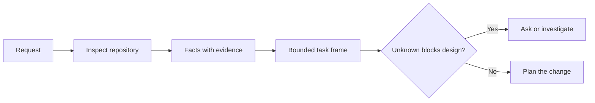

# एजेंट कोड लिखने से पहले कार्य को फ्रेम करें।

> एक कोडिंग एजेंट एक स्पष्ट कार्य को जल्दी से लागू कर सकता है. यह एक अस्पष्ट कार्य को जल्दी से भी लागू कर सकता है। गति समान है। लागत नहीं है।

> **【中文解读】**编码代理 实现清晰任务快速,实现模糊任务同样快速度,成本完全不同. 本课讲 写代码前的第一步:把一个模糊请求变成一个由仓库证据支、边界明确的任务框架 (任务框架)  (任务框架)  (任务框架)  (任务框架) )  (任务框架)  (任务框架)  (任务框架)  (任务框架)  (任务框架)  (任务框架)  (任务框架)  (任务框架)  (任务框架)  (任务框架)  (任务框架)  (任务框架)  (任务框架)  (任务框架)  (任务框架)  (任务框架)  (任务框架)  (任务框架)  (任务框架)  (任务框架)  (任务框架)  (任务框架)  (任务框架)  (任务框架)  (任务框架)  (任务框架)  (任务框架)  (任务框架)  (任务框架)  (任务框架)  (任务框架)  (任务)  (任务)  (任务)  (任务)  (任务)  (任务)  (任务)  (任务)  (任务)  (任务)  (任务)  (任务)  (任务)  (任务)  (任务)  (任务)  (任务)  (任务)  (任务)  ( ( ()  ()  ( 任务)  ( 任务)  ( 任务)  (                                                    

>  **【前置】**學本课前 請先掌握:Phase 14 第 31 课 ((Why model will fail先 understand failure mode,才理解为什么需要框架) और第 36 课 ((अनुबंधों की सीमा, दायरा करार इस वर्ग के कार्य ढांचे यह है कि यह कार्य परिभाषित चरण के पूर्व निर्धारित रूप में)  本课产`outputs/task-frame.md`धारा 44 में प्रमाण के कार्यान्वयन की योजना में बदल दिया गया है।

**Type:** Learn + Build | **类型:** 学习 + 动手实践
**Languages:** Python (stdlib) | **语言:** Python（标准库）
**Prerequisites:** Phase 14 lessons 31 and 36 | **前置知识:** Phase 14 第 31、36 课
**Time:** ~60 minutes | **时间:** 约 60 分钟

## सीखने के लक्ष्य

- संपादन से पहले किसी अनुरोध को सीमित कार्य फ्रेम में परिवर्तित करें।
  चश्मा अनुवादः एक अनुरोध को एक सीमांत कार्य ढांचे में परिवर्तित करें।
- अनुमानों और खुले प्रश्नों से भंडार संबंधी तथ्यों को अलग करना।
  चीनी भाषा में अनुवादः把仓库事实与假设的区分开来
- अनुमत मार्ग, निषिद्ध मार्ग और स्वीकृति के प्रमाण को परिभाषित करें।
  中文翻译: परिभाषित अनुमति मार्ग, प्रतिबंधित मार्ग और स्वीकृति प्रमाणों
- कार्य शुरू करने के लिए जब जासूस पर्याप्त है तय करें।
  अनुवादः निर्णय क्या समय अनुसंधान पर्याप्त है, मैं शुरू कर सकते हैं

## महंगी विफलता महंगी विफलता

 दोहरी ईमेल सुरक्षा जोड़ें विशिष्ट लगता है। यह नहीं है। क्या अद्वितीयता एपीआई, डोमेन सेवा या डेटाबेस में शामिल है? क्या तुलना केस-संवेदनशील है? कौन सा त्रुटि आकार पहले से ही सार्वजनिक है? क्या माइग्रेशन की अनुमति है? कौन सा परीक्षण व्यवहार साबित करता है?

> "बढ़ते हुए पुनःपुनःपुस्तक संरक्षण" बहुत विशिष्ट लगता है, वास्तव में विशिष्ट नहीं है। एकमात्र विशेषता एपीआई में सेवा या डेटाबेस में रखा जाना चाहिए? तुलना करें क्या अंतर है?

एक सक्षम एजेंट उन अंतराल को व्यवहार्य विकल्पों से भर देगा। यह खतरनाक मामला है क्योंकि कार्यान्वयन स्वच्छ, परीक्षण किया जा सकता है, और अभी भी सिस्टम के साथ असंगत है।

> एक सक्षम एजेंट इन रिक्तियों को भरने के लिए एक ऐसा विकल्प चुनता है जो तर्कसंगत लगता है। यह एक खतरनाक स्थिति हैः यह संभव है कि परीक्षण किया जाए, लेकिन पूरी प्रणाली के साथ असंगत है।

इसलिए कोडिंग एजेंट के काम की पहली इकाई संपादन नहीं है, यह एक कार्य फ्रेम है जिसे भंडार साक्ष्य द्वारा समर्थित है।

> इसलिए, एजेन्ट 工作 की पहली इकाई कोडिंग एक बार संपादित नहीं होती है, बल्कि एक कार्य ढांचा है जो भंडारण प्रमाण द्वारा समर्थित है।

> **【中文解读】**महंगी असफलता इसका मतलब यह नहीं है कि कोड खराब लिखा गया है, बल्कि कोड लिखा गया है लेकिन कार्य को गलत समझा गया है। एजेन्ट काम के अमूर्त होने से नहीं बदलता है और धीमा होता है। यह आत्मविश्वास से आपके लिए निर्णय लेता है। ये आपके लिए किए गए निर्णय हैं।

## कार्य फ्रेमवर्क कार्य फ्रेमवर्क

एक उपयोगी फ्रेम में छह फ़ील्ड होते हैंः

| Field | Question |
|---|---|
| Goal | What observable behavior must change? |
| Repository facts | What did you verify in code, tests, config, or history? |
| Allowed paths | Where may the change land? |
| Forbidden paths | What must remain untouched? |
| Acceptance evidence | Which commands or observations prove the goal? |
| Unknowns | Which decisions still need evidence or human judgment? |

> **【中文解读】**六个字段分别是: लक्ष्य (目标) 什么可观察行为必须改变) 仓库事实 (仓库事实) 您在代码,测试,配置或历史里核实过什么) 允许路径 (你在代码,测试,配置或历史里核实过什么) 允许路径 (你在代码,测试,配置或历史里核实过什么) 允许路径 (你在代码,测试,配置或历史里核实过什么) 允许路径 (你在代码,测试,配置或历史里核实过什么) 允许路径 (你在代码,测试,配置或历史里核实过什么) 允许路径 (你在代码,测试,配置或历史里核实过什么) 允许路径 (你在代码,测试,配置或历史里核实过什么) 允许路径 (你在代码,测试) 允许路径 (你允许落在哪) 什么绝不能碰) 禁止路径 (你绝不能碰) 否验证据 (你不能碰) 验证据 (你什么命令或观察能证明目标实现) 否是什么命令或观察可以证明) 否是未知项 (未知项 (哪些决定还需要证据或人的判断) 否是需要证据或人的判断) 最容易被忽视的是 禁止路径和未知项前者划出负空间,后者则则则则已被被保留的决定的决定是未予予予予予予予予予予予予予予予予予予予予予予予予予予予予予予予予予予予予予予予予予予予予予予予予予予予予予予予予予予予予予予予予予予予予予予予予予予予予予予予予予予予予予予予予予予予予予予予予予予予予予予予予予予予予予予予予予予予予予予予予予予予予予予予予予予予予予予予予予予予予予予予予予予予予予予予予予予予予予予

तथ्य रसीदों की आवश्यकता है। एपीआई डुप्लिकेट के लिए 409 का उपयोग करता है जब तक आप मौजूदा परीक्षण या हैंडलर को इंगित नहीं कर सकते तब तक यह एक तथ्य नहीं है। एक फ़ाइल पथ और पंक्ति पर्याप्त है। एक कमांड परिणाम बेहतर है जब व्यवहार मायने रखता है।

> तथ्य की आवश्यकता है  प्रमाण पत्र ── "API के लिए पुनः वापसी 409" आपके द्वारा निर्दिष्ट मौजूदा परीक्षण या प्रसंस्करणकर्ता से पहले कोई तथ्य नहीं है  फाइल पथ जोड़ना पर्याप्त है; व्यवहार से संबंधित, एक आदेश के संचालन के परिणाम अधिक आश्वस्त हैं 



>  **【类比】**任务框架像装修前的墙审批单:哪面墙能动(अनुमति मार्ग) 、哪面是承重墙绝不能动(प्रतिबन्धित मार्ग) 验收入住的标准是什么 (验收入住的标准是什么) △ स्वीकृति प्रमाण) ⋅没有这张单子,装修队(Agent) 动作越快,错墙的概率越大──

## पहचान प्रतिबंधों की खोज है।

पूरे रिपॉजिटरी को न पढ़ें. उन सतहों की खोज करें जो परिवर्तन को सीमित करती हैंः

> पूरे भंडारण को मत पढ़ना. . . . . . . . . . . . . . . . . . . . . . . . . . . . . . . . . . . . . . . . . . . . . . . . . . . . . . . . . . . . . . . . . . . . . . . . . . . . . . . . . . . . . . . . . . . . . . . . . . . . . . . . . . . . . . . . . . . . . . . . . . . . . . . . . . . . . . . . . . . . . . . . . . . . . . . . . . . . . . . . . . . . . . . . . . . . . . . . . . . . . . . . . . . . . . . . . . . . . . . . . . . . . . . . . . . . . . . . . . . . . . . . . . . . . . . . . . . . . . . . . . . . . . . . . . . . . . . . . . . . . . . . . . . . . . . . . . . . . . . . . . . . . . . . . . . . . . . . . . . . . . . . . . . . . . . . . . . . . . . . . . . . . . . . . . . . . . . . . . . . . . . . . . . . . . . . . . . . . . . . . . . . . . . . . . . . . . . . . . . . . . . . . . . . . . . . . . . . . . . . . . . . . . . . . . . . . . . . . . . . . . . . . . . . . . . . . . . . . . . . . . . . . . . . . . . . . . . . . . . . . . . . . . . . . . . . . . . . . . . . . . . . . . . . . . . . . . . . . . . . . . .

1. वर्तमान व्यवहार और उसके कॉल करने वाला।
   中文翻译:当前行为以及调用它的代码──
2. निकटतम मौजूदा परीक्षण.
   चीनी अनुवादः离得最近的现存测试──
3. सार्वजनिक अनुबंध या क्रमबद्ध रूप।
   चीनी अनुवादः सार्वजनिक करार या क्रमबद्धता के बाद के डेटा आकार
4. परियोजना निर्देश जो पथ को नियंत्रित करते हैं।
   中文翻译:管辖这些路径的项目规范(如 AGENTS.md)
5. निर्माण और सत्यापन आदेश।
   中文翻译:构建与验证命令。
6. स्थानीय पैटर्न को प्रकट करने वाले समान पूर्ण परिवर्तन।
   चीनी भाषा में अनुवादः similar of completed modification, वे अपनी परंपराओं को प्रकट करते हैं।

जब कोई निर्णय किसी सबूत के आधार पर लिया जाता है, तो उसे रोकना चाहिए, या उसे स्पष्ट रूप से सौंपा जाता है या उसे अज्ञात के रूप में सूचीबद्ध किया जाता है।

> जब प्रत्येक योजना में निर्णय के लिए कोई सबूत होता है, तो यह स्पष्ट रूप से अधिकृत होता है या अज्ञात परियोजनाओं के लिए सूचीबद्ध होता है, तो यह एक बार में रुक जाता है।

> **【中文解读】**侦察 का उद्देश्य  संपूर्ण कोड库 को समझना नहीं है, बल्कि  बंधन को ढूंढना हैः किसने इसे तैनात किया  किस परीक्षण ट्यूब ने इसे बनाया  सार्वजनिक करार长什么样  स्थानीय अभ्यास कैसे लिखा जाए  यह छह चेहरे  मिले, कार्य ढांचे के  तथ्य  लगभग भर गए हैं                                                                                                                                                                                                                         

## अज्ञात असफलता नहीं है अज्ञात विफलता नहीं है

एक अज्ञात एक नियंत्रित अंतर है। एक परिकल्पना उस अंतर का अनियंत्रित उत्तर है।

> अज्ञात एक नियंत्रित रिक्त स्थान है; परिकल्पना इस रिक्त स्थान पर एक अनियंत्रित उत्तर है।

प्रत्येक अज्ञात को वर्गीकृत करेंः

- **Discoverable:**भंडार या चल रही प्रणाली इसका जवाब दे सकती है।
  中文翻译:**可发现：**仓库或运行中的系统能回答它──
- **Decidable:**कार्य अनुबंध एजेंट को चुनने का अधिकार देता है।
  中文翻译:**可决定：**任务契约已授权代理 自行选择──
- **Human:**विकल्प उत्पाद व्यवहार, लागत, जोखिम या सार्वजनिक संगतता को बदलता है।
  中文翻译:**需人来定：**यह विकल्प उत्पाद व्यवहार, लागत, जोखिम या सार्वजनिक अनुकूलता को बदल देगा।
- **Deferred:**विकल्प इस स्लाइस के बाहर है और गैर-लक्ष्य में शामिल है।
  中文翻译:**可延后：**यह चयन इस भाग में नहीं है, इसे लक्ष्य में रखा जाना चाहिए।

एजेंट को खोज योग्य और विशेषाधिकारित अज्ञात के माध्यम से जारी रखना चाहिए।

>  खोजे जाने वाले  और अधिकृत किए गए  अज्ञात वस्तुओं के लिए, एजेंट  आगे बढ़ना चाहिए;  आवश्यक व्यक्ति के लिए  अज्ञात वस्तुओं के लिए, एजेंट  को इस चयन में दफन होने से पहले  रोकना चाहिए।

> **【中文解读】**अज्ञात वस्तुओं को विभाजित करना, अज्ञात की तुलना में अधिक सुरक्षित है। चार प्रकार के उपचार के लिए चार प्रकार हैंः खोजे जाने वाले परीक्षण, निर्णय लेने योग्य स्व-निर्धारण, व्यक्ति द्वारा निर्धारित पूर्व प्रश्न, अनिश्चितता में प्रवेश करने योग्य, गैर-उद्देश्य के लिए। सबसे अधिक डर है कि छिपे हुए तीसरे प्रकार के एजेंटों ने एक उत्पाद निर्णय को एक व्यक्ति द्वारा निर्धारित किया गया था।

## कार्यान्वयन से पहले स्वीकृति

पैच से पहले सबूत लिखें। सबूत हो सकता हैः

> पहले लिखें, फिर लिखें, फिर लिखें।

- एक केंद्रित इकाई या एकीकरण परीक्षण कमांड;
  中文翻译: एक条聚焦的单元或集成测试命令;
- एक नामित दृश्य पोर्ट और अपेक्षित स्थिति के साथ ब्राउज़र यात्रा;
  中文翻译: एक बार स्पष्ट दृश्य के साथ अपेक्षित स्थिति के ब्राउज़र ऑपरेशन यात्रा;
- एक वायर अनुरोध और सटीक प्रतिक्रिया अनुबंध;
  中文翻译: एक लाइन上请求和精确的响应契约;
- एक सीमा के साथ प्रदर्शन माप;
  中文翻译: एक带值 के प्रदर्शन माप;
- एक दायरा जांच जो पुष्टि करती है कि कोई संबंधित फ़ाइल नहीं बदल गई है।
  एक पुष्टिकरण बिना कोई संबंध नहीं दस्तावेज को संशोधित किया गया है।

परीक्षा पास करना कोई प्रमाण योजना नहीं है। प्रामाणिक परीक्षण और उसके समर्थन में दावा का नाम बताइए।

> "परीक्षा पारित हुई" एक प्रमाणन योजना नहीं है।

> **【中文解读】** प्राप्ति पूर्व-कार्यान्वयन है TDD  एजेंट 工程 में परिवर्तन:  एजेंट 动手之前就定好 क्या आदेश का क्या आउटपुट घोषित करने में सक्षम है                                                                                                                                                                                                                                        

## इसे बनाओ, इसे पूरा करो।

प्रयोगशाला एक बनाती है`TaskFrame`, अपनी सीमाओं और सबूतों को मान्य करता है, और लिखता है `outputs/task-frame.md`. .

>  प्रयोग भाग एक बनाने के लिए `TaskFrame`, परीक्षा की सीमाओं और साक्ष्य,并写出 `outputs/task-frame.md`

इस पाठ निर्देशिका से चलाएंः

```bash
python3 code/main.py
python3 -m unittest discover code/tests -v
```

उदाहरण को चार तरीकों से तोड़ेंः लक्ष्य को हटाएं, तथ्य प्राप्ति को हटाएं, एक अनुमति और प्रतिबंधित पथ को ओवरलैप करें, और स्वीकृति कमांड को हटाएं। सत्यापितकर्ता को प्रत्येक फ्रेम को अलग-अलग कारण से अस्वीकार करना चाहिए।

> इस उदाहरण को चार तरीकों से तोड़नाः लक्ष्य को हटाना, तथ्य के प्रमाण को हटाना, पथों को अनुमति देना और पथों को ओवरलैप करने से रोकना, अनुमोदन आदेश को हटाना।

## इसे एक वास्तविक भंडारण में उपयोग करें वास्तविक भंडारण में उपयोग करें

एक एजेंट को संपादित करने के लिए पूछने से पहलेः

> 让代理动手改代码之前:

1. लक्ष्य को व्यवहार के रूप में लिखें, फ़ाइल परिवर्तन नहीं।
   中文翻译:把目标写成一个行为,而不是一次文件改动──
2. दो या तीन तथ्यों को सटीक सबूत के साथ रिकॉर्ड करें।
   中文翻译:记录两三条带精确凭据的事实──
3. सबसे छोटी अनुमत पथ सेट का नाम दें।
   中文翻译:点名最小集合的允许路径──
4. नकारात्मक स्थान का नाम स्पष्ट रूप से दें।
   中文翻译:显式点名不做什么的负空间──
5. कार्य को समाप्त करने के लिए कमांड या अवलोकन लिखें।
   中文翻译:写下关闭 इस条任务的命令或观察──
6. उन निर्णयों की सूची बनाएं जिन्हें आपने अभी तक नहीं लिया है।
   中文翻译:列出你还没有证据支、尚无资格做决定──

फ्रेम को एक स्क्रीन पर फिट होना चाहिए। यदि यह नहीं हो सकता है, तो कार्य में कई स्वतंत्र रूप से सत्यापित परिवर्तन हो सकते हैं।

> 任务框架 should be left down  यदि यह नहीं हो तो यह कार्य कई स्वतंत्र रूप से सत्यापित परिवर्तनों को शामिल कर सकता है 

> **【中文解读】**यह छठ चरण इस वर्ग की व्यावहारिक सूची है, जो सीधे आपके कार्यप्रवाह में डाला जा सकता हैः लक्ष्य व्यवहार में लिखना  तथ्य के साथ प्रमाण पत्र  रास्ता न्यूनतम करने की अनुमति देना  नकारात्मक स्थान स्पष्टीकरण  अनुमोदन आदेश अग्रिम  अनिर्णित चीजों को सूचीबद्ध करना  एक स्क्रीन डाल दिया  एक अच्छा प्रारंभ  नहीं छोड़ने के लिए फ्रेमवर्क अक्सर मतलब है कि कार्य को तोड़ दिया जाना चाहिए 

## व्यायाम करें

1. अपने भंडार में से एक से एक असली बग को फ़्रेम करें बिना समाधान का प्रस्ताव दिया।
   Chinese: अपने ही गोदाम से एक असली बग चुनें, एक ढांचा बनाएं, कोई समाधान पेश न करें।
2. फ्रेम में एक दावा ढूंढें जो वास्तव में एक धारणा है। सबूत के साथ इसे बदलें।
   चीनी अनुवादः ढूंढ बाहर फ्रेमवर्क में एक वास्तविकता है परिकल्पना के  तथ्य, सबूत के साथ इसे बदल दें
3. एक अज्ञात मानव जोड़े जिसका जवाब सार्वजनिक अनुबंध को बदल देगा।
   Chinese: अनुवादः एक अनजान परियोजना को जोड़ना, इसका उत्तर सार्वजनिक समझौते को बदल देगा
4. सबसे छोटी सुरक्षित सेट में एक व्यापक अनुमति पथ विभाजित करें।
   中文翻译:把一条过宽的允许路径拆成最小安全集合──
5. स्वीकृति प्रमाण में एक दायरा रसीद जोड़ें।
   中文翻译:给验收证据加一条范围凭据──

## आगे पढ़ना 延伸閱讀

- [Nuseibeh and Easterbrook, Requirements Engineering: A Roadmap](https://www.cs.toronto.edu/~sme/papers/2000/ICSE2000.pdf), वास्तविक दुनिया के लक्ष्यों और बदलते प्रतिबंधों के लिए कार्यान्वयन को लंगर बनाने के लिए।
  中文翻译:नसेबी और ईस्टरब्रुक需求工程:路线图如何实现定在真世界目标和演化中的约束上
- [Yang et al., SWE-agent: Agent-Computer Interfaces Enable Automated Software Engineering](https://arxiv.org/abs/2405.15793), के लिए सबूत है कि एक कोडिंग एजेंट के आसपास इंटरफ़ेस इसकी प्रभावशीलता को बदलता है।
  中文翻译:Yang 等SWE-agent证明编码 एजेंट 周围的接口设计会改变它的实际效果──

## जो आप रखेंगे आप रखेंगे उत्पादन

रखो`outputs/task-frame.md`. यह अगले पाठ का इनपुट है, जहां फ्रेम एक सबूत-समर्थित निष्पादन योजना बन जाता है.

> रखरखाव`outputs/task-frame.md` यह अगले वर्ग का प्रवेश है अगले वर्ग में, कार्य ढांचा एक प्रमाण द्वारा समर्थित निष्पादन योजना में बदल जाएगा
