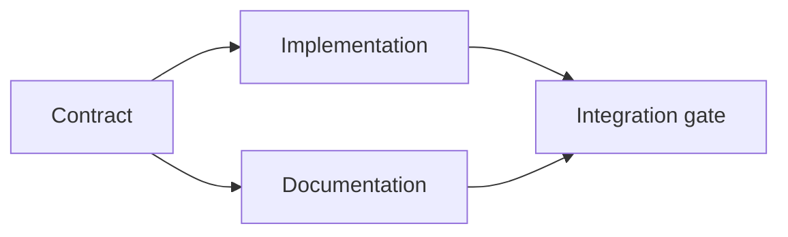

# सबूतों के आधार पर एक निष्पादन योजना बनाएं

> एक योजना एक सुंदर टू-डू सूची नहीं है यह एक निर्भरता ग्राफ है जिसमें प्रत्येक परिवर्तन का एक कारण है और प्रत्येक टर्मिनल नोड का प्रमाण है।

> **【中文解读】**计划不是" Better Looking Wait List ", बल्कि एक निर्भरता चित्र हैः प्रत्येक परिवर्तन के लिए एक कारण हैः प्रत्येक परिवर्तन के लिए एक कारण हैः प्रत्येक अंतराल के लिए एक आधार है।

>  **【前置】**學本课前कृपया पहले चरण 14 का ज्ञान प्राप्त करें 第43 课                                                                                                                                                                                                                                                      `outputs/task-frame.md`)―本课产出 `outputs/evidence-plan.json`, 45 वें वर्ग में बहु एजेंट 委托 करार बनेंगे

**Type:** Learn + Build | **类型:** 学习 + 动手实践
**Languages:** Python (stdlib) | **语言:** Python（标准库）
**Prerequisites:** Phase 14 lesson 43 | **前置知识:** Phase 14 第 43 课
**Time:** ~65 minutes | **时间:** 约 65 分钟

## सीखने के लक्ष्य

- एक कार्य फ्रेम को सबूत और प्रमाण के साथ कार्य आइटम में परिवर्तित करें।
  चश्मा अनुवादः把任务框架转化为带证据与证明的工作项.
- प्रोसा अनुक्रम के बजाय निर्भरता के रूप में मॉडल क्रम।
  中文翻译: प्रसव के रूप में कथा के बजाय, आश्रय के रूप में निर्माण के क्रम में।
- संपादन से पहले गायब तथ्यों, अज्ञात निर्भरताओं और चक्रों का पता लगाएं।
  चश्मा का प्रयोग करने के लिए एक अदृश्य रूप से अदृश्य रूप से अदृश्य रूप से अदृश्य रूप से अदृश्य रूप से अदृश्य रूप से अदृश्य रूप से अदृश्य रूप से अदृश्य रूप से अदृश्य रूप से अदृश्य रूप से अदृश्य रूप से अदृश्य रूप से अदृश्य रूप से अदृश्य रूप से अदृश्य रूप से अदृश्य रूप से अदृश्य रूप से अदृश्य रूप से अदृश्य रूप से अदृश्य रूप से अदृश्य रूप से अदृश्य रूप से अदृश्य रूप से अदृश्य रूप से अदृश्य रूप से अदृश्य रूप से अदृश्य रूप से अदृश्य रूप से अदृश्य रूप से अदृश्य रूप से अदृश्य रूप से अदृश्य रूप से अदृश्य रूप से अदृश्य रूप से अदृश्य रूप से अदृश्य रूप से अदृश्य रूप से अदृश्य रूप से अदृश्य रूप से अदृश्य रूप से अदृश्य रूप से अदृश्य रूप से अदृश्य रूप से अदृश्य रूप से अदृश्य रूप से अदृश्य रूप से अदृश्य रूप से अदृश्य रूप से अदृश्य रूप से अदृश्य रूप से अदृश्य रूप से अदृश्य रूप से अदृश्य रूप से अदृश्य रूप से अदृश्य रूप से अदृश्य रूप से अदृश्य रूप से है।
- अलग कदम जो एक साथ चल सकते हैं और कदम जो इंतजार करना होगा।
  च. भाषा अनुवादः区分可以同时运行的步骤和必须等待的步骤──

## एजेंट की योजना क्यों विफल होती है?

कमजोर योजनाओं भविष्य में अनुरोध दोहराएंः

> 弱计划只是把请求复述成未来时:

1. एपीआई अद्यतन.
   中文翻译:更新API。
2. परीक्षण जोड़ें।
   中文翻译:加测试──
3. दस्तावेज अद्यतन करें।
   中文翻译:更新文档──

उस सूची में कुछ भी नहीं कहता है कि क्या पाया गया था, क्यों उन फ़ाइलों सही हैं, कौन सा अनुबंध पहले बदलता है, या एक साथ क्या हो सकता है। एक एजेंट हर कदम का पालन कर सकता है और फिर भी पुनः काम कर सकता है।

> इस सूची में कोई भी वाक्य नहीं हैः पता चला क्या है, क्यों ये फाइलें हैं, कौन से अनुबंध पहले बदलते हैं, कौन से कदम आगे बढ़ सकते हैं।

> **【中文解读】**弱计划 के लक्षण हैं "पुनर्विचार अनुरोध" यह क्रमबद्ध प्रतीत होता है, लेकिन कोई भंडार प्रमाण नहीं है 强计划对每项工作做五个承诺 见下表:标识符 最小改动 证据 依赖 证明 缺少任何一项, एजेंट                                                                                                                                                                                                                         

एक मजबूत योजना प्रत्येक कार्य बिंदु के लिए पांच प्रतिबद्धताओं को शामिल करती हैः

| Commitment | Purpose |
|---|---|
| Identifier | Stable reference for dependencies and handoff |
| Change | The smallest behavior or contract change |
| Evidence | Repository facts that justify the change |
| Dependencies | Work that must be true first |
| Proof | The exact check that closes the item |

> **【中文解读】**五个承诺分别是:标识符 (标识符) 转变 (转变) 最小的行为或契约变更) 证据 (证据) 证明 (证据) 证据 (证据) 证据 (证据) 证据 (证据) 证据 (证据) 证据 (证据) 证据) 证据 (证据) 证据 (证据) 证据 (证据) 证据 (证据) 证据) 证据 (证据) 证据 (证据) 证据) 证据 (证据) 证据) 证据 (证据) 证据 (证据) 证据) 证据 (证据) 证据) 证据 (证据) 证据) 证据 (证据) 证据) 证据 (证据) 证据) 证据 (证据) 证据) 证据 证据 证据 证据 证据 证据 证据 证据 证据 证据 证据 证据 证据 证据 证据 证据 证据 证据 证据 证据 证据 证据 证据 证据 证据 证据 证据 证据 证据 证据 证据 证据 证据 证据 证据 证据 证据 证据 证据 证据 证据 证据 证据 证据 证据 证据 证据 证据 证据 证据 证据 证据 证据 证据 证据 证据 证据 证据 证据 证据 证据 证据 证据 证据 证据 证据 证据 证据 证据 证据 证据 证据 证据 证据 证据 证据 证据 证据 证据 证据 证据 证据 证据 证据 证据 证据 证据 证据 证据 证据 证据 证据 证据 证据 证据 证据 证据

## अनुबंध को लागू करने से पहले योजना बनाएं, पहले तय करें, फिर से इसे लागू करें

जब कई सतहें एक ही व्यवहार पर निर्भर करती हैं, तो पहले व्यवहार को परिभाषित करें। परीक्षण, कार्यान्वयन, प्रलेखन और एकीकरण फिर चार संस्करणों का आविष्कार करने के बजाय एक अनुबंध साझा कर सकते हैं।

> जब कई सतहें एक ही व्यवहार पर निर्भर करती हैं, तो पहले व्यवहार को स्वयं परिभाषित करें। परीक्षण, कार्यान्वयन, दस्तावेज, एकीकरण, फिर एक ही अनुबंध साझा करें, न कि प्रत्येक चार संस्करणों का आविष्कार करें।

>  **【类比】**契约先行像先定国标插头再生产电器器──插座厂(实现) 和电器厂(文档) एक साथ खोला जा सकता है, क्योंकि इंटरफ़ेस लॉक हो चुका है;验收员(集成门) केवल एक ही मानक जांच दोनों तरफ से देखना होगा── कोई राष्ट्रीय标志 नहीं है, और यह एक साथ खोला जा सकता है, उत्पादन插头大概率插插进插座──



ग्राफ सुरक्षित समवर्तीता का खुलासा करता है। अनुबंध तय होने के बाद कार्यान्वयन और प्रलेखन एक साथ आगे बढ़ सकते हैं। एकीकरण दोनों का इंतजार करता है।

> इस आलेख में सुरक्षा के पहलू प्रकट किये गये हैं। समझौते के तय होने के बाद, कार्यान्वयन और दस्तावेज एक साथ आगे बढ़ सकते हैं।

## सबूत योजना बदलता है

भंडारण साक्ष्य सजावट नहीं है। यह काम को बदलने में सक्षम होना चाहिएः

> 仓库证据不是装饰品──它必须有能力改变工作内容:

- एक मौजूदा सहायक एक नियोजित नए अमूर्त को हटा देता है।
  中文翻译: एक मौजूदा सहायक फ़ंक्शन, योजना में नए सारों को काट दिया गया।
- एक संगतता परीक्षण एक प्रवास कदम को मजबूर करता है।
  एक兼容性测试, मजबूर किया योजना के बाहर के स्थानांतरण चरणों
- एक तैनाती प्रतिबंध एक स्कीम परिवर्तन को दूसरे कार्य में ले जाता है।
  एक तैनाती, एक योजना को दूसरे कार्य में स्थानांतरित करना
- सार्वजनिक प्रतिक्रिया प्रकार कार्यान्वयन और प्रलेखन के क्रम को बदलता है।
  एक सार्वजनिक प्रतिक्रिया प्रकार, ने दस्तावेजों के पूर्व क्रम को बदल दिया।

यदि सबूत योजना को नहीं बदल सकते हैं, तो यह शायद उस निर्णय के लिए सबूत नहीं है।

> यदि सबूत बदलना योजनाबद्ध नहीं है, तो यह अधिकांश इस निर्णय का प्रमाण नहीं है।

> **【中文解读】**यह एक बहुत ही उपयोगी प्रमाणन मानदंड हैः "सबूत" को निर्णय के बगल में रखना, पूछना" यदि यह बदले में, योजना बदल जाएगी? "

## विराम के लिए डिजाइन किया गया है

एक पुनः शुरू करने योग्य योजना में कार्य वस्तुएं इतनी छोटी होती हैं कि एक और सत्र निर्धारित कर सकता हैः

> 编码 एजेंट की बैठक अचानक समाप्त हो जाएगी.

- कौन सा आइटम पूरा है;
  中文翻译:哪个工作项已完成;
- किस सबूत से निकला;
  中文翻译:哪个证明跑过了;
- किस कलाकृतियों में बदलाव हुआ है;
  中文翻译:哪些产物变了;
- कौन सी निर्भरता अब अनब्लॉक की गई है;
  中文翻译:哪些依赖已解锁;
- अगले सुरक्षित आइटम क्या है।
  中文翻译:下一个安全工作项是什么──

केवल चैट के अंदर के चेकबॉक्स में ही स्टेट को कोड न करें। प्लान को काम के बगल में स्टोर करें।

> न केवल स्थिति को चैट रिकॉर्ड के चयन बॉक्स में कोडित करें।

> **【中文解读】**एजेंट 会话自然短命:上下文窗口会满、网络会断、你会开新会话──所以计划的状态必须外置到文件系统就像游戏要存盘──"哪些证明已经跑了"这个条款尤其关键:新会话不应重复跑过昂贵的验证,更不应跳过以为它已经跑过──

## योजना सत्यापन

योजना को निष्पादन से पहले अस्वीकार करें जबः

> निम्नलिखित स्थिति में, इस योजना को निष्पादन से पहले अस्वीकार करनाः

- पहचानकर्ता दोहराया जाता है;
  中文翻译:标识符重复;
- किसी कार्य वस्तु में कोई प्रमाण नहीं है;
  中文翻译:某工作项没有证据;
- किसी कार्य वस्तु के पास कोई प्रमाण नहीं है;
  中文翻译:某工作项没有证明;
- किसी निर्भरता का नाम अज्ञात वस्तु का नाम है;
  中文翻译:某依指向不存在的工作项;
- ग्राफ में एक चक्र होता है;
  中文翻译: अवलंबून छंद;
- पहले अपरिवर्तनीय कार्य प्रासंगिक अनिश्चितता को हल करने से पहले होता है।
  प्रथम अपरिवर्तनीय क्रिया, प्रकट होने से पहले कि यह निर्भर करता है अनिश्चितता हल हो जाए।

पहले पांच चेक यांत्रिक हैं, अंतिम में न्याय की आवश्यकता होती है और उन्हें स्पष्ट रूप से बुलाया जाना चाहिए।

> पिछला पाँच लेख जाँच यंत्र की है। अंतिम लेख में न्याय की आवश्यकता है, इसे स्पष्ट रूप से अकेले ही इंगित किया जाना चाहिए।

> **【中文解读】**六条拒绝规则里藏藏着本课最重要的排序原则:不可逆动作 (परिवर्तन, हटाने, जारी करने, सार्वजनिक समझौते में परिवर्तन) को अनिश्चितता के बाद से ही बाहर होना चाहिए।

## इसे बनाओ, इसे पूरा करो।

`code/main.py`मॉडल कार्य आइटम, उनकी रसीदों को मान्य करता है, एक टॉपलॉजिकल क्रम के साथ निष्पादन तरंगों की गणना करता है, और लिखता है `outputs/evidence-plan.json`. .

> `code/main.py`建模工作项、校验它们的证书、拓排序计算执行波次,并写出 `outputs/evidence-plan.json`

दौड़ें:

> 运行:

```bash
python3 code/main.py
python3 -m unittest discover code/tests -v
```

उदाहरण में तीन लहरें उत्पन्न होती हैं। अनुबंध परिभाषा पहले चलती है। कार्यान्वयन और प्रलेखन एक साथ चलते हैं। एकीकरण गेट आखिरी चलता है।

> उदाहरण उत्पादन तीन दौर से निकलता हैः契约定义最先运行,实现和文档同时运行,集成门最后运行──

> **【中文解读】**"波次" का सीधा उपयोग क्रमबद्धता के लिए किया जाता हैः प्रत्येक कार्यक्रम में कार्यक्रम एक दूसरे पर निर्भर नहीं है, विभिन्न एजेंटों और प्रभागों को विभाजित किया जा सकता है;

## इसे एक कोडिंग एजेंट के साथ उपयोग करें

एजेंट से फ़ाइलों को बदलने से पहले योजना तैयार करने के लिए कहें। तीन चीजों के लिए योजना की समीक्षा करेंः

> 让代理在改文件之前先产出计划――审查计划时住三个事:

1. प्रत्येक पथ और व्यवहार का दावा एक भंडार रसीद है।
   中文翻译: प्रत्येक मार्ग और व्यवहार के कथन में भंडारण प्रमाण हैं。
2. प्रत्येक वस्तु में एक स्पष्ट पूर्णता प्रमाण है।
   中文翻译: प्रत्येक कार्य में एक स्पष्ट पूर्णता प्रमाण है。
3. ग्राफ महंगे या अपरिवर्तनीय काम को तब तक देरी करता है जब तक कि उस पर निर्भर अनिश्चितता का समाधान नहीं हो जाता।
   चीनी अनुवादः अवलंबित्व को अनमोल या अपरिवर्तनीय बनाने के लिए, अनिश्चितता को हल करने के बाद देरी से।

योजना को मंजूरी दें, सावधानी बरतने का कोई अस्पष्ट वादा नहीं।

> 👉 इस योजना को अनुमोदित किया गया है, "मैं छोटा सा दिल" के एक वाक्य के लिए नहीं 👉

## व्यायाम करें

1. एक प्रवासन वस्तु जोड़ा जाए जिसमें स्पष्ट मानव अनुमोदन की आवश्यकता हो।
   चीनी अनुवादःएक अतिरिक्त जोड़े जाने के लिए आवश्यक है
2. एक चक्र बनाएं और इसके पीछे छिपे हुए उत्पाद असहमति की व्याख्या करें।
   चीनी अनुवादः एक चक्र निर्भरता का निर्माण,并解释 इसके पीछे छिपे हुए उत्पादों के विभाजन.
3. एक आइटम को विभाजित करें जिसमें दो सबूत आदेश हैं।
   中文翻译:把一个带两条证明命令的工作项拆开.
4. एक कार्य आइटम जो मौजूदा शाखाओं में से किसी को छूने के बिना दूसरी लहर में चलाया जा सकता है जोड़ें।
   चीनी अनुवादः एक जोड़ा जा सकता है दूसरी लहर में चलाने के लिए, और दो मौजूदा शाखाओं के काम के लिए नहीं छूना.
5. JSON को सत्य के स्रोत के रूप में रखते हुए योजना को मार्कडाउन के रूप में प्रस्तुत करें।
   中文翻译:把计划染成 Markdown,同时保持 JSON 作为唯一事实来源──

## आगे पढ़ना 延伸閱讀

- [Nuseibeh and Easterbrook, Requirements Engineering: A Roadmap](https://www.cs.toronto.edu/~sme/papers/2000/ICSE2000.pdf), लक्ष्य, विनिर्देश, सहमति और विकास के बीच पुनरावर्ती संबंध के लिए।
  中文翻译:नसेइबे और ईस्टरब्रुक के बीच के संबंध
- [Barry Boehm, A Spiral Model of Software Development and Enhancement](https://dl.acm.org/doi/10.1145/12944.12948), एक निश्चित रैखिक अनुक्रम के बजाय जोखिम समाधान के आसपास विकास को क्रमबद्ध करने के लिए।
  हिन्दी अनुवादःबरी बोहम सॉफ्टवेयर विकास के लिए एक घुमावदार मॉडल है जो विकास को व्यवस्थित करने के लिए एक निश्चित लाइनर क्रम के बजाय एक निश्चित गतिशीलता के आसपास है।

## जो आप रखेंगे आप रखेंगे उत्पादन

रखो`outputs/evidence-plan.json`यह अगले पाठ में प्रतिनिधि अनुबंध बन जाता है।

> रखरखाव`outputs/evidence-plan.json` यह अगले वर्ग में एक अनुबंध बन जाएगा
