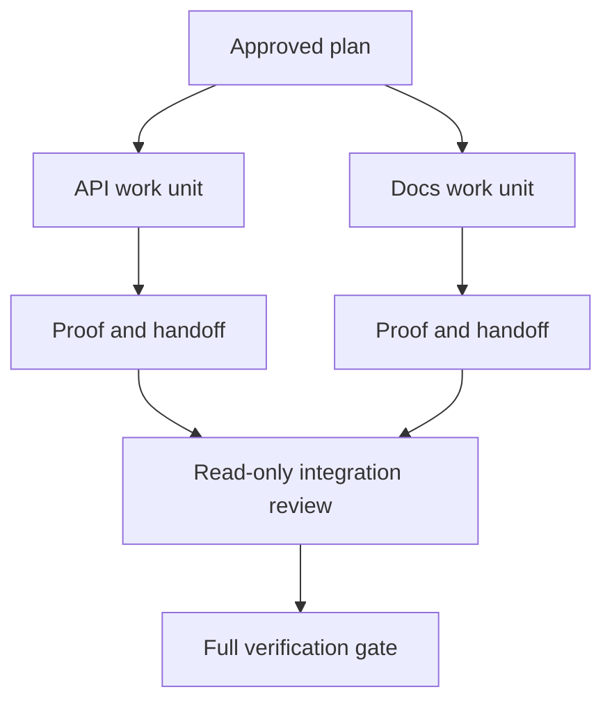

# प्रतिनिधि एजेंट अलगाव और विलय अनुबंध के साथ काम करते हैं

> समानांतर एजेंट केवल तभी दीवार समय बचाते हैं जब काम स्वतंत्र होता है। अन्यथा वे एक स्पष्ट कार्य को तेजी से विफलता दर के साथ समन्वय समस्या में बदल देते हैं।

> **【中文解读】**साथ ही एजेंट ऩ केवल काम में वास्तविक स्वतंत्र समय में ही समय बचाने में सक्षम होता है; अन्यथा यह एक स्पष्ट कार्य को एक समन्वय समस्या में बदल देता है, और अधिक तेजी से विफल रहता है।

>  **【前置】** इस वर्ग के अभिन्नकर्ता "निर्माता और मार्कर विभाजन" के संयुक्त चरण में आवेदन करते हैं) और  44  से प्रमाणीकरण के लिए योजना बनाने के लिए प्रमाणीकरण के लिए प्रमाणीकरण के लिए इस वर्ग के प्रवेश के लिए यह उत्पन्न होता है।`outputs/evidence-plan.json`, जिसमें से निष्पादन के बाद सीधे तय किया जाता है कि कौन से कार्यकर्ता काम कर सकते हैं।`outputs/delegation-plan.json`, रिकॉर्ड तोड़ना क्यों सुरक्षित है, मार्ग के लिए किसके लिए है, एकत्रित करने के लिए क्या सबूत प्राप्त करना है।

**Type:** Learn + Build | **类型:** 学习 + 动手实践
**Languages:** Python (stdlib) | **语言:** Python（标准库）
**Prerequisites:** Phase 14 lessons 39 and 44 | **前置知识:** Phase 14 第 39、44 课
**Time:** ~70 minutes | **时间:** 约 70 分钟

## सीखने के लक्ष्य

- यह तय करें कि क्या वास्तविक स्वतंत्रता से प्रतिनिधिमंडल को उचित ठहराया जाता है।
  中文翻译:判断委托是否被真实独立性所支──
- प्रत्येक कार्यकर्ता को विशेष फ़ाइल स्वामित्व और स्पष्ट प्रमाण दें।
  चीनी अनुवादः प्रत्येक कार्यकर्ता को 独占文件所有权和明确的证明──
- निर्भरता से गणना निष्पादन तरंगों।
  中文翻译:从依赖关系计算执行波次――
- एजेंट काम को सुरक्षित रूप से जोड़ने के लिए एक विलय अनुबंध डिजाइन करें।
  中文翻译:设计一个安全合并 工作的合并契约。

## समानांतरता परीक्षण और परीक्षा

अधिक एजेंट उपलब्ध होने के कारण प्रतिनिधि न करें। यदि इनमें से कम से कम एक सच हैः

> "अधिक एजेंट उपलब्ध" के कारण न करें। निम्नलिखित में से कम से कम एक लेख स्थापित होने पर ही कार्यभार ग्रहण किया जाएः

- दो जांच अलग-अलग अज्ञात प्रश्नों का स्वतंत्र रूप से उत्तर दे सकती है;
  中文翻译:两项调查能独立回答不同的未知项;
- दो कार्यान्वयन अलग-अलग फाइल और अनुबंधों का मालिक हैं;
  中文翻译: दो कार्यान्वयन परस्पर असहमत दस्तावेज और संधि;
- एक समीक्षक बिना किसी परिवर्तन के एक पूर्ण कलाकृतियों की जांच कर सकता है;
  中文翻译: एक समीक्षक इसे संशोधित किए बिना तैयार उत्पाद का निरीक्षण कर सकता है;
- स्थानीय कार्य जारी रहते हुए एक धीमी बाहरी जांच चल सकती है।
  एक धीमी गति से बाहरी जांच एक ही समय में चल सकती है।

एजेंटों को एक ही फ़ाइलों, एक ही हल नहीं हुआ निर्णय, या एक ही परिवर्तनशील वातावरण की आवश्यकता होने पर कार्य क्रमबद्ध रखें।

> जब कई एजेंटों को एक ही दस्तावेज की आवश्यकता होती है, एक ही अनिर्णित या एक ही परिवर्तनीय वातावरण, एक साथ चलना जारी रखें।

> **【中文解读】**"मेरी पंक्ति परीक्षण" इस वर्ग की पहली पंक्ति है: उपलब्धता कोई कारण नहीं है, स्वतंत्रता ही है। चार खंडों के अनुसार, "नहीं साझा किया जा सकता है" का एक सामान्य बिंदु है।

## एक कार्य इकाई एक अनुबंध है।

प्रत्येक आवंटित इकाई को निम्नलिखित आवश्यकताएं होती हैंः

> प्रत्येक अनुबंधित इकाई की आवश्यकताएंः

| Field | Meaning |
|---|---|
| Goal | One observable result |
| Owner | One accountable worker |
| Paths | Exclusive write ownership |
| Dependencies | Completed units required before starting |
| Proof | Exact evidence returned to the integrator |
| Handoff | Files changed, decisions made, remaining risk |

> **【中文解读】**六段里最关键的是 六段里最关键是 六段里最关键是 六段里最关键是 六段里最关键是 六段里最关键是 六段里最关键是 六段里最关键是 六段里最关键是 六段里最关键是 六段里最关键是 六段里最关键是 六段里最关键是 六段里最关键是 六段里最关键是 六段里最关键是 六段里最关键是 六段里最关键是 六段里最关键是 六段里最关键是 六段里最关键是 六段里最关键是 六段里最关键是 六段里最关键是 六段里最关键是 六段里最关键是 六段里最关键是 六段里最关键是 六段里最关键是 六段里最关键是 六段里最关键是 六段里最关键是 六段里最关键是 六段里最关键是 六段里最关键是 六段里最关键是 六段 六段 六段 六段 六段 六段 六段 六段 六段 六段 六段 六段 六段 六段 六段 六段 六段 六段 六段 六段 六段 六段 六段 六段 六段 六段 六段 六段 六段 六段 六段 六段 六段 六段 六段 六段 六段 六段 六段 六段 六段 六段 六段 六段 六段 六段 六段 六段 六段 六段 六段 六段 六段 六段 六段 六段 六段 六段 六段 六段 六段 六段 六段 六段 六段 六段 六段 六段 六段 六段 六段 六段 六段 六段

बैकएंड को संभालें यह एक कार्य इकाई नहीं है. डूपलेट चेक इन करें `app/accounts.py`और ध्यान केंद्रित खाता परीक्षण के साथ यह साबित है।

> "एक काम की इकाई नहीं है।`app/accounts.py`里实现重复检查,并使用聚焦的账户测试证明它"才是.

## अलगाव में तीन परतें हैं।

1. **Filesystem isolation:**अलग-अलग कार्यवृक्ष या रेत बॉक्स आकस्मिक साझा संपादन को रोकते हैं।
   中文翻译:**文件系统隔离：**独立工作树或沙箱防止意外的共享编辑──
2. **Ownership isolation:**अनुबंध दो श्रमिकों को एक ही पथ को जानबूझकर संपादित करने से रोकते हैं।
   中文翻译:**所有权隔离：**契约防止两个工人有意编辑同一路径──
3. **State isolation:**अलग लॉग और आउटपुट एक कार्यकर्ता को दूसरे कर्मचारी के सबूतों को ओवरराइट करने से रोकते हैं।
   中文翻译:**状态隔离：**独立日志与输出 एक कार्यकर्ता को दूसरे कर्मचारी को कवर करने से रोकने के लिए साक्ष्य

फ़ाइल सिस्टम अलगाव स्वामित्व को हल नहीं करता है। दो स्वच्छ कार्यवृक्ष अभी भी परस्पर विरोधी डिजाइन उत्पन्न कर सकते हैं। विलय अनुबंध को काम शुरू होने से पहले साझा इंटरफ़ेस को हल करना चाहिए।

> 文件系统隔离解决不了所有权问题―― दो स्वच्छ कार्यवृक्ष 仍然可能产生相互冲突的设计――合并契约必须在开工前就定制共享接口――

> **【中文解读】**तीन स्तरों के अलगाव को अक्सर गलत तरीके से "कामकाज के पेड़ पर काम पूरा हो गया" समझा जाता है। लेकिन कामकाज केवल दुर्घटनाग्रस्त टकराव से बचने के लिए काम करता है, दो श्रमिकों के बीच संघर्ष के विभिन्न पहलुओं के डिजाइन के लिए।



> 图解: अनुमोदित योजना दो कार्य इकाईओं में विभाजित है, प्रत्येक में प्रतिगमन प्रमाण पत्र और प्रतिगमन विवरण; अभियुक्त पहले केवल समीक्षा करता है, अंतिम में पूर्ण प्रमाण पत्र का संचालन करता है।

## इंटीग्रेटर काम को पुनर्निर्माण नहीं करता है

इंटीग्रेटर को:

> 集成者 चाहिए:

1. प्रत्येक हस्तान्तरण के लिए निर्धारित दायरा के अनुरूप होने की पुष्टि करें;
   中文翻译: प्रत्येक संबंध को उस क्षेत्र के अनुरूप होने की पुष्टि करें;
2. केवल श्रमिक के सारांश को नहीं, बल्कि प्रमाण का उत्पादन पढ़ें;
   中文翻译:读证明输出本身,而不只是工人的总结;
3. निर्भरता क्रम में परिवर्तनों को जोड़ना;
   中文翻译:按依序合并改动;
4. पूर्ण क्रॉस-इकाई गेट चलाएं;
   中文翻译:运行完整的跨单元验证门;
5. छिपे हुए दायरे के विस्तार को अस्वीकार करना;
   中文翻译:拒绝隐藏的范围扩张;
6. संघर्ष को नए निर्णय के रूप में रिकॉर्ड करें, मौन संपादन नहीं।
   中文翻译:把冲突记录为新决定,而不是改掉──

यदि एकीकरण के लिए एक कार्यकर्ता के अधिकांश परिणामों को फिर से लिखना आवश्यक है, तो मूल विघटन गलत था।

> यदि एकीकरण को कामगार के परिणामों का अधिकांश भाग फिर से लिखने की आवश्यकता होती है, तो प्रारंभिक विभाजन गलत है।

> **【中文解读】**️ ️ ️ ️ ️ ️ ️ ️ ️ ️ ️ ️ ️ ️ ️ ️ ️ ️ ️ ️ ️ ️ ️ ️ ️ ️ ️ ️ ️ ️ ️ ️ ️ ️ ️ ️ ️ ️ ️ ️ ️ ️ ️ ️ ️ ️ ️ ️ ️ ️ ️ ️ ️ ️ ️ ️ ️ ️ ️ ️ ️ ️ ️ ️ ️ ️ ️ ️ ️ ️ ️ ️ ️ ️ ️ ️ ️ ️ ️ ️ ️ ️ ️ ️ ️ ️ ️ ️ ️ ️ ️ ️ ️ ️ ️ ️ ️ ️ ️ ️ ️ ️ ️ ️ ️ ️ ️ ️ ️ ️ ️ ️ ️ ️ ️ ️ ️ ️ ️ ️ ️ ️ ️ ️ ️ ️ ️ ️ ️ ️ ️ ️ ️ ️ ️ ️ ️ ️ ️ ️ ️ ️ ️ ️ ️ ️ ️ ️ ️ ️ ️ ️ ️ ️ ️ ️ ️ ️ ️ ️ ️ ️ ️ ️ ️ ️ ️ ️ ️ ️

## मानव और एजेंट भूमिकाएँ

प्रतिनिधिमंडल मानव न्याय को नहीं हटाता है। मानव अभी भी सार्वजनिक व्यवहार, जोखिम, प्राधिकरण या अपरिवर्तनीय लागत को बदलने वाले विकल्पों का मालिक है। एजेंट सीमित जांच, कार्यान्वयन, सत्यापन और समीक्षा का मालिक हो सकते हैं।

> 委托 नहीं बदलता निर्णयों को. लोग जारी रखने के लिए जो सार्वजनिक व्यवहार को बदलने के लिए 风险, अधिकृत या अपरिवर्तनीय लागत के विकल्पों को. एजेंटों के पास हो सकता है के लिए एक सीमा है जांच, कार्यान्वयन, सत्यापन और समीक्षा.

यह एक कैलिब्रेटेड स्वायत्तता हैः प्रणाली जब सबूत और रिलैक मजबूत होते हैं तो स्वतंत्रता प्रदान करती है, और जब परिणाम उच्च होते हैं तो एक चेक पॉइंट की आवश्यकता होती है।

> यह है कि प्रणाली में प्रमाणों और रोट्रॉलिंग क्षमता के मजबूत घटक का विमोचन अधिकार, और इसके बाद गंभीर घटक में जाँच बिंदुओं को स्थापित करना।

> **【中文解读】**"कक्षाबद्ध स्वायत्तता" इस वर्ग के मूल्य प्रस्ताव हैः स्वायत्तता की डिग्री अधिक से अधिक बेहतर नहीं है, बल्कि "सबूत की ताकत × घुमाया जा सकता है" के साथ उचित अनुपात में होना चाहिए।

## इसे बनाओ, इसे पूरा करो।

प्रयोगशाला पथ ओवरलैप की जांच करता है, निर्भरता की पुष्टि करता है, सुरक्षित निष्पादन तरंगों की गणना करता है, और लिखता है `outputs/delegation-plan.json`. .

> प्रयोग भाग परीक्षण पथ परचयन परचयन निर्भर प्रणाली के कार्यान्वयन के लिए `outputs/delegation-plan.json`

दौड़ें:

> 运行:

```bash
python3 code/main.py
python3 -m unittest discover code/tests -v
```

डॉक्स इकाई को मालिक के लिए बदलें `app/`. योजना को अवरुद्ध होना चाहिए क्योंकि उस माता-पिता पथ एपीआई इकाई ओवरलैप करता है.

>                                                                                                                                                                                                                                                                                                                                                                                                                                                                                                                              `app/` योजना को रोकना चाहिए, क्योंकि इस पथ पर एपीआई के साथ एक इकाई ओवरलैप होती है

> **【中文解读】**破坏实验 把 doc 单元所有权改成 `app/`) के प्रदर्शन में स्वामित्व अलगाव की यंत्रिकीकरण हैः मार्ग पर निर्भर नहीं स्वयं पर निर्भर, पर परीक्षक द्वारा सीधे अस्वीकार।

## व्यायाम करें

1. वास्तविक परिवर्तन को दो स्वतंत्र कार्य इकाइयों और एक एकीकृत करने वाले में विघटित करें।
   中文翻译:把一个真实改动分解成两个独立工作单元和一个集成者──
2. प्रस्तावित समानांतर विभाजन को ढूंढें जो केवल स्वतंत्र दिखता है। साझा निर्णय बताएं।
   चीनी अनुवादः एक को ढूंढना केवल एक अलग दिखने वाला एक साथ चल रहा है, जो निर्णय साझा करता है, उसे बताओ।
3. एक केवल-पढ़ने वाला शोधकर्ता जोड़ा जाए जिसका आउटपुट एक तथ्यात्मक तालिका है।
   चीनी भाषा में अनुवादः加一个只读的调研工作者, इसका परिणाम एक तथ्य表.
4. एक विलय गेट जो सभी इकाई अनुबंधों के साथ अंतिम बदल फ़ाइल सेट की जांच करता है जोड़ें.
   चीनी अनुवादः加一个合并门:把最终的改动文件集合与所有单元契约逐一核对──
5. ऐसे कर्मचारी के लिए रद्द करने का नियम निर्धारित करें, जिसकी निर्भरता अमान्य हो जाती है।
   中文翻译:为一个依赖失效的工人 定义取消规则──

## आगे पढ़ना 延伸閱讀

- [Reid Smith, The Contract Net Protocol](https://doi.org/10.1109/TC.1980.1675516), वितरण कार्य आवंटन और परिणाम रिपोर्टिंग के लिए एक प्रारंभिक औपचारिक उपचार के लिए।
  चीनी अनुवादःरिड स्मिथ 契约网协议分布式任务分配与结果汇报的早期形式化处理,本课"工作单元即契约" के विचार स्रोत
- [Eric Horvitz, Principles of Mixed-Initiative User Interfaces](https://dl.acm.org/doi/10.1145/302979.303030), यह तय करने के लिए कि स्वचालितता को कब कार्य करना चाहिए और जब इसे नियंत्रण को किसी व्यक्ति को वापस देना चाहिए।
  चीनी अनुवादःएरिक हॉर्विट्ज़  मिश्रित主动界面的原则决定自动化何时该行动何时该交权归还人,即"校准的自主权" के लिए।

## जो आप रखेंगे आप रखेंगे उत्पादन

रखो`outputs/delegation-plan.json`यह रिकॉर्ड करता है कि विभाजन सुरक्षित क्यों है, प्रत्येक पथ का मालिक कौन है, और एकीकृत होने के लिए क्या सबूत प्राप्त करना चाहिए।

> रखरखाव`outputs/delegation-plan.json`यह इस विभाजन को सुरक्षित क्यों बनाता है, प्रत्येक मार्ग को किसके पास जाना है, और एकीकरण को क्या सबूत प्राप्त करना चाहिए, इसकी जानकारी देता है
