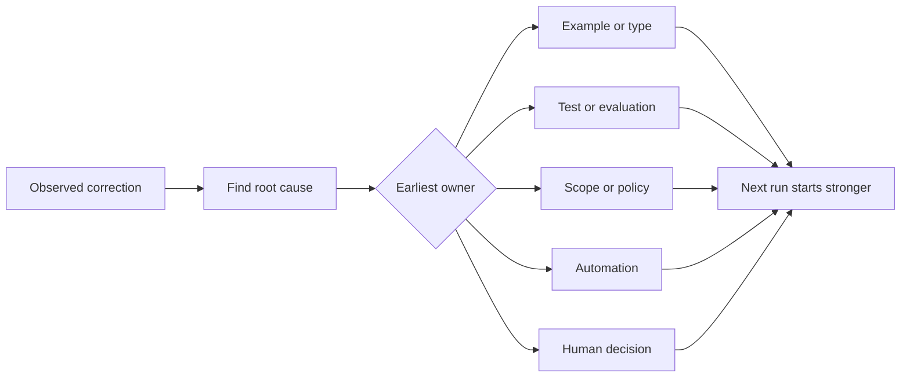

# प्रत्येक एजेंट सुधार को एक प्रणाली सुधार में परिवर्तित करें

> एक सुधार जो केवल चैट में रहता है, एक रन को ठीक करता है। एक सुधार को एक परीक्षण, सीमा, उदाहरण या उपकरण में बढ़ावा दिया जाता है, प्रत्येक बाद में रन में सुधार होता है।

> **【中文解读】**केवल चैट रिकॉर्ड में सुधार, केवल एक बार सुधार; परीक्षण, सीमा, उदाहरण या उपकरण के सुधार में अपग्रेड किया गया, सुधार के बाद प्रत्येक बार सुधार किया गया।

>  **【前置】**️️️️️️️️️️️️️️️️️️️️️️️️️️️️️️️️️️️️️️️️️️️️️️️️️️️️️️️️️️️️️️️️️️️️️️️️️️️️️️️️️️️️️️️️️️️️️️️️️️️️️️️️️️️️️️️️️️️️️️️️️️️️️️️️️️️️️️️️️️️️️️️️️️️️️️️️️️️️️️️️️️️️️️️️️️️️️️️️️️️️️️️️️️️️️️️️️️️️️️️️️️️️️️️️️️️️️️️️️️️️️️️️️️️️️️️️️️️️️️️️️️️️️️️️️️️️️️️️️️️️️️️️️️️️️️️️️️️️️️️️️️️️️️️️️️️️️️️️️️️️️️️️️️️️️️️️️️️️️️️️️️️️️️️️️️️️️️️️️️️️️️️️️️️️️️️️️️️️️️️️️️️️️️️️️️️️️️️️️️️️️️️️️️️️️️️️️️️️️️️️️️️️️️️️️️️️️️️️️️️️️️️️️️️️️️️️️️️️️️️️️️️️️️️️️️️️️️️️️️️️️️️️️️️️️️️️️️️️️️️️️️️️️️️️️️️️️️️️️️️️️️️️️️️️`outputs/feedback-ratchet.json`, यह भविष्य के काम की स्थिति में परिवर्तन के लिए एक इनपुट है.

**Type:** Learn + Build | **类型:** 学习 + 动手实践
**Languages:** Python (stdlib) | **语言:** Python（标准库）
**Prerequisites:** Phase 14 lessons 37 to 41 | **前置知识:** Phase 14 第 37-41 课
**Time:** ~65 minutes | **时间:** 约 65 分钟

## सीखने के लक्ष्य

- एजेंट सुधारों को टिकाऊ नियंत्रण में परिवर्तित करें।
  चीनी अनुवादः एजेंट के लिए नियंत्रण के साधनों में सुधार को परिवर्तित करना
- प्रत्येक नियंत्रण को सबसे पहले परत पर रखें जो पुनरावृत्ति को रोक सकता है।
  चीनी अनुवादः प्रत्येक नियंत्रण को पहले स्तर पर रखना जो पुनरावृत्ति को रोक सकता है।
- स्थिर फिंगरप्रिंट के साथ दोहराए गए पाठों को दोहराएं।
  中文翻译: using steady finger纹为重复的教训去重──
- नियंत्रणों को रिटायर करें जो अब वास्तविक जोखिम की रक्षा नहीं करते हैं।
  中文翻译:退役那些不再保护真实风险的控制──

## सुधार सबूत है। सुधार सबूत है।

जब आप किसी एजेंट को ऐसी फ़ाइल को संपादित न करें कहते हैं, तो आपने सीखा है कि दायरे की सीमा निष्पादित नहीं की जा सकती है। जब आप कहते हैं यह आउटपुट आकार गलत है, तो आपने सीखा है कि एक उदाहरण या परीक्षण गायब था। जब सेटअप फिर से विफल होता है, तो आपने सीखा है कि पर्यावरण ज्ञान स्वचालन में आता है।

> जब आप एजेंट से कहते हैं "" उस फ़ाइल को बदलें"", तो आप सीखते हैंः दायरा सीमा निष्पादित नहीं किया जा सकता है। जब आप कहते हैं "" यह आउटपुट आकार गलत है"", तो आप सीखते हैंः एक उदाहरण या परीक्षण की कमी है।

सुधार को कार्य प्रणाली के बारे में एक टिप्पणी के रूप में देखें, न कि शीघ्र लिखित विफलता के रूप में।

> एक बार में लिखने की विफलता के बजाय कार्य प्रणाली के अवलोकन को सही ढंग से सुधारना।

> **【中文解读】**इस खंड में एक अलग दृष्टिकोण बदल गया हैः प्रत्येक सुधार प्रणाली में अपनी खामियों की रिपोर्ट करने में है "" सीमाओं को निष्पादित करने योग्य"" उदाहरणों की कमी"" ज्ञान का अभाव नहीं है ""।

## सबसे पहले प्रभावी स्तर पर पदोन्नति करें

इस क्रम का प्रयोग करेंः

> 按这个顺序升级:

| Recurring failure | Durable destination |
|---|---|
| Wrong result or regression | Test or evaluation |
| Off-scope or unsafe action | Scope or permission policy |
| Repeated setup or command mistake | Automation or tool |
| Repeated output-format mistake | Canonical example plus validator |
| Ambiguous local convention | Instruction with a scenario check |
| Product disagreement | Human decision record |

पहले के नियंत्रण सस्ते होते हैं। एक प्रकार जो अमान्य स्थिति को रोकता है, वह समीक्षा टिप्पणी से अधिक मजबूत होता है जो बाद में इसे पकड़ लेता है। एक केंद्रित परीक्षण पैराग्राफ से अधिक मजबूत होता है जो एजेंट को याद करने के लिए कहता है।

> 越早的控制越便宜── एक प्रकार का अवैध राज्य होने से रोकने वाला, 强过一条事后才抓住的评审评论── एक केंद्रित परीक्षण, 强过一段求代理的文字──"记住‖──

> **【中文解读】**यह तालिका इस वर्ग की मुख्य निर्णय तालिका हैः परिणाम त्रुटि उन्नयन परीक्षण/मूल्यांकन के लिए; सीमा सीमा उन्नयन के लिए दायरा/अधिकार रणनीति; दोहराव पर पर्यावरण गड़बड़ उन्नयन के लिए स्वचालन; प्रारूप त्रुटि उन्नयन के लिए विनियमन उदाहरण और परीक्षक; निर्धारित शामिल उन्नयन के लिए दृश्य निरीक्षण के लिए निर्देश; उत्पाद विभाजन उन्नयन के लिए कृत्रिम निर्णय रिकॉर्ड। सिद्धांत है "越靠前的控制越便宜"能在类型系统中停留,别留到评审;能用测试钉死,别写在快速里里里里里里里里里里里里里里里里里里里里里里里里里里里里里里里里里里里里里里里里里里里里里里里里里里里里里里里里里里里里里里里里里里里里里里里里里里里里里里里里里里里里里里里里里里里里里里里里里里里里里里里里里里里里里里里里里里里里里里里里里里里里里里里里里里里里里里里里里里里里里里里里里里里里里里里里里里里里里里里里里里里里里里里里里里里里里里里里里里里里里里里里里里里里里里里里里里里里里里里里里里里里里里里里里里里里里里里里里里里里里里里里里里里里里里里里里里里里里里里里里里里里里里里里里里里里里里里里里里里里里里里里里里里里里里里里里里里里里里里里里里里里里里里里里里里里里里里里里里里里里里里里里里里里里里里里里里里里里里里里里里里里里里里里里里里里里里里里里里里里里里里里里里里里里里里里里里里里里里里里里里里里里里里里里里里里里里里里里里里里里



> 图解: observation to rectification → 找 root因 → 判定 the earliest responsibility layer(उदाहरण/प्रकार、测试/ मूल्यांकन、 सीमा/ रणनीति、 स्वचालन、 कृत्रिम निर्णय)→ अगली बार चलना से अधिक मजबूत से शुरू करने के बिंदु से शुरू हो जाए。

## रचेट रिकॉर्ड

पकड़ः

> 记录这些字段:

- लक्षण;
  中文翻译: लक्षण;
- मूल कारण;
  中文翻译:根因;
- परिणाम;
  中文翻译:后果;
- पुनरावृत्ति संख्या;
  中文翻译:复发次数;
- चयनित नियंत्रण;
  中文翻译: चयनित नियंत्रण;
- नियंत्रण के लिए सत्यापन;
  中文翻译: अपने आप को सत्यापित करने का तरीका नियंत्रित करना;
- मालिक;
  中文翻译:负责人;
- इसकी समीक्षा या रिटायरमेंट की तारीख।
  中文翻译:复审或退役日期──

प्रत्येक एक बार की प्राथमिकता को बढ़ावा न दें, बल्कि सुधार को बढ़ावा दें जब पुनरावृत्ति या परिणाम स्थायी जटिलता को उचित ठहराता है।

> प्रत्येक एक बार की प्राथमिकता को उन्नत न करें। केवल जब बार-बार दोहराए जाने वाले मामलों की संख्या या परिणाम गंभीर हो जाते हैं और स्थायी जटिलता की आवश्यकता होती है, तब ही उन्नयन इस लेख को सुधारता है।

> **【中文解读】**八段里," अपने स्वयं के सत्यापन को नियंत्रित करने का तरीका" और"退役日期" सबसे आसानी से省略 किया जाता है। पहले व्यक्ति यह सुनिश्चित करता है कि यह नियंत्रण वास्तव में रुका हुआ है।

>  **【类比】**棘轮手像一个只不跌的储蓄──之前:每次纠正都从零开始、说完就忘;之后:每次纠正都推动轮单向前进一格(一条可验证的控制),系统只会变强,不会回来──

## लक्षण से कारण अलग करें कारण और लक्षणों में अंतर करें

README में सम्पादित एजेंट एक लक्षण है। संभावित कारणों में शामिल हैंः

> "एजेंट ने README को बदल दिया है" लक्षण हैं। इसके संभावित कारणों में शामिल हैंः

- कार्य ने भंडारण रूट की अनुमति दी;
  中文翻译:任务允许仓库根目录;
- डॉक्स को अप्रत्यक्ष रूप से सुरक्षित माना गया था;
  中文翻译:文档被默认当作安全区;
- योजना के बंडल कार्यान्वयन और प्रलेखन;
  中文翻译: योजनाबद्ध रूप से एक साथ स्थापित;
- दो श्रमिकों के स्वामित्व में ओवरलैप था।
  中文翻译: दो मजदूरों का स्वामित्व है重叠──

प्रत्येक कारण एक अलग नियंत्रण से संबंधित है। एक नियम जो केवल लक्षण को दोहराता है, अगले थोड़ा अलग मामले में विफल हो जाएगा।

> प्रत्येक कारण पर अलग-अलग नियंत्रण होते हैं। केवल लक्षणों के नियमों को दोहराएं, अगली बार थोड़ी अलग स्थिति में विफल हो जाएंगे।

> **【中文解读】**यह सबसे आसान कदम हैः "Beware README" को नियम में लिखना आसान है, "क्यों इसे बदला जाएगा" पता लगाना मुश्किल है। लेकिन चार संभावित कारण चार अलग-अलग सुधारों की ओर इशारा करते हैं।

## नियंत्रण भी बिगड़ जाएगा

पुराने नियंत्रण संघर्ष कर सकते हैं, संदर्भ को फुला सकते हैं, और एक प्रणाली को एन्कोड कर सकते हैं जो अब मौजूद नहीं है। प्रत्येक प्रचारित नियम को एक सेवानिवृत्ति जांच की आवश्यकता होती है। जबः

> 旧控制会相互冲突、大上下文、并固化一个已经不存在的系统──每条升级过的规则都需要退役检查── निम्नलिखित स्थिति उत्पन्न होने पर, इसे हटाएं या फिर से लिखेंः

- अंतर्निहित वास्तुकला बदल गई है;
  中文翻译: तल्लो स्तरीय संरचना बदल गई है;
- इसे एक मजबूत निष्पादन योग्य नियंत्रण द्वारा प्रतिस्थापित किया गया है;
  中文翻译:更强的可执行控制取代了它;
- विफलता एक सार्थक विंडो के माध्यम से दोहराया नहीं गया है;
  中文翻译: एक अर्थपूर्ण समय के खिड़की में故障再未复发;
- नियंत्रण इससे होने वाले जोखिम से अधिक घर्षण पैदा करता है।
  चीनी अनुवादः नियंत्रण निर्माण के तनाव से अधिक है इसे बचाने के风险.

लक्ष्य सबसे लंबी निर्देश फ़ाइल नहीं है, यह सबसे छोटी प्रणाली है जो कठिन से प्राप्त निर्णय को संरक्षित करती है।

>  लक्ष्य सबसे लंबा निर्देश दस्तावेज नहीं है, बल्कि यह है कि यह निर्णय लेने की सबसे छोटी प्रणाली है।

> **【中文解读】**棘轮只进不退,但控制会过期──"प्रत्येक नियम सभी निरस्त जांच" से संबंधित हैं।

## इसे बनाओ, इसे पूरा करो।

प्रयोगशाला सुधारों को वर्गीकृत करती है, उन्हें नियंत्रण में बढ़ावा देती है, फिंगरप्रिंट डुप्लिकेट करती है, और लिखती है `outputs/feedback-ratchet.json`. .

> प्रयोग भाग सुधार वर्गों पर होगा, उन्हें नियंत्रण के लिए उन्नयन, उंगली के निशान के साथ वजन, और लिखते हैं`outputs/feedback-ratchet.json`

दौड़ें:

> 运行:

```bash
python3 code/main.py
python3 -m unittest discover code/tests -v
```

एक ही कारण के साथ दो अलग-अलग रूपों में सुधार जोड़ें। एक ही नियंत्रण में बिना किसी असंगत विफलता के गिरने तक सामान्यीकरण में सुधार करें।

> 加入两条措辞不同但根因相同的纠正──改进归化逻辑,直到它们合并成为一个控制,同时不让无关的失败被错合并──

> **【中文解读】**破坏实验演示指纹去重的关键张力:归一化太松,同一根因的两条纠正各立立一条控制;太紧,无关失败被错合并;错伤) 去重的点是根因,不是措辞

## व्यायाम करें

1. हाल ही में एक कोडिंग सत्र से पांच सुधार लें और उनके वास्तविक मालिकों को वर्गीकृत करें।
   चीनी भाषा अनुवादः एक हालिया संस्करण में पांच संशोधनों को सुधारने से, उन्हें वास्तविक जिम्मेदारी के स्तर में विभाजित किया गया है।
2. एक प्रोजा नियम को निष्पादित करने योग्य परीक्षण से प्रतिस्थापित करें।
   中文翻译:把一条文字规则替换成一个可执行的测试──
3. परिणाम भार जोड़ें ताकि गंभीर पहली घटना को तुरंत बढ़ावा दिया जा सके।
   चीनी अनुवादः加后果权重,让严重的第一次发生可以立即升级──
4. प्रयोगशाला आउटपुट में एक मालिक और सेवानिवृत्ति की तारीख जोड़ें।
   中文翻译:给实验输出加上负责人和退役日期──
5. एक मौजूदा एजेंट निर्देश की समीक्षा करें और इसे केवल मजबूत नियंत्रण के अस्तित्व को साबित करने के बाद हटा दें।
   चीनी अनुवादः समीक्षा एक मौजूदा एजेंट निर्देश, केवल जब यह साबित होता है कि अधिक मजबूत नियंत्रण है तो इसे हटा दिया जाता है।

## आगे पढ़ना 延伸閱讀

- [Basili, Caldiera, and Rombach, The Goal Question Metric Approach](https://www.cs.toronto.edu/~sme/CSC444F/handouts/GQM-paper.pdf), उद्देश्यों को प्रश्नों और परिचालन मापों में बदलने के लिए।
  中文翻译:Basili、Caldiera 与 Rombach目标问题度法把目标转化为问题和可操作的量度
- [Shinn et al., Reflexion](https://arxiv.org/abs/2303.11366), मॉडल वजन को बदलने के बिना बाद के निर्णयों को बेहतर बनाने के लिए प्रतिक्रिया के निशान का उपयोग करने के लिए।
  中文翻译:शिन 等Reflection Using反轨迹改进后续决策而不改动模型权重──
- [Madaan et al., Self-Refine](https://arxiv.org/abs/2303.17651), कार्य लूप के भीतर पुनरावृत्ति प्रतिक्रिया और संशोधन के लिए।
  中文翻译:Madaan 等स्वयं परिष्कृत任务循环内部的代反与修订──

## जो आप रखेंगे आप रखेंगे उत्पादन

रखो`outputs/feedback-ratchet.json`यह एजेंट-एस्पिड्ड इंजीनियरिंग पथ का स्थायी अंत और भविष्य के कार्यक्षेत्र परिवर्तनों के लिए इनपुट है।

> रखरखाव`outputs/feedback-ratchet.json` यह "एजेंट 辅助工程" मार्ग का स्थायी अंत है, भविष्य के कामकाज परिवर्तन का भी प्रवेश है
