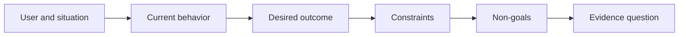

# परिणाम को चुनने से पहले परिणाम को परिभाषित करें

> जल्दी से लागू करने से गलत समस्या चुनने पर जुर्माना बढ़ जाता है। पहले परिणाम को आकार दें ताकि सही दिशा में गति इंगित की जा सके।

> **【中文解读】**"उत्पादन" (उत्पादन) आपके द्वारा निर्मित वस्तुओं का निर्धारण है  सहायक, पृष्ठ, मॉडल; "परिणाम" (परिणाम)  दुनिया में देखने योग्य परिवर्तन है  जो किसी भी परिस्थिति में कुछ बेहतर कर रहा है  अधिक तेजी से प्राप्त करने के लिए, चुनने के लिए अधिक मूल्यवान है  इस पाठ्यक्रम में आपको "परिणाम ढांचा" (परिणाम ढांचा) (परिणाम ढांचा) पढ़ना सिखाया गया है  उपयोगकर्ता  स्थिति  वर्तमान व्यवहार  अपेक्षित परिणाम  बंधन  गैर लक्ष्य  संपूर्ण प्रक्रिया किसी भी विशिष्ट व्याख्या का उल्लेख नहीं करती है  यह "बनाया निर्माण मार्ग  47-54 " (अंग्रेज़ी) का प्रवेश-पाठ है 

>  **【前置】**无硬性前置课程──本课是 47-54 课程『塑造构建』路径(结果定义 → 工作流发现 → 假设与风险 → 最小切片 → 规格 → 指标 → 分阶段发布 → 反所有权) के起点──

**Type:** Learn + Build | **类型:** 学习 + 动手实践
**Languages:** Python (stdlib) | **语言:** Python（标准库）
**Prerequisites:** None | **前置知识:** 无
**Time:** ~60 minutes | **时间:** 约 60 分钟

## सीखने के लक्ष्य

- समाधान का नाम दिए बिना परिणाम फ्रेम लिखें।
  中文翻译:写出一个不点名任何解决方案的结果框架──
- उपयोगकर्ता, स्थिति, वर्तमान व्यवहार और वांछित परिवर्तन की पहचान करें।
  中文翻译: पहचान उपयोगकर्ता, स्थिति, वर्तमान व्यवहार और अपेक्षाओं में परिवर्तन
- प्रतिबंध और गैर-लक्ष्य स्पष्ट करें।
  中文翻译:把约束和非目标写明确──
- समाधान को कठोर करने से पहले समाधान के रिसाव का पता लगाएं।
  चीनी अनुवादः समाधान में कठोरता के लिए बाहर निकलने से पहले इसे जांचें

## आउटपुट परिणाम नहीं होता है।

एक घटना सहायक का निर्माण करेंआउटपुट का नाम देता है। यह नहीं कहता है कि इसकी आवश्यकता किसके लिए है, क्या बेहतर हो जाता है, या क्या सुरक्षित रहना चाहिए।

> "एक दुर्घटना सहायक बनाना" एक उत्पादन का नाम है। इसमें यह नहीं कहा गया है कि किसके लिए इसकी आवश्यकता है, क्या बेहतर होगा, क्या सुरक्षित रहना चाहिए।

एक परिणाम फ्रेम कहता हैः

> 结果框架 कहते हैंः

> जब उत्पादन अलर्ट आता है, तो कॉल पर इंजीनियर विफल सेवा और एक सुरक्षित अगली कार्रवाई की पहचान दो मिनट के भीतर करता है, जबकि निदान केवल पढ़ने और ऑडिट करने योग्य रहता है।

> 译文: जब उत्पादन सूचना पुलिस आ जाती है, तो कार्यरत इंजीनियर दो मिनट में दोष सेवा को निर्धारित कर सकते हैं और एक सुरक्षित अगले कदम की खोज कर सकते हैं, जबकि पूरे प्रक्रिया को केवल पढ़ने और ऑडिट करने योग्य बनाए रख सकते हैं।

उस वाक्य को सॉफ्टवेयर, रनबुक, डेटा मरम्मत या छोटे इंटरफेस परिवर्तन से संतुष्ट किया जा सकता है। यह टीम को किसी ने कल्पना की पहली कलाकृतियों की बजाय परिणाम से जुड़ा रखता है।

> यह वाक्य एक सॉफ्टवेयर, एक कामकाज पुस्तिका, एक बार डेटा सुधार या एक छोटे से इंटरफ़ेस परिवर्तन से पूरा हो सकता है। यह टीम को किसी व्यक्ति के पहले विचार किए गए उत्पाद पर नहीं, बल्कि परिणाम पर निर्भर करता है।

> **【中文解读】**产出与结果的区别是本课的基地:产出只是解空间的入口,结果才是到达的终点―― ऊपर इस नमूने में कोई "辅助" "AI" "界面" नहीं है, केवल कौन, किस समय,多快, क्या नहीं बदल सकता है। क्योंकि इसमें कोई "解法", सॉफ्टवेयर, पुस्तिका, डेटा मरम्मत, लघु परिवर्तन नहीं है।

## छठी भाग फ्रेम

| Part | Question |
|---|---|
| User | Who experiences the problem directly? |
| Situation | When and where does it occur? |
| Current behavior | What happens today, including workarounds? |
| Desired outcome | What observable state should improve? |
| Constraints | Which safety, policy, cost, or compatibility limits are fixed? |
| Non-goals | What tempting adjacent work is excluded? |



> 图解: उपयोगकर्ता与情境 → 当前行为 → 期望结果 → 约束 → 非目标 → 证据问题,六段依序收紧──

> **【中文解读】**六段是有序的: पहले कोई और परिस्थिति,才谈到行为; पहले看清现状 (वर्तमान के माध्यम से)),才谈到改变;束收紧解空间,非目标住顺手的诱惑,最后落到"क्या निरीक्षण परिणाम सिद्ध हो सकता है"......表中最常跳过的是当前行为未写现状的"期望结果"

## समाधान लीक खोजें समाधान लीक खोजें

परिणाम कथन समाधान लीक करते हैं जब उनमें उत्पाद रूप, इंटरफ़ेस, मॉडल विकल्प, ढांचा या वास्तुकला होता है जो सबूतों से प्राप्त नहीं किया गया है।

> जब परिणाम में बयान में उत्पाद के रूप, इंटरफ़ेस, मॉडल चयन, ढांचे या संरचना शामिल है, तो समाधान लीक हो गया है।

- उपयोगकर्ताओं को साप्ताहिक एआई सारांश मिलता है सारांश और कैडेन्स लीक होता है।
  中文翻译:"उपयोगकर्ता प्रति सप्ताह एक एआई 摘要 प्राप्त करता है" इस रूप में "摘要" और "प्रति सप्ताह" इस लय को बाहर निकाला गया है।
- उपयोगकर्ता खाता परिवर्तनों को मंजूरी से पहले समझते हैं परिणाम का उल्लेख करते हैं।
  中文翻译:"उपयोगकर्ता ने अनुमोदन पूर्व समझ खाता परिवर्तन" का परिणाम बताया है।
- वेक्टर डेटाबेस को तैनात करें बुनियादी ढांचे का लीक।
  चीनी भाषा में अनुवादः"एक तरक्की डेटाबेस को तैनात करना" बुनियादी ढांचे को लीक कर दिया गया है।
- परीक्षण के दौरान प्रासंगिक नीतिगत साक्ष्य उपलब्ध हैं क्षमता का उल्लेख करता है।
  चीनी भाषा में अनुवादः"आढाई समय संबंधित नीति प्रमाण प्राप्त करने में सक्षम" का कथन एक क्षमता है।

जब संगतता वास्तव में इसे ठीक करती है तो प्रतिबंध प्रौद्योगिकी का नाम ले सकते हैं।

> जब एकजुटता वास्तव में तकनीकी चयन के समय बंद हो जाती है, तो एकजुटता में एकजुटता को परिभाषित किया जा सकता है।

> **【中文解读】**泄漏检测的判定:句子里出现了"उत्पाद स्वरूप/界面/模型/框架/架构"级别的词语(AI 摘要、向量库、App), जबकि यह अभी तक प्रमाणित नहीं हुआ है, यह है泄漏.

## प्रतिबंध परिणाम की रक्षा करते हैं

प्रतिबंध कार्यान्वयन विवरण नहीं हैं वे वास्तविक दुनिया के लक्ष्य का हिस्सा हैंः

> 约束不是实现细节──它们是真世界目标的一部分:

- निदान के दौरान कोई उत्पादन नहीं लिखता है;
  中文翻译:诊断期间不写生产库;
- घटना समय के बजट के भीतर प्रतिक्रिया;
  中文翻译: दुर्घटना समय बजट में प्रतिक्रिया;
- मौजूदा लेखा परीक्षा कार्यक्रम प्रामाणिक रहते हैं;
  中文翻译:现存审计事件保持权威性;
- कोई नई रनटाइम निर्भरता नहीं;
  中文翻译:不引入新运行时依赖;
- पहुंच व्यवहार बरकरार रहता है।
  中文翻译:无障碍行为保持完好──

एक निर्माण जो किसी प्रतिबन्ध का उल्लंघन करके परिणाम तक पहुंचता है, परिणाम तक नहीं पहुंचता है।

> एक निर्माण जो नियम के विपरीत आया, उसका कोई वास्तविक परिणाम नहीं आया।

> **【中文解读】**परिणाम के ढांचे में लिखा गया है, न कि पीआर के विवरण में, कारण यह है कि अंतिम वाक्य हैः "सफलता" का उल्लंघन करने वाले नियमों की सफलता नहीं है।

## गैर-लक्ष्य सीमाएँ बनाएं, गैर-लक्ष्य सीमाएँ निर्धारित करें

गैर-लक्ष्य एक उपयोगी स्लाइस को मंच में बदलने से रोकते हैं। अच्छे गैर-लक्ष्य कार्य को अस्वीकार करने के लिए पर्याप्त ठोस होते हैंः

> एक उपयोगी टुकड़े को एक मंच में फैलाने से रोकने का उद्देश्य नहीं है।

- कोई स्वचालित उपचार नहीं;
  中文翻译:不做自动修复;
- कोई नया अलर्ट-रूटिंग सिस्टम नहीं;
  中文翻译:不建新告警路由系统;
- घटना के कमांडर का प्रतिस्थापन नहीं किया गया;
  中文翻译:不取代事故指挥官;
- इस स्लाइस में कोई ऐतिहासिक विश्लेषण नहीं है।
  中文翻译:本切片不做历史分析──

> **【中文解读】**गैर लक्ष्य का दायरा नकारात्मक स्थान है, जो कि 43वीं कक्षा के कार्ययोजना ढांचे में "निषिद्ध मार्ग" के साथ है। एक गैर लक्ष्य की रचना को अच्छा या बुरा समझना, यह पूछना कि क्या इसका उपयोग एक विशिष्ट प्रलोभन को अस्वीकार करने के लिए किया जा सकता है।

## इसे बनाओ, इसे पूरा करो।

प्रयोगशाला एक वैधता प्रदान करती है`OutcomeFrame`और लिखता है `outputs/outcome-frame.json`. .

> 实验部分会校验一个 `OutcomeFrame`और लिखना`outputs/outcome-frame.json`

```bash
python3 code/main.py
python3 -m unittest discover code/tests -v
```

वांछित परिणाम को इंसेंट असिस्टेंट का उपयोग करके बदलें। सत्यापितकर्ता को यह चिह्नित करना चाहिए कि प्रस्तावित आउटपुट परिणाम में लीक हो गया है।

> इस पर विचार करने के लिए, "उपयोग दुर्घटना सहायक" को "उपयोग दुर्घटना सहायक" में बदलना चाहिए।

> **【中文解读】**破坏实验把"泄漏检测"变成一条机械规则:期望结果一 एक बार स्पष्टीकरण形态 (उपयोग/निर्माण/वितरण और उत्पादनाम) होने पर,校验器就拒绝──人工评审时同样只需要问一句:"क्या यह वाक्य हटाए गए उत्पादनाम फिर से स्थापित होगा?

## व्यायाम करें

1. अपने बैकलॉग से एक फीचर अनुरोध को परिणाम फ्रेम के रूप में फिर से लिखें।
   中文翻译:把你后载里的一个功能请求重写成结果框架──
2. एक प्रतिबंध जोड़े जो परिवर्तन करता है कि कौन से समाधान संभव हैं।
   चीनी अनुवादः加一条能改变"哪些解仍可行" के बंधन
3. दो गैर-गोल जोड़ें जो पहले स्लाइस को छोटा बनाए रखें।
   中文翻译:加两条非目标,让第一切片保持小──
4. वांछित परिणाम को खंडन करने वाली सबसे शुरुआती अवलोकन की पहचान करें।
   中文翻译: सबसे पहले के 能证伪期望结果的观察.
5. तीन अलग-अलग आउटपुट लिखें जो एक ही परिणाम को संतुष्ट कर सकते हैं।
   中文翻译:写出三种不同的产出,它们都能满足同一个结果──

## आगे पढ़ना 延伸閱讀

- [Nuseibeh and Easterbrook, Requirements Engineering: A Roadmap](https://www.cs.toronto.edu/~sme/papers/2000/ICSE2000.pdf), वास्तविक दुनिया के लक्ष्यों को सॉफ्टवेयर काम के लिए एंकर के रूप में इलाज के लिए.
  中文翻译:नuseibeh 与 ईस्टरब्रुक需求工程:路线图把真实世界目标当作软件工作的点──
- [Dardenne, van Lamsweerde, and Fickas, Goal-Directed Requirements Acquisition](https://doi.org/10.1016/0167-6423(93)90021-जी), उच्च स्तरीय लक्ष्यों को प्रतिबंधों और परिचालन आवश्यकताओं में परिष्कृत करने के लिए।
  中文翻译:डार्डेन、 वान लैम्सवेर्ड 与 Fickas लक्ष्य-निर्देशित की आवश्यकता प्राप्त把高层目标精化为束与可操作的需求

## जो आप रखेंगे आप रखेंगे उत्पादन

रखो`outputs/outcome-frame.json`. अगले पाठ में यह लोगों के कार्यप्रवाह के साथ परीक्षण करता है वास्तव में प्रदर्शन.

> रखरखाव`outputs/outcome-frame.json`️️️️️️️️️️️️️️️️️️️️️️️️️️️️️️️️️️️️️️️️️️️️️️️️️️️️️️️️️️️️️️️️️️️️️️️️️️️️️️️️️️️️️️️️️️️️️️️️️️️️️️️️️️️️️️️️️️️️️️️️️️️️️️️️️️️️️️️️️️️️️️️️️️️️️️️️️️️️️️️️️️️️️️️️️️️️️️️️️️️️️️️️️️️️️️️️️️️️️️️️️️️️️️️️️️️️️️️️️️️️️️️️️️️️️️️️️️️️️️️️️️️️️️️️️️️️️️️️️️️️️️️️️️️️️️️️️️️️️️️️️️️️️️️️️️️️️️️️️️️️️️️️️️️️️️️️️️️️️️️️️️️️️️️️️️️️️️️️️️️️️️️️️️️️️️️️️️️️️️️️️️️️️️️️️️️️️️️️️️️️️️️️️️️️️️️️️️️️️️️️️️️️️️️️️️️️️️️️️️️️️️️️️️️️️️️️️️️️️️️️️️️️️️️️️️️️️️️️️️️️️️️️️️️️️️️️️️️️️️️️️️️️️️️️️️️️️️️️️️️️️️️️️️️️
