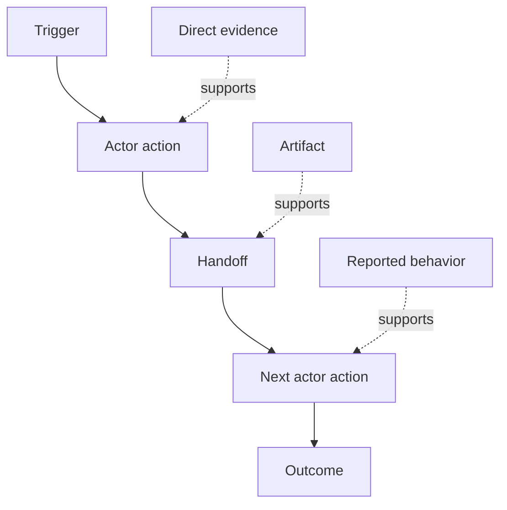

# काम के प्रवाह को खोजें लोग वास्तव में प्रदर्शन करते हैं

> आवश्यकताएं बैठक में एकत्रित होने के लिए इंतजार नहीं कर रही हैं, वे कार्यों, समाधानों, रिकॉर्ड और असहमति के बीच बिखरे हुए हैं।

> **【中文解读】**需求不是躺在会议里等等来收到的,而是散落在动作,绕行办法,记录和分歧里. इस कोर्स में आपको "अब क्या हो रहा है" से काम करने की धारा में बाहर निकलना सिखाया गया हैः प्रत्येक चरण को बनाने के लिएः प्रत्येक चरण को निर्माता को देने के लिए; कार्यकर्ता को देने के लिए;触发, आंदोलन,输入, आउटपुट,摩擦, अधिकार, साक्ष्य), साक्ष्य वर्ग को देने के लिए; प्रत्यक्ष निरीक्षण > उत्पाद > 口述 > 推断), और इसे औसत बनाने के बजाय मतभेदों को बनाए रखना। यह "रचना निर्माण मार्ग का दूसरा पाठ है।

>  **【前置】**️️️️️️️️️️️️️️️️️️️️️️️️️️️️️️️️️️️️️️️️️️️️️️️️️️️️️️️️️️️️️️️️️️️️️️️️️️️️️️️️️️️️️️️️️️️️️️️️️️️️️️️️️️️️️️️️️️️️️️️️️️️️️️️️️️️️️️️️️️️️️️️️️️️️️️️️️️️️️️️️️️️️️️️️️️️️️️️️️️️️️️️️️️️️️️️️️️️️️️️️️️️️️️️️️️️️️️️️️️️️️️️️️️️️️️️️️️️️️️️️️️️️️️️️️️️️️️️️️️️️️️️️️️️️️️️️️️️️️️️️️️️️️️️️️️️️️️️️️️️️️️️️️️️️️️️️️️️️️️️️️️️️️️️️️️️️️️️️️️️️️️️️️️️️️️️️️️️️️️️️️️️️️️️️️️️️️️️️️️️️️️️️️️️️️️️️️️️️️️️️️️️️️️️️️️️️️️️️️️️️️️️️️️️️️️️️️️️️️️️️️️️️️️️️️️️️️️️️️️️️️️️️️️️️️️️️️️️️️️️️️️️️️️️️️️️️️️️️️️️️️️️️️️️️`outputs/workflow-evidence.json`, अगले वर्ग में देखा गया घर्षण और अनिश्चितता को एक मानचित्र में बदल दिया जाएगा।

**Type:** Learn + Build | **类型:** 学习 + 动手实践
**Languages:** Python (stdlib) | **语言:** Python（标准库）
**Prerequisites:** Phase 14 lesson 47 | **前置知识:** Phase 14 第 47 课
**Time:** ~70 minutes | **时间:** 约 70 分钟

## सीखने के लक्ष्य

- वर्तमान कार्यप्रवाह को साक्ष्य के साथ आदेशित कार्यों के रूप में मॉडल करें।
  चीनी भाषा में अनुवादः把当前工作流建模为带证据的有序动作──
- रिपोर्ट या अनुमानित व्यवहार से प्रत्यक्ष अवलोकन को अलग करें।
  चीनी भाषा में अनुवादः把直接观察与口述、推断的行为区分开――
- घर्षण, हस्तान्तरण, अधिकार और छिपे हुए राज्य का पता लगाएं।
  中文翻译:定位摩擦、交接、权限和隐藏状态──
- अनिश्चित दावे को आवश्यकताओं में बदलने के बजाय दृश्यमान रखें।
  中文翻译:让不确定的断言保持可见,而不是把它们变成需求──

## वर्तमान प्रणाली से शुरू करें

लोगों को क्या चाहिए, यह पूछकर मत शुरू करो, बल्कि अब जो हो रहा है उसे फिर से बनाकर शुरू करो।

> मत पूछो कि लोग क्या चाहते हैं. . . . . . . . . . . . . . . . . . . . . . . . . . . . . . . . . . . . . . . . . . . . . . . . . . . . . . . . . . . . . . . . . . . . . . . . . . . . . . . . . . . . . . . . . . . . . . . . . . . . . . . . . . . . . . . . . . . . . . . . . . . . . . . . . . . . . . . . . . . . . . . . . . . . . . . . . . . . . . . . . . . . . . . . . . . . . . . . . . . . . . . . . . . . . . . . . . . . . . . . . . . . . . . . . . . . . . . . . . . . . . . . . . . . . . . . . . . . . . . . . . . . . . . . . . . . . . . . . . . . . . . . . . . . . . . . . . . . . . . . . . . . . . . . . . . . . . . . . . . . . . . . . . . . . . . . . . . . . . . . . . . . . . . . . . . . . . . . . . . . . . . . . . . . . . . . . . . . . . . . . . . . . . . . . . . . . . . . . . . . . . . . . . . . . . . . . . . . . . . . . . . . . . . . . . . . . . . . . . . . . . . . . . . . . . . . . . . . . . . . . . . . . . . . . . . . . . . . . . . . . . . . . . . . . . . . . . . . . . . . . . . . . . . . . . . . . . . . . . . . . .

प्रत्येक चरण के लिए, रिकॉर्ड करेंः

> प्रत्येक चरण के लिए, रिकॉर्डः

| Field | Example |
|---|---|
| Actor | On-call engineer |
| Trigger | Production alert arrives |
| Action | Opens alert, then searches dashboards |
| Input | Alert payload and deployment record |
| Output | Candidate service and owner |
| Friction | Context switching across three tools |
| Authority | Incident commander approves a write |
| Evidence | Screen recording, incident log, runbook |

कार्यप्रवाह स्क्रीन से बड़ा है इसमें प्रतीक्षा, कॉपी-पेस्ट, साइड चैनल, अनुमोदन, त्रुटि रिकवरी और ऐसे कदम शामिल हैं जिन्हें लोग ध्यान नहीं देते हैं।

> 工作流比屏幕大── इसमें प्रतीक्षा, कॉपी-टैग, लघु संदेश, स्वीकृति, त्रुटि पुनर्प्राप्ती, और उन चरणों को शामिल किया गया है जिन पर लोग ध्यान नहीं देते हैं──

> **【中文解读】**起点决定质量: "चाहे क्या" से उत्पन्न होना इच्छा清单, "अब कैसे करें" से उत्पन्न होना केवल बाध्यता है 八段里 फ्रिक्शन (摩擦) 权威 (权威) 证据) 易漏漏记 摩擦 सुधार का अवसर है, अधिकार AI 无法动手的边界 है, प्रमाण यह निर्धारित करता है कि यह रिकॉर्ड किस हद तक विश्वसनीय है 

## सबूत मजबूत है सबूत कमजोर है

एक सरल सबूत सीढ़ी का उपयोग करेंः

> एक सरल प्रमाण के साथः

1. **Direct behavior:**अवलोकन, पता लगाना, रिकॉर्ड करना या सिस्टम घटना।
   中文翻译:**直接行为：**观察、追踪、录屏或系统事件──
2. **Artifact:**टिकट, रनबुक, लॉग, फॉर्म या पूरा आउटपुट।
   中文翻译:**产物：**工单、运维手册、日志、表单或已完成作品──
3. **Reported behavior:**एक व्यक्ति बताता है कि वह क्या करता है।
   中文翻译:**口述行为：**某人描述自己怎么做──
4. **Inference:**टीम निष्कर्ष निकालेगा कि क्या हो सकता है।
   中文翻译:**推断：**टीम ने अनुमान लगाया कि क्या हुआ है।

चारो ही उपयोगी हो सकते हैं. केवल पहले दो ही वर्तमान व्यवहार को सीधे साबित करते हैं. बाकी को लेबल करें ताकि आत्मविश्वास चुपचाप नहीं बढ़ता है।

> चार स्तर उपयोगी हो सकते हैं, लेकिन केवल पहले दो स्तर ही वर्तमान व्यवहार को सीधे साबित कर सकते हैं।

> **【中文解读】** सबूत की सीढ़ी इस वर्ग की माप है: एक ही वाक्य ""कार्यक्रम इंजीनियर पहले उपकरण का परीक्षण करें"", सीधे देखे गए 、 काम में एक निशान 、 स्वयं के कहने 、 टीम का अनुमान, विश्वसनीयता में अंतर  कुछ वर्गों । बयान और निष्कर्ष नहीं हो सकता है, लेकिन लेबल पर होना चाहिए  अन्यथा वे दो या तीन बार के बाद में तथ्य के रूप में माना जाएगा, काम प्रवाह मॉडल के आधार पर इस तरह 注水।

>  **【类比】**证据阶梯像新闻信源分级级──之前:会议纪要里里"大家都如此干"和录屏观察写作如理直气壮;后:每条记录带等级标签直接观察是第一手信源,口述是当事人回忆,推断是编辑推测,信度不再膨胀──



> 图解:触发 → 行动者动作 → 交接 → 下一个行动者动作 → 结果;不同强度的证据(直接证据、产物、口述) 分别支不同的步骤──

## चार चीजों की खोज करें

- **Friction:**दोहराए गए प्रयास, देरी, पुनः प्रवेश, या पुनर्प्राप्ति।
  中文翻译:**摩擦：**पुनः श्रम, देरी, पुनः प्रवेश या पुनः प्राप्ति
- **Hidden state:**स्मृति, चैट या व्यक्तिगत नोट्स में ले जाने वाले तथ्यों।
  中文翻译:**隐藏状态：**‡ यादों ‡ बातचीत के रिकॉर्ड या व्यक्तिगत नोटों के साथ तथ्य ‡
- **Authority:**व्यक्ति या प्रणाली को परिणाम स्वरूप परिवर्तन करने की अनुमति दी गई।
  中文翻译:**权限：**किसी व्यक्ति या प्रणाली में कोई परिवर्तन होने की अनुमति दी जाती है।
- **Exceptions:**ऐसा मामला जहां सामान्य कार्यप्रवाह सामान्य नहीं होता है।
  中文翻译:**例外：**सामान्य कार्यप्रवाह सामान्य नहीं है।

एआई सुविधाएं अक्सर हस्तान्तरण और अपवादों में विफल रहती हैं क्योंकि खुश पथ एकमात्र पथ आकार दिया गया था।

> एआई  Function हमेशा से ही एक दूसरे के साथ रहता है क्योंकि शुरुआत में केवल एक अच्छा रास्ता बना दिया गया है।

> **【中文解读】**यह चार काम की प्रक्रिया में उच्च मूल्य का लक्ष्य हैः सुधार के बिंदु पर摩擦 संकेत; छिपे हुए राज्य स्वचालन की सबसे बड़ी बाधा है; अधिकार निर्णय जिसमें कृत्रिम जांच बिंदु छोड़ना चाहिए; अपवाद "प्रदर्शन पर्यावरण सामान्य"", उत्पादन पर्यावरण में बदलाव" के सामान्य मूल हैं। अंतिम वाक्य केवल एक खुश पथ पर लिखा जाना चाहिए  डिज़ाइन किए गए एआई फ़ंक्शन, पहली बार संपर्क या पहले अपवाद पर उजागर किया जाएगा।

## मत करो औसत मत करो मतभेदों को औसत मत करो

दो उपयोगकर्ता अच्छे कारणों से अलग-अलग वर्कफ़्लो कर सकते हैं। जब तक आप समझ नहीं लेते कि वे प्रतिनिधित्व करते हैंः

> दो उपयोगकर्ता अलग-अलग कार्यप्रवाहों में कार्य कर सकते हैं, और प्रत्येक के पास उचित कारण है ➡ इन परिवर्तनों को तब तक बनाए रखें जब तक आप उन्हें समझ नहीं लेते कि वे क्या प्रतिनिधित्व करते हैंः

- विभिन्न भूमिकाएँ;
  中文翻译: भिन्न角色;
- विभिन्न जोखिम स्तर;
  中文翻译: अलग-अलग风险等级;
- विरासत और वर्तमान प्रक्रिया;
  中文翻译:旧流程与新流程并存;
- विशेषज्ञता में अंतर;
  中文翻译:熟练度差异;
- एक वास्तविक नीतिगत असहमति।
  中文翻译:一场真正的政策分歧──

एक औसत कार्यप्रवाह किसी को भी वर्णन नहीं कर सकता है।

> एक औसत से अधिक काम की धारा हो सकता है जो भी वर्णन नहीं किया गया है।

> **【中文解读】**दो चरों को एक "औसत कार्यप्रवाह" में जोड़ना सबसे प्रासंगिक और सबसे खतरनाक प्रथा हैः यह एक गैर-मौजूद उपयोगकर्ता का वर्णन करता हैः पाँच कारणों से संबंधित है।

## इसे बनाओ, इसे पूरा करो।

प्रयोगशाला कार्यप्रवाह के प्रत्येक चरण पर साक्ष्य संग्रहीत करती है, आदेश और विश्वास को मान्य करती है, प्रत्यक्ष-सबूत अनुपात की गणना करती है, और लिखती है `outputs/workflow-evidence.json`. .

> प्रयोग का भाग प्रत्येक कार्यप्रवाह चरणों में प्रमाण प्रदान करेगा परीक्षा क्रम और विश्वास के साथ  प्रत्यक्ष प्रमाण अनुपात की गणना करेगा, और लिखता है `outputs/workflow-evidence.json`

```bash
python3 code/main.py
python3 -m unittest discover code/tests -v
```

एक अपवाद पथ जोड़ा जाए जिसमें तैनाती रिकॉर्ड गायब हो जाए। मुख्य क्रम को बरकरार रखें और शाखा की शुरुआत कहां से हो।

> इसके अलावा "निर्यात में कमी के लिए रिकॉर्ड" का अपवाद पथ।

> **【中文解读】**破坏实验 अभ्यास अपवाद है। यह एक मुख्य चरण के नोटिस में समाहित होने के बजाय, मुख्य चरण के साथ अपने स्वयं के साक्ष्य के एक शाखा के रूप में अपवाद को रेखांकित करता है। "प्रत्यक्ष साक्ष्य अनुपात" यह भी ध्यान देने योग्य है कि यह पूरे मॉडल में मात्राबद्ध है।

## व्यायाम करें

1. किसी से साक्षात्कार किए बिना एक लॉग से एक कार्यप्रवाह को पुनर्निर्माण करें।
   中文翻译:不访谈任何人,只从一日志重建工作流──
2. किसी उपयोगकर्ता से साक्षात्कार करें और उन सभी दावों को चिह्नित करें, जिनके लिए अभी भी प्रत्यक्ष सबूत नहीं हैं।
   चीनी भाषा में अनुवादः साक्षात्कार एक उपयोगकर्ता, अंक प्रत्येक लेख अभी भी प्रत्यक्ष प्रमाण की कमी है।
3. एक प्राधिकरण सीमा और एक विफलता रिकवरी कदम जोड़ें।
   चीनी भाषा अनुवादः एक अधिकार सीमा और एक असफलता पुनः प्राप्ति चरण जोड़ें
4. उन्हें मिलाए बिना दो वर्कफ़्लो वेरिएंट मॉडल।
   中文翻译:建模两条工作流变体,不合并它们──
5. एक प्रस्तावित विशेषता की पहचान करें जो एक दिखाई देने वाले कदम को हटाता है लेकिन छिपे हुए काम को छुपा नहीं रखता है।
   चीनी अनुवादः एक प्रस्तावित कार्य खोजें ""छोड़ दिया देखा कदम, लेकिन छुपा काम नहीं मिला""

## आगे पढ़ना 延伸閱讀

- [Nuseibeh and Easterbrook, Requirements Engineering: A Roadmap](https://www.cs.toronto.edu/~sme/papers/2000/ICSE2000.pdf), विशेष रूप से इसकी व्याख्या, मॉडलिंग और सत्यापन के रूप में उत्प्रेरणा के उपचार के बजाय सरल कब्जा।
  中文翻译:नuseibeh 与 ईस्टरब्रुक需求工程:路线图特别是把需求获取看作解释、建模与验证,而不是简单采集──
- [Gotel and Finkelstein, An Analysis of the Requirements Traceability Problem](https://doi.org/10.1109/ICRE.1994.292398), आवश्यकताओं और उनके स्रोतों के बीच संबंध बनाए रखने की कठिनाई के लिए।
  चीनी अनुवादःGotel और Finkelstein मांग का पता लगाने योग्य समस्या विश्लेषण मांग को बनाए रखने और इसके स्रोत के बीच संबंधों की कठिनाई

## जो आप रखेंगे आप रखेंगे उत्पादन

रखो`outputs/workflow-evidence.json`यह अवलोकन घर्षण और अनिश्चितता को अगले पाठ में एक मानदंड मानचित्र में बदल देता है।

> रखरखाव`outputs/workflow-evidence.json`️️️️️️️️️️️️️️️️️️️️️️️️️️️️️️️️️️️️️️️️️️️️️️️️️️️️️️️️️️️️️️️️️️️️️️️️️️️️️️️️️️️️️️️️️️️️️️️️️️️️️️️️️️️️️️️️️️️️️️️️️️️️️️️️️️️️️️️️️️️️️️️️️️️️️️️️️️️️️️️️️️️️️️️️️️️️️️️️️️️️️️️️️️️️️️️️️️️️️️️️️️️️️️️️️️️️️️️️️️️️️️️️️️️️️️️️️️️️️️️️️️️️️️️️️️️️️️️️️️️️️️️️️️️️️️️️️️️️️️️️️️️️️️️️️️️️️️️️️️️️️️️️️️️️️️️️️️️️️️️️️️️️️️️️️️️️️️️️️️️️️️️️️️️️️️️️️️️️️️️️️️️️️️️️️️️️️️️️️️️️️️️️️️️️️️️️️️️️️️️️️️️️️️️️️️️️️️️️️️️️️️️️️️️️️️️️️️️️️️️️️️️️️️️️️️️️️️️️️️️️️️️️️️️️️️️️️️️️️️️️️️️️️️️️️️️️️️️️️️️️️️️️️️️️
