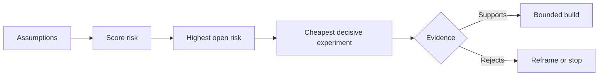

# मानचित्र परिकल्पना और सबसे जोखिम भरा एक को हल करने के लिए पहले

> एक रोडमैप में पहलुओं के अंदर अनिश्चितता छिपी रहती है। एक परिकल्पना नक्शा में उन पहलुओं के अस्तित्व के लायक होने से पहले क्या सच होना चाहिए, इसका खुलासा होता है।

> **【中文解读】**路线图 路线图 路线图 路线图 路线图 路线图 路线图 路线图 路线图 路线图 路线图 路线图 路线图 路线图 路线图 路线图 路线图 路线图 路线图 路线图 路线图 路线图 路线图 路线图 路线图 路线图 路线图 路线图 路线图 路线图 路线图 路线图 路线图 路线图 路线图 路线图 路线图 路线图 路线图 路线图 路线图 路图 路线图 路图 路线图 路图 路线图 路图 路线图 路图 路图 路线图 路图 路线图 路图 路线图 路图 路线图 路线图 路线图 路线图 路线图 路线图 路线图 路线图 路图 路线图 路线图 路图 路线图 路图 路图 路线图 路图 路图 路线图 路图 路图 路线图 路 路线图 路 路 路 路 路 路 路 路 路 路 路 路 路 路 路 路 路 路 路 路 路 路 路 路 路 路 路 路 路 路 路 路 路 路 路 路 路 路 路 路 路 路 路 路 路 路 路 路 路 路 路 路 路 路 路 路 路 路 路 路 路 路 路 路 路 路 路 路 路 路 路 路 路 路 路 路 路 路 路 路 路 路 路 路 路 路 路 路 路 路 路 路 路 路 路 路 路 路 路 路 路 路 

>  **【前置】**學本课前कृपया पहले समझेंःचरण 14 第 48 课  वास्तविक कार्यप्रवाह का पता लगाने 假设地图  वास्तविक होने वाली कार्यप्रवाह को कवर करना चाहिए, न कि कल्पना में कार्यप्रवाह)`outputs/assumption-map.json`"निर्णायक साक्ष्य का न्यूनतम टुकड़ा उत्पन्न कर सकता है"

**Type:** Learn + Build | **类型:** 学习 + 动手实践
**Languages:** Python (stdlib) | **语言:** Python（标准库）
**Prerequisites:** Phase 14 lesson 48 | **前置知识:** Phase 14 第 48 课
**Time:** ~65 minutes | **时间:** 约 65 分钟

## सीखने के लक्ष्य

- प्रस्तावित कार्य को स्पष्ट धारणाओं में परिवर्तित करें।
  चीनी अनुवादः把提议的工作转化为显式的假设──
- स्कोर प्रभाव, अनिश्चितता और अपरिवर्तनीयता को अलग से।
  चीनी भाषा अनुवादः分别给影响、不确定性和不可逆性打分──
- जोखिम के आधार पर अगला प्रयोग चुनें, उत्साह के आधार पर नहीं।
  चश्मा के बजाय भाव से अगला प्रयोग चुनें।
- परीक्षण किए गए अनुमानों को साक्ष्य और निर्णयों से प्रतिस्थापित करें।
  चीनी भाषा में अनुवादः सत्यापित होने के लिए सबूतों और निर्णयों के साथ।

## हर बिल्ड में सट्टेबाजी होती है हर बिल्ड में सब कुछ होता है

एक घटना उपकरण इस बात पर निर्भर हो सकता है कि ये सभी सच हैंः

> एक दुर्घटना निवारण उपकरण निम्नलिखित पर निर्भर हो सकता हैः

- चेतावनी संदर्भ में सेवा की पहचान के लिए पर्याप्त जानकारी है;
  चीनी भाषा में अनुवादःबुल पुलिस पर नीचे के लेख में पर्याप्त पहचान सेवा की जानकारी शामिल है;
- इंजीनियरों को एक सिफारिश पर भरोसा है जिसे उन्होंने स्वयं प्राप्त नहीं किया है;
  中文翻译: इंजीनियर会信任一条 स्वेच्छा से उत्पन्न सुझाव नहीं है;
- वांछित प्रतिक्रिया समय परिचालन के हिसाब से महत्वपूर्ण है;
  中文翻译:期望的响应时间在运维上真的重要;
- आवश्यक डेटा को असुरक्षित प्राधिकरण के बिना एक्सेस किया जा सकता है;
  中文翻译: आवश्यक डेटा无需危险权限即可访问;
- कार्यप्रवाह रखरखाव को उचित ठहराने के लिए पर्याप्त बार होता है।
  यह कार्यप्रवाह पर्याप्त रूप से हुआ है, दीर्घकालिक रखरखाव के लायक है।

ये कार्यान्वयन कार्य नहीं हैं, बल्कि निर्माण के लिए मूल्यवान, उपयोग करने योग्य, व्यवहार्य और सुरक्षित होने की शर्तें हैं।

> ये कार्य नहीं हैं, बल्कि इस निर्माण की "मूल्यवान, प्रयोज्य, प्रयोज्य, सुरक्षित" की शर्तें हैं।

> **【中文解读】** फ़ंक्शन लिस्ट की हर पंक्ति के पीछे कुछ छिपी हुई नोट्स दबाए जाते हैंः क्या उपयोगकर्ता इसका उपयोग करेगा  डेटा प्राप्त होगा  संगठन इसे बनाए रखेगा                                                                                                                                                                                                                                            

## मानसून कक्षाएँ

| Class | Question |
|---|---|
| Value | Will the outcome matter enough? |
| Usability | Can the user understand and act on it? |
| Feasibility | Can the system produce it with available data and constraints? |
| Viability | Can the organization sustain cost, ownership, and operation? |
| Safety | Can it fail without unacceptable consequence? |

> **【中文解读】**五类假设各问一个问题:价值 (¿结果足够重要吗) 可用性 (¿用户看懂并能根据此行动吗) 可用性 (¿用户看懂并能根据此行动吗) 可用性 (¿可用性)  अस्तित्व क्षमता (¿可用性)                                                                                                                                                                                                                          

यह सुविधा उपयोगी है इसका परीक्षण नहीं किया जा सकता है10 में से आठ ऑन कॉल इंजीनियर केवल पढ़ने के परिणाम के साथ सही सेवा को अधिक तेज़ी से पहचानते हैं।

> "यह कार्य उपयोगी है" परीक्षण नहीं करना; "दश योग्य इंजीनियरों में से आठ लोग केवल परिणामों को पढ़ने से अधिक तेजी से सही सेवा में स्थान प्राप्त करने में मदद कर सकते हैं"

## जोखिम एक संख्या नहीं है

प्रयोगशाला में एक से पांच तक तीन आयामों का उपयोग किया जाता हैः

> प्रयोग कोड तीन 1 से 5 के आयामों के साथः

- **Impact:**यदि यह धारणा गलत है तो क्षति।
  中文翻译:**影响：**假设为假时的损失──
- **Uncertainty:**वर्तमान साक्ष्य की कमजोरी।
  中文翻译:**不确定性：**现有证据有多弱之
- **Irreversibility:**प्रतिबद्धता के बाद सीखने की लागत।
  中文翻译:**不可逆性：**押上承诺后再学习的代价──

उदाहरण स्कोर प्रभाव और अनिश्चितता को गुणा करता है, फिर अपरिवर्तनीयता जोड़ता है। सूत्र सार्वभौमिक नहीं है। इसका उद्देश्य टीम को यह बताने के लिए मजबूर करना है कि एक अज्ञात को दूसरे से पहले हल क्यों किया जाना चाहिए।

> उदाहरण रेटिंग प्रभाव को अनिश्चितता से गुणा करती है, पुनः अपरिवर्तनीयता को जोड़ती है। यह सूत्र सामान्य नहीं है, इसका उद्देश्य यह है कि टीम स्पष्ट रूप से कहेः क्यों यह अज्ञात परियोजना पहले उस अज्ञात परियोजना को हल किया जाना चाहिए।

>  **【类比】**假设排雷像拆迁前的房屋检查:每面墙(假设) 分别量三数会塌多大面积(影响) 结构判断有多拿不准(不确定性) 错了还能不能回去(不可逆性) 先处理"倒塌最疼 + 最拿不准 + 不回去" उस面墙, बजाय सबसे अच्छा那面──



> **【中文解读】**इस प्रक्रम के चित्रण के लिए एक उदाहरण है: परिकल्पना → 打风险分 → 找到风险最高且仍开放的假设 → इसके लिए डिजाइन करने के लिए सबसे सस्ता निर्णयात्मक प्रयोग → 证据要么支持(进入有边界的建设),要么反对(重建问题或直接停止)  ध्यान दो आउटपुट都不叫"继续按照原计划做" प्रयोग का अर्थ है एक सस्ते स्थान पर विफलता को होने देना

## एक प्रयोग को डिजाइन करें, एक पुष्टि अनुष्ठान नहीं

एक उपयोगी परीक्षण में निम्नलिखित शामिल हैंः

> एक उपयोगी परीक्षण उपकरणः

- एक दावा जो गलत हो सकता है;
  中文翻译: एक संभावित गलत बयान;
- एक जनसंख्या या यथार्थवादी नमूना;
  中文翻译: एक वास्तविक समग्र या वास्तविक नमूना;
- एक अवलोकन योग्य परिणाम;
  中文翻译: एक observable परिणाम;
- परिणाम से पहले तय की गई सीमा;
  中文翻译: एक में परिणाम देखने से पहले तय अच्छा मूल्य;
- पास, विफलता, और अस्पष्ट सबूत के लिए एक अगला निर्णय।
  Chinese:                                                                                                                                                                                                                                                              

ऐसे परीक्षणों से बचें जो केवल यह साबित करें कि टीम विचार का निर्माण कर सकती है।

>  उन परीक्षणों से बचें जो केवल साबित करें कि "टीम यह काम कर सकती है"

> **【中文解读】**"पुष्टि समारोह" का अर्थ है वे प्रदर्शन जो परिणाम चाहे कैसा भी हो जारी रहेंगे प्रदर्शन सफल हो गया, सुधार पर असफल हो गया। वास्तविक प्रयोग में तीन कठिन संकेत हैंः निष्कर्ष गलत हो सकता है मूल्य पहले परिणाम निर्धारित किया गया है प्रत्येक प्रकार का प्रमाण विभिन्न अगले चरणों के लिए प्रदर्शन है  किसी भी एक से कम, यह प्रयोग नहीं है, यह अभ्यास है 

## क्रमांक बदलता है क्रमांक बदलता है क्रमांक बदलता है क्रमांक बदलता है

उच्च परिणाम, अपरिवर्तनीय विकल्पों को पहले सबूत की आवश्यकता होती है। एक केवल-पढ़ने के पुनरावृत्ति उत्पादन एकीकरण से पहले हो सकती है। एक अस्थायी एडाप्टर डेटा माइग्रेशन से पहले हो सकता है। एक मानव-अनुमोदित सिफारिश स्वचालित कार्रवाई से पहले हो सकती है।

> परिणामतः महत्वपूर्ण और अपरिवर्तनीय चयन के लिए पहले से अधिक प्रमाण की आवश्यकता होती है केवल उत्पादन के एकीकरण से पहले ही चल सकता है; अस्थायी अनुकूलन उपकरण डेटा स्थानांतरण से पहले ही चल सकता है; कृत्रिम स्वीकृति के सुझाव स्वचालित रूप से निष्पादित होने से पहले ही चल सकते हैं

निर्माण का आकार अनिश्चितता के आकार का अनुसरण करना चाहिए।

> निर्माण का आकार अनिश्चितता के आकार के साथ होना चाहिए

> **【中文解读】**排序原则 केवल एक वाक्य हैः जितना अधिक कठिन होता है, उतना ही अधिक सस्ता विकल्प पर सबूत प्राप्त करना पड़ता है।

## इसे बनाओ, इसे पूरा करो।

प्रयोगशाला परिकल्पनाओं को रैंक करती है, खुली दावों से परीक्षण की गई अंतर करती है, उच्चतम खुली जोखिम का चयन करती है, और लिखती है `outputs/assumption-map.json`. .

>  प्रयोग कोड परिकल्पना क्रमबद्ध करना                                                                                                                                                                                                                                                                                                                                                                                                                                                                                                                    `outputs/assumption-map.json`

```bash
python3 code/main.py
python3 -m unittest discover code/tests -v
```

उच्चतम जोखिम परिकल्पना पर साक्ष्य को बदलें और अगले प्रयोग में परिवर्तन कैसे होते हैं, उसका अवलोकन करें।

> 修改风险最高那条假设的证据 字段,观察"下一个实验"如何随之变化──

> **【中文解读】** `risk_score = impact * uncertainty + irreversibility`यह एक साधारण गणितीय प्रथा है जिसका अर्थ है कि यह अस्तित्व में है, लेकिन यह "पहले कौन सा प्रयोग किया गया है" को एक विवादास्पद, पुनः गणना योग्य स्पष्ट प्रश्न में बदल देता है।

## व्यायाम करें

1. आप जिस फीचर को बनाना चाहते हैं उसके लिए पांच धारणाएँ लिखिए।
   中文翻译:为你想做某功能写下五条假设──
2. एक सुरक्षा धारणा जोड़ी जो आपकी विशेषता सूची में छोड़ दी गई है।
   चीनी भाषा अनुवादः पूर一条你的功能清单遗漏的安全性假设──
3. एक ऐसी सीमा निर्धारित करें जो आपको निर्माण को रोकने के लिए प्रेरित करेगी।
   अनुवादः परिभाषित एक एक आपको इस निर्माण के मूल्य को रोकने देगा
4. एक बड़े प्रयोग को सस्ता निर्णायक परीक्षण से प्रतिस्थापित करें।
   中文翻译: एक बड़े प्रयोग को एक सस्ता परोक्ष प्रयोग में बदल देना।
5. जोखिम रैंकिंग को रोडमैप प्राथमिकता के साथ तुलना करें और असंगति की व्याख्या करें।
   चीनी अनुवादः对比风险排序与路线图优先级,并解释两者的错位──

## आगे पढ़ना 延伸閱讀

- [Barry Boehm, A Spiral Model of Software Development and Enhancement](https://dl.acm.org/doi/10.1145/12944.12948), एक जोखिम-आधारित विकास चक्र के लिए जो गहन प्रतिबद्धता से पहले अनिश्चितता को दूर करता है।
  Boehm螺旋模型风险驱动的发展循环: पहले अनिश्चितता को पहले हल करें, इससे पहले कि हम गहरे प्रतिबद्धताओं को पूरा करें
- [Dardenne, van Lamsweerde, and Fickas, Goal-Directed Requirements Acquisition](https://doi.org/10.1016/0167-6423(93)90021-जी), बाधाओं और बाधाओं को खत्म करते हुए लक्ष्य को परिष्कृत करने के लिए।
  हिन्दी अनुवादःDardenne 等 लक्ष्य-निर्देशित की मांग प्राप्त में परिष्कृत लक्ष्य के साथ ही अवस्थित बाधाओं और बाध्यताओं

## जो आप रखेंगे आप रखेंगे उत्पादन

रखो`outputs/assumption-map.json`. अगले पाठ में इसका उपयोग सबसे छोटा टुकड़ा चुनने के लिए किया जाता है जो निर्णायक सबूत पैदा कर सकता है.

> रखरखाव`outputs/assumption-map.json`️️️️️️️️️️️️️️️️️️️️️️️️️️️️️️️️️️️️️️️️️️️️️️️️️️️️️️️️️️️️️️️️️️️️️️️️️️️️️️️️️️️️️️️️️️️️️️️️️️️️️️️️️️️️️️️️️️️️️️️️️️️️️️️️️️️️️️️️️️️️️️️️️️️️️️️️️️️️️️️️️️️️️️️️️️️️️️️️️️️️️️️️️️️️️️️️️️️️️️️️️️️️️️️️️️️️️️️️️️️️️️️️️️️️️️️️️️️️️️️️️️️️️️️️️️️️️️️️️️️️️️️️️️️️️️️️️️️️️️️️️️️️️️️️️️️️️️️️️️️️️️️️️️️️️️️️️️️️️️️️️️️️️️️️️️️️️️️️️️️️️️️️️️️️️️️️️️️️️️️️️️️️️️️️️️️️️️️️️️️️️️️️️️️️️️️️️️️️️️️️️️️️️️️️️️️️️️️️️️️️️️️️️️️️️️️️️️️️️️️️️️️️️️️️️️️️️️️️️️️️️️️️️️️️️️️️️️️️️️️️️️️️️️️️️️️️️️️️️️️️️️️️️️️️
