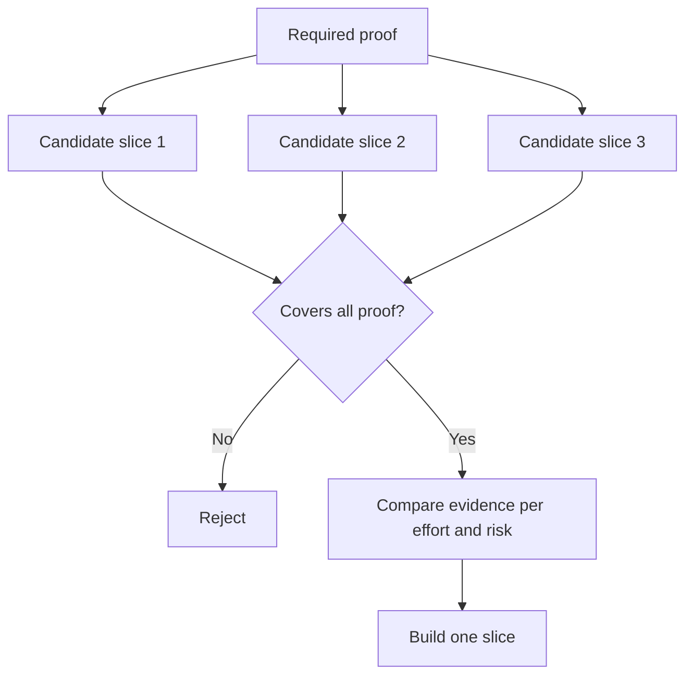

# निर्णय को बदलने के लिए सबसे छोटा टुकड़ा चुनें

> एक छोटा सा निर्माण जो अगले निर्णय को नहीं बदल सकता है, केवल अधूरा है।

> **【中文解读】**"बनाओ" केवल तभी होता है जब कुछ महत्वपूर्ण होने की पुष्टि हो सके_ एक बदलाव नहीं होता है_ एक निर्णय के अगले चरण के लिए_ एक छोटा सा निर्माण, न कि न्यूनतम संभव टुकड़ा, न ही पूरा हो_ एक छोटा सा निर्माण_ एक छोटा सा निर्माण_ एक छोटा सा निर्माण_ एक छोटा सा निर्माण_ एक छोटा सा निर्माण_ एक छोटा सा निर्माण_ एक छोटा सा निर्माण_ एक छोटा सा निर्माण_ एक छोटा सा निर्माण_ एक छोटा सा निर्माण_ एक छोटा सा निर्माण_ एक छोटा सा निर्माण_ एक छोटा सा निर्माण_ एक छोटा सा निर्माण_ एक छोटा सा निर्माण_ एक छोटा सा निर्माण_ एक छोटा सा निर्माण_ एक छोटा सा निर्माण_ एक छोटा सा निर्माण_ एक छोटा सा निर्माण_ एक छोटा सा निर्माण_ एक छोटा सा निर्माण_ एक छोटा सा निर्माण_ एक छोटा सा निर्माण_ एक छोटा सा निर्माण_ एक छोटा सा निर्माण_ एक छोटा सा निर्माण_ एक छोटा सा निर्माण_ एक छोटा सा निर्माण_ एक छोटा सा निर्माण_ एक छोटा सा निर्माण_ एक छोटा सा निर्माण_ एक छोटा सा निर्माण_ एक छोटा सा निर्माण_ एक छोटा सा निर्माण_ एक छोटा सा निर्माण_ एक महत्वपूर्ण परिवर्तन_ एक महत्वपूर्ण परिवर्तन_ एक महत्वपूर्ण परिवर्तन_ एक महत्वपूर्ण_ एक_ एक_ एक_ एक_ एक_ एक_ एक_ एक_ एक_ एक_ एक_ एक_ एक_ एक_ एक_ एक_ एक_ एक_ एक_ एक_ एक_ एक_ एक_ एक_ एक_ एक_ एक___ एक_ एक_______________________________________________________________________________________________________________________________________________________________________________________________________________

>  **【前置】**學本课前कृपया पहले सीखेंःPhase 14 第 49 课 (映射假设与风险本课的"必备证明集" सीधे वहां से आया风险最高的开放假设)`outputs/slice-decision.json`                                                                                                                                                                                                                                                              

**Type:** Learn + Build | **类型:** 学习 + 动手实践
**Languages:** Python (stdlib) | **语言:** Python（标准库）
**Prerequisites:** Phase 14 lesson 49 | **前置知识:** Phase 14 第 49 课
**Time:** ~65 minutes | **时间:** 约 65 分钟

## सीखने के लक्ष्य

- एक टुकड़ा को उसके सिद्ध होने वाली धारणाओं के आधार पर परिभाषित करें।
  中文翻译:用"切片能证明哪些假设"来定义切片──
- परिणाम मूल्य, अनिश्चितता में कमी, प्रयास और परिणाम को संतुलित करें।
  中文翻译: में परिणाम मूल्य、 अनिश्चितता消减、投入和后果之间做权衡──
- समय से पहले उत्पादन प्रतिबद्धता से पहले प्रतिवर्ती साक्ष्य पसंद करते हैं।
  चीनी अनुवादः पूर्वनिर्धारित उत्पादन स्तर के प्रतिबद्धता के बजाय, प्राथमिकता में चुना जा सकता है।
- कार्यप्रवाह के जोखिमपूर्ण भाग को छोड़ने वाले स्लाइस को अस्वीकार करें।
  चीनी अनुवादः जिन टुकड़ों को सही तरीके से काम के दौरान छोड़ दिया गया है, उन्हें अस्वीकार करना

## लंबवत अर्थ सबूत अंत से अंत तक                                                                                                                                                                                                                                                           

एक उपयोगी स्लाइस एक परिणाम का अवलोकन करने के लिए आवश्यक न्यूनतम वास्तविक कार्यप्रवाह को पार करती है। यह उपयोगकर्ताओं, डेटा, अवधि और क्षमता में संकीर्ण हो सकती है। यह सटीक अनिश्चितता को हटाकर संकीर्ण नहीं होना चाहिए जिसे आपको परीक्षण करने की आवश्यकता है।

> एक उपयोगी टुकड़ा एक परिणाम को देखने के लिए आवश्यक न्यूनतम वास्तविक कार्यप्रवाह को पार करने के लिए आवश्यक है। यह उपयोगकर्ता, डेटा, समय, क्षमता पर संकुचित हो सकता है, लेकिन "आप जिस अनिश्चितता का परीक्षण कर रहे हैं" को काटकर संकुचित नहीं कर सकता है।

उदाहरण:

> उदाहरण:

- दस वास्तविक घटनाओं पर केवल पढ़ने के लिए एक पुनरावृत्ति सेवा की पहचान और ऑपरेटर के विश्वास का परीक्षण करता है।
  च. भाषा अनुवादः跨十次真实事故的只读回放,能检验服务识别和操作员信任──
- सिंथेटिक डेटा पर पॉलिश किए गए डैशबोर्ड से समझ की जांच हो सकती है लेकिन डेटा व्यवहार्यता नहीं।
  चीनी अनुवादः संश्लेषित डेटा के आधार पर सटीक उपकरण का एक सेट "देखते हैं" का परीक्षण कर सकता है, लेकिन डेटा की उपलब्धता का परीक्षण नहीं कर सकता है।
- एक उत्पादन ऑटो-रिमेडिएटर एक ही समय में सब कुछ परीक्षण करता है अस्वीकार्य परिणाम के साथ।
  अनुवादः उत्पादन पर्यावरण का स्वचालित सुधार एक बार सब कुछ का परीक्षण करता है, लेकिन परिणाम अस्वीकार्य है।

> **【中文解读】**"तथ्य" का अर्थ है अंत से अंत तक वास्तविक कार्यप्रवाह को चालू करनाः प्रविष्टि वास्तविक है; निर्णय पथ वास्तविक है; एक परिणाम का अवलोकन कर सकता है। संकीर्ण दिशा केवल सीमा हो सकती है।

>  **【类比】**️️️️️️️️️️️️️️️️️️️️️️️️️️️️️️️️️️️️️️️️️️️️️️️️️️️️️️️️️️️️️️️️️️️️️️️️️️️️️️️️️️️️️️️️️️️️️️️️️️️️️️️️️️️️️️️️️️️️️️️️️️️️️️️️️️️️️️️️️️️️️️️️️️️️️️️️️️️️️️️️️️️️️️️️️️️️️️️️️️️️️️️️️️️️️️️️️️️️️️️️️️️️️️️️️️️️️️️️️️️️️️️️️️️️️️️️️️️️️️️️️️️️️️️️️️️️️️️️️️️️️️️️️️️️️️️️️️️️️️️️️️️️️️️️️️️️️️️️️️️️️️️️️️️️️️️️️️️️️️️️️️️️️️️️️️️️️️️️️️️️️️️️️️️️️️️️️️️️️️️️️️️️️️️️️️️️️️️️️️️️️️️️️️️️️️️️️️️️️️️️️️️️️️️️️️️️️️️️️️️️️️️️️️️️️️️️️️️️️️️️️️️️️️️️️️️️️️️️️️️️️️️️️️️️️️️️️️️️️️️️️️️️️️️️️️️️️️️️️️️️️️️️️️️️

## आवश्यक प्रमाण को परिभाषित करें पहले आवश्यक प्रमाण को परिभाषित करें

उच्चतम जोखिम वाले खुले परिकल्पनाओं को लें और उन्हें आवश्यक प्रमाण सेट में बदल दें। उम्मीदवार का टुकड़ा केवल तभी पात्र है जब वह उस सेट को कवर करता है।

> 取出风险最高的开放假设, इन्हें एक"आवश्यक प्रमाण संग्रह" में बदल दें।

फिर पात्र स्लाइसों की तुलना निम्नलिखित पर करेंः

> फिर पात्र टुकड़ों के बीच तुलना करेंः

| Dimension | Direction |
|---|---|
| Outcome value | More is better |
| Uncertainty reduced | More is better |
| Effort | Less is better |
| Consequence | Less is better |
| Reversibility | More is better |

प्रयोगशाला का स्कोर जानबूझकर सरल है। पात्रता गेट अंकगणित से अधिक मायने रखता है।

> 实验代码的评分故意简单――资格门比算术更重要――



> **【中文解读】**यहाँ क्रम इस वर्ग के केंद्र में हैः पात्रता门 ({{elbow gate)  अग्र, मूल्यांकन अंकगणित  बाद में                                                                                                                                                                                                                                                

## सामान्य झूठी न्यूनतम  常见 झूठी न्यूनतम टुकड़े

- **The UI-only minimum:**डेटा और परिचालन अनिश्चितता को हटा देता है।
  中文翻译:**只有 UI 的最小：**डेटा और परिचालन स्तर की अनिश्चितता को काट दिया गया।
- **The infrastructure-only minimum:**उपयोगकर्ता मूल्य के बिना तकनीकी संभावना साबित करता है।
  中文翻译:**只有基础设施的最小：**⇒ तकनीकी रूप से प्राप्त किया गया है, लेकिन उपयोगकर्ता मूल्य को साबित नहीं किया गया है।
- **The happy-path minimum:**सबसे अधिक जोखिम पैदा करने वाले अपवाद को छोड़ देता है।
  中文翻译:**只有正常路径的最小：**                                                                                                                                                                                                                                                              
- **The demo minimum:**एक प्रभावशाली कलाकृतियों का उत्पादन करता है लेकिन कोई दोहराया जा सकता माप नहीं है।
  中文翻译:**演示级最小：**उत्पादित करने वाले प्रदर्शनों में कोई पुनरावृत्ति नहीं है
- **The platform minimum:**एक कार्यप्रवाह से पहले पुनः प्रयोज्य मशीनरी का निर्माण करता है।
  中文翻译:**平台级最小：**किसी भी कार्यप्रवाह के मूल्य का प्रमाण देने से पहले ही पुनः प्रयोज्य मशीनों का निर्माण किया जा सकता है।

> **【中文解读】**五种假最小的各有诱惑:UI 最小出图快,基础设施最小对工程师胃口,演示最小最能动动领导――它们的共同点是系统性地绕开真正风险而"最小"的意思恰恰是让风险早点暴露――自检方法只有一个:逐条对照必备证明集,看看它最终证明了哪几条──

## एक रोक नियम जोड़ें.

कार्यान्वयन से पहले, लिखें कि यदि स्लाइस विफल हो जाती है तो क्या होता हैः

> "चोट असफल हुआ कैसे होगा":

- परिणाम को छोड़ना;
  中文翻译: इस परिणाम को त्यागना
- लक्ष्य उपयोगकर्ता या स्थिति को बदलना;
  中文翻译:更换目标用户或使用场景;
- एक अलग तंत्र का परीक्षण करें;
  中文翻译:换一种机制再测;
- बेहतर सबूत एकत्र करना;
  中文翻译:先收集更好的证据;
- और अधिक संकीर्ण अधिकार।
  中文翻译:把授权收得更狭──

यदि प्रत्येक परिणाम  बनाए रखने के लिए नेतृत्व करता है,  स्लाइस एक प्रयोग नहीं है।

> यदि प्रत्येक परिणाम "अगले काम" की ओर जाता है, तो यह टुकड़ा प्रयोग नहीं है।

> **【中文解读】**停止规则是实验的"诚实检查": एक सभी निष्कर्ष "继续建设" के टुकड़े होते हैं, केवल प्रयोग के बाहरी पहनावे की पूर्व निर्धारित योजना पर पहनते हैं।

## इसे बनाओ, इसे पूरा करो।

प्रयोगशाला उम्मीदवारों को आवश्यक प्रमाण के अनुसार फ़िल्टर करती है, पात्र स्लाइस को स्कोर करती है, और लिखती है `outputs/slice-decision.json`. .

>  प्रयोग कोड आवश्यक प्रमाण के अनुसार  उम्मीदवार  पात्र                                                                                                                                                                                                                                                         `outputs/slice-decision.json`

```bash
python3 code/main.py
python3 -m unittest discover code/tests -v
```

एक सस्ता उम्मीदवार जो केवल एक आवश्यक धारणा साबित करता है, उसे जोड़ें।

> इसके अलावा एक ही प्रमाण एक आवश्यक परिकल्पना है, लेकिन अधिक सस्ता उम्मीदवार है।

> **【中文解读】** `score = (结果价值 + 不确定性消减) / (投入 + 后果 × 不可逆系数)`只是排序工具; असली गार्डन员是集合包含检查 `required_proof <= set(item.proves)`️ कक्षा के बाद के विनाश के प्रयोग विशेष रूप से इस बात की पुष्टि करते हैंः एक सस्ते लेकिन सभी आवश्यक प्रमाणों को कवर नहीं करने वाले उम्मीदवार, रेटिंग पुनः उच्च भी प्रवेश नहीं करता है उम्मीदवार池 यह "योग्य द्वार उच्च से गणितीय" के कोडकरण है

## व्यायाम करें

1. एक ही परिणाम के लिए तीन स्लाइस डिजाइन करें, विभिन्न परिणाम स्तरों पर।
   चीनी अनुवादः तीन अलग-अलग परिणामों के लिए एक ही परिणाम डिजाइन के लिए।
2. उन्हें स्कोर करने से पहले आवश्यक प्रमाण निर्धारित करें।
   中文翻译:在打分之前先写下必备证明集──
3. निर्णायक साक्ष्य को संरक्षित करते हुए एक क्षमता को हटा दें।
   中文翻译: काट掉一项能力,同时保住决定性的证据──
4. असफल पायलट के लिए एक रोक नियम जोड़ें।
   चीनी भाषा में अनुवादः
5. एक पुनः प्रयोज्य मंच घटक की पहचान करें जिसे स्लाइस के बाद तक इंतजार करना चाहिए।
   中文翻译:指出一个应等切片后再做可复用平台组件──

## आगे पढ़ना 延伸閱讀

- [Barry Boehm, A Spiral Model of Software Development and Enhancement](https://dl.acm.org/doi/10.1145/12944.12948), प्रत्येक विकास चक्र को उन जोखिमों से मेल खाने के लिए जो इसे हल करना चाहिए।
  हिन्दी अनुवादःBoehm螺旋模型让每一轮发展循环应应它必须解决的风险
- [Lenarduzzi and Taibi, MVP Explained: A Systematic Mapping Study on the Definitions of Minimal Viable Product](https://arxiv.org/abs/1609.07592), सॉफ्टवेयर उत्पाद प्रथा में मिमिम  और लाभकारी  के बारे में अस्पष्टता के लिए।
  中文翻译:लेनारडुज़ी 与台北MVP 解析软件产品实践中"最小"和"可行"两个词的歧义理──

## जो आप रखेंगे आप रखेंगे उत्पादन

रखो`outputs/slice-decision.json`यह रिकॉर्ड क्यों यह टुकड़ा सबसे छोटा है कि निर्णय को बदल सकता है.

> रखरखाव`outputs/slice-decision.json`यह रिकॉर्ड करता है कि यह टुकड़ा "निर्णय बदलने वाला सबसे छोटा टुकड़ा" क्यों है
