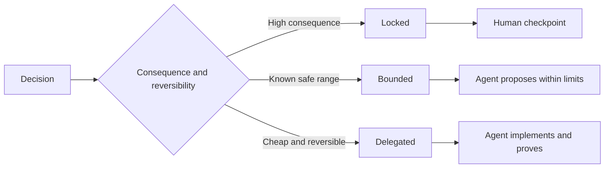

# निर्णायकता को बनाए रखने के लिए विशिष्टताएँ लिखें

> एक उपयोगी विनिर्देश अपरिवर्तनीय और सबूतों को ठीक करता है जबकि प्रतिवर्ती कार्यान्वयन विकल्पों को खुला छोड़ता है। यह निर्णय सीमा है, एक पटकथा नहीं है।

> **【中文解读】**एक अच्छा नियम "अवचल और प्रमाण" को लॉक करना, इसे निष्पादक को छोड़ना निर्णय की सीमा है, नाटक नहीं। एजेंट समय की एक वास्तविक समस्या हैः कार्य बहुत मोटा है, एजेंट केवल अंधा अनुमान लगाने की प्रणाली है; बहुत छोटा है, फिर एजेंट को लिखने वाले के लिए वापस ले जाया जाता है, एक संभावित रूप से गलत डिजाइन को प्रतिलिपि बनाने के लिए।

>  **【前置】**學本課前 請先掌握:Phase 14 第50 課  选择能改变决策的最小片 课规则服务的正是那个片) और 课 第33 课                                                                                                                                                                                                                                       `outputs/executable-specification.json`                                                                                                                                                                                                                                                              

**Type:** Learn + Build | **类型:** 学习 + 动手实践
**Languages:** Python (stdlib) | **语言:** Python（标准库）
**Prerequisites:** Phase 14 lesson 50 | **前置知识:** Phase 14 第 50 课
**Time:** ~75 minutes | **时间:** 约 75 分钟

## सीखने के लक्ष्य

- अलग परिणाम, अपरिवर्तनीय, उदाहरण, गैर-लक्ष्य, और प्रमाण।
  中文翻译:区分结果、不变量、示例、非目标和证明──
- निर्णयों को लॉक, लिमिटेड या डेलीगेटेड के रूप में चिह्नित करें।
  中文翻译:把每决定标注为锁定、受限或委托──
- एजेंटों के निर्णय को बनाए रखें जहां विकल्प सस्ते और उलटनीय हैं।
  中文翻译: में चुन सस्ते और可逆 जगह पर एजेंट की निर्णय शक्ति को बरकरार रखना
- मानव चेकपोस्टों की आवश्यकता है जहां परिणाम या सार्वजनिक व्यवहार में परिवर्तन होता है।
  चीनी अनुवादः जब कोई भी महत्वपूर्ण या सार्वजनिक व्यवहार में परिवर्तन होता है, तो कृत्रिम जांच को अनिवार्य करना।

## दो बुरा चरम हैं

एक कम निर्दिष्ट कार्य एजेंट से सिस्टम का अनुमान लगाने के लिए कहता है। एक अधिक निर्दिष्ट कार्य उसे एक डिजाइन का प्रतिलिपि बनाने के लिए कहता है जो पहले से ही गलत हो सकता है।

> 规格不足的任务让代理去猜系统;规格过度的任务让它抄抄一条可能就应该就错的设计――

उपयोगी मध्य एक निष्पादित अनुबंध हैः

> मध्य स्वरूप एक निष्पादन योग्य अनुबंध हैः

| Surface | Purpose |
|---|---|
| Outcome | The observable result |
| Invariants | Conditions that must always remain true |
| Examples | Concrete cases that reveal intent |
| Non-goals | Adjacent behavior intentionally excluded |
| Decision policy | Which choices are locked, bounded, or delegated |
| Proof | Evidence required before completion |

> **【中文解读】**两个极端对应两种浪费:规格不足浪费在返工上(एजेंट 猜错了重做),规格过度浪费在翻译上(人把设计写成伪代码,Agent 再转抄成代码,中间没有增量智能) 六面契约是中间路:结果说清"要什么"、不变量说清"任何时候不能破坏什么"、示例传递意图、非目标划边界、决策政策声明授权、证明定义"完成" प्रत्येक पहलू को निष्पादन करने के लिए निर्णय की जगह छोड़ दी गई है

## तीन निर्णय मोड

- **Locked:**एजेंट को चुनना नहीं चाहिए। सार्वजनिक संगतता, प्राधिकरण, सुरक्षा, अपरिवर्तनीय लागत या उत्पाद प्रतिबद्धता के लिए उपयोग।
  中文翻译:**锁定（Locked）：**एजेंट को स्वयं का चयन नहीं करना पड़ता। सार्वजनिक और अनुकूलता, अधिकार, सुरक्षा, अपरिवर्तनीय लागत या उत्पाद प्रतिबद्धता के लिए उपयोग किया जाता है।
- **Bounded:**एजेंट स्पष्ट सीमाओं के भीतर चुन सकता है। खोज बजट, पुनः प्रयास गणना, अनुमत निर्भरता, या एक ज्ञात इंटरफ़ेस परिवार के लिए उपयोग।
  中文翻译:**受限（Bounded）：**एजेंट को स्पष्ट सीमाओं के भीतर चयन किया जा सकता है।
- **Delegated:**स्थानीय संरचना, नाम, प्रतिवर्ती रेफैक्टर्स और कार्यान्वयन विवरण के लिए उपयोग।
  中文翻译:**委托（Delegated）：**एजेंट  इस विकल्प के मालिक है, लेकिन यह व्याख्या करने में सक्षम होना चाहिए  स्थानीय संरचना  नामकरण  प्रतिकूल पुनः निर्माण और कार्यान्वयन विवरण 



> **【中文解读】**तीन प्रकार के ढांचे का विभाजन मानक केवल एक ही समस्या हैः后果与可逆性──后果大、不可逆 → 锁定并设人工检查点;后果可控但有安全范围 → 受限,Agent 在界内自由;便宜且可逆 → 委托,Agent 自己定定但要解释──常见错误是两方向同时犯:把命名风格这样的小事锁死(浪费人的判断力),再把"不能写生产库"这样的大事默认委托 (((把产品风险交运气)

>  **【类比】**तीन प्रकार के निर्णय लेने के तरीके जैसे कि सजावट अनुबंध के तीन प्रकार के अनुच्छेदः बोझिल दीवार और जल विद्युत की ओर मुड़कर लिखना मृत्यु; लॉक गलत है कि मनुष्य जीवन को बाहर निकाले; बजट सीमित क्षेत्र; ब्रांडों की चयन; सीमित सुरक्षित क्षेत्र; कमरे के अंदर कैसे नियोजन श्रमिकों को देखने के लिए; प्रतिनिधि便宜可逆)

## उदाहरणों के माध्यम से व्यवहार निर्दिष्ट करें। उदाहरणों के साथ व्यवहार को परिभाषित करें।

उदाहरण विशेषणों की तुलना में इरादे को बेहतर ढंग से संपीड़ित करते हैं। उपयोगी,  मजबूत, और उत्पादन के लिए तैयार निष्पादित नहीं होते हैं। सामान्य, किनारे, विफलता और प्रतिबंधित उदाहरणों का एक छोटा सेट बिल्डर और सत्यापितकर्ता दोनों को कुछ ठोस देता है।

> उदाहरण से形容詞更能缩意图――"有助"",健壮"",生产可用"都不可执行―― एक समूह सामान्य, सीमांत, विफलता और प्रतिबंधित परिदृश्यों को कवर करने वाले कुछ उदाहरणों को प्रदान करता है, जो निर्माणकर्ता और सत्यापितकर्ता दोनों को पकड़ने में सक्षम हैं।

उदाहरण अपरिवर्तित वस्तुओं की जगह नहीं लेते हैं। एक गुजरता मामला सार्वभौमिक सुरक्षा नियम साबित नहीं कर सकता है।

> उदाहरण प्रतिस्थापन नहीं कर सकते। एक पारित उपयोग उदाहरण प्रमाण एक सामान्य सुरक्षा नियम नहीं है।

> **【中文解读】**इस खंड को हल करने के लिए "形容词陷": लिखने के लिए ""输出要干净" कुछ भी नहीं लिखा है, लिखने के लिए "" एक के साथ तैनात आईडी के सूचना सूचना के लिए समाधान करने के लिए सेवा के प्रभारी"" केवल इरादे पारित किया गया है। चार प्रकार के उदाहरण प्रत्येक में सामान्य संचरण के लिए है  सामान्य संचरण  सीमाओं के संचरण सटीकता  विफल संचरण  प्रतिबंधित संचरण ।

## सबूत का दावा से मेल लेना चाहिए सबूत का दावा से मेल लेना चाहिए

- इकाई परीक्षण स्थानीय कार्य अनुबंध साबित करता है।
  中文翻译:单元测试证明局部函数契约。
- एक तार परीक्षण क्रमबद्धता और परिवहन व्यवहार साबित करता है।
  中文翻译:线上(线) परीक्षण प्रमाण序列化与传输行为──
- ब्राउज़र यात्रा एक इंटरफ़ेस पथ साबित करता है।
  中文翻译:浏览器旅程证明一条界面路径──
- एक पुनरावृत्ति सेट प्रतिनिधि मामलों पर व्यवहार साबित करता है।
  中文翻译:回放集证明行为在代表性用例上的表现──
- लेखा परीक्षा लॉग से यह साबित होता है कि प्राधिकरण की सीमाएं बनी हुई हैं।
  चीनी अनुवादः लेखापरीक्षा की तारीख का प्रमाण

उच्चतर स्तर के दावे के प्रमाण के रूप में निचले स्तर को स्वीकार न करें।

> उच्च स्तरीय बयानों को समर्थन देने के लिए निम्न स्तरीय साक्ष्य का उपयोग न करें।

> **【中文解读】**प्रत्येक प्रमाण के अपने अधिकार क्षेत्र हैंः एक इकाई परीक्षण ट्यूब फ़ंक्शन, वायर  परीक्षण ट्यूब प्रोटोकॉल, ब्राउज़र यात्रा कार्यक्रम ट्यूब इंटरफ़ेस, पुनः संग्रहण संयंत्र समग्र व्यवहार, लेखा परीक्षा 日志管 अधिकारों। प्रमाणों का गलत स्तर सबसे आम "नकल स्वीकृति" है। एक ढेर हरे रंग के प्रकाशों के साथ एक इकाई परीक्षण "सत्ता सीमा सुरक्षा" का दावा करने के लिए किया जाता है, स्तर पर नहीं, जो शरीर के तापमान के प्रमाण के बराबर है रक्तचाप सामान्य।

## अनजान को जानबूझकर बनाए रखना

एक विनिर्देश में कहा जा सकता है कि प्रदर्शन किसी भी समय-बजट के भीतर लौटने वाले केवल-पढ़ने वाले स्रोत को चुन सकता है। यह अस्पष्टता नहीं है। यह एक सीमा और प्रमाण के साथ एक जानबूझकर अधिकृत निर्णय है।

> 规格 लिख सकते हैं "" समय के बजट के भीतर वापसी के लिए किसी भी केवल-पढ़ने योग्य डेटा स्रोत का चयन करने में सक्षम होना"" यह स्पष्ट नहीं है, बल्कि एक बार है, एक सबूत है, एक निश्चित रूप से जिम्मेदार है।

जब सबूत बदलते हैं तो विनिर्देशों में बदलाव होना चाहिए। लॉक और लिमिटेड विकल्पों के पीछे कारण को संरक्षित करें ताकि बाद की टीमें उन्हें पुरातात्विक विज्ञान के बिना संशोधित कर सकें।

> 证据变化时规格也应演化── लॉकडाउन और प्रतिबंधित चयन के पीछे के कारणों को बरकरार रखते हुए, बाद की टीमों को उन्हें संशोधित करने के लिए "प्राचीन" पर भरोसा नहीं करना पड़ा──

> **【中文解读】**"चिंतित रहना अज्ञात" और "चिंतित नहीं होना" में अंतर सीमा और प्रमाण में हैः पूर्व व्यक्ति ने चयन अंतरिक्ष (किसी भी केवल पढ़ने के स्रोत) बंधन (समय बजट) और स्वीकृति (स्वीकार)  प्रमाण में लिखा है), बाद वाला कुछ भी नहीं लिखा है।

## इसे बनाओ, इसे पूरा करो।

प्रयोगशाला हर अनुबंध सतह को मान्य करती है, निर्णय मोड की जांच करती है, और लिखती है `outputs/executable-specification.json`. .

>  प्रयोग कोड                                                                                                                                                                                                                                                                                                                                                                                                                                                                                                                           `outputs/executable-specification.json`

```bash
python3 code/main.py
python3 -m unittest discover code/tests -v
```

उत्पादन-लेखन निर्णय को लॉक से डेलिगेट में ले जाएं। समझाएं कि योजना मूल्य को क्यों स्वीकार करती है लेकिन उत्पाद जोखिम नहीं।

> इस निर्णय को "उत्पादन लिखें" से लॉक किया गया है 改成委托化── समझाएँ क्यों डेटा模式(स्केम) इस मूल्य को स्वीकार करें, जबकि उत्पाद风险 अस्वीकार करें──

> **【中文解读】**校验器 के दो कठिन नियम ध्यान देने योग्य हैंः छ面缺一不可,且非委托模式必须带理由"无理由锁定"和"无面契约"都被判定不完整──课后破坏实验是个性好的思考题:生产写入改委托在语法上完全合法 ((यह委托模式 का उपयोग है), लेकिन उत्पाद风险 ने यह तय किया कि यह इस लॉक मरने के लिए श्रेणी में आता है模式 चयन हमेशा जोखिम का निर्णय है, प्रारूप नहीं है प्रश्न

## व्यायाम करें

1. छह विनिर्देश सतहों में एक बैकलॉग टिकट परिवर्तित करें।
   中文翻译:把一张后载 工单转写成六面的规格──
2. तीन कार्यान्वयन निर्देशों को एक अपरिवर्तनीय और दो उदाहरणों से प्रतिस्थापित करें।
   中文翻译:把三条实现命令替换成一条不变量加两个例子──
3. प्रत्येक निर्णय को चिह्नित करें और प्रत्येक अवरुद्ध या सीमित विकल्प को सही ठहराते हैं।
   च. च. च. च. च. च. च. च. च. च. च. च. च. च. च. च. च. च. च. च. च. च. च. च. च. च. च. च. च. च. च. च. च. च. च. च. च. च. च. च. च. च. च. च. च. च. च. च. च. च. च. च. च. च. च. च. च. च. च. च. च. च. च. च. च. च. च. च. च. च. च. च. च. च. च. च. च. च. च. च. च. च. च. च. च. च. च. च. च. च. च. च. च. च. च. च. च. च. च. च. च. च. च. च. च. च. च. च. च. च. च. च. च. च. च. च. च. च. च. च. च. च. च. च. च. च. च. च. च. च. च. च. च. च. च. च. च. च. च. च. च. च. च. च. च. च. च. च. च. च. च. च. च. च. च. च. च. च. च. च. च. च. च. च. च. च. च. च. च. च. च. च. च. च. च. च. च. च. च. च. च. च. च. च. च. च. च. च. च. च. च. च. च. च. च. च. च. च. च. च. च. च. च. च. च. च. च. च. च. च. च. च. च. च. च. च. च. च. च. च.
4. प्रत्येक अपरिवर्तनीय के लिए एक प्रमाण रसीद जोड़ें।
   चीनी भाषा में अनुवादः
5. किसी ऐसे प्रतिबंध को हटा दें जिसमें कोई सबूत या जोखिम तर्क न हो।
   Chinese: 删掉一条既无证也无风险理由支的约束──

## आगे पढ़ना 延伸閱讀

- [Nuseibeh and Easterbrook, Requirements Engineering: A Roadmap](https://www.cs.toronto.edu/~sme/papers/2000/ICSE2000.pdf), लक्ष्य, सटीक विनिर्देशों, सत्यापन, सहमति और विकास के बीच संबंध के लिए।
  中文翻译:नसेइबे और ईस्टरब्रुक需求工程:路线图目标、精确规格、验证、共识与演化之间的关系──
- [Zave and Jackson, Four Dark Corners of Requirements Engineering](https://doi.org/10.1145/267895.267896), पर्यावरण परिकल्पनाओं, आवश्यकताओं और विनिर्देशों को अलग करने के लिए।
  चीनी अनुवादःजैव और जैक्सन के बीच चार अंधेरे कोणों में पर्यावरण परिकल्पनाएँ, आवश्यकताएँ और नियम
- [Gotel and Finkelstein, An Analysis of the Requirements Traceability Problem](https://doi.org/10.1109/ICRE.1994.292398), यह संरक्षित करने के लिए कि आवश्यकता क्यों मौजूद है और यह कहां से आई है।
  चीनी अनुवादःGotel 与 Finkelstein 需求追溯性问题分析 保留" आवश्यकता क्यों मौजूद है ∼ कहां से"

## जो आप रखेंगे आप रखेंगे उत्पादन

रखो`outputs/executable-specification.json`यह अनुबंध बन जाता है जो कोडिंग एजेंटों और मानव समीक्षाओं साझा करते हैं।

> रखरखाव`outputs/executable-specification.json`यह मानव मूल्यांकन के साथ साझा संधि में कोड एजेंट बन जाएगा
