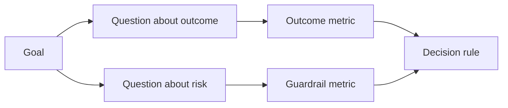

# परिणाम होने से पहले सफलता के लिए डिज़ाइन मेट्रिक्स

> मापने से निर्णय का जवाब मिलना चाहिए, डैशबोर्ड को सजाना नहीं। लक्ष्य से शुरू करें, प्रश्न प्राप्त करें, फिर उन सबसे छोटे मापों का चयन करें जो उन्हें जवाब देते हैं।

> **【中文解读】**测量应回答一个决策,而不是装点一块仪表盘──本课讲 GQM目标问题标标) 方法在 工程中的落地: 工程中的落地: 工程中的落地: 工程中的落地: 工程中的落地: 工程中的落地: 工程中的落地: 工程中的落地: 工程中的落地: 工程中的落地: 工程中的落地: 工程中的落地: 工程中的落地: 工程中的落地: 工程中的落地: 工程中的落地: 工程中的落地: 工程中的落地: 工程中的落地: 工程中的落地: 工程中的落地: 工程中的落地: 工程中的落地: 工程中的落地: 工程中的落地: 工程中的落地: 工程中的落地: 工程中的落地: 工程中的落地: 工程中的落地: 工程中的落地: 工程中的落地: 工程中的落地: 工程中的落地: 工程中的落地: 工程中的落地: 工程中的落地: 工程的落地: 工程的落地: 工程的落地: 工程的落地: 工程的落地: 工程的落地: 工程的落地: 工程的落地: 工程的落地: 工程的落地: 工程的落地: 工程的落地.

>  **【前置】**學本课前 請先掌握:Phase 14 第47 课  成果先于产出本课的"目标"从那里而来) और第51 课   写保留判断力规则规格里的"证明"面在此展开成测量计划)  本课  产出`outputs/measurement-report.json`门 课原型/试点/生产三档的证据 门

**Type:** Learn + Build | **类型:** 学习 + 动手实践
**Languages:** Python (stdlib) | **语言:** Python（标准库）
**Prerequisites:** Phase 14 lessons 47 and 51 | **前置知识:** Phase 14 第 47、51 课
**Time:** ~70 minutes | **时间:** 约 70 分钟

## सीखने के लक्ष्य

- परिणाम लक्ष्य से प्रश्न और माप प्राप्त करें।
  中文翻译: from result目标推导出问题和标标――
- परिणामों का अवलोकन करने से पहले सीमाओं, खिड़कियों, स्रोतों और दिशाओं को परिभाषित करें।
  中文翻译: 值、窗口、来源和方向──
- गार्डरेल्स और काउंटरमेट्रिक्स के साथ परिणाम मीट्रिक जोड़ी।
  चीनी अनुवादः परिणाम संकेत पर ध्यान देना
- निर्माण द्वारा समर्थित निर्णय के साथ मूल्यांकन साक्ष्य मेल खाते हैं।
  चीनी अनुवादः  मूल्यांकन प्रमाणों को निर्माण के लिए आवश्यक निर्णयों के साथ मेल खाने दें

## लक्ष्य, प्रश्न, मेट्रिक  लक्ष्य, प्रश्न, सूचक

एक लक्ष्य से शुरू करें:

> एक लक्ष्य से शुरूः

> असुरक्षित कार्यों को बढ़ाए बिना प्रभावित सेवा की पहचान करने के लिए समय को कम करें।
>
>                                                                                                                                                                                                                                                               

प्रश्न उत्पन्न करेंः

> 推导出问题:

- सही सेवा कितनी जल्दी पहचान ली जाती है?
  中文翻译:正确服务被定位有多快吗?
- कितनी बार पहचान सेवा सही है?
  हिन्दी अनुवादः स्थलांतरित सेवा के लिए क्या संभावना है?
- क्या निदान केवल पढ़ने के लिए बना रहता है?
  中文翻译: क्या निदान प्रक्रिया केवल पढ़ने के लिए ही है?
- क्या कार्यप्रवाह अलर्ट को खारिज करने या ऑपरेटर का कार्यभार बढ़ाता है?
  क्या इस कार्यप्रवाह ने सूचना सूचना उपेक्षा दर या ऑपरेटरों के बोझ को बढ़ाया है?

फिर उन प्रश्नों को परिचालन करने वाले माप चुनें।

> फिर चुनें कि इन समस्याओं को आकस्मिक संख्यात्मक सूचक में कैसे बदलें।



> **【中文解读】**GQM का मार्गदर्शन दिशा अपरिवर्तनीय: लक्ष्य → 问题 → 指标── लक्ष्य है निर्णय भाषा (((快而不险), समस्या है अनुसंधान भाषा ((多快?多准?只读吗?),指标才是数字语言(中位秒数、正确率、写次数) 

## एक मीट्रिक एक अनुबंध की जरूरत है

प्रत्येक मीट्रिक आवश्यकताओंः

> प्रत्येक संकेत के लिए आवश्यक हैः

| Field | Example |
|---|---|
| Name | `median_identification_seconds` |
| Direction | at most |
| Threshold | 120 |
| Window | ten incident replays |
| Source | replay event log |
| Population | on-call engineers in the pilot |
| Kind | outcome or guardrail |

स्रोत और खिड़की के बिना, एक संख्या को पुनः प्रस्तुत नहीं किया जा सकता है। एक सीमा के बिना, यह निर्णय नहीं ले सकता है।

>  कोई स्रोत और खिड़की नहीं, एक संख्या पुनः प्राप्त नहीं की जा सकती है; कोई मूल्य नहीं, यह निर्णयों को प्रेरित नहीं कर सकती है

> **【中文解读】**契约的七字段回答四个问题:叫什么 (Name) 朝哪边好 (Direction) 、多好算好 (Threshold) 、在哪测的 (Window/Source/Population) 、属于哪类的 (Kind) ٬缺"在哪测的",同一数字换个环境就不可复现;缺"多好算好",指标永远只会"看起来变好"── यह और धारा 51 课程规格契约的规格构建指标也是需要收收条款的规格──

>  **【类比】**️️️️️️️️️️️️️️️️️️️️️️️️️️️️️️️️️️️️️️️️️️️️️️️️️️️️️️️️️️️️️️️️️️️️️️️️️️️️️️️️️️️️️️️️️️️️️️️️️️️️️️️️️️️️️️️️️️️️️️️️️️️️️️️️️️️️️️️️️️️️️️️️️️️️️️️️️️️️️️️️️️️️️️️️️️️️️️️️️️️️️️️️️️️️️️️️️️️️️️️️️️️️️️️️️️️️️️️️️️️️️️️️️️️️️️️️️️️️️️️️️️️️️️️️️️️️️️

## परिणाम, गार्डरेल, और काउंटरमेट्रिक

- **Outcome metric:**क्या वांछित स्थिति में सुधार हुआ?
  中文翻译:**结果指标：**期望 की स्थिति में सुधार हुआ है?
- **Guardrail:**क्या एक निश्चित बाध्यता सही रही?
  中文翻译:**护栏指标：**固定约束是否仍然成立?
- **Counter-metric:**क्या स्थानीय सुधार की शिफ्ट की लागत या नुकसान कहीं और हुआ?
  中文翻译:**反指标：**क्या स्थानीय सुधारों ने लागत या नुकसान को दूसरे स्थान पर स्थानांतरित कर दिया है?

घटना के कार्यप्रवाह के लिए, गति पर्याप्त नहीं है। सटीकता, उत्पादन लेखन, ऑपरेटर कार्यभार और चूक सूचनाएं एक तेज़ लेकिन असुरक्षित परिणाम से बचती हैं।

> दुर्घटना कार्यप्रवाह के लिए, केवल गति ही अपर्याप्त है। सटीकता दर, उत्पादन लेखन की संख्या, ऑपरेटरों के बोझ और रिपोर्टिंग की कमी, रक्षा "त्वरित लेकिन असुरक्षित" के परिणाम हैं।

> **【中文解读】**तीन प्रकार के संकेतक एक त्रिकोण के रूप में होते हैंः परिणाम संकेतक प्रमाण "बदला हुआ है",护 संकेतक "बदला नहीं हुआ है" (जैसे उत्पादन में लिखा हुआ है कि "恒为零"),反 संकेतक "बदला हुआ है" (जहां तक कि "बदला हुआ है")

## ऑफ़लाइन और ऑनलाइन साक्ष्य

ऑफ़लाइन रिप्ले दोहराव और किनारे कवरेज के लिए उपयोगी है। एक सीमाबद्ध पायलट वास्तविक व्यवहार, विश्वास और वर्कफ़्लो प्रभाव के लिए उपयोगी है। कोई भी दूसरे के प्रतिस्थापन नहीं करता है।

> ऑनलाइन रिलीज़ का मूल्य पुनरावृत्ति और सीमा कवर पर आधारित है; अंतरिक्ष परीक्षण का मूल्य वास्तविक व्यवहार, विश्वास और कार्यप्रवाह पर आधारित है

वर्तमान निर्णय का उत्तर देने के लिए सबसे सस्ता सबूत का उपयोग करें। केवल इसलिए वास्तविक उपयोगकर्ताओं को उजागर न करें क्योंकि कार्यान्वयन तैयार है।

> उपयोग कर सकेंगे वर्तमान निर्णय के सबसे सस्ते साक्ष्य का उत्तर देने के लिए।

> **【中文解读】**离线/在线的取舍标准是"当前决策需要什么",不是"实现进展到哪里了"――回放集答"算法对不对",试点答"人信不信、用不用"―― सबसे आम गलती यह है कि केवल परीक्षण करने के लिए प्रश्न का उत्तर देने के लिए एक 离线 सूचक का उपयोग करके 离线指标 का उपयोग किया जाए।

## निर्णय लेने से पहले आप मापें, पहले निर्णय, पुनः डेटा का परीक्षण

परिणाम देखने से पहले पास, विफलता और अस्पष्ट पथ लिखें। अन्यथा टीम निर्माण की रक्षा के लिए सीमा को स्थानांतरित करेगी।

> परिणाम देखने से पहले अच्छा लिखें, असफलता और भ्रम तीन मार्गों को देखें। अन्यथा टीम इस निर्माण को बनाए रखने के लिए अवश्य ही काम करेगी।

उदाहरण:

> उदाहरण:

- पासः सही सेवा दर कम से कम 0.9 और औसत समय अधिकतम 120 सेकंड;
  中文翻译:通过:正确服务率 0.9 से कम नहीं और मध्यम खपत समय 120 से अधिक नहीं;
- विफलताः उत्पादन लेखन या सुधार दर 0.75 से कम;
  中文翻译:失败: किसी भी उत्पादन में लिखाई हुई, या 0.75 से कम की सही दर;
- अस्पष्टः व्यापक भिन्नता के साथ छोटा सुधार, एक बड़े पुनरावृत्ति सेट की आवश्यकता होती है।
  中文翻译:模糊: सुधार幅度小且方差大,需要扩大回放集再测──

> **【中文解读】**"पहले निर्णय" मानव-उपरोधी रक्षा का कार्य है: डेटा के आने के बाद पुनः निर्धारण  मूल्य, लगभग हर कोई अपने डेटा को पहले से ही पारित स्थान पर  मूल्य निर्धारित करेगा।

## इसे बनाओ, इसे पूरा करो।

प्रयोगशाला एक माप योजना को मान्य करती है, समावेशी सीमाओं का मूल्यांकन करती है, यादगार मानों को रिकॉर्ड करती है, और लिखती है `outputs/measurement-report.json`. .

>  प्रयोग कोड校验 एक माप योजना  सीमा मान से युक्त  मूल्य प्राप्त करें  रिकॉर्ड अनुपलब्ध मूल्य, और लिखें `outputs/measurement-report.json`

```bash
python3 code/main.py
python3 -m unittest discover code/tests -v
```

गार्डरेल मेट्रिक्स को हटा दें और देखें कि योजना क्यों अमान्य हो जाती है, भले ही परिणाम मेट्रिक्स बने रहें।

>                                                                                                                                                                                                                                                               

> **【中文解读】**校验器 के नियम इस वर्ग के कोडकरण हैंः缺目标、缺问题、缺结果指标、缺结果类、缺护类、方向非法、缺来源或窗口 किसी भी लेख से स्थिति 无效 हो जाती है, पीछे के अंक का पूरा अर्थ खो जाता है विशेष ध्यान देंः护缺失 नहीं करेगी रिपोर्ट "कम एक", बल्कि पूरे योजना को रद्द करने के लिए अनुमति देगा बिना समर्थन परिणाम指标" त्वरित लेकिन असुरक्षित" के साथ पारित करने के लिए

## व्यायाम करें

1. एक परिणाम लक्ष्य से तीन प्रश्न निकालें।
   中文翻译:从一个结果目标推导出三个问题──
2. एक काउंटरमेट्रिक जो एक अन्य भूमिका में स्थानांतरित लागत को पकड़ता है जोड़ें।
   चीनी अनुवादः加一个能抓住"成本被转移到另一个角色" के खिलाफ指标.
3. प्रत्येक मीट्रिक के लिए स्रोत, जनसंख्या और विंडो को परिभाषित करें।
   中文翻译:为每个标标定义来源、人群和窗口──
4. मान उत्पन्न करने से पहले पास, असफल और अस्पष्ट निर्णय लिखें।
   中文翻译: 生成数值之前写好通过、失败和模糊三条决策──
5. एक मीट्रिक की पहचान करें जो एकत्र करना आसान है लेकिन निर्णय को नहीं बदल सकता है। इसे हटा दें।
   चीनी अनुवादः एक आसान संग्रह खोजें लेकिन निर्णय लेने के लिए एक संकेत को बदलने के लिए, इसे हटा दें।

## आगे पढ़ना 延伸閱讀

- [Basili, Software Modeling and Measurement: The Goal/Question/Metric Paradigm](https://drum.lib.umd.edu/items/8119803a-362b-42ec-b6ce-2311713e7236), स्पष्ट लक्ष्यों से परिचालन माप प्राप्त करने के लिए।
  中文翻译:Basili软件建模与测量:GQM 范式从显式目标推导可操作测量──
- [Basili, Caldiera, and Rombach, The Goal Question Metric Approach](https://www.cs.toronto.edu/~sme/CSC444F/handouts/GQM-paper.pdf), विधि को प्रतिक्रिया और सुधार प्रणाली के रूप में लागू करने के लिए।
  中文翻译:Basili、Caldiera 与 RombachGQM 方法把该方法用作反与改进系统──

## जो आप रखेंगे आप रखेंगे उत्पादन

रखो`outputs/measurement-report.json`. यह प्रोटोटाइप, पायलट या उत्पादन चरण के लिए साक्ष्य गेट को परिभाषित करता है।

> रखरखाव`outputs/measurement-report.json` यह मूल प्रकार 试点 生产阶段 के प्रमाण 门 को परिभाषित करता है
