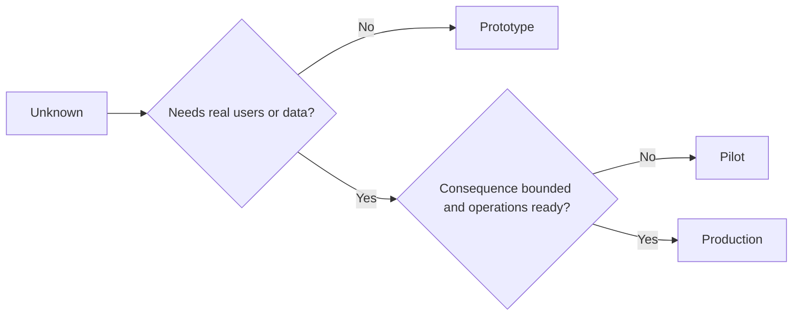

# प्रोटोटाइप, पायलट, या उत्पादन जानबूझकर चुनें

> ये अलग-अलग सीखने के वातावरण हैं, पॉलिशिंग के स्तर नहीं। उस चरण का चयन करें जो वर्तमान अज्ञात का जवाब देता है, कम से कम अनावश्यक परिणाम के साथ।

> **【中文解读】**मूल प्रकार, परीक्षण बिंदु, उत्पादन तीन अलग-अलग सीखने के वातावरण हैं, जो तीन स्तरों के लिए नहीं हैं। चयन स्तर का मानदंड केवल एक हैः जो न्यूनतम अनावश्यक परिणामों के साथ वर्तमान अज्ञात का उत्तर दे सकता है। इस वर्ग में, "छप्पर", "परिशिष्ट", "संकेत" को कक्षा 50-52 के अंतिम चरण में रखा गया है। पर्यावरण नियंत्रणः मूल प्रकार को किसी भी समय फेंक दिया जा सकता है, परीक्षण बिंदु को परिभाषित और वापस किया जा सकता है, उत्पादन का अर्थ है कि संगठन ने निरंतर जिम्मेदारी स्वीकार की है। सबसे आसान घटनाएं चयन त्रुटि नहीं हैं, बल्कि मूल प्रकार "भूमि" उत्पादन प्रणाली में बदल गई हैं।

>  **【前置】**學本课前 請先掌握:Phase 14 第50 课  न्यूनतम 切片 先确定要证明什么) 第51 课 规格契约 控制与证明条款) 第52 课  सफलता सूचक每档的证据门) 本课产出`outputs/stage-decisions.json`️️️️️️️️️️️️️️️️️️️️️️️️️️️️️️️️️️️️️️️️️️️️️️️️️️️️️️️️️️️️️️️️️️️️️️️️️️️️️️️️️️️️️️️️️️️️️️️️️️️️️️️️️️️️️️️️️️️️️️️️️️️️️️️️️️️️️️️️️️️️️️️️️️️️️️️️️️️️️️️️️️️️️️️️️️️️️️️️️️️️️️️️️️️️️️️️️️️️️️️️️️️️️️️️️️️️️️️️️️️️️️️️️️️️️️️️️️️️️️️️️️️️️️️️️️️️️️️️️️️️️️️️️️️️️️️️️️️️️️️️️️️️️️️️️️️️️️️️️️️️️️️️️️️️️️️️️️️️️️️️️️️️️️️️️️️️️️️️️️️️️️️️️️️️️️️️️️️️️️️️️️️️️️️️️️️️️️️️️️️️️️️️️️️️️️️️️️️️️️️️️️️️️️️️️️️️️️️️️️️️️️️️️️️️️️️️️️️️️️️️️️️️️️️️️️️️️️️️️️️️️️️️️️️️️️️️️️️️️️️️️️️️️️️️️️️️️️️️️️️️️️️️️️️️

**Type:** Learn + Build | **类型:** 学习 + 动手实践
**Languages:** Python (stdlib) | **语言:** Python（标准库）
**Prerequisites:** Phase 14 lessons 50 to 52 | **前置知识:** Phase 14 第 50-52 课
**Time:** ~70 minutes | **时间:** 约 70 分钟

## सीखने के लक्ष्य

- अज्ञात, दर्शकों, डेटा, परिणाम और तत्परता से एक निर्माण चरण चुनें।
  中文翻译:अज्ञात项、受众、数据、后果和就绪度根据选择构建档位──
- चरण-विशिष्ट नियंत्रण और बाहर निकलने के मानदंडों को परिभाषित करें।
  चीनी भाषा अनुवादः परिभाषित档位专属的控制措施和退出标准──
- प्रोटोटाइप को चुपचाप उत्पादन प्रणाली बनने से रोकें।
  中文翻译: रोकथाम原型变成生产系统──
- वास्तविक प्राधिकरण को तब तक विलंबित करें जब तक कि सबूत और संचालन इसे सही न ठहराएं।
  चीनी अनुवादः जब वास्तविक अधिकारों की सीमा प्रमाणों और संवाहक क्षमताओं के साथ उस पर तैनात हो जाती है।

## तीन अलग-अलग प्रश्न

| Stage | Primary question |
|---|---|
| Prototype | Can this mechanism produce the evidence at all? |
| Pilot | Does it work safely with a bounded real audience and real conditions? |
| Production | Can we own it continuously at the promised reliability and risk level? |

एक प्रोटोटाइप तकनीकी रूप से पूरा हो सकता है और अभी भी डिस्पोजेबल हो सकता है। एक पायलट दर्शकों और प्राधिकरण में सीमित रहते हुए उत्पादन डेटा का उपयोग कर सकता है। उत्पादन तब शुरू होता है जब संगठन निरंतर जिम्मेदारी स्वीकार करता है।

> **【中文解读】**तीन श्रेणी प्रश्न तीन अलग-अलग प्रश्न हैंः प्रामाणिक प्रश्न "क्या यह तंत्र साक्ष्य उत्पन्न करने में सक्षम है", परीक्षण प्रश्न "क्या यह एक समूह के वास्तविक दर्शकों और वास्तविक परिस्थितियों में सुरक्षित है", उत्पादन प्रश्न "क्या हम प्रतिबद्ध विश्वसनीयता और जोखिम स्तर पर इसका स्वामित्व जारी रख सकते हैं"।

## प्रोटोटाइप, मूल

प्रोटोटाइप का उपयोग करें जब अज्ञात को वास्तविक उपयोगकर्ताओं या वास्तविक डेटा की आवश्यकता नहीं होती है। इसे रखेंः

> जब अज्ञात वस्तुओं को वास्तविक उपयोगकर्ता या वास्तविक डेटा की आवश्यकता नहीं होती है, तो मूल प्रकार का उपयोग करें।

- डिस्कार्ड करने योग्य;
  中文翻译:随时可扔;
- अलग-अलग;
  中文翻译:隔离;
- व्यवहार में संकीर्ण;
  中文翻译: व्यवहार面窄;
- सीखने के प्रश्न के बारे में स्पष्ट रूप से;
  中文翻译:把学习问题写明白;
- झूठी परिचालन गारंटी से मुक्त।
  चीनी अनुवादः 不带任何虚假的运维保证──

तंत्र को एक और चरण प्राप्त होने से पहले वास्तुकला को अनुकूलित न करें।

> इस तंत्र को अगले स्तर पर जीतने से पहले, अनुकूलन संरचनाओं को नहीं करना चाहिए।

> **【中文解读】**मूल के पांच अनुच्छेदों में सबसे कठिन "पृथक" और "नहित फर्जी परिवहन维保证":पृथक गारंटी यह विफल होने पर और शून्य के लिए; नहीं वादा करने के लिए उपलब्धता सुनिश्चित करता है कोई भी इस पर निर्भर करने के लिए शुरू करने के लिए है।

## पायलट  परीक्षण

पायलट का उपयोग तब करें जब अज्ञात को वास्तविक व्यवहार, यथार्थवादी डेटा या वास्तविक वर्कफ़्लो की आवश्यकता होती है, लेकिन परिणाम या तत्परता अभी तक व्यापक रिलीज के साथ संगत नहीं है।

> जब अज्ञात परियोजनाओं को वास्तविक व्यवहार, वास्तविक डेटा या वास्तविक कार्यप्रवाह की आवश्यकता होती है, लेकिन परिणाम या तैयारी भी व्यापक रूप से प्रकाशित होने के लिए असंगत होती है, तो प्रयोग बिंदुओं का उपयोग करें।

पायलट को आवश्यकता हैः

> 试点需要:

- एक नामित दर्शक;
  中文翻译:点名的人群;
- एक मानव मालिक;
  中文翻译:一位人类负责人;
- सीमित अवधि और अधिकार;
  चीनी भाषा में अनुवादः有界的时长与权限;
- लेखा परीक्षा और वापसी;
  中文翻译:审计与回滚;
- आउटपुट और गार्डरेल की सीमाएं;
  中文翻译: परिणाम与护值 (第52 课) से प्राप्त;
- विस्तार, संशोधन या रोक के लिए बाहर निकलने के मानदंड।
  中文翻译:扩展、修订或停止的退出标准──

> **【中文解读】**试点的定义性特征是"真实但有界": वास्तविक डेटा、真实人群,但受众点名、时长封顶、权限收窄──六项要求里"人类负责人"和"退出标准" सबसे अधिक बार省略 बिना जिम्मेदार के परीक्षण के बाहर होने पर नहीं मिलता है, मानव拍板回滚, नहीं退出标准的试点会默认无限期,变成一个半永久的不明物体──

## उत्पादन उत्पादन

उत्पादन को तैनाती से अधिक की आवश्यकता हैः

> उत्पादन की आवश्यकता से अधिकः

- सेवा स्तर का उद्देश्य;
  中文翻译:服务级别目标(SLO);
- कॉल पर और घटनाओं के मालिकाना अधिकार;
  中文翻译:值班与事故归属;
- सुरक्षा और गोपनीयता समीक्षा;
  中文翻译: सुरक्षा एवं गोपनीयता समीक्षा;
- लागत और क्षमता नियंत्रण;
  中文翻译: लागत与容量控制;
- वापसी और पुनर्प्राप्ति;
  中文翻译:回滚与恢复;
- निरंतर निगरानी;
  中文翻译: सतत निगरानी;
- एक सेवानिवृत्ति पथ।
  中文翻译:一条退役路径──



> **【中文解读】**七项中最反直觉是最后一条"退役路径": उत्पादन में प्रवेश करने से पहले इसे कैसे बाहर निकालना है, यह एक दुखद विचार नहीं है, बल्कि यह स्वीकार करना है कि प्रत्येक प्रणाली के जीवन चक्र हैं  कोई भी退役路径 प्रणाली नहीं है  अंततः यह "न कोई भी हिम्मत करता है और न ही कोई जानता है कि क्यों चल रहा है" की विरासत में बदल गया है  निर्णय वृक्ष का तर्क:

>  **【类比】**तीन चरणों में ड्राइविंग मशीनः ड्राइविंग मशीनः ड्राइविंग मशीनः ड्राइविंग मशीनः ड्राइविंग मशीनः ड्राइविंग मशीनः ड्राइविंग मशीनः ड्राइविंग मशीनः ड्राइविंग मशीनः ड्राइविंग मशीनः ड्राइविंग मशीनः ड्राइविंग मशीनः ड्राइविंग मशीनः ड्राइविंग मशीनः ड्राइविंग मशीनः ड्राइविंग मशीनः ड्राइविंग मशीनः ड्राइविंग मशीनः ड्राइविंग मशीनः ड्राइविंग मशीनः ड्राइविंग मशीनः ड्राइविंग मशीनः ड्राइविंग मशीनः ड्राइविंग मशीनः ड्राइविंग मशीनः ड्राइविंग मशीनः ड्राइविंग मशीनः ड्राइविंग मशीनः ड्राइविंग मशीनः ड्राइविंग मशीनः ड्राइविंग मशीनः ड्राइविंग मशीनः ड्राइविंग मशीनः ड्राइविंग मशीनः ड्राइविंग मशीनः ड्राइविंग मशीनः ड्राइविंग मशीनः ड्राइविंग मशीनः ड्राइविंग मशीनः ड्राइविंग मशीनः ड्राइविंग मशीनः ड्राइविंग मशीनः ड्राइविंग मशीनः ड्राइविंग मशीनः ड्राइविंग मशीनः ड्राइविंग मशीनः ड्राइविंग मशीनः ड्राइविंग मशीनः ड्राइविंग मशीनः ड्राइविंग मशीनः ड्राइविंग मशीनः ड्राइविंग मशीनः ड्राइविंग मशीनः ड्राइविंग मशीनः ड्राइविंग मशीनः ड्राइविंग मशीनः ड्राइविंग मशीनः ड्राइविंग मशीनः ड्राइविंग मशीनः ड्राइविंग मशीनः ड्राइविंग मशीनः ड्राइविंग मशीनः ड्राइविंग मशीनः ड्राइविंग मशीनः ड्राइविंग मशीनः ड्राइविंग मशीनः ड्राइविंग मशीनः ड्राइविंग मशीनः ड्राइविंग मशीनः ड्राइविंग मशीनः ड्राइविंग मशीनः ड्राइविंग मशीनः ड्राइविंग मशीनः ड्राइविंग मशीनः ड्राइविंग मशीनः ड्राइविंग मशीनः ड्राइविंग मशीनः ड्राइविंग मशीनः ड्राइविंग मशीनः ड्राइविंग मशीनः ड्राइविंग मशीनः ड्राइविंग मशीनः ड्राइविंग मशीनः ड्राइविंग मशीनः ड्राइविंग मशीनः ड्राइविंग मशीनः ड्राइविंग मशीनः ड्राइविंग मशीनः ड्राइविंग मशीनः ड्राइविंगः ड्राइविंगः ड्राइविंगः ड्राइविंगः ड्राइविंगः ड्राइविंगः ड्राइविंगः ड्राइविंगः ड्राइविंगः ड्राइविंगः ड्राइविंगः ड्राइविंगः ड्राइविंगः ड्राइविंगः ड्राइविंगः ड्राइविंगः ड्राइविंगः ड्राइविंगः ड्राइविंगः ड्राइविंगः ड्राइविंगः ड्राइविंगः ड्राइविंगः ड्राइविंगः ड्राइविंगः ड्राइविंगः ड्राइविंगः ड्राइविंगः ड्राइविंगः ड्राइविंगः।

## स्टेज ड्रिफ्ट  阶段漂移

प्रोटोटाइप कोड खतरनाक हो जाता है जब यह उपयोगकर्ताओं, डेटा या प्राधिकरण को प्राप्त करता है, बिना स्वामित्व प्राप्त किए। कॉन्फ़िगरेशन, एक्सेस कंट्रोल, टेलीमेट्री और प्रलेखन में प्रोटोटाइप और पायलट सीमाओं को चिह्नित करें। चेतावनी बैनर पर्याप्त नहीं है।

> जब मूल कोड को बिना किसी श्रेय के उपयोगकर्ता, डेटा या अधिकार प्राप्त होते हैं, तो यह खतरनाक हो जाता है।

इस चरण को सिस्टम से ही देखा जा सकता है।

> 档位 को सिस्टम से ही देखा जाना चाहिए।

> **【中文解读】**阶段漂移(चरण बहाव) सबसे आम चुपचाप दुर्घटना हैः "临时跑一下" का मूल रूप से लिखित स्क्रिप्ट वास्तविक प्रवाह में प्रवेश करता है, तीन महीने बाद यह किसी के भी साहस के बिना फिर से शुरू करने का एक महत्वपूर्ण मार्ग बन गया है। रक्षा को तकनीकी नियंत्रण पर निर्भर करना चाहिए।

## इसे बनाओ, इसे पूरा करो।

प्रयोगशाला निर्णय संदर्भ से एक चरण चुनती है, आवश्यक नियंत्रण लौटाती है, और लिखती है `outputs/stage-decisions.json`. .

>  प्रयोग कोड निर्णय पर निम्न लेख से श्रेणी से बाहर चुनें                                                                                                                                                                                                                                                                                                                                                                                                                                                                                                                 `outputs/stage-decisions.json`

```bash
python3 code/main.py
python3 -m unittest discover code/tests -v
```

पायलट उदाहरण को कम परिणामी के साथ परिचालन की तत्परता में बदलें। यह समझाएं कि उत्पादन को सही ठहराने के लिए अतिरिक्त सबूत क्या हैं।

> इस पर एक उदाहरण को निम्न परिणामों में परिवर्तित करें और इसे लागू करें।

> **【中文解读】** `choose_stage`⇒ ⇒ ⇒ ⇒ ⇒ ⇒ ⇒ ⇒ ⇒ ⇒ ⇒ ⇒ ⇒ ⇒ ⇒ ⇒ ⇒ ⇒ ⇒ ⇒ ⇒ ⇒ ⇒ ⇒ ⇒ ⇒ ⇒ ⇒ ⇒ ⇒ ⇒ ⇒ ⇒ ⇒ ⇒ ⇒ ⇒ ⇒ ⇒ ⇒ ⇒ ⇒ ⇒ ⇒ ⇒ ⇒ ⇒ ⇒ ⇒ ⇒ ⇒ ⇒ ⇒ ⇒ ⇒ ⇒ ⇒ ⇒ ⇒ ⇒ ⇒ ⇒ ⇒ ⇒ ⇒ ⇒ ⇒ ⇒ ⇒ ⇒ ⇒ ⇒ ⇒ ⇒ ⇒ ⇒ ⇒ ⇒ ⇒ ⇒ ⇒ ⇒ ⇒ ⇒ ⇒ ⇒ ⇒ ⇒ ⇒ ⇒ ⇒ ⇒ ⇒ ⇒ ⇒ ⇒ ⇒ ⇒ ⇒ ⇒ ⇒ ⇒ ⇒ ⇒ ⇒ ⇒ ⇒ ⇒ ⇒ ⇒ ⇒ ⇒ ⇒ ⇒ ⇒ ⇒ ⇒ ⇒ ⇒ ⇒ ⇒ ⇒ ⇒ ⇒ ⇒ ⇒ ⇒ ⇒ ⇒ ⇒ ⇒ ⇒ ⇒ ⇒ ⇒ ⇒ ⇒ ⇒ ⇒ ⇒ ⇒ ⇒ ⇒ ⇒ ⇒ ⇒ ⇒ ⇒ ⇒ ⇒ ⇒ ⇒ ⇒ ⇒ ⇒ ⇒ ⇒ ⇒ ⇒ ⇒ ⇒ ⇒ ⇒ ⇒ ⇒ ⇒ ⇒ ⇒ ⇒ ⇒ ⇒ ⇒ ⇒ ⇒ ⇒ ⇒ ⇒ ⇒ ⇒ ⇒ ⇒ ⇒ ⇒ ⇒ ⇒ ⇒ ⇒ ⇒ ⇒ ⇒ ⇒ ⇒ ⇒ ⇒ ⇒ ⇒ ⇒ ⇒ ⇒ ⇒ ⇒ ⇒ ⇒ ⇒ ⇒ ⇒ ⇒ ⇒    ⇒ ⇒                                                                                       

## व्यायाम करें

1. तीन वर्तमान परियोजनाओं को सीखने के चरण के अनुसार वर्गीकृत करें, न कि तैनाती की स्थिति के अनुसार।
   中文翻译:按学习阶段 (शिक्षा के चरण पर)
2. पायलट के बाहर निकलने के मानदंड लिखें जिनमें स्टॉप निर्णय शामिल हो।
   中文翻译:为试点写包含"停止"决策的退出标准──
3. एक तकनीकी नियंत्रण जो एक प्रोटोटाइप को उत्पादन डेटा तक पहुंचने से रोकता है जोड़ें।
   चीनी अनुवादः加一条技术控制, रोकना原型碰到生产数据──
4. निर्माण उत्पादन को बनाने वाली पहली परिचालन जिम्मेदारी की पहचान करें।
   中文翻译:指出第一"接下它,构建就成了生产" के संचालन责任.
5. सीमाबद्ध पायलट के लिए एक रोलबैक रसीद तैयार करें।
   中文翻译:为有界试点设计一个回滚凭证──

## आगे पढ़ना 延伸閱讀

- [Barry Boehm, A Spiral Model of Software Development and Enhancement](https://dl.acm.org/doi/10.1145/12944.12948), प्रत्येक पुनरावृत्ति के प्रति प्रतिबद्धता को हल किए गए जोखिम से मेल खाने के लिए।
  Boehm 螺旋模型让每一轮代的承诺与已解决风险相匹配
- [Fagerholm et al., Building Blocks for Continuous Experimentation](https://doi.org/10.1145/2601248.2601276), प्रयोगों को निरंतर चलाने के लिए आवश्यक संगठनात्मक और तकनीकी परिस्थितियों के लिए।
  चीनी भाषा अनुवादःFagerholm 等 निरंतर प्रयोग के निर्माण ब्लॉक निरंतर प्रयोग के लिए आवश्यक संगठन और तकनीकी शर्तों

## जो आप रखेंगे आप रखेंगे उत्पादन

रखो`outputs/stage-decisions.json`यह दर्शाता है कि प्रत्येक चरण क्यों उचित है और अगले चरण से पहले कौन से नियंत्रण मौजूद होना चाहिए।

> रखरखाव`outputs/stage-decisions.json`यह रिकॉर्ड करता है कि प्रत्येक श्रेणी क्यों बनी है, साथ ही अगले श्रेणी में प्रवेश करने से पहले कौन से नियंत्रण मौजूद होने चाहिए
