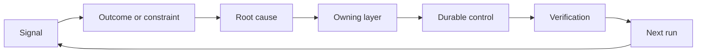

# मालिक और सेवानिवृत्ति के साथ एक प्रतिक्रिया रैकट बनाएं

> शिपिंग एक निर्माण लूप बंद करता है और सीखने लूप खोलता है। सबूत प्रणाली को बदलना चाहिए या यह टेलीमेट्री बन जाता है किसी का भी मालिक नहीं है।

> **【中文解读】** एक निर्माण चक्र जारी करने पर, एक साथ सीखने के चक्र को खोलने पर  साक्ष्य को सिस्टम को बदलना चाहिए, अन्यथा यह बिना किसी व्यक्ति के मान्यता प्राप्त दूर परीक्षण डेटा में बदल जाता है ️ इस कोर्स में एजेंट 工程方法論系列 (Phase 14 · 43-54) का ज्ञान शामिल हैः दुर्घटनाओं, मूल्यांकन  उपयोगकर्ता व्यवहार और सुधार को "मास्टर ️  प्रमाण   रिटायरमेंट शर्तों" की कठिनाई में बदल दें, ताकि सिस्टम केवल बेहतर दिशा में एक-एक करके बंद हो जाए, और पुराने नियंत्रण को हटा दिया जा सके ️ 43-53 ️ कैसे करें, कैसे करें, कैसे करें, अगली बार बेहतर करें।

>  **【前置】**學本課前कृपया पहले सीखेःचरण 14 第 46 課                                                                                                                                                                                                                                                       

**Type:** Learn + Build | **类型:** 学习 + 动手实践
**Languages:** Python (stdlib) | **语言:** Python（标准库）
**Prerequisites:** Phase 14 lessons 46 and 53 | **前置知识:** Phase 14 第 46、53 课
**Time:** ~75 minutes | **时间:** 约 75 分钟

## सीखने के लक्ष्य

- घटनाओं, मूल्यांकन, उपयोगकर्ता व्यवहार, और सुधारों को स्वामित्व वाली कार्रवाई में बदल दें।
  चीनी अनुवादः把事故、评估、user behavior and correction transformed into owner's actions── दुर्घटनाओं का आकलन करने वाले उपयोगकर्ता के व्यवहार और सुधार को मालिक के कार्यों में परिवर्तित करने वाला व्यक्ति
- प्रत्येक संकेत को संदर्भ, मूल्यांकन, नीति, रनटाइम या बैकलॉग पर रूट करें।
  चीनी अनुवादः प्रत्येक प्रकार के संकेतों को ऊपर से नीचे तक ले जाएँ, मूल्यांकन, रणनीति, संचालन या प्रतीक्षा सूची में।
- गंभीरता और आवृत्ति के अनुसार पुनरावृत्ति को प्राथमिकता दें।
  चीनी अनुवादः क्रमशः तीव्रता के अनुसार
- हर नियंत्रण को एक सेवानिवृत्ति की स्थिति दें।
  चीनी भाषा अनुवादः प्रत्येक नियंत्रण उपाय के लिए एक शर्त के साथ।

## प्रतिक्रिया बुनियादी ढांचा है।

एक टीम किसी भी घटना से सीखने के बिना निशान, मूल्यांकन, समर्थन टिकट और घटना लॉग एकत्र कर सकती है। गायब तंत्र प्रमोशन हैः एक मालिक और सबूत के साथ अवलोकन से स्थायी परिवर्तन के लिए एक परिभाषित पथ।

> एक टीम किसी भी घटना की पहचान कर सकती है, लेकिन किसी भी घटना से कुछ नहीं सीखती है।

लूप हैः

> यह चक्र हैः

1. एक ठोस संकेत का पालन करें;
   中文翻译:观察到一个具体信号;
2. इसे किसी परिणाम, बाध्यता या धारणा से जोड़ें;
   中文翻译: इसे किसी परिणाम 约束或假设 से जोड़ना;
3. सबसे पहले सिस्टम परत की पहचान करें जो कारण का मालिक है;
   中文翻译:找到"拥有这个根因" के सबसे पहले सिस्टम层;
4. एक सीमित परिवर्तन पैदा करना;
   中文翻译: एक सीमावर्ती परिवर्तन का निर्माण;
5. यह सत्यापित करें कि पुनरावृत्ति कम होने की संभावना है;
   हिन्दी अनुवादः验证复发概率确实下降了;
6. जांच करें कि क्या नियंत्रण बरकरार रहना चाहिए।
   中文翻译:复核这个控制是否还应保留──

> **【中文解读】**"反是基础设施" का अर्थ हैः सीखने के लिए दृष्टिकोण पर निर्भर नहीं है तंत्रों पर निर्भर करता है।可观测性、评估、工单系统只是原材料 के एक पाइपलाइन है, वास्तविक सुविधाएँ हैं कि 条六步升升路 विशेष रूप से 条六步升升路, वे अधिकांश टीमों के कार्यप्रवाह में मौलिक रूप से मौजूद नहीं हैंः सुधार अपूर्ण पुनरावलोकन दर,装完永不复核── बिना इन दो चरणों के, "复盘" केवल एक सामूहिक भावनात्मक गतिविधि है।

## मालिक स्तर के लिए मार्ग 路由到负责层

| Signal | Destination |
|---|---|
| False positive, regression, wrong result | Evaluation or test |
| Missing context, duplicate work, stale fact | Context source or retrieval route |
| Unsafe action or authority gap | Policy or permission boundary |
| Timeout, retry storm, unavailable dependency | Runtime control |
| New product need or unresolved tradeoff | Shaped backlog item |

सबसे पहले प्रभावी परत पर कारण को ठीक करें। जब किसी परीक्षण या अनुमति से विफलता असंभव हो सकती है तो एक और शीघ्र पैराग्राफ न जोड़ें।

> जब कोई परीक्षा या कोई अधिकार किसी प्रकार की असफलता को असंभव बना दे तो तुरंत पुनः मत जाओ।



> **【中文解读】**路由表把"什么信号去哪"变成查表操作:错误结果去评估、缺上下文去检查、越权去策略、超时去运行时、新产品诉求去待办――核心纪律是"最早有效层"快速是最贵的修复位置(每轮都占据下文、随着模型变化),测试和权限是最便宜的位置(一次写入、永久生效) 

## स्वामित्व नियंत्रण का हिस्सा है।

हर रश्श कार्रवाई की जरूरत हैः

> प्रत्येक टर्नर रनिंग के लिए आवश्यक हैः

- एक मालिक;
  中文翻译:恰好一个主人;
- परिणाम और पुनरावृत्ति पर आधारित प्राथमिकता;
  हिन्दी अनुवादः परिणामों और पुनरावृत्ति की आवृत्ति के आधार पर प्राथमिकता;
- बदलने वाला कलाकृतियों;
  中文翻译:要改那工件;
- परिवर्तन का प्रमाण देने वाली सत्यापन;
  中文翻译:证明该变更生效的验证;
- समीक्षा या समाप्ति विंडो;
  中文翻译: एक复核或到期窗口;
- एक सेवानिवृत्ति की स्थिति।
  中文翻译:一条退役条件。

एक अनपढ़ सुधार बेहतर स्वरूपण के साथ एक अवलोकन है।

>  कोई मुख्य व्यक्ति सुधार नहीं, बस एक बेहतर देखने का अवलोकन रिकॉर्ड 

> **【中文解读】**六段里"恰好一个主人" और"退役条件" दो अलग-अलग पहलुओं के होते हैंः主人保证变更真实落地(观察→行动),退役条件保证控制不会无限堆积(行动→清理) 最后那句话值得贴在工单系统门口把"建议改成X"写得更漂亮不会让它发生,签署上一个名和一个验证命令才会

## सेवानिवृत्त स्थिर नियंत्रण

प्रतिक्रिया प्रणाली नीति को जमा करती है। यह नीति विरोधाभासी और महंगी हो सकती है। समीक्षा नियंत्रण करती है जबः

> प्रति प्रणाली संचय रणनीति, जबकि ये रणनीति परस्पर विरोधी हो सकती हैं।

- वास्तुकला या कार्यप्रवाह में परिवर्तन;
  中文翻译: संरचना या कार्य प्रवाह में परिवर्तन;
- एक निम्न स्तर की अपरिवर्तनीय उच्च स्तर की निर्देशों को बदल देती है;
  中文翻译: किसी निम्न स्तर की अपरिवर्तनीयता ने उच्च स्तर के निर्देशों को बदल दिया;
- चयनित विंडो पर संरक्षित विफलता दिखाई नहीं दी है;
  中文翻译: पूरे निरीक्षण खिड़की में एक बार भी नहीं देखा गया;
- नियंत्रण अधिक बार वैध कार्य को रोकता है इससे नुकसान नहीं होता है।
  चीनी अनुवादः यह नियंत्रण सामान्य काम को रोकने के लिए अधिक बार है

पेंशन लेने के लिए सबूत भी चाहिए।

> 退役 退役 退役 退役 退役 退役 退役 退役 退役 退役 退役 退役 退役 退役 退役 退役 退役 退役 退役 退役 退役 退役 退役 退役 退役 退役 退役 退役 退役 退役 退役 退役 退役 退役 退役 退役 退役 退役 退役 退役 退役 退役 退役 退役 退役 退役 退役 退役 退役 退役 退役 退役 退役 退役 退役 退役 退役 退役 退役 退役 退役 退役 退役 退役 退役 退役 退役 退役 退役 退役 退 退 退 退 退 退 退 退 退 退 退 退 退 退 退 退 退 退 退 退 退 退 退 退 退 退 退 退 退 退 退 退 退 退 退 退 退 退 退 退 退 退 退 退 退 退 退 退 退 退 退 退 退 退 退 退 退 退 退 退 退 退 退 退 退 退 退 退 退 退 退 退 退 退 退 退 退 退 退 退 退 退 退 退 退 退 退 退 退 退 退 退 退 退 退 退 退 退 退 退 退 退 退 退 退 退 退 退 退 退 退 退 退 退 退 退 退 退 退 退 退 退 退 退 退 退 退 退 退 退 退 退 退 退 退 退 退 退 退 退 退 退 退 退 退 退 退 退 退 退

> **【中文解读】**यह भाग "टर्न रील" को वापस करने के लिए हैः केवल अंदर नहीं लौटने वाले टर्न रील अंततः मशीन को बंद कर देंगे। चार पुनर्विक्रय संकेतों में चौथा सबसे व्यावहारिक है। एक नियंत्रण रोके जाने वाले अनुपालन अनुरोध पर रोक लगाने के जोखिम से अधिक है, यह बीमा से कर में बदल गया है। लेकिन वापस लेने के लिए सबूत भी देना चाहिएः खिड़की के अंदर零复发≠ कभी नहीं होगा, हटाने से पहले पहले पुष्टि करें कि रक्षा पहले से ही कम परत के अपरिवर्तनीयता से है।

## कनेक्ट बिल्ड और कोडिंग एजेंट प्रतिक्रियाएँ 打通 निर्माण  और कोड एजेंट 

एक ही रच दोनों पटरियों पर सेवा करता हैः

> एक टक्कर सेवा दो रेल्वे:

- उत्पाद प्रमाण परिणाम फ्रेम, धारणा, स्लाइस या माप योजना को बदलता है।
  中文翻译:产品证据改变结果框架、假设、切片或测量计划──
- कोडिंग एजेंट सुधार परीक्षणों, संदर्भ, दायरे, स्वचालन या हस्तांतरण को बदलते हैं।
  中文翻译:编码 एजेंट का纠正改变测试、上下文、范围、自动化或交接──
- घटनाएं उत्पाद सीमा और एजेंट कार्यक्षेत्र दोनों को बदल सकती हैं।
  中文翻译: दुर्घटना既可以改变产品边界,也可以改变代理工作台──

यही कारण है कि निर्माण को आकार देना एक ऐसा चरण नहीं है जो कोडिंग से पहले समाप्त होता है। यह प्रत्येक स्वीकार किए गए परिवर्तन के माध्यम से जारी रहता है।

> यही कारण है कि "कास्टिंग प्लास्टिक" एक ऐसा चरण नहीं है जो कोडिंग शुरू होने से पहले समाप्त होता है, यह प्रत्येक स्वीकार किए गए परिवर्तन के माध्यम से चलता है।

> **【中文解读】**इस धारा में 43-54  श्रृंखला का समापन हुआ है: 43  वर्ग के कार्य ढांचे का परिकल्पना "इंजीनियर लोग इस सुझाव पर विश्वास करते हैं") परीक्षण के वास्तविक प्रमाणों को टक्कर देने पर, परिवर्तन केवल कोड नहीं है, और एक और कार्य ढांचे भी है।

## इसे बनाओ, इसे पूरा करो।

प्रयोगशाला संकेतों को वर्गीकृत करती है, स्वामित्व वाली रचश क्रियाएँ बनाती है, उन्हें प्राथमिकता देती है, और लिखती है `outputs/feedback-backlog.json`. .

>  प्रयोग कोड संकेत वर्ग                                                                                                                                                                                                                                                                                                                                                                                                                                                                                                                         `outputs/feedback-backlog.json`

```bash
python3 code/main.py
python3 -m unittest discover code/tests -v
```

रनटाइम टाइमआउट सिग्नल जोड़ें और पुष्टि करें कि यह सामान्य बैकलॉग के बजाय रनटाइम पर रूट करता है।

> अतिरिक्त एक रन टाइम सुपर टाइम संकेत, पुष्टि यह चलाते समय के लिए मार्ग है और सामान्य प्रतीक्षा में प्रवेश नहीं किया गया है।

> **【中文解读】** `destination()`प्रयोग की गई शब्दों के साथ, वास्तविक प्रणाली में तत्वों को बदलना या आनुवांशिक रूप से अलग करना संभव है।`promote()`则把六字段动作象化: प्राथमिकता = 严重度 × 频率, प्रत्येक उद्देश्य के लिए तय स्थायी कार्य`evaluations/regression-suite.json`)、 निश्चित प्रमाण पत्र तथा साथ में संख्या के वापसी की शर्तें― ध्यान दें`expires_after_days`इसका अर्थ "आधिकाल स्वचालित रूप से हटाया जाना" नहीं है, बल्कि "आधिकाल को फिर से जाँचना चाहिए"

## व्यायाम करें

1. एक घटना और एक उपयोगकर्ता शिकायत को एक रच कार्रवाई में बदल दें।
   चीनी अनुवादः把一次事故和一条用户投诉转写成棘轮动作
2. सबसे पहले जो परत हो सकती है उसे नाम दें जो प्रत्येक पुनरावृत्ति को रोक सकती है।
   中文翻译:指出能阻止每次复发的最早层──
3. प्रयोगशाला आउटपुट में सत्यापन कमांड या अवलोकन जोड़ें।
   चीनी अनुवादः Give experiment output पूरक परीक्षण आदेश या निरीक्षण
4. पॉलिसी नियम के लिए सेवानिवृत्ति की शर्त को परिभाषित करें।
   中文翻译:为一条策略规则定义退役条件──
5. अगले कार्य फ्रेम में वापस अनुशरण एक स्वीकार सुधार।
   चीनी अनुवादः एक अनुच्छेद को अगले कार्य के ढांचे में वापस ले जाना

## आगे पढ़ना 延伸閱讀

- [Basili, Caldiera, and Rombach, The Goal Question Metric Approach](https://www.cs.toronto.edu/~sme/CSC444F/handouts/GQM-paper.pdf), उद्देश्य उन्मुख माप के माध्यम से संगठनात्मक सीखने के लिए।
  中文翻译:Basili、Caldiera 与 RombachGQM 方法通过目标导向的测量实现组织学习──
- [Fagerholm et al., Building Blocks for Continuous Experimentation](https://doi.org/10.1145/2601248.2601276), तकनीकी और संगठनात्मक लूप के लिए जो सबूतों को उत्पाद विकास के निरंतर विकास से जोड़ता है।
  चीनी अनुवादःFagerholm आदि  निरंतर प्रयोग के निर्माण खंड                                                                                                                                                                                                                                                        
- [Nuseibeh and Easterbrook, Requirements Engineering: A Roadmap](https://www.cs.toronto.edu/~sme/papers/2000/ICSE2000.pdf), सिस्टम जीवन चक्र के दौरान विकसित आवश्यकताओं के साथ व्यवहार करने के लिए।
  中文翻译:नसेबी और ईस्टरब्रुक需求工程:路线图把需求视为在系统生命周期中持续演化──

## जो आप रखेंगे आप रखेंगे उत्पादन

रखो`outputs/feedback-backlog.json`यह उत्पाद निर्णय और वितरण पथ का समापन आस्तीन है और अगले परिणाम फ्रेम में इनपुट है।

> रखरखाव`outputs/feedback-backlog.json` यह "उत्पाद निर्णय और वितरण" मार्ग का अंतिम भाग है, यह अगले परिणाम ढांचे का भी प्रवेश है
