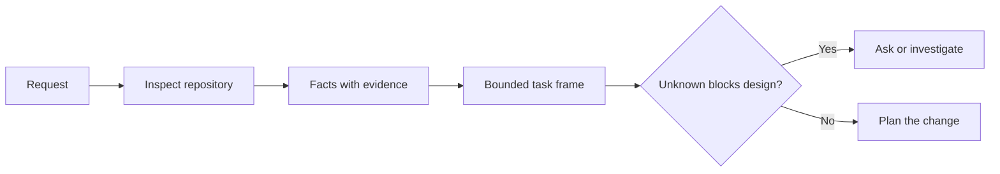

# Đặt khung nhiệm vụ trước khi nhân viên viết mã.

> Một nhân viên lập trình có thể thực hiện một nhiệm vụ rõ ràng nhanh chóng. Nó cũng có thể thực hiện một nhiệm vụ không rõ ràng nhanh chóng. Tốc độ giống nhau. Chi phí không phải.

> **【中文解读】**编码 Agent 实现清晰任务快,实现模糊任务同样快速度,价格完全不同. 本课讲 Agent 写代码前的第一步: biến một模糊请求 thành một 仓库证据支、边界明确的任务框架.

>  **【前置】**Học本课前请先掌握:Phase 14 第 31 课 (Why model will fail先理解失败模式,才理解为什么需要框架) và第 36 课 (Công ước phạm vi, phạm vi契约本课的任务框架是它在任务定义阶段的前置形态) ⋅本课产`outputs/task-frame.md`会在第44课变成证支的执行计划──

**Type:** Learn + Build | **类型:** 学习 + 动手实践
**Languages:** Python (stdlib) | **语言:** Python（标准库）
**Prerequisites:** Phase 14 lessons 31 and 36 | **前置知识:** Phase 14 第 31、36 课
**Time:** ~60 minutes | **时间:** 约 60 分钟

## Mục tiêu học tập

- Chuyển đổi yêu cầu thành khung nhiệm vụ giới hạn trước khi chỉnh sửa.
  Trong động tác, chuyển một yêu cầu thành khung nhiệm vụ có biên giới.
- Lấy các dữ liệu lưu trữ riêng biệt từ giả định và các câu hỏi mở.
  Trung ngữ翻译:把仓库事实与假设, chờ quyết định
- Định nghĩa các con đường được phép, các con đường bị cấm, và bằng chứng chấp nhận.
  Trung文翻译: định nghĩa cho phép đường, cấm đường và chấp nhận chứng cứ.
- Hãy quyết định khi nào việc trinh sát đủ để bắt đầu công việc.
  Trung ngữ翻译:判断什么时候侦察已足够,可以开始动手.

## Sự thất bại đắt tiền, sự thất bại đắt tiền.

Tổ thêm bảo vệ email trùng lặp nghe có vẻ cụ thể. Nó không. Sự độc đáo có thuộc về API, dịch vụ miền hoặc cơ sở dữ liệu không? So sánh có nhạy cảm với trường hợp?

> "加上重复邮箱保护" nghe có vẻ rất cụ thể, thực tế không cụ thể.

Một nhân viên có khả năng sẽ lấp đầy những khoảng trống đó bằng những lựa chọn hợp lý. Đó là trường hợp nguy hiểm bởi vì việc thực hiện có thể sạch, được thử nghiệm, và vẫn không tương thích với hệ thống.

> Một đại lý có khả năng sẽ sử dụng những lựa chọn có vẻ hợp lý để lấp đầy những khoảng trống này. Đây là tình huống nguy hiểm: thực hiện có thể làm sạch, có kiểm tra bao phủ, nhưng vẫn không phù hợp với toàn bộ hệ thống.

Do đó, đơn vị đầu tiên của công việc lập trình-nhà làm không phải là một chỉnh sửa.

> Do đó, đơn vị đầu tiên của việc lập trình của đại lý không phải là một lần chỉnh sửa, mà là một khuôn khổ nhiệm vụ được hỗ trợ bởi chứng cứ khoán.

> **【中文解读】**Sự thất bại đắt tiền không phải là viết mã xấu, mà là viết mã đối với nhưng nhiệm vụ hiểu sai. Công viên sẽ không thay đổi bởi nhiệm vụ mờ dần. Công viên sẽ tự tin thay thế bạn để đưa ra quyết định.

## Quadro nhiệm vụ Quadro nhiệm vụ

Một khung hữu ích có sáu trường:

| Field | Question |
|---|---|
| Goal | What observable behavior must change? |
| Repository facts | What did you verify in code, tests, config, or history? |
| Allowed paths | Where may the change land? |
| Forbidden paths | What must remain untouched? |
| Acceptance evidence | Which commands or observations prove the goal? |
| Unknowns | Which decisions still need evidence or human judgment? |

> **【中文解读】**六个段分别是: mục tiêu (what can be observed behavior must change) 仓库事实 (what can be observed behavior must change) 仓库事实 (what can be observed behavior must change) 仓库事实 (what can be observed behavior must change) 仓库事实 (what can be observed behavior must change) 仓库事实 (what can be observed behavior must change) 仓库事实 (what can be observed behavior must change) 仓库事实 (what can be observed behavior must change) 仓库事实 (what can be observed behavior must change) 仓库事实 (what can be observed behavior must change) 仓库事实 (what can be observed behavior must change) 仓库事实 (what can be observed behavior must change) 仓库事实 (what can be observed behavior must change) 仓库事实 (what can be observed behavior must change) 仓库事实 (what can be observed behavior must change) 仓库事实 (what can be observed behavior must change) 仓库事实 (what can be observed) 仓库事实 (what can be observed) 仓库事实 (what can be observed) 仓库事) 仓库事实 (what can be observed) 仓库事实 (what can be observed) 仓库事) 仓库事实 (what can be observed) 仓库事 (what can be observed) 仓库事) 仓库事实 (what can be observed) 仓库 facts (what can be observed) 仓库 facts) 仓库 facts (what can be observed (what can be observed) 仓库 facts) 仓库 facts (what can be observed (what can be observed) 仓库 facts) 仓库 facts (what can be observed (what can be observed) 仓库 facts) 仓库 facts (what can be observed (what can be observed)                                                        

Các dữ liệu cần biên nhận.  API sử dụng 409 cho bản sao không phải là một sự thật cho đến khi bạn có thể chỉ ra các thử nghiệm hoặc xử lý hiện có. Một con đường tệp và dòng là đủ. Kết quả lệnh tốt hơn khi hành vi quan trọng.

> Thực tế cần chứng minh. "API đối với lặp lại trở lại 409" trước khi bạn chỉ ra các thử nghiệm hoặc xử lý tồn tại không phải là thực tế.



>  **【类比】**任务框架像装修前的墙审批单:哪面墙能动(được phép đường) 哪面是承重墙绝不能动 (được cấm đường) 验收入住的标准是什么 (验收入住的标准是什么) 验收收入住的标准是什么 (验收收入住的标准是什么) 没有这张单子,装修队 (Agent) 动作越快,错墙的概率越大――

## Nhận thức là tìm kiếm những giới hạn.

Không đọc toàn bộ kho lưu trữ. Tìm kiếm các bề mặt hạn chế thay đổi:

> Đừng đọc cả kho... tìm những gì thực sự ràng buộc sự thay đổi này.

1. Hành vi hiện tại và người gọi nó.
   Trung ngữ翻译:当前行为以及调用它的代码──
2. Thử nghiệm gần nhất hiện có.
   Trung ngữ翻译:离得最近的现存测试──
3. Hợp đồng công cộng hoặc hình dạng liên tục.
   Trung ngữ翻译:公开契约或序列化后的数据形状──
4. Các hướng dẫn dự án điều khiển con đường.
   Trung文翻译:管辖这些路径的项目规范(如 AGENTS.md)
5. Các lệnh xây dựng và xác minh.
   Trung ngữ翻译:构建与验证命令。
6. Những thay đổi hoàn thành tương tự cho thấy các mô hình địa phương.
   Trung văn翻译:类似的已完成改动, chúng tiết lộ thói quen của bản địa.

Hãy dừng lại khi mọi quyết định được lên kế hoạch đều được chứng minh bằng bằng chứng, được ủy quyền rõ ràng hoặc được liệt kê như là không rõ.

> Khi mỗi quyết định trong kế hoạch đều có bằng chứng, được xác định được ủy quyền hoặc đã được liệt kê cho các dự án chưa biết, dừng theo dõi.

> **【中文解读】**侦察的目的不是了解整个代码库,而是寻找约束:谁调用它,哪个试管它,公开契约长什么样,本地惯例怎么写.

## Những điều không biết không phải là thất bại.

Một cái không biết là một khoảng cách được kiểm soát. Một giả định là một câu trả lời không được kiểm soát cho khoảng cách đó.

> Không biết là một lỗ hổng được kiểm soát; giả thuyết là một lần không kiểm soát được câu trả lời cho lỗ hổng này.

Đánh phân loại mỗi người không biết:

- **Discoverable:**bộ lưu trữ hoặc hệ thống chạy có thể trả lời.
  Trung ngữ翻译:**可发现：**Hệ thống trong kho hoặc hoạt động có thể trả lời nó.
- **Decidable:**hợp đồng nhiệm vụ cho phép đại lý lựa chọn.
  Trung ngữ翻译:**可决定：**任务契约已授权  Agent 自行选择──
- **Human:**sự lựa chọn thay đổi hành vi sản phẩm, chi phí, rủi ro hoặc tính tương thích của công chúng.
  Trung ngữ翻译:**需人来定：**Sự lựa chọn này sẽ thay đổi hành vi sản phẩm, chi phí, rủi ro hoặc khả năng chấp nhận công khai.
- **Deferred:**sự lựa chọn nằm ngoài đoạn này và thuộc về các mục tiêu không có mục tiêu.
  Trung ngữ翻译:**可延后：**Sự lựa chọn này không thuộc về phần này, nên được đưa vào mục tiêu không.

Đặc vụ phải tiếp tục thông qua những điều không biết được phát hiện và ủy quyền.

> Đối với những điều chưa biết có thể phát hiện được và được ủy quyền, Đại lý nên tiếp tục tiến hành; đối với những điều chưa biết cần người ta xác định, Đại lý nên tạm dừng trước khi sự lựa chọn này được chôn vào mã hóa.

> **【中文解读】**Để phân loại những điều không biết, hơn giả vờ không có điều không biết là an toàn hơn. Có bốn loại đối phó với bốn loại xử lý: kiểm tra có thể tìm thấy, tự chọn có thể quyết định, yêu cầu người ta đưa ra một câu hỏi trước, có thể kéo dài vào không mục tiêu.

## Ưu điểm trước khi thực hiện Ưu điểm trước khi thực hiện Ưu điểm trước khi thực hiện Ưu điểm trước khi thực hiện Ưu điểm trước khi thực hiện Ưu điểm trước khi thực hiện Ưu điểm trước khi thực hiện Ưu điểm trước khi thực hiện Ưu điểm trước khi thực hiện Ưu điểm trước khi thực hiện Ưu điểm trước khi thực hiện Ưu điểm trước khi thực hiện Ưu điểm trước khi thực hiện Ưu điểm trước khi thực hiện Ưu điểm trước khi thực hiện Ưu điểm trước khi thực hiện Ưu điểm trước khi thực hiện Ưu điểm trước khi thực hiện Ưu điểm trước khi thực hiện Ưu điểm trước khi thực hiện Ưu điểm trước khi thực hiện Ưu điểm trước khi thực hiện Ưu điểm trước khi thực hiện Ưu điểm trước khi thực hiện

Hãy viết bằng chứng trước khi đệm.

> Trước viết chứng minh, viết lại bổ sung.

- một đơn vị tập trung hoặc chỉ huy thử nghiệm tích hợp;
  Trung ngữ翻译: 一条聚焦的单元或集成测试命令;
- một chuyến đi trình duyệt với một cửa sổ xem có tên và trạng thái dự kiến;
  Trung文翻译: một lần chỉ định trình duyệt hoạt động của quan điểm và tình trạng mong đợi;
- yêu cầu bằng điện thoại và hợp đồng trả lời chính xác;
  Trung文翻译: một dòng trên yêu cầu và xác định đáp ứng thỏa thuận;
- Một phép đo hiệu suất với ngưỡng;
  Trung文翻译: một phép đo hiệu suất của một con người;
- kiểm tra phạm vi xác nhận không có thay đổi tập tin không liên quan.
  Trung ngữ翻译:一个确认没有无关文件被改动的范围检查──

Thử nghiệm vượt qua không phải là một kế hoạch chứng minh.

> "Bảo sát đã qua" không phải là một chương trình chứng minh.

> **【中文解读】** chấp nhận trước khi thực hiện là TDD trong các biến thể trong kỹ thuật của Đại lý: trước khi Đại lý động tay hãy xác định tốt  gì lệnh của những gì xuất phát có thể tuyên bố nhiệm vụ hoàn thành──

## Hãy xây dựng nó.

Phòng thí nghiệm tạo ra một`TaskFrame`, xác nhận ranh giới và bằng chứng của nó, và viết `outputs/task-frame.md`- Tôi không biết.

> 实验部分会创建一个 `TaskFrame`, kiểm tra biên giới của nó và chứng minh,并 viết ra `outputs/task-frame.md`

Đi từ thư mục bài học này:

```bash
python3 code/main.py
python3 -m unittest discover code/tests -v
```

Hãy phá vỡ ví dụ theo bốn cách: loại bỏ mục tiêu, loại bỏ biên nhận thực tế, chồng chéo một con đường được phép và cấm, và loại bỏ lệnh chấp nhận.

> Sử dụng bốn cách phá vỡ ví dụ này: xóa bỏ mục tiêu, xóa bỏ một chứng cứ thực tế, để cho phép đường và cấm đường chồng lên, xóa bỏ lệnh chấp nhận, cho phép kiểm tra, cho phép kiểm tra, để loại bỏ mỗi khung bị phá hủy.

## Sử dụng nó trong kho thực sự

Trước khi yêu cầu một đại lý chỉnh sửa:

> Trong để cho đại lý 动手改代码之前:

1. Viết mục tiêu như một hành vi, không phải là thay đổi tập tin.
   Trung ngữ翻译:把目标写成一个行为, chứ không phải là một lần chuyển đổi tài liệu.
2. Hãy ghi lại hai hoặc ba sự kiện với bằng chứng chính xác.
   Trung ngữ翻译:记录两三条带精确凭据的事实──
3. Tên gọi đường dẫn nhỏ nhất được phép.
   Trung文翻译:点名最小集合的允许路径──
4. Hãy đặt tên không gian âm rõ ràng.
   Trung文翻译:显式点名不做什么的负空间。
5. Viết lệnh hoặc quan sát kết thúc nhiệm vụ.
   Trung ngữ翻译:写下关闭 这条任务的命令或观察.
6. Hãy liệt kê những quyết định mà bạn chưa đạt được.
   Trung ngữ翻译:列出你还没有证据支、尚无资格做决定──

Các khung nên phù hợp trên một màn hình. Nếu không thể, nhiệm vụ có thể chứa nhiều thay đổi có thể kiểm tra độc lập.

> 任务框架应该一屏放下. Nếu không, nhiệm vụ này có thể chứa nhiều thay đổi có thể kiểm chứng độc lập.

> **【中文解读】**Đây là một bước thực tế trong bài học, có thể được gắn trực tiếp vào dòng công việc của bạn: mục tiêu viết thành hành vi, thực tế với bằng chứng, cho phép tối thiểu hóa đường lối, biểu hiện không gian tiêu cực, chấp nhận lệnh trước, chưa quyết định.

## Tập luyện.

1. Chụp một lỗi thực sự từ một trong các kho lưu trữ của bạn mà không đề xuất một giải pháp.
   Trung ngữ: Từ kho của bạn chọn một lỗi thực sự trong kho của bạn làm khung, không thể đưa ra giải pháp.
2. Tìm một tuyên bố trong khung đó thực sự là một giả định. Thay thế nó bằng chứng.
   Trung ngữ翻译:找出框架里一条实际是假设的事实, dùng bằng chứng thay thế nó
3. Thêm một người không biết câu trả lời của người sẽ thay đổi hợp đồng công cộng.
   Trung ngữ翻译:加一个需人来定的未知项,答案将改变公开契约──
4. Chia một con đường rộng cho phép vào bộ an toàn nhỏ nhất.
   Trung文翻译:把一条过宽的允许路径拆成最小安全集合──
5. Thêm một biên nhận phạm vi vào bằng chứng chấp nhận.
   Trung文翻译:给验收证证加一条范围凭证──

## Xem thêm 延伸阅读

- [Nuseibeh and Easterbrook, Requirements Engineering: A Roadmap](https://www.cs.toronto.edu/~sme/papers/2000/ICSE2000.pdf), để gắn kết việc thực hiện với các mục tiêu trong thế giới thực và những hạn chế đang phát triển.
  Trung ngữ翻译:Nuseibeh 与 Easterbrook 需求工程:路线图如何实现定在真世界目标和演化中的约束上.
- [Yang et al., SWE-agent: Agent-Computer Interfaces Enable Automated Software Engineering](https://arxiv.org/abs/2405.15793), để chứng minh rằng giao diện xung quanh một chất mã hóa thay đổi hiệu quả của nó.
  Trung ngữ翻译:Yang 等SWE-agent证明编码 Agent 周围的接口设计会改变它的实际效果──

## Những gì bạn giữ lại, những gì bạn giữ lại là sản phẩm

Cứ giữ lại`outputs/task-frame.md`Nó là đầu vào bài học tiếp theo, nơi khung trở thành một kế hoạch thực hiện được hỗ trợ bằng chứng.

> Bảo trì`outputs/task-frame.md` Đó là một phần nhập của lớp tiếp theo, trong lớp tiếp theo, khung nhiệm vụ sẽ trở thành một kế hoạch thực hiện được hỗ trợ bởi chứng cứ🏻
