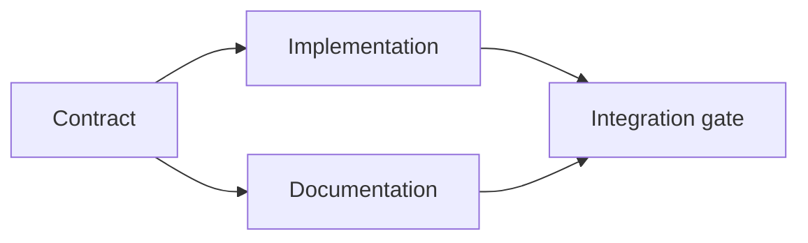

# Hãy xây dựng một kế hoạch hành quyết dựa trên bằng chứng.

> Một kế hoạch không phải là một danh sách phải làm đẹp hơn. Nó là một biểu đồ phụ thuộc trong đó mỗi thay đổi có một lý do và mỗi nút cuối có bằng chứng.

> **【中文解读】**计划不是"看得更好的待办清单", mà là một bản đồ phụ thuộc: mỗi thay đổi có lý do, mỗi kết thúc có lý do.

>  **【前置】**Học tập trước bài học Hãy bắt đầu nắm bắt giai đoạn 14 第 43 课                                                                                                                                                                                                                                                       `outputs/task-frame.md`◊本课产出 `outputs/evidence-plan.json`, sẽ trở thành một hợp đồng ủy thác nhiều đại lý trong bài học 45 .

**Type:** Learn + Build | **类型:** 学习 + 动手实践
**Languages:** Python (stdlib) | **语言:** Python（标准库）
**Prerequisites:** Phase 14 lesson 43 | **前置知识:** Phase 14 第 43 课
**Time:** ~65 minutes | **时间:** 约 65 分钟

## Mục tiêu học tập

- Chuyển đổi một khung nhiệm vụ thành các mục làm việc với bằng chứng và bằng chứng.
  Trung ngữ翻译:把任务框架转化为带证据与证明的工作项.
- Mô hình sắp xếp như phụ thuộc thay vì chuỗi văn.
  Trung ngữ翻译: Sử dụng sự phụ thuộc xây dựng hình thức trước sau, chứ không phải sử dụng散文式叙述.
- Khám phá các sự kiện bị thiếu, phụ thuộc không rõ, và chu kỳ trước khi chỉnh sửa.
  Trung ngữ翻译:在动手编辑之前,检测缺失的事实、未知依赖和循环依赖──
- Các bước riêng biệt có thể chạy cùng nhau từ các bước phải chờ.
  Trung ngữ翻译:区分可以同时运行步骤和必须等待的步骤──

## Tại sao kế hoạch của đại lý thất bại?

Các kế hoạch yếu sẽ lặp lại yêu cầu trong thời gian tương lai:

> 弱计划只是把请求复述成未来时:

1. Tắc lại API.
   Trung文翻译:更新 API。
2. Thêm thêm các xét nghiệm.
   Trung ngữ翻译:加测试──
3. Cập nhật tài liệu.
   Trung văn翻译:更新文档。

Không có gì trong danh sách đó nói về những gì đã được tìm thấy, tại sao các tệp đó là chính xác, hợp đồng nào thay đổi đầu tiên, hoặc những gì có thể xảy ra cùng lúc.

> Trong danh sách này không có câu nào giải thích: tìm ra những gì, tại sao những tài liệu này, những thỏa thuận nào trước đó thay đổi, những bước nào có thể được thực hiện.

> **【中文解读】**弱计划的特征是"复述请求"它看起来有序号,有动词,但没有一个仓库证据――强计划对每个工作项做五个承诺 (见下表):标识符,最小改动,证据,依赖,证明――缺任何一个项目, 代理都会使用自己的默认假设补充,返工在难免――

Một kế hoạch mạnh mẽ đưa ra năm cam kết cho mỗi mục công việc:

| Commitment | Purpose |
|---|---|
| Identifier | Stable reference for dependencies and handoff |
| Change | The smallest behavior or contract change |
| Evidence | Repository facts that justify the change |
| Dependencies | Work that must be true first |
| Proof | The exact check that closes the item |

> **【中文解读】**五个承诺分别是:标识符 (标识符) 转变 (转变) 最小的行为或契约变更 (变更) 证据 (证据) 证明 (转变) 合理仓库事实 (经验) 转变 (经验) 转变 (经验) 转变 (经验) 转变 (经验) 转变 (经验) 转变 (经验) 转变 (经验) 转变 (经验) 转变 (经验) 转变 (经验) 转变 (经验) 转变 (经验) 转变 (经验) 转变 (经验) 转变 (经验) 转变 (经验) 转变 (经验) 转变 (经验) 转变 (经验) 转变 (经验) 转变 (经验) 转变 (经验) 转变 (经验) 转变 (经验) 转变 (经验) 转变 (经验) 转变 (经验) 转变 (经验) 转变 (经验) 转变 (经验) 转变 (经验) 转变 (经验) 转变) 转变 (经验) 转变 (经验) 转变 (经验) 转变) 转变 (经验) 转变 (经验) 转变) 转变 (经验) 转变 (经验) 转变 (经验) 转变 (经验) 转变) 转变 (经验) 转变 (经验) 转变 (经验) 转变) 转变 (经验) 转变 (经验) 变 (经验) 变 (经验) 经验) 经过 (经过) 经过 (经过) 经过) 经过 (经过) 经过 (经过) 经过 (经过) 经过 (经过) 经过) 经过 (经过) 经过 (经过) 经过) 经过 (经过) 经过 (经过) 经过) 经过 (经过)

## Hãy lên kế hoạch hợp đồng trước khi thực hiện.

Khi nhiều bề mặt phụ thuộc vào cùng một hành vi, hãy xác định hành vi trước tiên. Các thử nghiệm, thực hiện, tài liệu và tích hợp sau đó có thể chia sẻ một hợp đồng thay vì phát minh bốn phiên bản.

> Khi nhiều bề mặt phụ thuộc vào cùng một hành vi, trước tiên xác định hành vi tự mình.

>  **【类比】**契约先行像先定国标插头再生产电器.插座厂. 插座厂. 插座厂. 插座厂. 插座厂. 插座厂. 插座厂. 插座厂. 插座厂. 插座厂. 插座厂. 插座厂. 插座厂. 插座厂. 插座厂. 插座厂. 插座厂. 插座厂. 插座厂. 插座厂. 插座厂. 插座厂. 插座厂. 插座厂. 插座厂. 插座厂. 插座厂. 插座厂. 插座厂. 插座厂. 插座厂. 插座厂. 插座厂. 插座厂. 插座厂. 插座厂. 插座厂. 插座. 插座. 插座. 插座. 插座. 插座. 插座. 插座. 插座. 插座. 插座. 插座. 插座. 插座.



Hình đồ họa cho thấy sự đồng thời an toàn. Việc thực hiện và tài liệu có thể tiến hành cùng nhau sau khi hợp đồng được xác định.

> Đây là một bức tranh cho thấy sự phát triển của an ninh. Sau khi thỏa thuận được xác định, việc thực hiện và tài liệu có thể được tiến hành cùng lúc; sự tích hợp cần phải được hoàn thành.

## Bằng chứng thay đổi kế hoạch

Bằng chứng lưu trữ không phải là trang trí. Nó nên có khả năng thay đổi công việc:

> 仓库证据不是装饰品―― nó phải có khả năng thay đổi nội dung công việc:

- Một người trợ giúp hiện có loại bỏ một trừu tượng mới được lên kế hoạch.
  Trung ngữ翻译: một hàm hỗ trợ đã tồn tại, cắt bỏ các chi tiết mới trong kế hoạch.
- Một thử nghiệm tương thích buộc một bước di chuyển.
  Trung ngữ翻译:一个兼容性测试,逼出计划外的迁移步骤──
- Một hạn chế triển khai di chuyển một thay đổi sơ đồ vào một nhiệm vụ khác.
  Trung ngữ翻译: 一部署约束,把方案变更搬进另一个任务.
- Một loại phản ứng công cộng thay đổi thứ tự thực hiện và tài liệu.
  Trung ngữ翻译: một kiểu phản ứng công khai, thay đổi thứ tự trước sau của việc thực hiện và tài liệu.

Nếu bằng chứng không thể thay đổi kế hoạch, nó có lẽ không phải bằng chứng cho quyết định đó.

> Nếu bằng chứng thay đổi không có kế hoạch, nó hầu hết không phải bằng chứng cho quyết định này.

> **【中文解读】**Đây là một tiêu chuẩn giả sử rất hữu ích: đặt "các chứng" bên cạnh quyết định, hỏi" nếu nó ngược lại, kế hoạch sẽ thay đổi không? "

## Thiết kế cho sự gián đoạn

Các phiên lập trình-đại diện kết thúc bất ngờ. Một kế hoạch có thể tiếp tục có các mục làm việc đủ nhỏ để một phiên khác có thể xác định:

> 编码 Đại diện của cuộc họp sẽ bất ngờ kết thúc.

- mục nào hoàn chỉnh;
  中文翻译:哪个工作项已完成;
- bằng chứng nào đã chạy;
  Trung ngữ翻译:哪个证明跑过了;
- những vật liệu nào đã thay đổi;
  中文翻译: 哪些产物变了;
- các thuộc tính nào hiện đã được mở khóa;
  Trung文翻译:哪些依赖已解锁;
- thứ an toàn tiếp theo là gì.
  Trung ngữ翻译: 下一个安全工作项是什么?

Đừng mã hóa trạng thái chỉ trong các hộp kiểm bên trong trò chuyện.

> Đừng chỉ lập trạng thái trong hộp chọn trong hồ sơ trò chuyện. Hãy đặt kế hoạch bên cạnh công việc.

> **【中文解读】**Các chương trình sẽ được thực hiện trong các phiên bản mới, và sẽ được thực hiện trong các phiên bản mới.

## Chuyên gia xác nhận kế hoạch

Thử án trước khi thực hiện khi:

> Trong trường hợp sau đây, trước khi thực hiện, từ chối kế hoạch này:

- Một nhận dạng được sao chép;
  中文翻译:标识符重复;
- một mặt hàng làm việc không có bằng chứng;
  Trung文翻译:某工作项没有证据;
- một mặt hàng làm việc không có bằng chứng;
  Trung ngữ翻译:某个工作项没有证明;
- một sự phụ thuộc đặt tên cho một mục không rõ;
  Trung văn翻译:某个依赖指向不存在的工作项;
- biểu đồ chứa một chu kỳ;
  Trung ngữ翻译:依赖图里有环;
- hành động không thể đảo ngược đầu tiên xảy ra trước khi sự không chắc chắn liên quan được giải quyết.
  Trung ngữ: n n n n n n n n n n n n n n n n n n n n n n n n n n n n n n n n n n n n n n n n n n n n n n n n n n n n n n n n n n n n n n n n n n n n n n n n n n n n n n n n n n n n n n n

Năm kiểm tra đầu tiên là cơ khí, cuối cùng đòi hỏi sự phán xét và nên được gọi rõ ràng.

> Trước đây, kiểm tra là cơ khí. Điều cuối cùng cần sức phán xét, nên được rõ ràng chỉ ra.

> **【中文解读】**六条拒绝规则里藏藏着本课最重要的排序原则:不可逆动作 (không thể đảo ngược) (tránh chuyển, xóa, phát hành, công khai thỏa thuận thay đổi) phải được loại bỏ sau khi không chắc chắn.

## Hãy xây dựng nó.

`code/main.py`mô hình các mục làm việc, xác nhận biên nhận của chúng, tính toán sóng thực hiện với một loại topological, và viết `outputs/evidence-plan.json`- Tôi không biết.

> `code/main.py`建模工作项,校验它们的证据,使用拓排序计算执行波次,并写出`outputs/evidence-plan.json`

Đi chạy:

> 运行:

```bash
python3 code/main.py
python3 -m unittest discover code/tests -v
```

Ví dụ tạo ra ba sóng. định nghĩa hợp đồng chạy trước. thực thi và tài liệu chạy cùng nhau. Cổng tích hợp chạy cuối cùng.

> Trong khi đó, các công ty đã được triển khai để phát triển các công ty.

> **【中文解读】**"Boa" là ứng dụng trực tiếp của quy trình sắp xếp: mỗi một loạt các công việc không phụ thuộc vào nhau, có thể phân chia cho các đại lý khác nhau và hành trình;

## Sử dụng nó với một nhân viên mã hóa với nhân viên mã hóa

Hãy yêu cầu đại lý đưa ra kế hoạch trước khi thay đổi các tệp.

> 让代理在改文件之前先产出计划.

1. Mỗi yêu cầu về đường đi và hành vi đều có biên lai.
   Trung ngữ翻译: Mỗi bài viết có bằng chứng khoán.
2. Mỗi mặt hàng đều có một bằng chứng hoàn thành rõ ràng.
   Trung ngữ翻译: Mỗi công việc có một chứng minh hoàn thành rõ ràng.
3. Chữ đồ họa trì hoãn công việc đắt tiền hoặc không thể đảo ngược cho đến khi sự không chắc chắn mà nó phụ thuộc vào được giải quyết.
   Trung ngữ翻译: phụ thuộc vào việc làm đắt tiền hoặc không thể đảo ngược, trễ cho đến khi sự không chắc chắn phụ thuộc vào nó được giải quyết.

Hãy chấp thuận kế hoạch, không phải là lời hứa mơ hồ để cẩn thận.

> Ưu tiên của tôi là kế hoạch này, không phải là một câu "I'll take my heart"

## Tập luyện.

1. Thêm một mục di cư đòi hỏi sự chấp thuận của con người rõ ràng.
   Trung ngữ翻译:加一个需要人工显然批准的迁移工作项.
2. Tạo một chu kỳ và giải thích sự bất đồng sản phẩm ẩn đằng sau nó.
   Trung ngữ翻译: tạo ra một vòng tròn phụ thuộc,并 giải thích nó đằng sau sự phân chia của sản phẩm ẩn.
3. Chia một mục có hai lệnh chứng minh.
   Trung ngữ翻译:把一个带两条证明命令的工作项拆开.
4. Thêm một mục làm việc có thể chạy trong sóng thứ hai mà không chạm vào bất kỳ nhánh hiện có.
   Trung ngữ翻译:加一个可以在第二波运行、且不触碰两条现有分支工作项──
5. Đưa kế hoạch như Markdown trong khi giữ JSON như là nguồn của sự thật.
   Trung文翻译:把计划染成 Markdown, đồng thời giữ JSON 作为唯一事实来源──

## Xem thêm 延伸阅读

- [Nuseibeh and Easterbrook, Requirements Engineering: A Roadmap](https://www.cs.toronto.edu/~sme/papers/2000/ICSE2000.pdf), cho mối quan hệ lặp lại giữa mục tiêu, đặc điểm, sự đồng thuận và tiến hóa.
  Trung ngữ翻译:Nuseibeh và Easterbrook 需求工程:路线图目标、规格、共识与演化之间的代关系。
- [Barry Boehm, A Spiral Model of Software Development and Enhancement](https://dl.acm.org/doi/10.1145/12944.12948), để sắp xếp phát triển xung quanh giải quyết rủi ro thay vì một chuỗi tuyến tính cố định.
  Trung ngữ翻译:Barry Boehm 软件开发的螺旋模型围绕风险消解而不是固定线性顺序来安排开发

## Những gì bạn giữ lại, những gì bạn giữ lại là sản phẩm

Cứ giữ lại`outputs/evidence-plan.json`Nó sẽ trở thành hợp đồng ủy nhiệm trong bài học tiếp theo.

> Bảo trì`outputs/evidence-plan.json` Nó sẽ trở thành một hiệp ước ủy thác trong next class 
