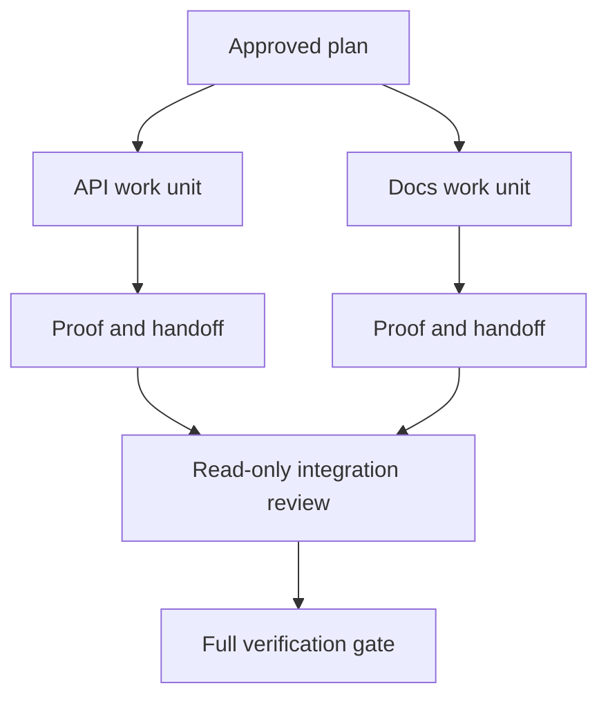

# Đại diện làm việc với hợp đồng cách ly và hợp đồng hợp nhất

> Các đại lý song song chỉ tiết kiệm thời gian tường khi công việc độc lập. Nếu không họ chuyển đổi một nhiệm vụ rõ ràng thành một vấn đề phối hợp với tỷ lệ thất bại nhanh hơn.

> **【中文解读】**Và hành trình đại lý chỉ có thể tiết kiệm thời gian khi thực sự độc lập trong công việc; nếu không nó biến một nhiệm vụ rõ ràng thành một vấn đề phối hợp, và thất bại nhanh hơn.

>  **【前置】**Học tập trước bài học hãy nắm bắt giai đoạn 14 Chương 39 ️️️️️️️️️️️️️️️️️️️️️️️️️️️️️️️️️️️️️️️️️️️️️️️️️️️️️️️️️️️️️️️️️️️️️️️️️️️️️️️️️️️️️️️️️️️️️️️️️️️️️️️️️️️️️️️️️️️️️️️️️️️️️️️️️️️️️️️️️️️️️️️️️️️️️️️️️️️️️️️️️️️️️️️️️️️️️️️️️️️️️️️️️️️️️️️️️️️️️️️️️️️️️️️️️️️️️️️️️️️️️️️️️️️️️️️️️️️️️️️️️️️️️️️️️️️️️️️️️️️️️️️️️️️️️️️️️️️️️️️️️️️️️️️️️️️️️️️️️️️️️️️️️️️️️️️️️️️️️️️️️️️️️️️️️️️️️️️️️️️️️️️️️️️️️️️️️️️️️️️️️️️️️️️️️️️️️️️️️️️️️️️️️️️️️️️️️️️️️️️️️️️️️️️️️️️️️️️️️️️️️️️️️️️️️️️️️️️️️️️️️️️️️️️️️️️️️️️️️️️️️️️️️️️️️️️️️️️️️️️️️️️️️️️️️️️️️️️`outputs/evidence-plan.json`, trong đó các hành động tiếp theo trực tiếp quyết định những người lao động có thể làm việc cùng)`outputs/delegation-plan.json`, ghi lại phân chia vì sao an toàn, đường đến ai, tập hợp để nhận bằng chứng.

**Type:** Learn + Build | **类型:** 学习 + 动手实践
**Languages:** Python (stdlib) | **语言:** Python（标准库）
**Prerequisites:** Phase 14 lessons 39 and 44 | **前置知识:** Phase 14 第 39、44 课
**Time:** ~70 minutes | **时间:** 约 70 分钟

## Mục tiêu học tập

- Quyết định liệu việc ủy quyền có được biện minh bởi sự độc lập thực sự hay không.
  Trung文翻译:判断委托是否被真实独立性所支──
- Cho mỗi công nhân sở hữu tài liệu độc quyền và chứng minh rõ ràng.
  Trung ngữ翻译: Đưa cho mỗi công nhân quyền sở hữu và chứng minh rõ ràng của tài liệu độc quyền.
- Lập sóng thực hiện tính toán từ các phụ thuộc.
  Trung ngữ翻译:从依赖关系计算执行波次――
- Thiết kế hợp đồng hợp nhất để kết hợp công việc của đại lý một cách an toàn.
  Trung ngữ翻译:设计一个安全合并 Agent 工作的合并契约。

## Thử nghiệm song song và không đi kiểm tra

Không ủy quyền vì có nhiều đại lý hơn.

> Đừng vì "có nhiều đại lý có thể sử dụng" được ủy thác. Khi dưới đây ít nhất một điều được ủy thác:

- hai cuộc điều tra có thể trả lời các câu hỏi khác nhau một cách độc lập;
  Trung文翻译:两项调查能独立回答不同的未知项;
- hai tổ chức thực hiện có hồ sơ và hợp đồng không liên kết;
  Trung文翻译: hai thực hiện có văn bản và hiệp ước không tương quan với nhau;
- Một nhà kiểm tra có thể kiểm tra một đồ tạo vật hoàn thành mà không thay đổi nó;
  Trung văn翻译: một thẩm phán có thể kiểm tra sản phẩm đã hoàn thành mà không sửa đổi nó;
- Một kiểm tra bên ngoài chậm có thể chạy trong khi công việc địa phương tiếp tục.
  Trung ngữ翻译: một kiểm tra bên ngoài chậm có thể được thực hiện trong công việc địa phương tiếp tục.

Giữ việc liên tục khi các nhân viên cần cùng các tệp, cùng một quyết định chưa được giải quyết, hoặc cùng một môi trường thay đổi.

> Khi nhiều đại lý cần cùng một tài liệu, cùng một quyết định chưa quyết định hoặc cùng một môi trường thay đổi, giữ liên kết.

> **【中文解读】**"Tử nghiệm đồng hành" là câu đầu tiên của bài học này: khả dụng không phải là lý do, độc lập chỉ là.

## Một đơn vị làm việc là một hợp đồng.

Mỗi đơn vị được ủy quyền cần:

> Mỗi đơn vị được ủy thác cần:

| Field | Meaning |
|---|---|
| Goal | One observable result |
| Owner | One accountable worker |
| Paths | Exclusive write ownership |
| Dependencies | Completed units required before starting |
| Proof | Exact evidence returned to the integrator |
| Handoff | Files changed, decisions made, remaining risk |

> **【中文解读】**六段里最关键的是 Paths (独占写所有权) 和 Proof (交回集成人确实证据) "搞定后端"之所以不合格,是因为它既没有独占的路径,也没有可接受的证据责任不能落在一个工人头上.                                                                                                                                                                                                                         

Handling the backend không phải là một đơn vị làm việc.  Thực hiện kiểm tra trùng lặp `app/accounts.py`và chứng minh nó bằng bài kiểm tra tài khoản tập trung

> "Hãy làm việc" không phải là một đơn vị.`app/accounts.py`里实现重复检查,并使用聚焦的账户测试证明它""才是.

## Trẻ lập có ba tầng.

1. **Filesystem isolation:**cây làm việc hoặc hộp cát riêng biệt ngăn chặn việc chỉnh sửa chung tình cờ.
   Trung ngữ翻译:**文件系统隔离：**独立工作树或沙箱防止意外的共享编辑──
2. **Ownership isolation:**hợp đồng ngăn cản hai công nhân cố tình chỉnh sửa cùng một con đường.
   Trung ngữ翻译:**所有权隔离：**契约 ngăn chặn hai công nhân có ý định biên tập cùng đường.
3. **State isolation:**Các hồ sơ và kết quả khác nhau ngăn cản một công nhân ghi lại bằng chứng của công nhân khác.
   Trung ngữ翻译:**状态隔离：**独立日志与输出 ngăn chặn một công nhân 覆盖另一员工证据──

Việc tách biệt hệ thống tập tin không giải quyết quyền sở hữu. Hai cây làm việc sạch vẫn có thể tạo ra các thiết kế mâu thuẫn. Hợp đồng hợp nhất phải giải quyết giao diện chia sẻ trước khi bắt đầu công việc.

> 文件系统隔离解决不了所有权问题――两个干净的工作树 仍然可能产生相互冲突的设计――合并契约必须在开工之前就定定共享接口――

> **【中文解读】**Ba tầng chia rẽ thường bị nhầm nghĩ là "đánh thành cây làm việc ngay lập tức hoàn thành"―― nhưng cây làm việc chỉ phòng chống lại tai nạn bất ngờ, phòng không hai công nhân trong các cuộc xung đột khác nhau.



> 图解: kế hoạch đã được phê duyệt tách ra thành hai đơn vị làm việc, mỗi đơn vị trao đổi chứng chỉ và thông báo giao tiếp; người tập hợp làm trước chỉ đọc đánh giá, cuối cùng vận hành toàn bộ chứng chỉ.

## Người tích hợp không xây dựng lại công việc.

Người tích hợp nên:

> 集成者应该:

1. xác nhận mỗi giao hàng phù hợp với phạm vi giao dịch;
   Trung文翻译: xác nhận mỗi phần liên kết phù hợp với phạm vi phân phối của nó;
2. đọc kết quả bằng chứng, không chỉ tổng kết của người lao động;
   Trung文翻译:读证明输出本身,而不只是工人的总结;
3. kết hợp các thay đổi trong trật tự phụ thuộc;
   Trung文翻译:按依序合并改动;
4. chạy toàn bộ cổng chéo đơn vị;
   Trung文翻译:运行完整的跨单元验证门;
5. từ chối mở rộng phạm vi ẩn;
   Trung văn翻译:拒绝隐藏的范围扩张;
6. ghi lại xung đột như những quyết định mới, không phải sửa đổi im lặng.
   Trung ngữ翻译:把冲突记录为新决定,而不是改掉──

Nếu việc tích hợp đòi hỏi phải viết lại hầu hết kết quả của người lao động, sự phân hủy ban đầu là sai.

> Nếu tập hợp cần viết lại phần lớn kết quả của người lao động, giải thích phân tích ban đầu là sai lầm.

> **【中文解读】**Vai trò của người tích hợp là "người nhận", không phải "người chọn bổ刀"[6].

## Nhân vật và nhân viên vai trò

Việc ủy quyền không loại bỏ phán đoán của con người. Con người vẫn sở hữu những lựa chọn thay đổi hành vi công chúng, rủi ro, thẩm quyền hoặc chi phí không thể đảo ngược.

> 委托 không thay thế phán quyết của người khác. Người ta tiếp tục có những lựa chọn sẽ thay đổi hành vi công khai, rủi ro, quyền hoặc không thể đảo ngược.

Đây là tự trị chuẩn hóa: hệ thống cho phép tự do khi bằng chứng và sự quay lại mạnh mẽ, và đòi hỏi một điểm kiểm soát khi hậu quả cao.

> Đây là quyền tự chủ của việc chuẩn bị: hệ thống có quyền tự chủ trong chứng cứ và khả năng quay lại mạnh mẽ, trong các kết quả nghiêm trọng của các kết quả.

> **【中文解读】**"Tự chủ chuẩn bị" là giá trị của bài học này: mức độ tự chủ không phải là越高越好, mà nên tương đương với "cực lượng bằng chứng × có thể xoay" thành正比──低风险可回滚的(跑测试、查代码) Mặc dù được phép;高风险不可逆的(删数据、发布、改公开契约) phải để lại điểm kiểm tra── đây cũng là "tự chủ thời gian" không biến thành "tự chấp nhận sai lầm lớn"

## Hãy xây dựng nó.

Phòng thí nghiệm kiểm tra đường dẫn chồng chéo, xác nhận sự phụ thuộc, tính toán sóng thực hiện an toàn, và viết `outputs/delegation-plan.json`- Tôi không biết.

> 实验部分会检查路径重叠、校验依赖、计算安全的执行波次,并写出 `outputs/delegation-plan.json`

Đi chạy:

> 运行:

```bash
python3 code/main.py
python3 -m unittest discover code/tests -v
```

Thay đổi đơn vị tài liệu để sở hữu `app/`Kế hoạch nên bị chặn bởi vì con đường gốc này chồng chéo với đơn vị API.

> Để tài liệu đơn vị chuyển thành sở hữu`app/`◊ kế hoạch nên bị chặn, vì đường dẫn này với API  đơn vị chồng lên.

> **【中文解读】**破坏实验 把 docs 单元所有权改成 `app/`) thể hiện là cơ chế hóa của sự tách biệt quyền sở hữu: đường lối chồng lên không dựa trên bản thân, dựa trên các máy kiểm tra trực tiếp từ chối.

## Tập luyện.

1. Phân hủy một thay đổi thực sự thành hai đơn vị làm việc độc lập và một bộ tích hợp.
   Trung ngữ翻译:把一个真实改动分解成两个独立工作单元和一个集成者.
2. Tìm một phân chia song song được đề xuất mà chỉ có vẻ độc lập.
   Tìm một chỉ nhìn ra độc lập và chia rẽ các kế hoạch, nói ra nó chia sẻ quyết định.
3. Thêm một nhân viên nghiên cứu chỉ đọc mà sản lượng của nó là một bảng thực tế.
   Trung ngữ翻译:加一个只读的调研工人, kết quả là một thực tế表.
4. Thêm một cổng kết hợp kiểm tra tập tin thay đổi cuối cùng với tất cả các hợp đồng đơn vị.
   Trung ngữ翻译:加一个合并门:把最终改动文件集合与所有单元契约逐一核对.
5. Định nghĩa một quy tắc hủy bỏ cho một công nhân mà sự phụ thuộc trở nên vô hiệu.
   Trung文翻译:为一个依赖失效的工人 定义取消规则──

## Xem thêm 延伸阅读

- [Reid Smith, The Contract Net Protocol](https://doi.org/10.1109/TC.1980.1675516), để xử lý chính thức sớm về phân bổ nhiệm vụ phân chia và báo cáo kết quả.
  Trung ngữ翻译:Reid Smith契约网协议分布式任务分配与结果汇报的早期形式化处理,本课"工作单元即契约"的思想源头──
- [Eric Horvitz, Principles of Mixed-Initiative User Interfaces](https://dl.acm.org/doi/10.1145/302979.303030), để quyết định khi nào tự động hóa nên hoạt động và khi nào nó nên trả lại sự kiểm soát cho một người.
  Trung ngữ翻译:Eric Horvitz混合主动界面的原则决定自动化何时该行动何时该交权归还人,即"校准的自主权"的出处.

## Những gì bạn giữ lại, những gì bạn giữ lại là sản phẩm

Cứ giữ lại`outputs/delegation-plan.json`Nó ghi lại lý do tại sao sự chia rẽ là an toàn, ai sở hữu mỗi con đường, và bằng chứng tích hợp phải nhận được.

> Bảo trì`outputs/delegation-plan.json`Nó ghi lại lý do tại sao sự phân chia này là an toàn, mỗi con đường trở lại với ai, cũng như sự tích hợp phải nhận được bằng chứng gì.
