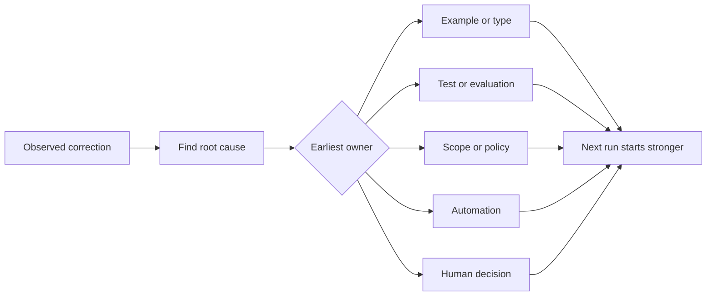

# Hãy biến mọi sự sửa chữa của nhân viên thành một cải tiến hệ thống

> Một sửa đổi chỉ tồn tại trong trò chuyện sửa chữa một lần chạy. Một sửa đổi được quảng bá thành một bài kiểm tra, ranh giới, ví dụ hoặc công cụ cải thiện mỗi lần chạy sau đó.

> **【中文解读】**Chỉ sống trong hồ sơ trò chuyện, chỉ sửa một lần chạy; được nâng cấp thành kiểm tra, biên giới, ví dụ hoặc công cụ sửa chữa, mỗi lần chạy sau khi cải thiện.

>  **【前置】**Học tập trước bài học Chương 37-41                                                                                                                                                                                                                                                           `outputs/feedback-ratchet.json`, nó là tương lai làm việc thay đổi đầu vào.

**Type:** Learn + Build | **类型:** 学习 + 动手实践
**Languages:** Python (stdlib) | **语言:** Python（标准库）
**Prerequisites:** Phase 14 lessons 37 to 41 | **前置知识:** Phase 14 第 37-41 课
**Time:** ~65 minutes | **时间:** 约 65 分钟

## Mục tiêu học tập

- Chuyển đổi các điều chỉnh của chất độc thành điều khiển bền.
  Trung ngữ翻译:把对代理的纠正转化为持久的控制手段──
- Đặt mỗi điều khiển ở lớp sớm nhất có thể ngăn ngừa tái phát.
  Trung ngữ翻译:把每个控制放在能预防复发的最早一层――
- Tăng lại các bài học lặp đi lặp lại với dấu vân tay ổn định.
  Trung文翻译: dùng dấu chân vững chắc để lặp lại bài học để lặp lại.
- Tắt kiểm soát không còn bảo vệ rủi ro thực sự.
  Trung ngữ翻译:退役那些不再保护真实风险的控制──

## Sự sửa chữa là bằng chứng.

Khi bạn nói với một đại lý không chỉnh sửa tập tin đó, bạn đã học được rằng giới hạn phạm vi không thể thực hiện. Khi bạn nói  hình thức đầu ra này là sai, bạn đã học được rằng một ví dụ hoặc thử nghiệm bị thiếu. Khi thiết lập thất bại một lần nữa, bạn đã học được rằng kiến thức môi trường thuộc về tự động hóa.

> Khi bạn nói với đại lý rằng "Điều gì thay đổi tài liệu đó"", bạn học được: phạm vi biên giới không thể thực hiện được. Khi bạn nói rằng "Hình thức xuất này không đúng", bạn học được: thiếu một ví dụ hoặc thử nghiệm. Khi môi trường xây dựng thất bại một lần nữa, bạn học được: kiến thức môi trường nên tự động hóa.

Hãy coi sự sửa chữa như một quan sát về hệ thống làm việc, chứ không phải là một sự thất bại trong việc viết.

> Hãy sửa chữa đúng cách để quan sát hệ thống làm việc, chứ không phải là một lần nhanh chóng  viết thất bại.

> **【中文解读】**Bài này đã thay đổi quan điểm: mỗi lần sửa chữa là một hệ thống báo cáo lỗ hổng của mình "đường biên không thể thực hiện" "ví dụ thiếu hụt" "knowledge without fall-over"......

## Thăng cấp lên lớp hiệu quả sớm nhất

Sử dụng thứ tự này:

> 按这个顺序升级:

| Recurring failure | Durable destination |
|---|---|
| Wrong result or regression | Test or evaluation |
| Off-scope or unsafe action | Scope or permission policy |
| Repeated setup or command mistake | Automation or tool |
| Repeated output-format mistake | Canonical example plus validator |
| Ambiguous local convention | Instruction with a scenario check |
| Product disagreement | Human decision record |

Các kiểm soát trước đó rẻ hơn. Một loại ngăn chặn trạng thái không hợp lệ mạnh hơn bình luận đánh giá mà nhận được nó sau đó. Một bài kiểm tra tập trung mạnh hơn một đoạn yêu cầu người đại lý nhớ.

> 越早的控制越便宜── một loại ngăn chặn tình trạng bất hợp pháp xuất hiện,强过一条事后才抓住它的评审评论── một bài kiểm tra tập trung,强过一段求代理"记住"文字──

> **【中文解读】**Bảng này là bảng quyết định cốt lõi của bài học này: kết quả lỗi nâng cấp cho thử nghiệm/ đánh giá; vượt biên nâng cấp cho phạm vi/ quyền hạn chiến lược; lặp lại đạp môi trường thối nâng cấp cho tự động hóa; định dạng lỗi nâng cấp cho quy định ví dụ thêm máy kiểm tra; định nghĩa bao gồm nâng cấp cho kiểm tra cảnh; sản phẩm phân biệt nâng cấp cho quyết định nhân tạo ghi chép.



> 图解: quan sát để sửa chữa → 找根因 → 判定最早的责任层(ví dụ/类型、测试/评估、范围/策略、自动化、人工决定)→ lần tiếp theo vận hành từ điểm khởi đầu mạnh hơn bắt đầu。

## - Nhận dạng của Ratchet.

Tận bắt:

> 记录这些字段:

- triệu chứng;
  中文翻译: triệu chứng;
- Nguyên nhân gốc rễ;
  中文翻译:根因;
- hậu quả;
  中文翻译:后果;
- số lần tái phát;
  Trung văn翻译:复发次数;
- kiểm soát được lựa chọn;
  中文翻译: chọn định kiểm soát;
- xác minh để kiểm soát;
  Trung文翻译: kiểm soát cách kiểm chứng bản thân;
- chủ sở hữu;
  Trung văn翻译:负责人;
- ngày để xem xét hoặc nghỉ hưu.
  Trung ngữ翻译:复审或退役日期。

Không khuyến khích mọi ưu tiên một lần, khuyến khích một sự điều chỉnh khi tái phát hoặc hậu quả biện minh cho sự phức tạp vĩnh viễn.

> Đừng nâng cấp từng lần ưu tiên một lần. Chỉ khi số lần lặp lại hoặc hậu quả nghiêm trọng đến mức đáng để đưa ra sự phức tạp vĩnh viễn, mới nâng cấp điều này được sửa chữa.

> **【中文解读】**Trong 8 đoạn, " kiểm soát bản thân bằng chứng" và "trong thời hạn nghỉ hưu" dễ bị bỏ qua nhất. Người ta bảo đảm rằng điều này thực sự ngăn chặn được. Người ta thừa nhận rằng kiểm soát có tuổi thọ.

>  **【类比】**棘轮手像一个只不跌的储蓄──之前: 每次纠正都从零开始、说完就忘;之后: 每次纠正都推动轮单向前进一格 (((一条可验证的控制), hệ thống chỉ sẽ变强, sẽ không quay trở lại。

## Đánh biệt nguyên nhân từ triệu chứng  phân biệt nguyên nhân và triệu chứng

Đại lý được chỉnh sửa README là một triệu chứng.

> "Đại lý 改了 README" là triệu chứng.

- nhiệm vụ cho phép nguồn kho;
  Trung文翻译: nhiệm vụ cho phép thư mục kho;
- Docs được xem là an toàn;
  Trung文翻译:文档被默认当作安全区;
- thực hiện và tài liệu kế hoạch được kết hợp;
  Trung ngữ翻译: plan把实现和文档捆绑在一起;
- Hai công nhân có quyền sở hữu chồng chéo.
  Trung文翻译: quyền sở hữu của hai công nhân có chồng lên.

Mỗi nguyên nhân thuộc về một điều khiển khác nhau. Một quy tắc chỉ lặp lại triệu chứng sẽ thất bại trong trường hợp tiếp theo khác nhau một chút.

> Mỗi nguyên nhân có thể kiểm soát khác nhau. Chỉ cần lặp lại các quy tắc của các triệu chứng, trong một tình huống khác nhau một chút lần sau đó sẽ không hiệu quả.

> **【中文解读】**Đây là một bước dễ dàng nhất: viết "Buy ReadME" thành quy tắc dễ dàng, tìm ra "Tại sao nó sẽ được thay đổi" khó khăn. Nhưng bốn nguyên nhân có thể chỉ ra bốn cách khác nhau sửa đổi  khép lại cho phép đường dẫn  rõ ràng lập ra cấm đường dẫn  chia kế hoạch  sửa lại quyền sở hữu  toàn thành và "README"

## Các điều khiển cũng sẽ bị hư hỏng.

Các điều khiển cũ có thể xung đột, làm phồng xung quanh và mã hóa một hệ thống không còn tồn tại nữa.

> 旧控制会相互冲突、大上下文、并固化一个已经不存在的系统──每条升级过的规则都需要退役检查──当下列情况出现时,删除或重写它:

- Kiến trúc cơ bản đã thay đổi;
  Trung văn翻译: cấu trúc tầng dưới đã biến đổi;
- Một điều khiển thực thi mạnh hơn đã thay thế nó;
  Trung ngữ翻译:更强的可执行控制取代了它;
- lỗi không tái diễn trong một khoảng thời gian có ý nghĩa;
  Trung ngữ翻译: trong một cái cửa sổ thời gian có ý nghĩa故障再未复发;
- điều khiển tạo ra nhiều xung đột hơn là rủi ro mà nó ngăn chặn.
  Trung ngữ翻译: kiểm soát các xung đột của sản xuất đã vượt qua nó phòng chống của cư trú风险.

Mục tiêu không phải là tập tin hướng dẫn dài nhất mà là hệ thống nhỏ nhất để giữ lại sự phán xét khó khăn.

> 目标 không phải là tài liệu chỉ thị dài nhất, mà là hệ thống ít nhất của khả năng phán đoán để bảo tồn.

> **【中文解读】**棘轮只进不退,但控制会过期──" Mỗi quy tắc phải có kiểm tra退役" với các mục tiêu của các tài liệu như AGENTS.md:

## Hãy xây dựng nó.

Phòng thí nghiệm phân loại các sửa chữa, quảng bá chúng thành các kiểm soát, ghi lại dấu vân tay, và viết `outputs/feedback-ratchet.json`- Tôi không biết.

> Phần thí nghiệm sẽ làm cho các phân loại sửa chữa, nâng cấp chúng để kiểm soát, sử dụng dấu vân tay để cân nhắc, và viết ra`outputs/feedback-ratchet.json`

Đi chạy:

> 运行:

```bash
python3 code/main.py
python3 -m unittest discover code/tests -v
```

Thêm hai sửa chữa có định dạng khác nhau với cùng một nguyên nhân. Cải thiện bình thường hóa cho đến khi chúng sụp đổ thành một điều khiển mà không sụp đổ các thất bại không liên quan.

> 加入两条措辞不同但根因相同的纠正──改进归化逻辑,直到它们合并成为一个控制,同时不让无关失败被错合并──

> **【中文解读】**破坏实验演示 指纹重重的关键张力:归一化太松,同一根因的两条纠正各立一条控制;太紧,无关失败被错合并(误伤) ・重重的点是根因,不是措辞

## Tập luyện.

1. Hãy lấy 5 sửa đổi từ một phiên mã hóa gần đây và phân loại chủ sở hữu thực sự của chúng.
   Từ một lần gần đây 编码会话里取五条纠正,分类它们的真正责任层.
2. Thay thế một quy tắc bằng một bài kiểm tra có thể thực hiện.
   Trung文翻译:把一条文字规则替换成一个可执行的测试──
3. Thêm trọng lượng hậu quả để có thể thúc đẩy một sự xuất hiện đầu tiên nghiêm trọng ngay lập tức.
   Trung ngữ翻译:加后果权重,让严重的第一次发生可以立即升级──
4. Thêm một chủ sở hữu và ngày nghỉ hưu vào sản xuất phòng thí nghiệm.
   Trung ngữ翻译:给实验输出加上负责人和退役日期。
5. Xem lại một hướng dẫn của một đại lý hiện có và xóa nó chỉ sau khi chứng minh rằng có một kiểm soát mạnh hơn.
   Trung ngữ翻译:审查一条现有代理指令, chỉ có thể xóa nó sau khi chứng minh có kiểm soát mạnh hơn.

## Xem thêm 延伸阅读

- [Basili, Caldiera, and Rombach, The Goal Question Metric Approach](https://www.cs.toronto.edu/~sme/CSC444F/handouts/GQM-paper.pdf), để biến mục tiêu thành câu hỏi và các phép đo hoạt động.
  Trung文翻译:Basili、Caldiera 与 Rombach目标问题量法把目标转化为问题和可操作的量量──
- [Shinn et al., Reflexion](https://arxiv.org/abs/2303.11366), để sử dụng dấu vết phản hồi để cải thiện các quyết định sau đó mà không thay đổi trọng lượng mô hình.
  Trung文翻译:Shinn 等Reflection用反轨迹改进后续决策而不改动模型权重──
- [Madaan et al., Self-Refine](https://arxiv.org/abs/2303.17651), cho phản hồi lặp lại và sửa đổi bên trong vòng lặp nhiệm vụ.
  Trung文翻译:Madaan 等Self-Refine nhiệm vụ vòng lặp bên trong của代反与修订。

## Những gì bạn giữ lại, những gì bạn giữ lại là sản phẩm

Cứ giữ lại`outputs/feedback-ratchet.json`Nó là kết thúc lâu dài của con đường kỹ thuật hỗ trợ nhân viên và đầu vào các thay đổi trong tương lai.

> Bảo trì`outputs/feedback-ratchet.json`Nó là điểm cuối cùng lâu dài của tuyến đường "Công viên hỗ trợ công nghiệp", cũng là bước vào trong quá trình chuyển động của công ty trong tương lai.
