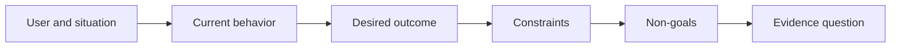

# Định nghĩa kết quả trước khi bạn chọn kết quả đầu ra

> Việc thực hiện nhanh sẽ làm tăng hình phạt cho việc chọn sai vấn đề.

> **【中文解读】**" sản xuất " (output) là những gì bạn quyết định xây dựng (what you decide to build) một trợ lý, một trang, một mô hình; " kết quả " (output) là những thay đổi có thể quan sát được trên thế giới.

>  **【前置】**无硬性前置课程──本课是 47-54 课程"塑造构建"路径(结果定义 → 工作流发现 → 假设与风险 → 最小切片 → 规格 → 指标 → 分阶段发布 → 反所有权) 的起点──

**Type:** Learn + Build | **类型:** 学习 + 动手实践
**Languages:** Python (stdlib) | **语言:** Python（标准库）
**Prerequisites:** None | **前置知识:** 无
**Time:** ~60 minutes | **时间:** 约 60 分钟

## Mục tiêu học tập

- Viết một khung kết quả mà không đặt tên cho giải pháp.
  Trung ngữ翻译:写出一个不点名任何解决方案的结果框架.
- Xác định người dùng, tình huống, hành vi hiện tại và thay đổi mong muốn.
  Trung文翻译:识别用户、情境、当前行为和期望的改变──
- Định rõ ràng các hạn chế và không mục tiêu.
  Trung ngữ翻译:把约束和非目标写明确──
- Khám phá rò rỉ dung dịch trước khi nó cứng vào phạm vi.
  Trung ngữ翻译: 在解决方案泄漏硬化成范围之前检测到它──

## Kết quả không phải là kết quả.

Xây dựng trợ lý xảy ra sự cố đặt tên cho một đầu ra. Nó không nói ai cần nó, điều gì sẽ trở nên tốt hơn, hoặc điều gì phải được bảo vệ.

> "Mở một trợ lý tai nạn" là một sản phẩm xuất. Nó không nói ai cần nó, điều gì sẽ thay đổi tốt, điều gì phải giữ an toàn.

Một khung kết quả nói:

> 结果框架 nói:

> Khi một cảnh báo sản xuất đến, kỹ sư đang gọi xác định dịch vụ thất bại và hành động an toàn tiếp theo trong vòng hai phút, trong khi chẩn đoán vẫn chỉ được đọc và kiểm toán.

> 译文: Khi báo cáo sản xuất đến, kỹ sư có thể trong hai phút xác định tình trạng cố tình và tìm ra một động thái tiếp theo an toàn, đồng thời chẩn đoán toàn bộ quá trình chỉ được đọc và kiểm tra.

Câu đó có thể được thỏa mãn bằng phần mềm, sổ chạy, sửa chữa dữ liệu, hoặc thay đổi giao diện nhỏ hơn. Nó giữ cho nhóm gắn bó với kết quả thay vì tạo vật đầu tiên mà ai đó tưởng tượng.

> Câu này có thể được thực hiện bởi một phần mềm, một cuốn sách vận hành, một lần sửa dữ liệu hoặc một giao diện nhỏ hơn để đáp ứng. Nó cho phép nhóm tập trung vào kết quả, chứ không phải tập trung vào sản phẩm mà ai đó nghĩ ra trước tiên.

> **【中文解读】**Sự khác biệt giữa sản xuất và kết quả là nền tảng của bài học này: sản xuất chỉ là một lối vào giải thích không gian, kết quả là điểm cuối cùng để đến.

## Quang hình 6 phần

| Part | Question |
|---|---|
| User | Who experiences the problem directly? |
| Situation | When and where does it occur? |
| Current behavior | What happens today, including workarounds? |
| Desired outcome | What observable state should improve? |
| Constraints | Which safety, policy, cost, or compatibility limits are fixed? |
| Non-goals | What tempting adjacent work is excluded? |



> 图解: user与情境 → 当前行为 → 期望结果 → 约束 → 非目标 → 证据问题,六段依序收紧。

> **【中文解读】**六段是有序的: trước người và tình huống,才谈到行为;先看清现状 (bao gồm các phương pháp bỏ qua hiện tại),才谈到改变;约束收紧解空间, không có mục tiêu 住顺手的诱惑,最后落到" những gì quan sát có thể chứng minh kết quả đạt được"......

## Tìm giải pháp rò rỉ tìm ra giải pháp rò rỉ

Các tuyên bố kết quả rò rỉ các giải pháp khi chúng chứa một hình thức sản phẩm, giao diện, lựa chọn mô hình, khung hoặc kiến trúc không được thu được bằng chứng.

> Khi kết quả được trình bày trong bao gồm các hình dạng, giao diện, lựa chọn mô hình, khung hoặc cấu trúc sản phẩm chưa được chứng minh, giải pháp đã bị rò rỉ.

- Người dùng nhận được một bản tóm tắt AI hàng tuần rò rỉ bản tóm tắt và thời gian.
  Trung ngữ翻译::" Người dùng mỗi tuần nhận được một bản tóm tắt AI" đã phát tán "chốt truyện" và "hằng tuần" này.
- Người dùng hiểu được những thay đổi tài khoản trước khi phê duyệt tuyên bố kết quả.
  Trung ngữ翻译::"user在批准前理解账户变更"陈述结果──
- Dân dụng cơ sở dữ liệu vector rò rỉ cơ sở hạ tầng.
  Trung ngữ: "Lập trình một cơ sở dữ liệu khối lượng" đã rò rỉ cơ sở hạ tầng.
- Các bằng chứng chính sách có liên quan có sẵn trong quá trình xem xét tuyên bố khả năng.
  Trung ngữ翻译:"Hình thức của việc đánh giá có thể nhận được chứng cứ chính sách liên quan"

Các hạn chế có thể đặt tên công nghệ khi sự tương thích thực sự sửa chữa nó.

> Khi tính hợp nhất thực sự bị khóa khi chọn kỹ thuật, bạn có thể đặt tên kỹ thuật.

> **【中文解读】**漏洞检测的判定:句子里出现了"产品形态/界面/模型/框架/架构"级别的词语(AI 摘要、向量库、App),而它还没有得到证据,就是漏洞.

## Các hạn chế bảo vệ kết quả

Các hạn chế không phải là chi tiết thực hiện.

> 约束 không phải là để thực hiện các chi tiết.

- Không có sản phẩm nào viết trong quá trình chẩn đoán;
  Trung文翻译:诊断期间不写生产库;
- phản ứng trong ngân sách thời gian xảy ra sự cố;
  Trung文翻译: trong ngân sách thời gian tai nạn;
- Các sự kiện kiểm toán hiện có vẫn có thẩm quyền;
  Trung文翻译: hiện存审计事件保持权威性;
- Không có sự phụ thuộc thời gian chạy mới;
  Trung文翻译:不引入新运行时依赖;
- Hành vi tiếp cận vẫn còn nguyên vẹn.
  Trung文翻译:无障碍行为保持完好──

Một công trình xây dựng đạt được kết quả bằng cách vi phạm một hạn chế đã không đạt được kết quả.

> Một xây dựng dựa trên trái quy tắc đã đến, không có kết quả thực sự đến.

> **【中文解读】**约束写在结果框架里而不是 PR 描述里,原因是最后句: 违约约的"成功"不算成功.

## Không mục tiêu tạo ra một ranh giới

Những mục tiêu không có mục tiêu ngăn chặn một mảnh hữu ích trở thành một nền tảng.

> Không mục tiêu ngăn chặn một mảnh hữu ích phát triển thành một nền tảng.

- Không có sự khắc phục tự động;
  Trung文翻译:不做自动修复;
- Không có hệ thống định tuyến cảnh báo mới;
  Trung文翻译:不建新告警路由系统;
- Không thay thế chỉ huy vụ việc;
  Trung文翻译:不取代事故指挥官;
- Không có phân tích lịch sử trong đoạn này.
  Trung ngữ翻译:本切片不做历史分析。

> **【中文解读】**Không mục tiêu là không gian tiêu cực, cùng cấu trúc với "con đường cấm" trong khuôn khổ nhiệm vụ thứ 43.

## Hãy xây dựng nó.

Phòng thí nghiệm xác nhận`OutcomeFrame`và viết `outputs/outcome-frame.json`- Tôi không biết.

> 实验部分会校验一个 `OutcomeFrame`Không viết ra`outputs/outcome-frame.json`

```bash
python3 code/main.py
python3 -m unittest discover code/tests -v
```

Thay thế kết quả mong muốn bằng  sử dụng trợ lý xảy ra. Người xác nhận nên đánh dấu rằng kết quả được đề xuất đã rò rỉ vào kết quả.

> Thay đổi kết quả mong đợi thành "hỗ trợ sử dụng tai nạn" (Use Accident Assistant)

> **【中文解读】**破坏实验把"泄漏检测"变成一条机械规则:期望结果一 một khi xuất hiện解法形态(使用/建/部署加产品名),校验器就拒绝――人工评审时同样只需要问一句:"这句删掉产品名还成立吗?"

## Tập luyện.

1. Tái viết lại yêu cầu tính năng từ backlog của bạn như một khung kết quả.
   Trung文翻译:把你后载里的一个功能请求重写成结果框架──
2. Thêm một hạn chế thay đổi những giải pháp vẫn có thể.
   Trung ngữ翻译:加一条能改变" những gì vẫn có thể giải quyết"
3. Thêm hai mục tiêu không mục tiêu giữ cho mảnh đầu tiên nhỏ.
   Trung文翻译:加两条非目标,让第一切片保持小──
4. Xác định quan sát sớm nhất mà sẽ bác bỏ kết quả mong muốn.
   Trung文翻译:指出最早的、能证伪期望结果的观察──
5. Viết ba kết quả khác nhau có thể thỏa mãn kết quả tương tự.
   Trung ngữ翻译:写出三种不同的产出,它们都能满足同一个结果.

## Xem thêm 延伸阅读

- [Nuseibeh and Easterbrook, Requirements Engineering: A Roadmap](https://www.cs.toronto.edu/~sme/papers/2000/ICSE2000.pdf), để đối xử với các mục tiêu trong thế giới thực như là neo cho công việc phần mềm.
  Trung ngữ翻译:Nuseibeh 与 Easterbrook需求工程:路线图把真世界目标当作软件工作的点──
- [Dardenne, van Lamsweerde, and Fickas, Goal-Directed Requirements Acquisition](https://doi.org/10.1016/0167-6423(93)90021-G), để tinh chỉnh các mục tiêu cấp cao thành các hạn chế và yêu cầu hoạt động.
  Trung ngữ翻译:Dardenne、van Lamsweerde 与 Fickas目标导向的需求获取把高层目标精化为束与可操作的需求──

## Những gì bạn giữ lại, những gì bạn giữ lại là sản phẩm

Cứ giữ lại`outputs/outcome-frame.json`Bài học tiếp theo sẽ thử nghiệm nó so với những người thực sự làm việc.

> Bảo trì`outputs/outcome-frame.json` 下一课将它对照人们实际执行工作流来检查
