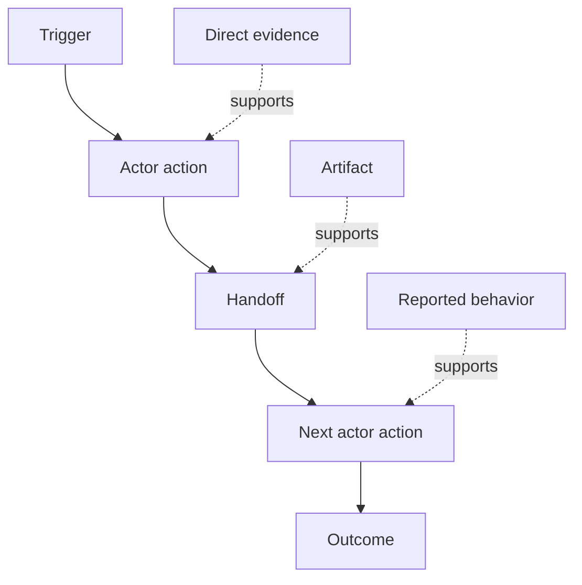

# Khám phá dòng công việc mà mọi người thực sự thực hiện

> Các yêu cầu không phải chờ đợi trong một cuộc họp để được thu thập.

> **【中文解读】**需求不是躺在会议里等来收取,而是散落在动作,绕行办法,记录和分歧里. 需要不是躺在会议里等来收取,而是散落在动作,绕行办法,记录和分歧里. 本课教你从"现在真的是发生什么"发出做工作流发现:给每个步骤建模:

>  **【前置】**Học tập trước bài học Hãy bắt đầu nắm bắt giai đoạn 14 Chương 47  Bài học trước kết quả xuất hiện trong bài kiểm tra này chính là khung kết quả: kết quả mong đợi phải nằm trong dòng công việc thực tế của người ta, chứ không phải trong dòng công việc tưởng tượng.`outputs/workflow-evidence.json`, bài học tiếp theo sẽ biến những xung đột và sự không chắc chắn được quan sát thành một bản đồ giả định.

**Type:** Learn + Build | **类型:** 学习 + 动手实践
**Languages:** Python (stdlib) | **语言:** Python（标准库）
**Prerequisites:** Phase 14 lesson 47 | **前置知识:** Phase 14 第 47 课
**Time:** ~70 minutes | **时间:** 约 70 分钟

## Mục tiêu học tập

- Mô hình hóa dòng công việc hiện tại như các hành động được sắp xếp với bằng chứng.
  Trung ngữ翻译:把当前工作流建模为带证据的有序动作──
- Phân biệt quan sát trực tiếp từ hành vi được báo cáo hoặc suy luận.
  Trung ngữ翻译:把直接观察与口述、推断的行为区分开――
- Tìm kiếm sự xung đột, giao hàng, quyền lực và trạng thái ẩn.
  Trung文翻译:定位摩擦、交接、权限和隐藏状态──
- Giữ các yêu cầu không chắc chắn hiển thị thay vì biến chúng thành yêu cầu.
  Trung文翻译:让不确定的断言保持可见, thay vì biến chúng thành nhu cầu.

## Bắt đầu với hệ thống hiện tại

Đừng bắt đầu bằng cách hỏi mọi người muốn có những đặc điểm gì mà hãy bắt đầu bằng cách tái tạo những gì đang xảy ra.

> Đừng hỏi mọi người muốn làm gì. Hãy xây dựng lại những gì đang xảy ra.

Đối với mỗi bước, ghi lại:

> Đối với từng bước, ghi lại:

| Field | Example |
|---|---|
| Actor | On-call engineer |
| Trigger | Production alert arrives |
| Action | Opens alert, then searches dashboards |
| Input | Alert payload and deployment record |
| Output | Candidate service and owner |
| Friction | Context switching across three tools |
| Authority | Incident commander approves a write |
| Evidence | Screen recording, incident log, runbook |

Phòng công việc lớn hơn màn hình. Nó bao gồm chờ đợi, sao chép dán, kênh bên, chấp thuận, phục hồi lỗi, và các bước mà mọi người đã ngừng nhận thấy.

> 工作流比屏幕大── nó bao gồm chờ đợi, sao chép dán, thông báo nhỏ, phê duyệt, lỗi phục hồi, cũng như những bước mà mọi người đã không còn chú ý nữa──

> **【中文解读】**Từ "cái gì muốn" ra ra là "cái gì muốn", từ "tì làm thế nào để làm" ra ra ra chỉ là "cái gì muốn" ra. Từ "tì làm thế nào để làm" ra ra chỉ là "cái gì muốn" ra.

## Bằng chứng có sức mạnh. Bằng chứng có sức mạnh yếu.

Sử dụng một cái thang bằng chứng đơn giản:

> Sử dụng một bước đơn giản:

1. **Direct behavior:**quan sát, theo dõi, ghi lại hoặc sự kiện hệ thống.
   Trung ngữ翻译:**直接行为：**观察, 追踪, ghi lại, ghi lại, ghi lại, ghi lại, ghi lại, ghi lại, ghi lại, ghi lại, ghi lại, ghi lại, ghi lại, ghi lại, ghi lại, ghi lại, ghi lại, ghi lại, ghi lại, ghi lại, ghi lại, ghi lại, ghi lại, ghi lại, ghi lại, ghi lại, ghi lại, ghi lại, ghi lại, ghi lại, ghi lại, ghi lại, ghi lại, ghi lại, ghi lại, ghi lại, ghi lại, ghi lại, ghi lại, ghi lại, ghi lại, ghi lại, ghi lại, ghi lại, ghi lại, ghi lại, ghi lại, ghi lại, ghi lại, ghi lại, ghi lại, ghi lại, ghi lại, ghi lại, ghi lại, ghi lại, ghi lại, ghi lại, ghi lại, ghi lại, ghi lại, ghi lại, ghi lại, ghi lại, ghi lại, ghi lại, ghi lại, ghi nhận, ghi nhận, ghi nhận, ghi nhận, ghi nhận, ghi nhận, ghi nhận, ghi nhận, ghi nhận, ghi nhận, ghi nhận, ghi nhận, ghi nhận, ghi
2. **Artifact:**vé, sổ chạy, nhật ký, biểu mẫu hoặc đầu ra hoàn thành.
   Trung ngữ翻译:**产物：**工单、运维手册、日志、表单或已完成的作品──
3. **Reported behavior:**một người mô tả những gì họ làm.
   Trung ngữ翻译:**口述行为：**某人描述自己怎么做──
4. **Inference:**Nhóm kết luận những gì có thể xảy ra.
   Trung ngữ翻译:**推断：**Đội đã xác định chuyện gì đã xảy ra.

Tất cả bốn đều có thể hữu ích. Chỉ hai thứ đầu tiên chứng minh trực tiếp hành vi hiện tại.

> Bốn cấp có thể hữu ích, nhưng chỉ hai cấp trước có thể chứng minh trực tiếp hành vi hiện tại.

> **【中文解读】**证阶梯 là thước đo của bài học này: cùng một câu nói "Đội ngũ kỹ sư xem xét trước bảng thiết bị", trực tiếp quan sát được, những gì đã được thực hiện, những gì đã được thực hiện, những gì đã được thực hiện, những gì đã được thực hiện, những gì đã được thực hiện, những gì đã được thực hiện, những gì đã được thực hiện, những gì đã được thực hiện, những gì đã được thực hiện, những gì đã được thực hiện, những gì đã được thực hiện, những gì đã được thực hiện, những gì đã được thực hiện, những gì đã được thực hiện, những gì đã được thực hiện, những gì đã được thực hiện, những gì đã được thực hiện, những gì đã được thực hiện, những gì đã được thực hiện, những gì đã được thực hiện, những gì đã được thực hiện, những gì đã được thực hiện, những gì đã được thực hiện, những gì đã được thực hiện, những gì đã được thực hiện, những gì đã được thực hiện, và những gì đã được thực hiện.

>  **【类比】**证据阶梯像新闻信源分级级. Trước: cuộc họp纪要里"大家都如此干"和录屏观察写作如理直气壮;后:每条记录带等级标签直接观察是第一手信源,口述是当事人回忆,推断是编辑推测,信度不再膨──



> 图解:触发 → 行动者动作 → 交接 → 下一个行动者动作 → 结果;不同强度的证据(直接证据、产物、口述) 分别支不同的步骤。

## Tìm kiếm bốn thứ

- **Friction:**nỗ lực lặp đi lặp lại, trì hoãn, tái nhập cảnh hoặc phục hồi.
  Trung ngữ翻译:**摩擦：**重复劳动、延迟、 tái nhập học hoặc phục hồi补救.
- **Hidden state:**những sự thật được ghi nhớ, trò chuyện hoặc ghi chú cá nhân.
  Trung ngữ翻译:**隐藏状态：**基于记忆、聊天记录或个人笔记携带的事实──
- **Authority:**người hoặc hệ thống được phép thực hiện một sự thay đổi theo sau.
  Trung ngữ翻译:**权限：**Được phép làm những thay đổi có hậu quả cho người hoặc hệ thống.
- **Exceptions:**trường hợp khi dòng công việc bình thường không còn bình thường.
  Trung ngữ翻译:**例外：**Chuyển động công việc bình thường không còn bình thường nữa.

Các tính năng AI thường thất bại trong việc trao tặng và ngoại lệ bởi vì con đường hạnh phúc là con đường duy nhất được hình thành.

> AI 功能 thường chết trong giao tiếp và ngoại lệ, vì ban đầu chỉ tạo ra một con đường hạnh phúc.

> **【中文解读】**Đây là mục tiêu giá trị cao trong dòng công việc: điểm cải thiện của các chỉ dẫn độ gạt; trạng thái ẩn là trở ngại lớn nhất cho tự động hóa; quyền quyết định trong đó phải để lại điểm kiểm tra nhân tạo; ngoại lệ là "sự diễn xuất môi trường bình thường, sản xuất môi trường xe hơi".

## Đừng đánh giá trung bình sự bất đồng. Đừng đánh giá trung bình sự khác biệt.

Hai người dùng có thể thực hiện các dòng công việc khác nhau vì lý do tốt.

> Hai người dùng có thể đang thực hiện các dòng công việc khác nhau, và mỗi người có lý do hợp lý.

- các vai trò khác nhau;
  中文翻译: rôles khác nhau;
- mức độ rủi ro khác nhau;
  Trung文翻译: khác biệt风险等级;
- quá trình truyền thống và hiện tại;
  Trung ngữ翻译:旧流程与新流程并存;
- Sự khác biệt về chuyên môn;
  Trung文翻译:熟练度差异;
- Một sự bất đồng chính sách thực sự.
  Trung ngữ翻译:一场真正的政策分歧──

Một dòng công việc trung bình không thể mô tả ai cả.

> Một người được bình thường làm việc có thể mô tả không có.

> **【中文解读】**Việc kết hợp hai biến thể vào một "giá trung bình" là một cách thực hành nguy hiểm nhất: nó mô tả một người dùng không tồn tại.

## Hãy xây dựng nó.

Phòng thí nghiệm lưu trữ bằng chứng về từng bước của dòng công việc, xác nhận thứ tự và sự tin tưởng, tính toán tỷ lệ bằng chứng trực tiếp, và viết `outputs/workflow-evidence.json`- Tôi không biết.

> Phần thí nghiệm sẽ cung cấp cho mỗi dòng công việc các bước lưu trữ bằng chứng, quy trình kiểm tra và tin tưởng, tính tỷ lệ bằng chứng trực tiếp, và viết ra.`outputs/workflow-evidence.json`

```bash
python3 code/main.py
python3 -m unittest discover code/tests -v
```

Thêm một đường ngoại lệ trong đó ghi chép triển khai bị thiếu. Giữ trật tự chính nguyên vẹn và ghi lại nơi bắt đầu chi nhánh.

> 加一条"Lịch ghi nhớ thất bại" là một cách ngoại lệ.

> **【中文解读】**破坏实验练习 là một ngoại lệ xây dựng: các quy trình chính duy trì tính tuyến tính, ngoại lệ như một nhánh của tự chứng minh, thay vì bị gắn vào một số bước chính của nó.

## Tập luyện.

1. Tái tạo lại một dòng công việc từ một nhật ký mà không phỏng vấn ai.
   Trung ngữ翻译:不访谈任何人, chỉ từ một日志重建工作流.
2. Đàm phỏng vấn người dùng và đánh dấu mọi tuyên bố vẫn thiếu bằng chứng trực tiếp.
   Trung ngữ翻译:访谈一位用户,标记每一条仍缺少直接证据的断言──
3. Thêm một giới hạn thẩm quyền và một bước phục hồi thất bại.
   Trung ngữ翻译:加一个权限边界和一条失败恢复步骤。
4. Mô hình hai biến thể dòng công việc mà không hợp nhất chúng.
   Trung ngữ翻译:建模两条工作流变体,不合并它们──
5. Xác định một tính năng được đề xuất loại bỏ một bước hiển thị nhưng để lại công việc ẩn không bị ảnh hưởng.
   Trung ngữ翻译: tìm một "đánh bỏ các bước nhìn thấy, nhưng không gặp phải việc ẩn" đề xuất chức năng.

## Xem thêm 延伸阅读

- [Nuseibeh and Easterbrook, Requirements Engineering: A Roadmap](https://www.cs.toronto.edu/~sme/papers/2000/ICSE2000.pdf), đặc biệt là việc xử lý việc tạo ra như là giải thích, mô hình hóa và xác nhận thay vì chỉ là bắt.
  Trung ngữ翻译:Nuseibeh 与 Easterbrook需求工程:路线图特别是把需求获取看作解释、建模与验证,而不是简单采集──
- [Gotel and Finkelstein, An Analysis of the Requirements Traceability Problem](https://doi.org/10.1109/ICRE.1994.292398), vì sự khó khăn trong việc bảo tồn mối quan hệ giữa các yêu cầu và nguồn gốc của chúng.
  Trung ngữ翻译:Gotel và Finkelstein 需求可追踪性问题分析 需求保留与来源之间的关系困难──

## Những gì bạn giữ lại, những gì bạn giữ lại là sản phẩm

Cứ giữ lại`outputs/workflow-evidence.json`Nó biến sự chi phối và sự không chắc chắn được quan sát thành một bản đồ giả định trong bài học tiếp theo.

> Bảo trì`outputs/workflow-evidence.json`❖ NextKhoa học sẽ biến những xung đột và sự không chắc chắn được quan sát thành một bản đồ giả định.
