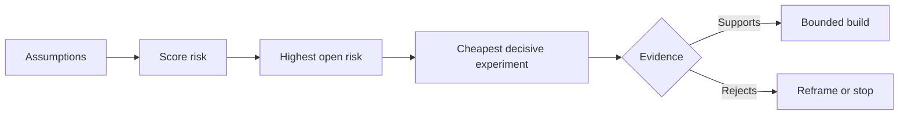

# Giả sử bản đồ và giải quyết rủi ro nhất trước tiên

> Một bản đồ đường dẫn che giấu sự không chắc chắn bên trong các tính năng.

> **【中文解读】**路线图把不确定性藏在一个"功能"里; giả định地图则把"这些功能值得存在的前提"放在桌面上. 本课是 Agent 工程方法论系列 (Phase 14 · 43-54) 里承承起上下一环: 第48 课发现人们实际执行的工作流,本课把"这件事值得做"本身分解成一组可证实的假设,根据影响,不确定性,不可逆性三维排行风险,然后先确定最不便宜,最能活的实验,然后先做最令人兴奋的功能.

>  **【前置】**Học tập:Phase 14 第 48 课                                                                                                                                                                                                                                                          `outputs/assumption-map.json`Trong bài học 50 được sử dụng để chọn "có thể tạo ra các mảnh nhỏ nhất của chứng cứ quyết định".

**Type:** Learn + Build | **类型:** 学习 + 动手实践
**Languages:** Python (stdlib) | **语言:** Python（标准库）
**Prerequisites:** Phase 14 lesson 48 | **前置知识:** Phase 14 第 48 课
**Time:** ~65 minutes | **时间:** 约 65 分钟

## Mục tiêu học tập

- Chuyển đổi công việc được đề xuất thành giả định rõ ràng.
  Trung ngữ翻译:把提议的工作转化为显式的假设.
- Nhận điểm tác động, không chắc chắn và không thể đảo ngược riêng biệt.
  Trung ngữ翻译:分别给影响、不确定性和不可逆性打分──
- Chọn thử nghiệm tiếp theo theo rủi ro, không phải nhiệt tình.
  Trung ngữ翻译:按风险而不是热情来选择下一个实验──
- Thay thế giả định được kiểm tra bằng bằng chứng và quyết định.
  Trung ngữ翻译: dùng chứng cứ và quyết định thay thế giả thuyết đã kiểm tra.

## Mỗi tòa nhà đều có cá cược.

Một công cụ xảy ra có thể phụ thuộc vào tất cả những điều này là đúng:

> Một công cụ xử lý tai nạn có thể phụ thuộc vào các điều sau:

- ngữ cảnh cảnh báo báo có đủ thông tin để xác định dịch vụ;
  Trung ngữ翻译:告警上下文包含足以识别服务的信息;
- Các kỹ sư tin tưởng vào một khuyến nghị mà họ không tự mình lấy ra;
  Trung文翻译: Các nhà kỹ sư sẽ tin tưởng một条 không phải là những lời khuyên tự đưa ra;
- Thời gian phản ứng mong muốn quan trọng về mặt hoạt động;
  Trung ngữ翻译:期望的响应时间在运维上真的重要;
- dữ liệu cần thiết có thể được truy cập mà không có thẩm quyền không an toàn;
  Trung文翻译: 需数据无需危险权限即可访问;
- dòng công việc xảy ra thường xuyên đủ để biện minh cho việc bảo trì.
  Trung ngữ翻译: This workflow happened often enough, worth long-term maintenance.

Đây không phải là những nhiệm vụ thực hiện mà là điều kiện để xây dựng có giá trị, có thể sử dụng, khả thi và an toàn.

> Những điều này không phải là thực hiện nhiệm vụ, mà là điều kiện tiên quyết cho việc xây dựng "có giá trị, khả dụng, khả thi, an toàn".

> **【中文解读】**Mỗi dòng sau danh sách chức năng đều có một vài dấu hiệu ẩn: người dùng sẽ sử dụng nó như vậy DATA get get it DATA get it DATA get it up DATA get it done DATA get it done DATA get it done DATA get it done DATA get it done DATA get it done DATA get it done DATA get it done DATA get it done DATA get it done DATA get it done DATA get it done DATA get it done DATA get it done DATA get it done DATA get it done DATA get it done DATA get it done DATA get it done DATA get it done DATA get it done DATA get it done DATA get it done DATA get it done DATA get it done DATA get it done DATA get it done DATA get it done DATA get it done DATA get it done DATA get it done DATA get it done DATA get it done DATA get it done DATA get it done DATA get it done DATA get it done DATA get it done DATA get it done DATA get it done DATA get it done DATA get it done DATA get it done DATA get it done DATA get done DATA get it done DATA get done DATA get done DATA get it done DATA get done DATA DATA DATA DATA DATA DATA DATA DATA DATA DATA DATA DATA DATA DATA DATA DATA DATA DATA DATA DATA DATA DATA DATA DATA DATA DATA DATA DATA DATA DATA DATA DATA DATA DATA DATA DATA DATA DATA DATA DATA DATA DATA DATA DATA DATA DATA DATA DATA DATA DATA DATA DATA DATA DATA DATA DATA DATA DATA DATA DATA DATA DATA DATA DATA DATA DATA DATA DATA DATA DATA DATA DATA DATA DATA DATA DATA DATA DATA DATA DATA DATA DATA DATA DATA DATA DATA DATA DATA DATA DATA DATA DATA DATA DATA DATA DATA DATA DATA DATA DATA DATA DATA DATA DATA DATA DATA DATA DATA DATA DATA DATA DATA DATA 

## Các lớp giả định

| Class | Question |
|---|---|
| Value | Will the outcome matter enough? |
| Usability | Can the user understand and act on it? |
| Feasibility | Can the system produce it with available data and constraints? |
| Viability | Can the organization sustain cost, ownership, and operation? |
| Safety | Can it fail without unacceptable consequence? |

> **【中文解读】**五类假设各问一个问题: giá trị (¿结果足够重要?) 可用性 (¿用户看懂并能根据此行动吗) 可用性 (¿用户看懂并能根据此行动吗) 可用性 (¿可用性)  khả năng tồn tại (¿có sẵn)  khả năng tồn tại (¿có sẵn)  khả năng tồn tại (¿ tổ chức có thể nuôi dưỡng chi phí, thuộc về và vận hành)  an toàn (¿có thể chấp nhận được hậu quả khi nó thất bại)                                                                                                                                                                                                 

Viết giả định như các câu nói có thể giả mạo. Công tính hữu ích không thể kiểm tra. 8 trong 10 kỹ sư gọi xác định dịch vụ chính xác nhanh hơn với kết quả chỉ đọc có thể.

> Hãy viết giả thuyết thành một câu chuyện có thể chứng minh được. "Công dụng này hữu ích" không kiểm tra; "8 trong 10 kỹ sư có giá trị chỉ có thể đọc kết quả nhanh hơn để định vị đúng dịch vụ".

## 风险 không phải là một con số

Phòng thí nghiệm sử dụng ba chiều từ 1 đến 5:

> 实验代码用三个 1 đến 5 尺寸:

- **Impact:**thiệt hại nếu giả định là sai.
  Trung ngữ翻译:**影响：**假设为假时的损失──
- **Uncertainty:**Sự yếu kém của bằng chứng hiện tại.
  Trung ngữ翻译:**不确定性：**Có bằng chứng hiện tại có nhiều điểm yếu.
- **Irreversibility:**chi phí học tập sau khi cam kết.
  Trung ngữ翻译:**不可逆性：**押上承诺后再学习的代价──

Điểm số ví dụ nhân tác động và không chắc chắn, sau đó thêm tính không thể đảo ngược. Công thức không phải là phổ quát. Mục đích của nó là buộc nhóm để nói tại sao một người không biết nên được giải quyết trước người khác.

> Ví dụ đánh giá ảnh hưởng nhân lên không chắc chắn, thêm vào không thể đảo ngược.

>  **【类比】**假设排雷像拆迁前的房屋检查: 每面墙(假设) 分别量三数会倒塌多大面积(影响) 结构判断有多拿不准(不确定性) 错了还能不能回去(不可逆性) 首处理"倒塌最疼 + 最拿不准 + 不回去"那面墙,而不是最好那面──



> **【中文解读】**Đây là một trong những yếu tố có thể gây ra sự thất bại trong việc xây dựng một cơ sở để xây dựng một cơ sở để xây dựng một cơ sở để xây dựng một cơ sở để xây dựng một cơ sở để xây dựng một cơ sở để xây dựng một cơ sở để xây dựng một cơ sở cho các cơ sở.

## Thiết kế một thí nghiệm, không phải là nghi lễ xác nhận. Thiết kế một thí nghiệm, chứ không phải là nghi lễ xác nhận.

Một thử nghiệm hữu ích có:

> Một bài kiểm tra hữu ích:

- một tuyên bố có thể là sai;
  Trung文翻译: một lời nói có thể giả dối;
- một con người hoặc một mẫu thực tế;
  Trung văn翻译: một thực tế总体或现实样本;
- kết quả có thể quan sát được;
  Trung văn翻译:一个可观察的结果;
- Một ngưỡng được quyết định trước khi kết quả;
  Trung文翻译: một 值 được xác định trước khi nhìn thấy kết quả;
- một quyết định tiếp theo cho thông qua, thất bại, và bằng chứng mơ hồ.
  Trung ngữ翻译:为通过、失败和模糊证据分别准备好下一步决策──

Tránh các thử nghiệm chỉ chứng minh rằng nhóm có thể xây dựng ý tưởng.

> Tránh những thử nghiệm chỉ chứng minh "cụ thể đội làm được điều này".

> **【中文解读】**"Tình thức xác nhận" là những diễn thuyết bất kể kết quả sẽ tiếp tục được thực hiện bất kể kết quả nào. Demo thành công trên đường, thất bại trong sửa chữa lại.

## Sự đảo ngược thay đổi trật tự.

Các lựa chọn có tính chất cao và không thể đảo ngược cần bằng chứng trước đó. Một bản lặp lại chỉ đọc có thể đi trước sự tích hợp sản xuất. Một bộ điều chỉnh tạm thời có thể đi trước việc di chuyển dữ liệu. Một khuyến nghị được phê duyệt bởi con người có thể đi trước hành động tự động.

> Kết quả của việc lựa chọn quan trọng và không thể đảo ngược cần bằng chứng sớm hơn. Chỉ có thể đọc và phát hành trước khi tích hợp sản xuất; điều chỉnh tạm thời có thể đi trước khi chuyển dữ liệu; đề xuất phê duyệt nhân tạo có thể đi trước khi thực hiện tự động.

Hình dạng của xây dựng nên theo hình dạng của sự không chắc chắn.

> hình dạng xây dựng nên theo đuổi hình dạng không chắc chắn.

> **【中文解读】**Nguyên tắc xếp hạng chỉ có một câu: càng khó quay lại quyết định, càng cần phải trước tiên nhận bằng chứng trên một hình thức thay thế rẻ tiền.

## Hãy xây dựng nó.

Phòng thí nghiệm xếp hạng các giả định, phân biệt được thử nghiệm từ các yêu cầu mở, chọn rủi ro mở cao nhất, và viết `outputs/assumption-map.json`- Tôi không biết.

> 实验代码给假设排序,区分已检查与仍开放的断言,选择风险最高的开放项目,并写出`outputs/assumption-map.json`

```bash
python3 code/main.py
python3 -m unittest discover code/tests -v
```

Thay đổi bằng chứng về giả định rủi ro cao nhất và quan sát cách thí nghiệm tiếp theo thay đổi.

> 修改风险最高那条假设的证据 字段,观察"下一个实验"如何随之变化──

> **【中文解读】** `risk_score = impact * uncertainty + irreversibility`Đó là một phép toán đơn giản cố ý. Ý nghĩa của sự tồn tại của nó không chính xác, mà là biến "đầu tiên làm thử nghiệm nào" thành một vấn đề rõ ràng có thể tranh cãi, có thể tính lại.

## Tập luyện.

1. Viết ra năm giả định cho một tính năng bạn muốn xây dựng.
   Trung ngữ翻译:为你想做某功能写下五条假设──
2. Thêm một giả định an toàn mà danh sách tính năng của bạn bỏ qua.
   Trung ngữ翻译:补一条你的功能清单遗漏的安全性假设──
3. Định nghĩa một ngưỡng khiến bạn dừng xây dựng.
   Trung ngữ翻译: định nghĩa một sẽ khiến bạn dừng lại xây dựng này 值.
4. Thay thế một thí nghiệm lớn bằng một thử nghiệm quyết định rẻ hơn.
   Trung ngữ翻译:把一个大实验换成一个更便宜的实验, nhưng cũng có một thử nghiệm quyết định.
5. So sánh xếp hạng rủi ro với ưu tiên trên lộ trình và giải thích sự không phù hợp.
   Trung ngữ翻译:对比风险排序与路线图优先级,并解释两者的错位──

## Xem thêm 延伸阅读

- [Barry Boehm, A Spiral Model of Software Development and Enhancement](https://dl.acm.org/doi/10.1145/12944.12948), cho một chu kỳ phát triển dựa trên rủi ro giải quyết sự không chắc chắn trước khi cam kết sâu sắc hơn.
  Trung ngữ翻译:Boehm螺旋模型风险驱动的发展循环: 在更深的承诺之前先解决不确定性──
- [Dardenne, van Lamsweerde, and Fickas, Goal-Directed Requirements Acquisition](https://doi.org/10.1016/0167-6423(93)90021-G), để tinh chỉnh mục tiêu trong khi làm nổi lên những trở ngại và hạn chế.
  Trung ngữ翻译:Dardenne 等 目标导向的需求获取 在精化目标的同时浮现障碍与约束

## Những gì bạn giữ lại, những gì bạn giữ lại là sản phẩm

Cứ giữ lại`outputs/assumption-map.json`Bài học tiếp theo sử dụng nó để chọn mảnh nhỏ nhất có thể tạo ra bằng chứng quyết định.

> Bảo trì`outputs/assumption-map.json`❖ Next class sẽ sử dụng nó để chọn ra các mảnh nhỏ nhất của chứng cứ quyết định.
