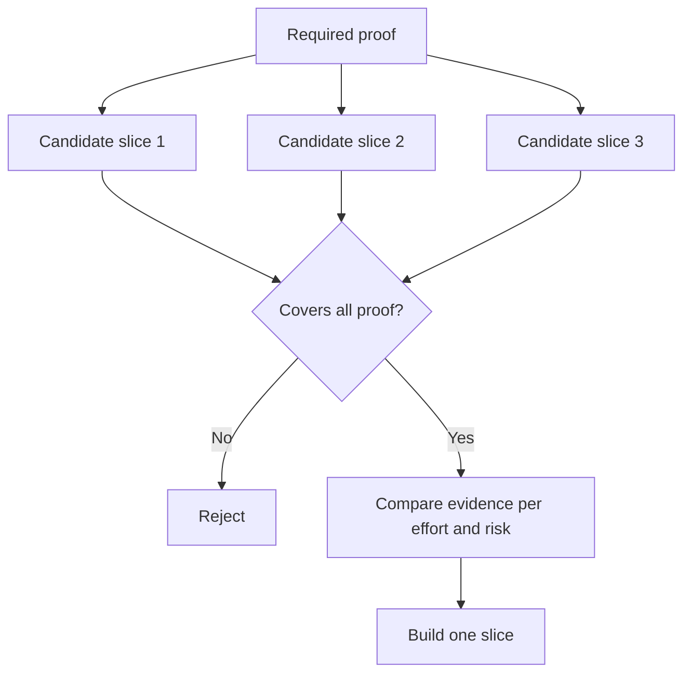

# Chọn một mảnh nhỏ nhất có thể thay đổi quyết định

> Một cái nhỏ chỉ hữu ích khi nó chứng minh một điều gì đó quan trọng. Một cái nhỏ mà không thể thay đổi quyết định tiếp theo chỉ là không hoàn chỉnh.

> **【中文解读】**"làm nhỏ" chỉ có giá trị trong khi có thể chứng minh rằng điều cần thiết, chỉ có một thay đổi không thể thay đổi các quyết định của bước tiếp theo, không phải là mảnh nhỏ nhất có thể làm, chỉ là không hoàn thành.

>  **【前置】**Học tập trước bài học:Phase 14 第 49 课                                                                                                                                                                                                                                                         `outputs/slice-decision.json`会成为第51课规格文档的输入.

**Type:** Learn + Build | **类型:** 学习 + 动手实践
**Languages:** Python (stdlib) | **语言:** Python（标准库）
**Prerequisites:** Phase 14 lesson 49 | **前置知识:** Phase 14 第 49 课
**Time:** ~65 minutes | **时间:** 约 65 分钟

## Mục tiêu học tập

- Định nghĩa một mảnh bằng những giả định nó chứng minh.
  Trung文翻译:用"切片能证明哪些假设"来定义切片──
- Tăng giá trị kết quả, giảm sự không chắc chắn, nỗ lực và hậu quả.
  Trung ngữ翻译: trong kết quả giá trị, không chắc chắn tiêu thụ, đầu tư và hậu quả.
- Tích thích bằng chứng đảo ngược hơn là cam kết sản xuất sớm.
  Trung ngữ翻译: ưu tiên lựa chọn chứng cứ có thể đảo ngược, thay vì cam kết sản xuất quá sớm.
- Tránh các mảnh bỏ qua phần nguy hiểm của dòng công việc.
  Trung ngữ翻译: từ chối những mảnh của những người thích quay vòng.

## Dữ liệu đứng nghĩa là bằng chứng cuối cùng đến cuối

Một đoạn hữu ích vượt qua dòng công việc thực tế tối thiểu cần thiết để quan sát kết quả. Nó có thể hẹp về người dùng, dữ liệu, thời gian và khả năng. Nó không nên hẹp bằng cách loại bỏ sự không chắc chắn chính xác bạn cần kiểm tra.

> Một đoạn hữu ích để đi qua "có thể quan sát một kết quả" được yêu cầu ít nhất thực sự dòng chảy làm việc. Nó có thể thu hẹp trên người dùng, dữ liệu, thời gian, khả năng, nhưng không thể cắt bỏ "những không chắc chắn mà bạn đang kiểm tra" để thu hẹp.

Ví dụ:

> Ví dụ:

- Một bản đọc-chỉ-lần lặp lại trên mười sự cố thực kiểm tra nhận dạng dịch vụ và niềm tin của nhà điều hành.
  Trung ngữ翻译:跨十次真实事故的只读回放,能检验服务识别和操作员信任──
- Một bảng điều khiển được đánh bóng trên dữ liệu tổng hợp có thể kiểm tra sự hiểu biết nhưng không kiểm tra khả thi của dữ liệu.
  Trung ngữ翻译: dựa trên dữ liệu tổng hợp, bộ dụng cụ tinh tế có thể kiểm tra "xem hiểu", nhưng kiểm tra không có tính khả thi dữ liệu.
- Một máy tự trị sản xuất kiểm tra mọi thứ cùng một lúc với hậu quả không thể chấp nhận được.
  Trung ngữ翻译: tự động sửa chữa của môi trường sản xuất một lần kiểm tra tất cả mọi thứ, nhưng hậu quả không thể chấp nhận được.

> **【中文解读】**"nghĩa" có nghĩa là đầu đến cuối打通真工作流:输入是真的;决策路径是真的;能观察一个结果;窄的方向只能是范围;多少人;多少数据;多长时间;不能是深度;把最难的步骤抽掉;第二,三个例子是两个典型反面:

>  **【类比】**Trong khi đó, một số người có thể tìm thấy một cái tên là "đối tượng của một nhà", nhưng nếu không có điện, nó sẽ không thể chứng minh được vấn đề quan trọng nhất.

## Định nghĩa bằng chứng cần thiết Đầu tiên xác định bằng chứng cần thiết trước

Hãy lấy các giả định mở có nguy cơ cao nhất và biến chúng thành một bộ bằng chứng cần thiết. Một mảnh ứng cử viên chỉ đủ điều kiện nếu nó bao gồm bộ đó.

> 取出风险最高的开放假设, biến chúng thành một "bộ chứng minh cần thiết"  Ứng viên chỉ có thể bao gồm bộ này,才有评价资格.

Sau đó so sánh các mảnh đủ điều kiện trên:

> Sau đó so sánh giữa các mảnh có đủ điều kiện:

| Dimension | Direction |
|---|---|
| Outcome value | More is better |
| Uncertainty reduced | More is better |
| Effort | Less is better |
| Consequence | Less is better |
| Reversibility | More is better |

Điểm số của phòng thí nghiệm là đơn giản.

> 实验代码的评分故意简单――资格门比算术更重要――



> **【中文解读】**Dòng trình tự này là cốt lõi của bài học: Qualification Gate (trang cánh tay) ở phía trước, đánh giá là toán học ở phía sau.

## Những điểm tối thiểu giả thường xuyên

- **The UI-only minimum:**loại bỏ dữ liệu và sự không chắc chắn về hoạt động.
  Trung ngữ翻译:**只有 UI 的最小：** cắt bỏ sự không chắc chắn về dữ liệu và vận hành.
- **The infrastructure-only minimum:**chứng minh khả năng kỹ thuật mà không có giá trị người dùng.
  Trung ngữ翻译:**只有基础设施的最小：**证明 được thực hiện trên kỹ thuật, nhưng không chứng minh giá trị người dùng.
- **The happy-path minimum:**bỏ qua ngoại lệ tạo ra nguy cơ lớn nhất.
  Trung ngữ翻译:**只有正常路径的最小：**ữa được bỏ lỡ phần lớn các chiệc khác thường trong việc sản xuất.
- **The demo minimum:**tạo ra một vật cổ thuyết phục nhưng không có phép đo lặp lại.
  Trung ngữ翻译:**演示级最小：**nghành ra những biểu diễn thuyết phục, nhưng không có phép đo lặp lại.
- **The platform minimum:**xây dựng máy móc tái sử dụng trước khi một dòng công việc kiếm được nó.
  Trung ngữ翻译:**平台级最小：**Trong bất kỳ một dòng chảy chứng minh giá trị trước khi tạo ra máy có thể sử dụng được.

> **【中文解读】**五种假最小的各有各种诱惑:UI 最小出图快,基础设施最小对工程师胃口,演示最小最能动动领导――它们的共同点是系统地绕开真正风险而"最小"的意思恰恰是让风险早点暴露――自检方法只有一个:逐条对照必备证明集,看看它最终证明了哪几条――

## Thêm một quy tắc dừng lại.

Trước khi thực hiện, viết những gì xảy ra nếu mảnh thất bại:

> Trước khi thực hiện, hãy viết "Cài đoạn thất bại đã thành công":

- bỏ kết quả;
  Trung文翻译: bỏ bỏ kết quả này (全方向止损);
- thay đổi người dùng mục tiêu hoặc tình huống;
  中文翻译:更换目标用户或使用场景;
- kiểm tra một cơ chế khác;
  中文翻译:换一种机制再测;
- thu thập bằng chứng tốt hơn;
  Trung文翻译:先收集更好的证据;
- quyền hạn hạn hạn chế hơn nữa.
  Trung ngữ翻译:把授权收得更狭──

Nếu mọi kết quả dẫn đến việc xây dựng, thì đoạn không phải là thí nghiệm.

> Nếu mọi kết quả đều đi theo hướng tiếp tục làm, thì đoạn này không phải là một thí nghiệm.

> **【中文解读】**停止规则是实验的"诚实检查": một tất cả kết quả là "继续建设" của một mảnh, chỉ đơn giản là mặc vào kế hoạch đã được thiết lập của thí nghiệm ngoài bộ áo.

## Hãy xây dựng nó.

Phòng thí nghiệm lọc ứng cử viên bằng bằng chứng cần thiết, ghi điểm các mảnh hợp lệ, và viết `outputs/slice-decision.json`- Tôi không biết.

> 实验代码根据必证证过候选人、给有资格的切片打分,并写出 `outputs/slice-decision.json`

```bash
python3 code/main.py
python3 -m unittest discover code/tests -v
```

Thêm một ứng cử viên rẻ hơn chứng minh chỉ một giả định yêu cầu. Nó nên vẫn không đủ điều kiện ngay cả khi điểm số của nó là cao.

> Ngoài một chỉ chứng minh một điều cần thiết giả thuyết, nhưng rẻ hơn ứng cử viên.

> **【中文解读】** `score = (结果价值 + 不确定性消减) / (投入 + 后果 × 不可逆系数)`Chỉ là một công cụ sắp xếp; người bảo vệ thực sự là một tập hợp bao gồm kiểm tra.`required_proof <= set(item.proves)`                                                                                                                                                                                                                                                              

## Tập luyện.

1. Thiết kế ba mảnh cho cùng một kết quả ở các mức độ hậu quả khác nhau.
   Trung ngữ翻译:为同一个结果设计三个不同的后果等级的切片.
2. Đề xuất bằng chứng cần thiết trước khi ghi điểm.
   Trung ngữ翻译: 在打分之前先写下必备证明集──
3. Tháo một khả năng trong khi vẫn giữ lại bằng chứng quyết định.
   Trung ngữ翻译: cắt bỏ một năng lực, đồng thời giữ lại chứng cứ quyết định.
4. Thêm một quy tắc dừng cho phi công thất bại.
   Trung文翻译:为一次失败的试点补一条停止规则──
5. Xác định một thành phần nền tảng có thể được sử dụng lại nên chờ cho đến khi cắt.
   Trung ngữ翻译:指出一个应该等切片后再做可复用平台组件──

## Xem thêm 延伸阅读

- [Barry Boehm, A Spiral Model of Software Development and Enhancement](https://dl.acm.org/doi/10.1145/12944.12948), để phù hợp với từng chu kỳ phát triển với các rủi ro mà nó phải giải quyết.
  Trung ngữ翻译:Boehm螺旋模型让每轮发展循环对应它必须解决的风险
- [Lenarduzzi and Taibi, MVP Explained: A Systematic Mapping Study on the Definitions of Minimal Viable Product](https://arxiv.org/abs/1609.07592), vì sự mơ hồ xung quanh minimum và viable trong thực tiễn sản phẩm phần mềm.
  Trung ngữ翻译:Lenarduzzi 与 TaibiMVP 解析软件产品实践中"最小"和"可行"两个词的歧义理──

## Những gì bạn giữ lại, những gì bạn giữ lại là sản phẩm

Cứ giữ lại`outputs/slice-decision.json`Nó ghi lại tại sao mảnh này là mảnh nhỏ nhất có thể thay đổi quyết định.

> Bảo trì`outputs/slice-decision.json`Nó ghi lại tại sao đoạn này là "đơn giản nhất có thể thay đổi quyết định".
