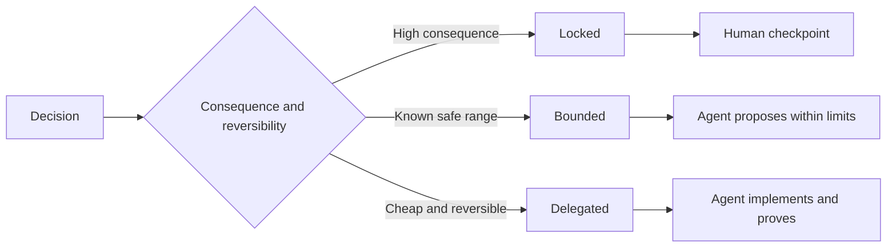

# Hãy viết những thông số đặc trưng để giữ cho sự phán xét.

> Một đặc điểm hữu ích sửa đổi các biến động và bằng chứng trong khi để lại các lựa chọn thực hiện đảo ngược mở.

> **【中文解读】**Một quy định tốt khóa" không thay đổi và chứng cứ", để cho việc thực hiện có thể được lựa chọn để để cho người thực thi Đó là ranh giới quyết định, không phải là kịch bản.

>  **【前置】**Học tập trước bài học:Phase 14 第 50 课  选择能改变决策的最小片 本课规格服务的正是那片) và 第 33 课   把命令写成可执行的束,命令作为限制的思想在这里扩展到完整规格)`outputs/executable-specification.json`Đó là hợp đồng chung của Codifier Agent và Human Review.

**Type:** Learn + Build | **类型:** 学习 + 动手实践
**Languages:** Python (stdlib) | **语言:** Python（标准库）
**Prerequisites:** Phase 14 lesson 50 | **前置知识:** Phase 14 第 50 课
**Time:** ~75 minutes | **时间:** 约 75 分钟

## Mục tiêu học tập

- Kết quả riêng biệt, không biến đổi, ví dụ, không mục tiêu và bằng chứng.
  Trung ngữ翻译:区分结果、不变量、示例、非目标和证明──
- Đánh dấu các quyết định như bị khóa, giới hạn hoặc ủy quyền.
  Trung ngữ翻译:把每个决定标注为锁定、受限或委托──
- Giữ sự phán đoán của các đại lý khi lựa chọn rẻ và đảo ngược.
  Trung文翻译: Trong lựa chọn rẻ và có thể ngược lại giữ được sự phán đoán của Đại lý.
- Cần phải có các trạm kiểm soát của con người khi hậu quả hoặc hành vi của công chúng thay đổi.
  Trung ngữ翻译: Trong những thay đổi quan trọng hoặc công khai về hành vi sau đó, bắt buộc kiểm tra nhân tạo.

## Hai cực kỳ xấu. Hai cực kỳ xấu.

Một nhiệm vụ không xác định rõ ràng yêu cầu một đại lý đoán hệ thống.

> 规格不足任务让代理猜系统;规格过度任务让它抄写一个可能就错的设计.

Một hợp đồng có thể thực hiện được là một hợp đồng hữu ích:

> Có hình thức trung gian hữu ích là một hợp đồng có thể thực hiện:

| Surface | Purpose |
|---|---|
| Outcome | The observable result |
| Invariants | Conditions that must always remain true |
| Examples | Concrete cases that reveal intent |
| Non-goals | Adjacent behavior intentionally excluded |
| Decision policy | Which choices are locked, bounded, or delegated |
| Proof | Evidence required before completion |

> **【中文解读】**两个极端对应两种浪费:规格不足浪费在返工上(Agent 猜错了重做),规格过度浪费在翻译上(人把设计写成伪代码,Agent 再转抄成代码,中间没有增量智能) 六面契约是中间路:结果说清"要什么"、不变量说清"任何时候不能破坏什么"、示例传递意图、非目标划边界、决策政策声明授权、证明定义"完成"

## Ba phương thức quyết định.

- **Locked:**Các tác nhân không được lựa chọn. Sử dụng cho sự tương thích công cộng, thẩm quyền, an toàn, chi phí không thể đảo ngược, hoặc cam kết sản phẩm.
  Trung ngữ翻译:**锁定（Locked）：**Trưởng không phải tự chọn. Được sử dụng cho công khai khả năng tương thích, quyền hạn, an toàn, chi phí không thể đảo ngược hoặc cam kết sản phẩm.
- **Bounded:**người đại lý có thể chọn trong giới hạn rõ ràng. Sử dụng cho ngân sách tìm kiếm, đếm lại, phụ thuộc được phép, hoặc một gia đình giao diện được biết.
  Trung ngữ翻译:**受限（Bounded）：**Trưởng lý có thể chọn trong giới hạn rõ ràng.
- **Delegated:**đại lý sở hữu sự lựa chọn và phải giải thích nó. sử dụng cho cấu trúc địa phương, tên, refactor đảo ngược, và chi tiết thực hiện.
  Trung ngữ翻译:**委托（Delegated）：**Cơ quan có sự lựa chọn này, nhưng phải có thể giải thích nó.



> **【中文解读】**三种模式的分分标准只有一个问题:后果与可逆性──后果大、不可逆 → 锁定并设人工检查点;后果可控但有安全范围 → 受限,Agent 在界内自由;便宜且可逆 → 委托,Agent 自定但要解释──常见错误是两方向同时犯:把命名风格这样的小事锁死(浪费人的判断力),再把"不能写生产库"这样的大事默认委托 ((把产品风险交运气)

>  **【类比】**三种决策模式像装修合同的三类条款:承重墙和水电走向写死 (cái chết) 锁错了要出的人生;预算有限区间;品牌任选 (cái được giới hạn);房间内部如何布置工人看看办 (cái làm việc);

## Định nghĩa hành vi thông qua ví dụ.

Ví dụ nén ý định tốt hơn các đặc điểm. Helpful, robust, vàproduction-ready không thể thực hiện. Một bộ nhỏ các ví dụ bình thường, cạnh, thất bại và cấm cung cấp cho cả người xây dựng và xác minh một cái gì đó cụ thể.

> Ví dụ hơn so với形容词更能缩意图. "có giúp đỡ" "健壮" "生产可用" đều không thể thực hiện.

Ví dụ không thay thế các tính không biến đổi. Một trường hợp qua không thể chứng minh một quy tắc an toàn phổ quát.

> Example cannot substitute unchanged quantity. Một ví dụ được thông qua chứng minh không phải là một quy tắc an toàn thích hợp.

> **【中文解读】**Đây là một phần giải quyết "形容词陷": viết:"输出要干净" như bất cứ điều gì không được viết, viết:" cho một người có ID triển khai báo cáo nên phân tích ra người chịu trách nhiệm dịch vụ" chỉ truyền ý định.

## Bằng chứng phải phù hợp với tuyên bố bằng chứng phải phù hợp với tuyên bố

- Một thử nghiệm đơn vị chứng minh hợp đồng chức năng địa phương.
  Trung文翻译:单元测试证明局部函数契约。
- Một thử nghiệm dây chứng minh sự liên kết và hành vi vận chuyển.
  Trung ngữ翻译:线上(线) test chứng minh序列化与传输行为──
- Một chuyến đi trình duyệt chứng minh một đường giao diện.
  Trung文翻译:浏览器旅程证明一条界面路径──
- Một bộ lặp lại chứng minh hành vi trên các trường hợp đại diện.
  Trung ngữ翻译:回放集证明行为在代表性用例上的表现──
- Một sổ kiểm toán chứng minh rằng giới hạn thẩm quyền được giữ.
  Trung ngữ翻译:审计日志证明 quyền hạn biên giới thực sự đã được giữ lại.

Không chấp nhận một lớp thấp hơn như bằng chứng cho một tuyên bố lớp cao hơn.

> Đừng chấp nhận bằng chứng cấp thấp để ủng hộ những tuyên bố cấp cao.

> **【中文解读】**Mỗi loại chứng minh có phạm vi quản lý của nó: chức năng ống kiểm tra đơn vị, giao thức ống kiểm tra dây, giao diện trình duyệt, hành vi toàn bộ tập hợp ống kiểm tra, kiểm tra nhật ký quyền hạn.

## Bảo tồn những điều không biết được một cách cố ý.

Một thông số kỹ thuật có thể nói theo thực hiện có thể chọn bất kỳ nguồn chỉ đọc nào trả lại trong ngân sách thời gian. Đó không phải là sự mơ hồ. Đó là một quyết định ủy quyền cố ý với một ranh giới và bằng chứng.

> Quy tắc có thể viết:" thực hiện có thể chọn bất kỳ nguồn dữ liệu chỉ đọc được được trả về trong ngân sách thời gian""."Đây không phải là một sự hiểu biết, mà là một sự có mặt, có chứng minh có ý định ủy thác"."

Các thông số kỹ thuật nên phát triển khi bằng chứng thay đổi. Giữ nguyên nhân đằng sau các lựa chọn bị khóa và giới hạn để các nhóm sau này có thể sửa đổi chúng mà không cần khảo cổ học.

> 证据变化时规格也应演化──保留锁定与限制选择背后的理由,后来的团队才不需要靠"古古"修改它们──

> **【中文解读】**Sự khác biệt giữa "có ý định giữ chưa biết" và "không nghĩ rõ" nằm ở biên giới và chứng minh: người trước đã viết ra không gian chọn lựa (không có gì để đọc) 约束 (không có gì để đọc) 约束 (không có gì để xem) 预算 (không có gì để xem) và chấp nhận (không có gì để xem) 证明 (không có gì để xem) ), người sau cũng không viết gì hết.

## Hãy xây dựng nó.

Phòng thí nghiệm xác nhận mọi mặt hợp đồng, kiểm tra các chế độ quyết định, và viết `outputs/executable-specification.json`- Tôi không biết.

> 实验代码校验契约的每面、检查决策模式,并写出 `outputs/executable-specification.json`

```bash
python3 code/main.py
python3 -m unittest discover code/tests -v
```

Di chuyển quyết định viết sản xuất từ khóa sang ủy quyền. Giải thích tại sao các kế hoạch chấp nhận giá trị nhưng rủi ro sản phẩm không.

> Để "đánh thành sản xuất" này quyết định từ khóa 改 thành ủy quyền ☐ giải thích tại sao dữ liệu mô hình ☐ sơ đồ ☐ chấp nhận giá trị này, và sản phẩm ☐ không chấp nhận ☐

> **【中文解读】**Có hai quy tắc cứng của máy kiểm tra đáng chú ý: sáu mặt thiếu một, và không ủy thác mô hình phải có lý do" không có lý do khóa" và" không có mặt hợp đồng" đều sẽ được coi là không đầy đủ.

## Tập luyện.

1. Chuyển đổi một vé backlog vào sáu bề mặt kỹ thuật.
   Trung ngữ翻译:把一张后载 工单转写成六面的规格──
2. Thay thế ba hướng dẫn thực thi bằng một không thay đổi và hai ví dụ.
   Trung文翻译:把三条实现命令替换成一条不变量加两个例子──
3. Hãy ghi lại mọi quyết định và biện minh cho mọi lựa chọn bị khóa hoặc bị giới hạn.
   Trung ngữ翻译: Đưa cho mỗi quyết định một mô hình ký hiệu,并 cho mỗi lựa chọn bị khóa hoặc bị hạn chế một lý do.
4. Thêm một biên nhận bằng chứng cho mỗi biến đổi.
   Trung ngữ翻译:为每条不变量补一条对应的证明凭证──
5. Giảm một hạn chế không có bằng chứng hoặc lý do rủi ro.
   Trung ngữ翻译:删掉一条既无证也无风险理由支的约束──

## Xem thêm 延伸阅读

- [Nuseibeh and Easterbrook, Requirements Engineering: A Roadmap](https://www.cs.toronto.edu/~sme/papers/2000/ICSE2000.pdf), cho mối quan hệ giữa các mục tiêu, đặc điểm chính xác, xác thực, đồng thuận và tiến hóa.
  Trung ngữ翻译:Nuseibeh và Easterbrook需求工程:路线图目标、精确规格、验证、共识与演化之间的关系──
- [Zave and Jackson, Four Dark Corners of Requirements Engineering](https://doi.org/10.1145/267895.267896), để phân biệt các giả định, yêu cầu và đặc điểm môi trường.
  Trung ngữ翻译:Zave và Jackson 需求工程的四个黑暗角落 区分环境假设、需求与规格──
- [Gotel and Finkelstein, An Analysis of the Requirements Traceability Problem](https://doi.org/10.1109/ICRE.1994.292398), để bảo tồn lý do tại sao yêu cầu tồn tại và nó đến từ đâu.
  Trung ngữ翻译:Gotel 与 Finkelstein 需求追溯性问题分析 保留"需求为何存在"",从何而来":"

## Những gì bạn giữ lại, những gì bạn giữ lại là sản phẩm

Cứ giữ lại`outputs/executable-specification.json`Nó trở thành hợp đồng mà các đại lý lập trình và các nhà đánh giá con người chia sẻ.

> Bảo trì`outputs/executable-specification.json`Nó sẽ trở thành một hợp đồng chung của Codified Agent và Human Review.
