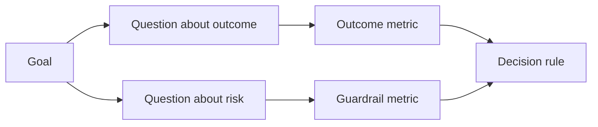

# Thiết kế thành công métrics trước khi kết quả tồn tại  kết quả xuất hiện trước, trước xác định chỉ số thành công

> Mức đo nên trả lời một quyết định, không phải trang trí bảng điều khiển. Bắt đầu với mục tiêu, dẫn ra các câu hỏi, sau đó chọn các số liệu nhỏ nhất trả lời chúng.

> **【中文解读】** đo lường nên trả lời một quyết định, chứ không phải là đặt một khối đồ chơi.                                                                                                                                                                                                                                                     

>  **【前置】**Học tập trước bài học:Phase 14 第 47 课  成果先于产出本课的"目标"从那里来) và第 51 课  写保留判断力规则规格里的"证明"面在此展开成测量计划)  本课产出`outputs/measurement-report.json`门 试点/生产三档的证据 门

**Type:** Learn + Build | **类型:** 学习 + 动手实践
**Languages:** Python (stdlib) | **语言:** Python（标准库）
**Prerequisites:** Phase 14 lessons 47 and 51 | **前置知识:** Phase 14 第 47、51 课
**Time:** ~70 minutes | **时间:** 约 70 分钟

## Mục tiêu học tập

- Thuộc dẫn các câu hỏi và số liệu từ một mục tiêu kết quả.
  Từ kết quả mục tiêu推导出问题和标标.
- Định nghĩa ngưỡng, cửa sổ, nguồn và hướng dẫn trước khi quan sát kết quả.
  Trung ngữ翻译: 在观察结果之前定义值、窗口、来源和方向──
- Kết hợp các số liệu kết quả với các đường dây và các số liệu phản đối.
  Trung ngữ翻译:给结果指标配上护指标和反指标──
- Bằng chứng đánh giá phù hợp với quyết định mà xây dựng phải hỗ trợ.
  Trung ngữ翻译:让评估证据与建设必须支的决策相匹配──

## Mục tiêu, câu hỏi, Metric  mục tiêu, vấn đề, chỉ số

Bắt đầu với mục tiêu:

> Từ một mục tiêu bắt đầu:

> Giảm thời gian để xác định dịch vụ bị ảnh hưởng mà không tăng các hành động không an toàn.
>
> Trong khuôn khổ không tăng không an toàn hoạt động, rút ngắn thời gian cần thiết cho dịch vụ định vị bị ảnh hưởng.

Các câu hỏi bắt nguồn:

> 推导出问题:

- Làm thế nào nhanh chóng xác định dịch vụ đúng?
  Trung ngữ翻译:正确服务被定位有多快吗?
- Dịch vụ xác định được xác định là đúng bao nhiêu lần?
  Trung ngữ翻译: định vị dịch vụ có nhiều khả năng là đối với?
- Liệu chẩn đoán vẫn chỉ được đọc?
  Trung ngữ翻译: 诊断过程是否保持只读?
- Dòng công việc có làm tăng việc từ chối cảnh báo hoặc tải trọng công việc của người vận hành không?
  Trung ngữ翻译: Có phải dòng công việc này đã làm tăng tỷ lệ bỏ qua cảnh sát hay gánh nặng của nhà điều hành không?

Sau đó chọn các số liệu làm việc các câu hỏi đó.

> Sau đó chọn để biến những vấn đề này thành chỉ số có thể kiểm tra.



> **【中文解读】**Các chỉ dẫn của GQM là không thể đảo ngược: mục tiêu → 问题 → chỉ tiêu. Mục tiêu là ngôn ngữ quyết định (快而不险), vấn đề là ngôn ngữ nghiên cứu (多快?多准?只读吗?), chỉ tiêu là ngôn ngữ số (中位秒数、正确率、写次数)  nhảy qua tầng trung trực tiếp từ mục tiêu tạo chỉ tiêu, bạn sẽ nhận được "đồng độ đáp ứng thời gian" như vậy không trả lời quyết định cũng không tiết lộ rủi ro của các thiết bị trên bàn đồ trang trí.

## Một Metric cần một hợp đồng

Mỗi số liệu cần:

> Mỗi chỉ số cần:

| Field | Example |
|---|---|
| Name | `median_identification_seconds` |
| Direction | at most |
| Threshold | 120 |
| Window | ten incident replays |
| Source | replay event log |
| Population | on-call engineers in the pilot |
| Kind | outcome or guardrail |

Nếu không có nguồn và cửa sổ, một số không thể được tái tạo.

> Không có nguồn và cửa sổ, một số không thể tái hiện; không có giá trị, nó không thể thúc đẩy quyết định.

> **【中文解读】**契约的七字段回答四个问题:叫什么 (Name) 朝哪边好 (Direction) 、多好算好 (Threshold) 、在哪测 (Window/Source/Population) 、属于哪类的(Kind) ⋅缺"在哪测的",同一数字换个环境就不可复现;缺"多好算好",指标永远只会"看起来在变好"──

>  **【类比】**Chỉ số:  giá trị  cửa sổ  nguồn gốc là chỉ số của " chỉ số  giá trị  máu                                                                                                                                                                                                                                                 

## Kết quả, Guardrail, và Counter-Metric  kết quả chỉ số 护 chỉ số và chống chỉ số

- **Outcome metric:**tình trạng mong muốn đã được cải thiện?
  Trung ngữ翻译:**结果指标：**Tình trạng của anh đã cải thiện chưa?
- **Guardrail:**Có phải một giới hạn cố định vẫn đúng không?
  Trung ngữ翻译:**护栏指标：**固约束是否仍然成立?
- **Counter-metric:**việc cải thiện địa phương có phải là chi phí hay thiệt hại ở nơi khác?
  Trung ngữ翻译:**反指标：**Việc cải thiện địa phương có chuyển chi phí hoặc tổn thương sang nơi khác không?

Đối với một dòng công việc xảy ra, tốc độ không đủ. Sự chính xác, sản xuất viết, tải trọng công việc của nhà điều hành và các cảnh báo bị bỏ qua bảo vệ khỏi một kết quả nhanh chóng nhưng không an toàn.

> Đối với dòng công việc tai nạn, chỉ có tốc độ là không đủ.

> **【中文解读】**三种指标构成一个三角形: kết quả chỉ số chứng minh "变好了",护指标守住"没变坏" (如生产写入恒为零),反指标住"坏处是不是被挪走了" (本团队快了,是不是把负担给下游值班) ⋅ AI 系统最经典的反指标案例:客服机器人优化"平均处理时间"至极低,同时"人工转接率"和"客户次来电率"升.

## Bằng chứng trực tuyến và ngoại tuyến Bằng chứng trực tuyến và ngoại tuyến

Phân tích trực tuyến hữu ích cho khả năng lặp lại và bảo hiểm cạnh. Một máy bay bay bay có giới hạn hữu ích cho hành vi thực tế, tin tưởng và hiệu ứng luồng làm việc.

> Giá trị của việc phát hành trực tuyến nằm trong khả năng lặp lại và bao phủ biên giới; giá trị của các thử nghiệm biên giới nằm trong hành vi thực tế, tin tưởng và hiệu ứng dòng chảy công việc.

Sử dụng bằng chứng rẻ nhất có thể trả lời quyết định hiện tại. Đừng phơi bày người dùng thực sự chỉ vì việc thực hiện đã sẵn sàng.

> Sử dụng để trả lời bằng chứng rẻ nhất của quyết định hiện tại. Không chỉ vì việc thực hiện đã hoàn thành, hãy đưa người dùng thực sự ra ngoài.

> **【中文解读】**离线/在线的取舍标准是"当前决策需要什么",不是"实现进展到哪里了"――回放集答"算法对不对",试点答"人信不用"",用不用"",最常见的错误是用离线指标回答只有试点才能回答问题 ((工程师"应该"会信任这个建议"), hoặc ngược lại, một chức năng được viết bằng cách vội vàng trên dòng chảy thực sự――

## Hãy quyết định trước khi bạn đo lường, quyết định trước, kiểm tra lại dữ liệu

Viết đường đi, thất bại và không rõ ràng trước khi thấy kết quả.

> Trong khi nhìn thấy kết quả trước khi viết tốt qua, thất bại và mờ trí. Nếu không, đội chắc chắn sẽ cố gắng để duy trì cấu trúc này và di chuyển  giá trị.

Ví dụ:

> Ví dụ:

- Pass: tốc độ dịch vụ chính xác ít nhất 0,9 và thời gian trung bình tối đa 120 giây;
  Trung文翻译:通过:正确服务率 không thấp hơn 0,9 且中位耗时不超过120秒;
- thất bại: bất kỳ tỷ lệ ghi sản xuất hoặc sửa chữa nào dưới 0,75;
  Trung文翻译:失败: xuất hiện bất kỳ sản xuất nào, hoặc tỷ lệ chính xác thấp hơn 0,75;
- không rõ ràng: cải tiến nhỏ với sự khác biệt rộng, đòi hỏi một bộ lặp lại lớn hơn.
  Trung文翻译:模糊: cải thiện幅度小且方差大, cần mở rộng回放集再测──

> **【中文解读】**"Phân quyết trước" là một công cụ phòng thủ về tính con người: sau khi dữ liệu xuất hiện, hầu như mọi người sẽ đặt giá trị lại trong vị trí dữ liệu của họ vừa qua tốt.

## Hãy xây dựng nó.

Phòng thí nghiệm xác nhận một kế hoạch đo lường, đánh giá các ngưỡng bao gồm, ghi lại các giá trị thiếu, và viết `outputs/measurement-report.json`- Tôi không biết.

> 实验代码校验一个测量计划、根据含边界值的值求值、记录缺失值,并写出 `outputs/measurement-report.json`

```bash
python3 code/main.py
python3 -m unittest discover code/tests -v
```

Tắt các métrics guardrail và quan sát tại sao kế hoạch trở nên vô hiệu ngay cả khi các métrics kết quả vẫn còn.

> 删掉护标标,观察为什么即使结果标都存在, toàn bộ kế hoạch cũng sẽ bị kết án là vô hiệu.

> **【中文解读】**Các quy tắc của máy kiểm tra là mã hóa của bài học này: thiếu mục tiêu, thiếu vấn đề, thiếu chỉ số, thiếu kết quả, thiếu bảo vệ, không hướng bất hợp pháp, thiếu nguồn gốc hoặc cửa sổ bất kỳ điều gì sẽ khiến tình trạng trở nên vô hiệu, số lượng sau đó hoàn toàn mất ý nghĩa.

## Tập luyện.

1. Lấy 3 câu hỏi từ một mục tiêu kết quả.
   Trung ngữ翻译:从一个结果目标推导出三个问题――
2. Thêm một counter-metric mà bắt chi phí chuyển sang một vai trò khác.
   Trung ngữ翻译:加一个能抓住"成本被转移给另一个角色"的反标志.
3. Định nghĩa nguồn, dân số và cửa sổ cho mỗi métric.
   Trung ngữ翻译:为每个标标定义来源、人群和窗口──
4. Viết bỏ qua, thất bại, và quyết định mơ hồ trước khi tạo ra các giá trị.
   Trung ngữ翻译:在生成数值之前写好通过、失败和模糊三条决策──
5. Hãy xác định một số liệu dễ thu thập nhưng không thể thay đổi quyết định.
   Tìm ra một chỉ số dễ dàng để thu thập nhưng không thay đổi quyết định, xóa nó đi.

## Xem thêm 延伸阅读

- [Basili, Software Modeling and Measurement: The Goal/Question/Metric Paradigm](https://drum.lib.umd.edu/items/8119803a-362b-42ec-b6ce-2311713e7236), để lấy các phép đo hoạt động từ các mục tiêu rõ ràng.
  Trung文翻译:Basili软件建模与测量:GQM 范式从显式目标推导可操作测量──
- [Basili, Caldiera, and Rombach, The Goal Question Metric Approach](https://www.cs.toronto.edu/~sme/CSC444F/handouts/GQM-paper.pdf), để áp dụng phương pháp như một hệ thống phản hồi và cải tiến.
  Trung文翻译:Basili、Caldiera 与 RombachGQM 方法把该方法用作反与改进系统──

## Những gì bạn giữ lại, những gì bạn giữ lại là sản phẩm

Cứ giữ lại`outputs/measurement-report.json`Nó xác định cổng bằng chứng cho nguyên mẫu, thí điểm hoặc giai đoạn sản xuất.

> Bảo trì`outputs/measurement-report.json` It defines the proof of the original  试点 or production stage 门
