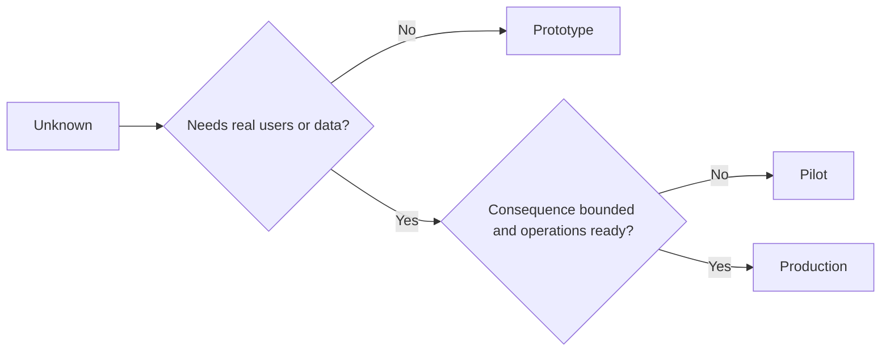

# Chọn nguyên mẫu, phi công, hoặc sản xuất cố ý.

> Đây là môi trường học tập khác nhau, không phải mức độ đánh bóng.

> **【中文解读】**Mô hình thử nghiệm, sản xuất là ba loại môi trường học tập khác nhau, không phải là ba lớp. Chỉ có một tiêu chuẩn: Một trong những trường hợp có thể đáp ứng với ít nhất những hậu quả không cần thiết cho những điều chưa biết.

>  **【前置】**Học本课前请先掌握:Phase 14 第50 课(mặt nhất 片先确定要证明什么) 第51 课(规格契约控制与证明条款) 和第52 课(成功指标每档的证据门)  本课产出`outputs/stage-decisions.json`là 54 课反棘轮的运营基线.

**Type:** Learn + Build | **类型:** 学习 + 动手实践
**Languages:** Python (stdlib) | **语言:** Python（标准库）
**Prerequisites:** Phase 14 lessons 50 to 52 | **前置知识:** Phase 14 第 50-52 课
**Time:** ~70 minutes | **时间:** 约 70 分钟

## Mục tiêu học tập

- Chọn một giai đoạn xây dựng từ không biết, khán giả, dữ liệu, hậu quả, và sẵn sàng.
  Trung文翻译:根据未知项、受众、数据、后果和就绪度选择构建档位──
- Định nghĩa các biện pháp kiểm soát và tiêu chí thoát khỏi giai đoạn cụ thể.
  Trung ngữ翻译:定义档位专属的控制措施和退出标准──
- Giữ nguyên mẫu từ một cách lặng lẽ trở thành hệ thống sản xuất.
  Trung文翻译: ngăn chặn nguyên kiểu trở thành hệ thống sản xuất.
- Hoãn lại quyền thực sự cho đến khi bằng chứng và hoạt động chứng minh nó.
  Trung ngữ:  thực quyền hạn  ở đởi chứng cứ và vận hành khả năng đều phù hợp với nó khi 

## Ba câu hỏi khác nhau.

| Stage | Primary question |
|---|---|
| Prototype | Can this mechanism produce the evidence at all? |
| Pilot | Does it work safely with a bounded real audience and real conditions? |
| Production | Can we own it continuously at the promised reliability and risk level? |

Một nguyên mẫu có thể hoàn thành kỹ thuật và vẫn có thể dùng một lần. Một phi công có thể sử dụng dữ liệu sản xuất trong khi vẫn bị giới hạn trong khán giả và thẩm quyền.

> **【中文解读】**三档问有三个不同的问题: nguyên mẫu hỏi" cơ chế này có thể sản xuất bằng chứng không?"试点问" trong một nhóm có giới hạn thực sự người dùng và điều kiện thực sự nó có an toàn không?", sản xuất hỏi" chúng ta có thể tiếp tục sở hữu nó với mức độ độ tin cậy và rủi ro cam kết"―― kỹ thuật hoàn thành không liên quan đến cấp độ.

## Mô hình nguyên mẫu

Sử dụng một nguyên mẫu khi điều không biết không đòi hỏi người dùng thực hoặc dữ liệu thực.

> Khi các mục chưa biết không cần người dùng thực hoặc dữ liệu thực, sử dụng kiểu nguyên bản.

- có thể tháo;
  Trung ngữ翻译:随时可扔;
- cách ly;
  Trung文翻译:隔离;
- hành vi hạn chế;
  中文翻译: hành vi 面窄;
- rõ ràng về câu hỏi học tập;
  Trung文翻译:把学习问题写明白;
- Không có bảo đảm hoạt động sai lầm.
  Trung ngữ翻译:不带任何虚假的运维保证。

Đừng tối ưu hóa kiến trúc trước khi cơ chế đạt được một giai đoạn khác.

> Trong cơ chế này giành được vị trí tiếp theo, đừng tối ưu hóa cấu trúc.

> **【中文解读】**Trong 5 quy tắc nguyên bản, khó nhất là "lỗi" và "không mang bảo đảm vận chuyển giả": "lỗi" bảo đảm nó thất bại khi sóng và mặt đối với không; không hứa hẹn khả dụng là đảm bảo không ai bắt đầu phụ thuộc vào nó.

## Phi công thử nghiệm

Sử dụng một máy bay bay khi điều không biết đòi hỏi hành vi thực tế, dữ liệu thực tế hoặc một dòng công việc thực tế, nhưng hậu quả hoặc sẵn sàng chưa tương thích với việc phát hành rộng.

> Khi các dự án không biết cần hành vi thực tế, dữ liệu thực tế hoặc dòng công việc thực tế, nhưng hậu quả hoặc sẵn sàng cũng không phù hợp với việc phát hành rộng rãi, hãy dùng thử điểm.

Một phi công cần:

> 试点需要:

- một khán giả được đặt tên;
  Trung文翻译:点名的人群;
- một chủ nhân;
  Trung ngữ翻译:一位人类负责人;
- Thời gian và thẩm quyền hạn chế;
  Trung ngữ翻译:有界的时长与权限;
- kiểm toán và quay trở lại;
  Trung văn翻译:审计与回滚;
- Các ngưỡng kết quả và đường dây bảo vệ;
  中文翻译:结果与护值 (来自第52课);
- tiêu chí thoát khỏi để mở rộng, sửa đổi hoặc dừng.
  Trung ngữ翻译:扩展、修订或停止的退出标准──

> **【中文解读】**Tính năng định nghĩa của thử nghiệm là "true but bound": sử dụng dữ liệu thực tế、 thực nhân dân, nhưng với tên người dùng、时长封顶、 quyền hạn hạn hạn hạn hạn.

## Sản xuất Sản xuất

Sản xuất cần nhiều hơn là triển khai:

> Nhu cầu sản xuất hơn:

- Mục tiêu cấp dịch vụ;
  Trung文翻译:服务级别目标(SLO);
- quyền sở hữu khi gọi và khi xảy ra sự cố;
  Trung văn翻译:值班与事故归属;
- xem xét bảo mật và quyền riêng tư;
  Trung ngữ翻译:安全与隐私审查;
- kiểm soát chi phí và năng lực;
  Trung文翻译:成本与容量控制;
- Lái quay trở lại và phục hồi;
  Trung ngữ翻译:回滚与恢复;
- giám sát liên tục;
  Trung文翻译:持续监控;
- một con đường về hưu.
  Trung ngữ翻译:一条退役路径。



> **【中文解读】**Trong 7 điều phản trực giác nhất là "cách thoát" cuối cùng: trước khi vào sản xuất phải viết tốt nó làm thế nào để thoát khỏi đây. Đây không phải là một điều buồn, mà là thừa nhận mỗi hệ thống có chu kỳ sống. Không có một hệ thống thoát khỏi đường thoát, cuối cùng tất cả đều trở thành một di sản của "không ai dám động và không ai biết tại sao đang chạy".

>  **【类比】**3 giai đoạn của xe: lái xe ầm ầm ầm ầm ầm ầm ầm ầm ầm ầm ầm ầm ầm ầm ầm ầm ầm ầm ầm ầm ầm ầm ầm ầm ầm ầm ầm ầm ầm ầm ầm ầm ầm ầm ầm ầm ầm ầm ầm ầm ầm ầm ầm ầm ầm ầm ầm ầm ầm ầm ầm ầm ầm ầm ầm ầm ầm ầm ầm ầm ầm ầm ầm ầm ầm ầm ầm ầm ầm ầm ầm ầm ầm ầm ầm ầm ầm ầm ầm ầm ầm ầm ầm ầm ầm ầm ầm ầm ầm ầm ầm ầm ầm ầm ầm ầm ầm ầm ầm ầm ầm ầm ầm ầm ầm ầm ầm ầm ầm ầm ầm ầm ầm ầm ầm ầm ầm ầm ầm ầm ầm ầm ầm ầm ầm ầm ầm ầm ầm ầm ầm ầm ầm ầm ầm ầm ầm ầm ầm ầm ầm ầm ầm ầm ầm ầm ầm ầm ầm ầm ầm ầm ầm ầm ầm ầm ầm ầm ầm ầm ầm ầm ầm ầm ầm ầm ầm ầm ầm ầm ầm ầm ầm ầm ầm ầm ầm ầm ầm ầm ầm ầm ầm ầm ầm ầm ầm ầm ầm ầm ầm ầm ầm ầm ầm ầm ầm ầm ầm ầm ầm ầm ầm ầm ầm ầm ầm ầm ầm ầm ầm ầm ầm ầm ầm ầm ầm ầm ầm ầm ầm ầm ầm ầm ầm ầm ầm ầm ầm ầm ầm ầm ầm ầm ầm ầm ầm ầm ầm ầm ầm ầm ầm ầm ầm ầm ầm ầm ầm ầm ầm

## Bước Drift 阶段漂移

Mã nguyên mẫu trở nên nguy hiểm khi nó thu được người dùng, dữ liệu hoặc quyền lực mà không có quyền sở hữu.

> Khi mã nguyên mẫu được nhận được người dùng, dữ liệu hoặc quyền hạn mà không được thuộc về, nó trở nên nguy hiểm.

Bước này nên được quan sát từ hệ thống.

> 档位 nên được quan sát ra từ hệ thống tự nó.

> **【中文解读】**阶段漂移(phase drift) là tai nạn tĩnh lặng phổ biến nhất: "临时跑一下" của kịch bản nguyên mẫu đã tiếp cận dòng chảy thực tế, sau ba tháng nó trở thành một con đường quan trọng mà không ai dám khởi động lại.

## Hãy xây dựng nó.

Phòng thí nghiệm chọn một giai đoạn từ bối cảnh quyết định, trả lại các kiểm soát cần thiết, và viết `outputs/stage-decisions.json`- Tôi không biết.

> 实验代码 từ việc đưa ra quyết định cho các thành phần sau đây:`outputs/stage-decisions.json`

```bash
python3 code/main.py
python3 -m unittest discover code/tests -v
```

Thay đổi ví dụ thí điểm để có hậu quả thấp với sự sẵn sàng hoạt động. Giải thích những bằng chứng bổ sung nào sẽ biện minh cho sản xuất.

> Hãy biến ví dụ của thử nghiệm thành kết quả thấp và vận hành.

> **【中文解读】** `choose_stage`Các phần tử sau đó là mã hóa của cây quyết định: không cần thực tế người dùng / dữ liệu → nguyên mẫu;运维未就绪、后果 ≥4 或不可逆 → phi công;其余 → sản xuất.

## Tập luyện.

1. Lập mục ba dự án hiện tại theo giai đoạn học tập, chứ không phải tình trạng triển khai.
   Trung ngữ翻译:按学习阶段 (按学习阶段) (而非部署状态) cho bạn 3 dự án trong đầu.
2. Viết các tiêu chí thoát phi công bao gồm quyết định dừng.
   Trung文翻译:为试点写包含"停止"决策的退出标准──
3. Thêm một điều khiển kỹ thuật ngăn chặn một nguyên mẫu đạt đến dữ liệu sản xuất.
   Trung ngữ翻译:加一条技术控制, ngăn chặn nguyên nhân gặp phải dữ liệu sản xuất.
4. Xác định trách nhiệm hoạt động đầu tiên làm cho sản xuất xây dựng.
   Trung ngữ翻译:指出第一"接下它,构建就成了生产"的运营责任.
5. Thiết kế một biên bản quay lại cho phi công có giới hạn.
   Trung ngữ翻译:为有界试点设计一份回滚凭证──

## Xem thêm 延伸阅读

- [Barry Boehm, A Spiral Model of Software Development and Enhancement](https://dl.acm.org/doi/10.1145/12944.12948), để phù hợp với cam kết của mỗi lần lặp lại với rủi ro được giải quyết.
  Trung ngữ翻译:Boehm螺旋模型让每轮代的承诺与已解决风险相匹配
- [Fagerholm et al., Building Blocks for Continuous Experimentation](https://doi.org/10.1145/2601248.2601276), cho các điều kiện tổ chức và kỹ thuật cần thiết để chạy các thí nghiệm liên tục.
  Trung ngữ翻译:Fagerholm 等持续实验的构建块持续开展实验所需的组织与技术条件──

## Những gì bạn giữ lại, những gì bạn giữ lại là sản phẩm

Cứ giữ lại`outputs/stage-decisions.json`Nó ghi lại lý do tại sao mỗi giai đoạn đều được biện minh và những điều khiển nào phải tồn tại trước giai đoạn tiếp theo.

> Bảo trì`outputs/stage-decisions.json`Nó ghi lại lý do tại sao mỗi cấp được thành lập, cũng như những điều khiển cần phải tồn tại trước khi bước vào cấp độ tiếp theo.
