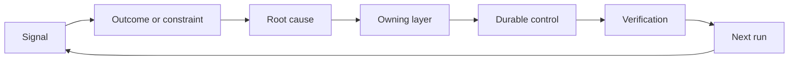

# Xây dựng một Ratchet phản hồi với sở hữu và nghỉ hưu 

> Việc vận chuyển đóng một vòng xây dựng và mở vòng học tập bằng chứng phải thay đổi hệ thống hoặc nó sẽ trở thành điện đo không ai sở hữu.

> **【中文解读】**                                                                                                                                                                                                                                                              

>  **【前置】**Học tập trước:Phase 14 第 46 课                                                                                                                                                                                                                                                          

**Type:** Learn + Build | **类型:** 学习 + 动手实践
**Languages:** Python (stdlib) | **语言:** Python（标准库）
**Prerequisites:** Phase 14 lessons 46 and 53 | **前置知识:** Phase 14 第 46、53 课
**Time:** ~75 minutes | **时间:** 约 75 分钟

## Mục tiêu học tập

- Chuyển đổi các sự cố, đánh giá, hành vi của người dùng và sửa chữa thành hành động của riêng bạn.
  Trung ngữ翻译:把事故、评估、用户行为和纠正转化为有主人的行动──
- Định hướng mỗi tín hiệu đến bối cảnh, đánh giá, chính sách, thời gian chạy hoặc backlog.
  Trung ngữ翻译:把每类信号路由到上下文、评估、策略、运行时或等待列表──
- Cấp ưu tiên tái phát theo mức độ nghiêm trọng và tần suất.
  Trung ngữ翻译:按严重程度与复发频率排排优先级──
- Đưa cho mọi người kiểm soát một điều kiện nghỉ hưu.
  Trung ngữ翻译:给每个控制措施配一条退役条件──

## Phản hồi là cơ sở hạ tầng.

Một nhóm có thể thu thập các dấu vết, đánh giá, vé hỗ trợ và nhật ký sự cố mà không cần học hỏi từ bất kỳ một trong số chúng.

> Một nhóm có thể theo dõi, đánh giá, công việc và ghi chép tai nạn, nhưng không có gì khác.

Chuyện này là:

> Chuyện này là:

1. quan sát một tín hiệu cụ thể;
   Trung文翻译: quan sát một tín hiệu cụ thể;
2. kết nối nó với một kết quả, hạn chế hoặc giả định;
   Trung文翻译:把它关联到某结果、约束或假设;
3. xác định lớp hệ thống sớm nhất có nguyên nhân;
   Trung文翻译: tìm thấy "拥有这个根因" của tầng hệ thống đầu tiên;
4. tạo ra một sự thay đổi giới hạn;
   Trung文翻译: tạo ra một sự thay đổi có biên giới;
5. xác minh rằng tái phát trở nên ít có khả năng;
   Trung文翻译:验证复发概率确实降低;
6. xem xét xem liệu kiểm soát có nên tiếp tục hay không.
   Trung文翻译:复核这个控制是否还应保留──

> **【中文解读】**"反是基础设施" có nghĩa là: học không dựa vào thái độ dựa trên cơ chế. 可观测性,评估,工单系统只是原料的管道, thực tế là cơ sở là một con đường nâng cao 6 bước, đặc biệt là 5/6 bước, chúng không tồn tại trong quá trình làm việc của đa số nhóm:改完不验证复发率,装完永不复核. Không có hai bước này, "复盘" chỉ là một hoạt động tình cảm tập thể.

## Con đường đến tầng sở hữu.

| Signal | Destination |
|---|---|
| False positive, regression, wrong result | Evaluation or test |
| Missing context, duplicate work, stale fact | Context source or retrieval route |
| Unsafe action or authority gap | Policy or permission boundary |
| Timeout, retry storm, unavailable dependency | Runtime control |
| New product need or unresolved tradeoff | Shaped backlog item |

Xác định nguyên nhân ở lớp hiệu quả sớm nhất. Đừng thêm một đoạn văn nhanh hơn khi thử nghiệm hoặc quyền có thể làm cho sự thất bại không thể xảy ra.

> Trong giai đoạn đầu, khi một bài kiểm tra hoặc một quyền hạn có thể khiến một thất bại trở nên không thể, đừng quay lại ngay lập tức 里加一段话.



> **【中文解读】**路由表把"什么信号去哪"变成查表操作:错误结果去评估、缺上下文去检查、越权去策略、超时去运行时、新产品诉求去等办. 核心纪律是"早期有效层""快速是最贵的修复位置(每轮都占下文、随模型变化),测试和权限是最便宜的位置 ((一次写入、永久生效) .

## Quyền sở hữu là một phần của sự kiểm soát.

Mỗi hành động cần:

> Mỗi vòng quay đều cần:

- một chủ sở hữu;
  中文翻译:恰好一个主人;
- ưu tiên dựa trên hậu quả và tái phát;
  Trung ngữ翻译: dựa trên các ưu tiên về hậu quả và tần suất tái phát;
- Các tác phẩm được thay đổi;
  Trung văn翻译:要改那工件;
- Việc xác minh thay đổi;
  Trung文翻译: chứng minh 变更生效的验证;
- một cửa sổ xem xét hoặc hết hạn;
  中文翻译: một cái cửa sổ kiểm tra hoặc đến期;
- Điều kiện nghỉ hưu.
  Trung ngữ翻译:一条退役条件。

Một cải tiến không có là một quan sát với định dạng tốt hơn.

> Không có người chủ cải tiến, chỉ là một bài viết về bản sao của một người xem.

> **【中文解读】**六段里"恰好一个主人" và"退役条件" cấu thành hai hướng đơn của vòng rào: chủ bảo đảm变更真实落地(观察→行动),退役条件保证控制不会无限堆积(行动→清理) ・・・ cuối cùng là câu đáng để đăng vào cửa của hệ thống đơn công  để " đề xuất thay đổi thành X" được viết đẹp hơn sẽ không để nó xảy ra, ký một tên trên và một lệnh kiểm chứng chỉ mới được họp.

## Quyết nhiệm kiểm soát Stale

Các hệ thống phản hồi tích lũy chính sách. Chính sách đó có thể trở nên mâu thuẫn và tốn kém.

> Phản ứng hệ thống sẽ tích lũy các chiến lược, trong khi các chiến lược này có thể trở nên tương phản với nhau 价格高昂.

- thay đổi kiến trúc hoặc dòng công việc;
  Trung文翻译: cấu trúc hoặc dòng làm việc xảy ra sự thay đổi;
- Một tính không biến cấp thấp thay thế cho một hướng dẫn cấp cao hơn;
  Trung文翻译: Một không biến của một tầng thấp hơn đã thay thế một chỉ thị của một tầng cao hơn;
- lỗi được bảo vệ không xuất hiện trên cửa sổ được chọn;
  Trung文翻译: bị bảo vệ thất bại trong suốt cửa sổ quan sát không xuất hiện một lần;
- kiểm soát ngăn chặn công việc hợp pháp thường xuyên hơn là ngăn chặn thiệt hại.
  Trung 文翻译: Điều này làm cản trở công việc bình thường nhiều hơn là làm tổn thương.

Tái hưu cũng cần bằng chứng. Đừng xóa một kiểm soát vì nó cảm thấy cũ.

> 退役 cũng cần chứng cứ. Đừng vì cảm thấy đã qua rồi, hãy xóa một cái kiểm soát.

> **【中文解读】**Đây là phần cho "cánh cốc" cài đặt lại: chỉ vào không quay lại cốc cốc cuối cùng sẽ khóa máy chết. Trong bốn tín hiệu kiểm soát, thứ tư là thực tế nhất. Khi một điều khiển ngăn chặn yêu cầu tuân thủ hơn nhiều so với rủi ro bị chặn, nó về từ bảo hiểm trở thành thuế. Nhưng việc rút lại cũng phải chứng minh: cửa sổ trong零复发≠ không bao giờ tái phát, xóa trước xác nhận trước bảo vệ đã được tiếp quản bởi các không thay đổi của tầng thấp hơn.

## Kết nối xây dựng và lập trình-động tác phản hồi .

Cùng một con đòn phục vụ cả hai đường ray:

> 同一个棘轮服务两条轨道:

- Bằng chứng sản phẩm thay đổi khung kết quả, giả định, mảnh hoặc kế hoạch đo lường.
  Trung ngữ翻译:产品证据改变结果框架、假设、切片或测量计划──
- Các sửa đổi của bộ phận mã hóa thay đổi các thử nghiệm, ngữ cảnh, phạm vi, tự động hóa hoặc giao hàng.
  Trung ngữ翻译:编码 Agent 的纠正改变测试、上下文、范围、自动化或交接──
- Các sự cố có thể thay đổi cả giới hạn sản phẩm và bàn làm việc của đại lý.
  Trung文翻译:事故既可以改变产品边界,也可以改变代理工作台──

Đó là lý do tại sao việc định hình xây dựng không phải là một giai đoạn kết thúc trước khi mã hóa. Nó tiếp tục thông qua mọi thay đổi được chấp nhận.

> Đó là lý do tại sao "nhà hình hình thành" không phải là một giai đoạn kết thúc trước khi mã hóa bắt đầu nó trải qua mỗi lần thay đổi được chấp nhận.

> **【中文解读】**Đây là phần kết thúc 43-54 系列: 第43 课的任务框架假设 ("Đại sư会信任这个建议") được thử nghiệm thực sự chứng minh khi bị lật đổ, thay đổi không chỉ là mã, còn có một khung nhiệm vụ tiếp theo bản thân.

## Hãy xây dựng nó.

Phòng thí nghiệm phân loại tín hiệu, tạo ra các hành động ratchet, ưu tiên chúng, và viết `outputs/feedback-backlog.json`- Tôi không biết.

> 实验代码给信号分类 创建有主人的棘轮动作 排好优先级,并写出 `outputs/feedback-backlog.json`

```bash
python3 code/main.py
python3 -m unittest discover code/tests -v
```

Thêm một tín hiệu thời gian chạy và xác nhận rằng nó hướng đến thời gian chạy thay vì sự chậm trễ chung.

> Lưu ý: + 1                                                                                                                                                                                                                                                            

> **【中文解读】** `destination()`Using keywords match presentation route 表的思想(truth system có thể thay đổi thành phần của các loại máy hoặc phân loại nhân tạo),`promote()`则把六字段动作象化: ưu tiên = 严重度 × 频率, mỗi mục đích bị ràng buộc cố định lâu dài`evaluations/regression-suite.json`(■ xác định chứng chỉ và có số lượng từ chức.`expires_after_days`Ý nghĩa của nó không phải là "to be deleted automatically", mà là "to be deleted"

## Tập luyện.

1. Hãy biến một vụ tai nạn và một khiếu nại của người dùng thành hành động.
   Trung ngữ翻译:把一次事故和一条用户投诉转写成棘轮动作。
2. Hãy cho tên lớp sớm nhất có thể ngăn chặn mỗi lần tái phát.
   Trung ngữ翻译:指出能阻止每次复发的最早层──
3. Thêm lệnh xác minh hoặc quan sát vào đầu ra phòng thí nghiệm.
   Trung ngữ翻译:给实验输出补上验证命令或观察。
4. Định nghĩa điều kiện nghỉ hưu cho quy tắc chính sách.
   Trung文翻译:为一条策略规则定义退役条件──
5. Theo dõi một đã chấp nhận sửa đổi trở lại khung nhiệm vụ tiếp theo.
   Trung ngữ翻译:把一条被接受的纠正追溯到下一个任务框架里去──

## Xem thêm 延伸阅读

- [Basili, Caldiera, and Rombach, The Goal Question Metric Approach](https://www.cs.toronto.edu/~sme/CSC444F/handouts/GQM-paper.pdf), cho việc học tập tổ chức thông qua đo lường hướng đến mục tiêu.
  Trung文翻译:Basili、Caldiera 与 RombachGQM 方法通过目标导向的测量实现组织学习──
- [Fagerholm et al., Building Blocks for Continuous Experimentation](https://doi.org/10.1145/2601248.2601276), cho vòng lặp kỹ thuật và tổ chức kết nối bằng chứng với phát triển sản phẩm tiếp tục.
  Trung ngữ翻译:Fagerholm 等 liên tục thử nghiệm xây dựng khối  đưa bằng chứng trở lại liên tục sản phẩm phát triển của các vòng lặp công nghệ và tổ chức.
- [Nuseibeh and Easterbrook, Requirements Engineering: A Roadmap](https://www.cs.toronto.edu/~sme/papers/2000/ICSE2000.pdf), để xử lý các yêu cầu như phát triển trong chu kỳ đời sống của hệ thống.
  Trung文翻译:Nuseibeh 与 Easterbrook需求工程:路线图把需求视为在系统生命周期中持续演化──

## Những gì bạn giữ lại, những gì bạn giữ lại là sản phẩm

Cứ giữ lại`outputs/feedback-backlog.json`. Nó là tác phẩm kết thúc của các sản phẩm phán xét và giao hàng và đầu vào khung kết quả tiếp theo.

> Bảo trì`outputs/feedback-backlog.json` Đó là phần cuối cùng của "cách phân xử và giao hàng" và cũng là một phần nhập vào khung kết quả tiếp theo.
